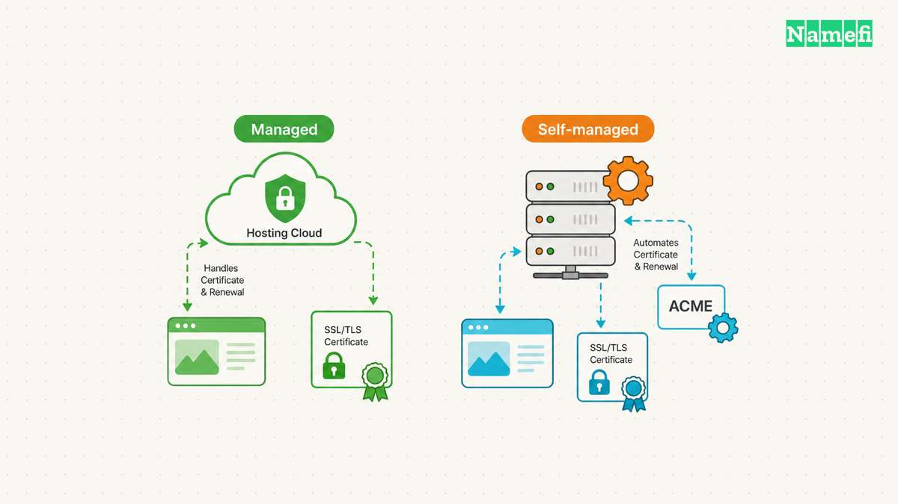
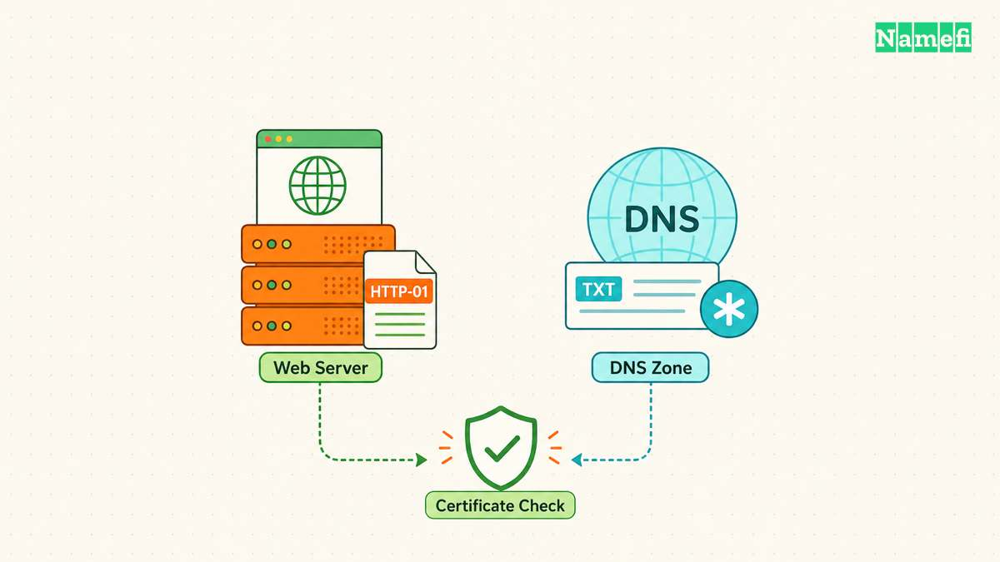
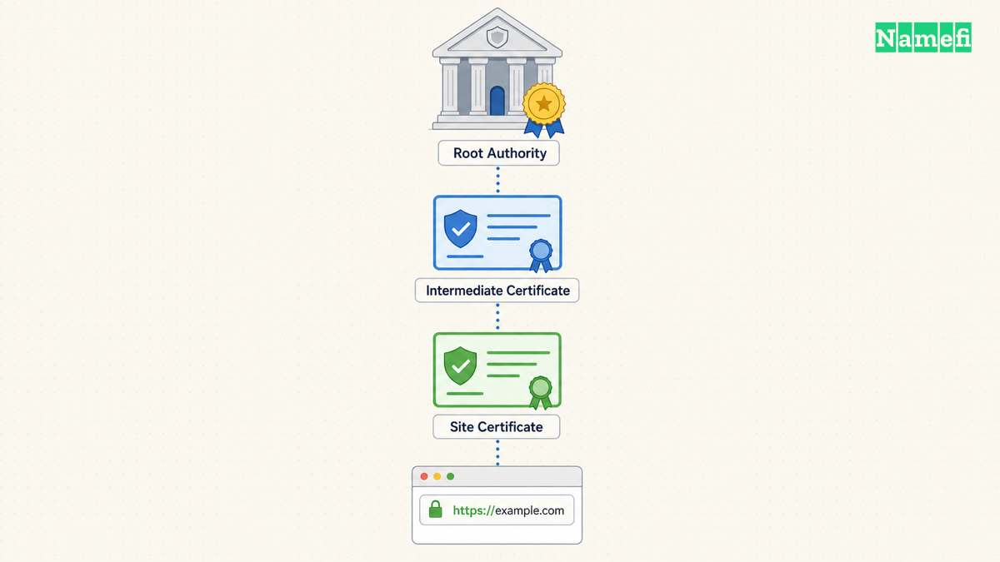

You can get a free HTTPS certificate through a hosting provider that manages certificates or through an ACME client such as Certbot. Start with the hosting provider’s HTTPS settings. If the provider does not manage certificates, use the [official Let’s Encrypt getting-started guide](https://letsencrypt.org/getting-started/). [Let’s Encrypt explains both routes](#lets-encrypt-explains-the-two-setup-routes).

Let’s Encrypt charges no certificate fee, although a hosting provider may charge for administration. [The certificate authority explains the cost boundary](#lets-encrypt-explains-certificate-fees). Free issuance still needs correct validation, installation, and renewal.

## Managed hosting provides the first route to check

Open the platform’s custom-domain or HTTPS settings. Confirm that the intended domain belongs to the correct project. Then follow the platform’s certificate instructions instead of installing a separate certificate manager without a reason.

Let’s Encrypt says a hosting provider can operate the ACME client for the customer. The provider may automate the process or require a configuration option. [The official guide explains managed issuance](#lets-encrypt-explains-the-two-setup-routes).

As practical guidance, ask the provider four questions: Does the plan include HTTPS? Which hostnames does the certificate cover? Who handles renewal? Where do failures appear?

A free certificate offer does not answer all four questions. Check the actual plan and deployment. A site-builder certificate may cover the published site while leaving another separately hosted application outside that arrangement.

Keep a record of the certificate manager. Two independent renewal systems can create confusing ownership of configuration files or deployment hooks. Choose a clear operating arrangement before enabling additional automation.

## A self-managed server needs an ACME client

Let’s Encrypt issues certificates through the ACME API. The authority’s website provides instructions rather than a manual certificate checkout. The official guide recommends Certbot for most operators who need to run an ACME client. [Let’s Encrypt explains client selection](#lets-encrypt-explains-the-two-setup-routes).

Choose the instructions for the actual operating system and web server. Confirm the required administrative access. Avoid pasting an installation command intended for a different distribution or server layout.

Before issuance, list the required hostnames. A hypothetical site might need `example.com` and `www.example.com`. Another application might require `app.example.com`. The examples describe coverage planning and do not report issued certificates.

Keep the private key within the authorized certificate-management system. Let’s Encrypt states that the subscriber generates and manages the private key rather than sending the key to the authority. [The FAQ describes private-key handling](#lets-encrypt-explains-private-key-control).

Do not paste a private key into a public checker. A checker needs a public hostname or certificate, depending on the task. The private key grants a different capability and requires restricted access.

## Domain validation must match the deployment

Let’s Encrypt validates control of the requested names through challenges. HTTP-01 places a token file at a defined web path and uses port 80. DNS-01 publishes a TXT value and supports wildcard issuance. [The challenge documentation explains the differences](#lets-encrypt-compares-validation-challenges).

| Deployment need | Route to evaluate |
| --- | --- |
| Public web server with a supported client | HTTP-01 |
| Wildcard certificate | DNS-01 |
| Several web servers behind one name | A challenge arrangement that reaches every required endpoint |
| Managed platform | The platform’s supported validation workflow |

A wildcard request requires more than adding an asterisk to a DNS record. Let’s Encrypt’s DNS-01 workflow requires control of the challenge TXT record. Follow the issuer’s exact instructions for the requested names.

DNS automation also creates an access decision. Let’s Encrypt warns against placing unrestricted DNS API credentials on the web server and recommends narrower credentials or separate validation. [The challenge guidance explains that risk](#lets-encrypt-compares-validation-challenges).

As operating advice, grant the certificate system only the DNS access the workflow needs. Document who can change the challenge configuration and where renewal errors appear.

For DNS-01, use a TXT query in [Namefi's DNS lookup](https://namefi.io/domain-tools/dns) at the exact challenge name the client supplied. Compare that public resolver's answer with the required value. The lookup does not issue a certificate, inspect the served certificate, or test automatic renewal.

## Issuance and a working HTTPS site require separate checks

A successfully issued certificate still needs deployment to the service that terminates TLS. Confirm the certificate manager installs the correct certificate and chain for the intended hostname.

Test the public URL from a separate client. Check the hostname, certificate validity, and trust result. If a proxy terminates TLS, identify whether the check concerns the browser-facing connection or the proxy’s connection to the origin.

The [certificate checking guide](/en/blog/ssl-certificate-check/) provides a focused validation workflow. The [HTTPS explanation](/en/blog/what-is-https/) covers the broader connection model.

As practical guidance, check application assets after enabling HTTPS. A page can load while an embedded resource still uses an old URL. Test forms and application redirects through the canonical public address before declaring the deployment complete.

Do not disable certificate verification to hide a deployment error. Fix the hostname, chain, or deployment configuration that caused the failure.

## Renewal needs an owner before launch

The certificate manager needs continuing access to the validation method. A revoked DNS API credential or a removed HTTP challenge route can break renewal automation. Treat those dependencies as part of the service configuration. Remove obsolete DNS-01 TXT challenge records through the client’s documented process. [Let’s Encrypt recommends cleaning up old TXT records](#lets-encrypt-compares-validation-challenges).

Let’s Encrypt emphasizes automated issuance and renewal in its challenge guidance. [The DNS-01 documentation explains the automation requirement](#lets-encrypt-compares-validation-challenges). As operating advice, test renewal through the chosen client’s supported procedure and confirm that deployment follows renewal.

Assign a person or team to receive alerts. Monitor the certificate that the public service actually presents rather than relying only on a successful client log.

The next action is concrete: check managed HTTPS first, or select the official client instructions for the server. Complete validation and deployment, then verify the public hostname and the renewal owner.

## Sources and further reading

### Lets Encrypt explains the two setup routes

[Lets Encrypt explains the two setup routes](https://letsencrypt.org/getting-started/#:~:text=will%20my%20hosting%20provider%20get%20and%20manage%20certificates%20from%20Let%E2%80%99s%20Encrypt%20for%20me). Supporting passage: “will my hosting provider get and manage certificates from Let’s Encrypt for me” Checked 2026-10-30.

### Lets Encrypt explains certificate fees

[Lets Encrypt explains certificate fees](https://letsencrypt.org/docs/faq/#:~:text=We%20do%20not%20charge%20a%20fee%20for%20our%20certificates.). Supporting passage: “We do not charge a fee for our certificates.” Checked 2026-10-30.

### Lets Encrypt explains private key control

[Lets Encrypt explains private key control](https://letsencrypt.org/docs/faq/#:~:text=The%20private%20key%20is%20always%20generated%20and%20managed%20on%20your%20own%20servers). Supporting passage: “The private key is always generated and managed on your own servers” Checked 2026-10-30.

### Lets Encrypt compares validation challenges

[Lets Encrypt compares validation challenges](https://letsencrypt.org/docs/challenge-types/#:~:text=This%20challenge%20asks%20you%20to%20prove%20that%20you%20control%20the%20DNS%20for%20your%20domain%20name%20by%20putting%20a%20specific%20value%20in%20a%20TXT%20reco). Supporting passage: “This challenge asks you to prove that you control the DNS for your domain name by putting a specific value in a TXT record under that domain name. It is harder to configure than HTTP-01, but can work in scenarios that HTTP-01 can’t. It also allows you to issue wildcard certificates.” Checked 2026-10-30.
