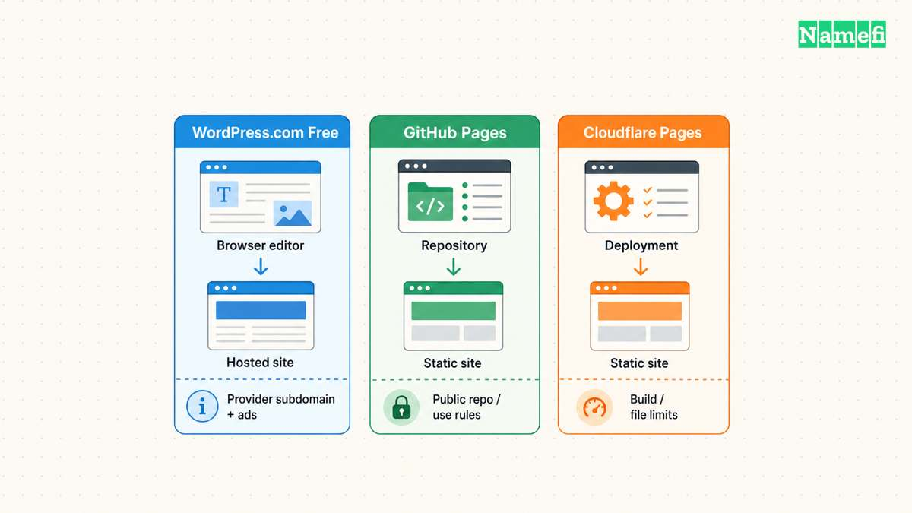

Free hosting can work for a personal blog, documentation site, portfolio, or static project when the plan fits the site. Start with WordPress.com for browser-based publishing, GitHub Pages for repository-based static publishing, or Cloudflare Pages for a static deployment workflow. The right choice depends on the website’s requirements.

These are options selected by use case, not speed-test winners. This guide does not claim that any provider will remain free forever. Check the official limits and terms before committing a real website.

## The useful comparison starts with the type of website

| Option | Useful starting case | Important boundary |
| --- | --- | --- |
| WordPress.com Free | A blog or information site edited in a browser | The free plan uses a WordPress.com subdomain and displays ads |
| GitHub Pages | Static project documentation or a personal site | GitHub restricts commercial transaction and SaaS uses |
| Cloudflare Pages Free | A static site with a deployment workflow | Builds, files, and other platform resources have limits |

The provider documents the factual plan boundaries: [WordPress.com’s plan page](#wordpress-com-documents-free-plan-boundaries), [GitHub’s Pages policy](#github-documents-pages-usage-restrictions), and [Cloudflare’s Pages limits](#cloudflare-publishes-pages-limits).

A static site serves generated files. A traditional dynamic application needs additional runtime capabilities and possibly a database. Do not select a free static plan for a server application without verifying the application’s actual deployment requirements.

A free trial is also different from an ongoing free tier. Review when billing begins, what happens when limits are reached, and whether the account requires payment details.

## WordPress.com Free suits a browser-based publishing workflow

WordPress.com offers a hosted free plan with no expiration period stated in the current offer. The free service includes a WordPress.com subdomain and a block editor for pages and posts. [The provider’s free-plan page describes the workflow](#wordpress-com-describes-the-free-publishing-workflow).

Use the official [free website route](https://wordpress.com/free/) and choose the free subdomain if the free service meets your needs. A custom domain requires a paid plan. WordPress.com also says free sites display WordPress.com ads. [Review the current plan boundaries](#wordpress-com-documents-free-plan-boundaries) before building around an upgrade-dependent feature.

This option is useful when writing and editing matter more than control of the hosting environment. Try creating a page, adding an image, changing navigation, and publishing a post before investing substantial time.

Do not confuse WordPress.com hosting with installing WordPress software on another host. The two choices create different account, maintenance, and migration responsibilities.

If you may move later, test export early. WordPress.com says a content export includes posts, pages, and comments, but excludes the theme design, customizations, and plugins. [The export guide explains the scope](#wordpress-com-explains-content-export-limits).

## GitHub Pages suits static content stored in a repository

GitHub Pages takes HTML, CSS, and JavaScript from a repository and publishes a static website. GitHub makes Pages available for public repositories on GitHub Free. [The Pages introduction documents the model](#github-explains-pages-publishing).

Use the official [Pages getting-started documentation](https://docs.github.com/en/pages/getting-started-with-github-pages/what-is-github-pages#about-github-pages). Confirm that you can maintain the source files and publishing configuration.

The free public-repository route requires particular care with the repository’s contents. Keep passwords, private documents, and secret configuration out of published files and repository history. Publishing source is an access decision, not just a deployment convenience.

GitHub says Pages cannot serve as free hosting for an online business, ecommerce site, or commercial SaaS. GitHub also cautions against sensitive transactions through Pages. [The usage restrictions are explicit](#github-documents-pages-usage-restrictions).

A personal project reference site can fit this workflow. A customer account application or transactional store needs a different assessment. A static HTML page does not automatically make an otherwise prohibited use acceptable.

## Cloudflare Pages suits a static deployment workflow

Cloudflare documents deploying static HTML through Pages. The deployment needs the appropriate output directory and a top-level `index.html` for the root page. [The static HTML guide describes the setup](#cloudflare-documents-static-html-deployment).

Start with [Cloudflare’s static-site instructions](https://developers.cloudflare.com/pages/framework-guides/deploy-anything/#deploy-with-cloudflare-pages). Deploy on the provided project address before connecting the main domain.

Cloudflare’s Free plan has limits for builds, files, file sizes, and other resources. Functions follow additional requirements. [Check the current limits](#cloudflare-publishes-pages-limits) against your project rather than interpreting a free static tier as unlimited application hosting.

Custom-domain setup also has conditions. An apex domain requires the relevant Cloudflare zone. A custom subdomain can use a CNAME without moving the whole zone. [Cloudflare documents the distinction](#cloudflare-explains-custom-domain-requirements).

That difference matters when email already relies on the current DNS provider. Review the existing zone before moving nameservers. A nameserver change affects more than the website connection.

## Free hosting can still require paid services

A custom domain registration is separate from free hosting unless an offer explicitly includes the registration. Email, databases, forms, backups, and application functions can also create separate requirements.

Our [domain and hosting comparison](/en/blog/domain-vs-hosting/) helps identify the separate services. Use the comparison to avoid assuming that a free website automatically includes a business mailbox.

Before selecting a provider, complete a requirement list: custom domain, browser editing, application runtime, storage, forms, access controls, and export. Mark every requirement that needs an upgrade or another service.

Do not store private information in a public preview. Check the plan’s supported access controls before uploading private content. A link that has not been shared widely still needs an explicit access decision.

## A small trial project can reveal the actual limitations

Publish a representative page rather than an empty homepage. Include an image, internal navigation, and the form or application behavior the real site requires.

Test the public URL from another browser session. Check HTTPS, mobile layout, missing-page behavior, and the intended custom-domain route if supported. Verify that the project can be updated and recovered by the person who will maintain the site.

Choose the free option when the plan satisfies those requirements and the documented limits fit the project. Move to a paid plan when a required capability or operational responsibility justifies the expense. The useful measure is a maintainable working site, not the absence of a hosting invoice alone.

## Sources and further reading

### WordPress com describes the free publishing workflow

[WordPress com describes the free publishing workflow](https://wordpress.com/free/#:~:text=WordPress.com%20offers%20a%20free%20plan%20with%20no%20time%20limit), checked 2026-10-30.

### WordPress com documents free plan boundaries

[WordPress com documents free plan boundaries](https://wordpress.com/pricing/#:~:text=Free%20sites%20display%20WordPress.com%20ads%20to%20visitors.), checked 2026-10-30.

### WordPress com explains content export limits

[WordPress com explains content export limits](https://wordpress.com/support/export/#:~:text=Your%20export%20file%20will%20include%20your%20posts%2C%20pages%2C%20and%20comments%20but%20will%20not%20include%20your%20theme%20design%2C%20customizations%2C), checked 2026-10-30.

### GitHub explains Pages publishing

[GitHub explains Pages publishing](https://docs.github.com/en/pages/getting-started-with-github-pages/what-is-github-pages#:~:text=GitHub%20Pages%20is%20available%20in%20public%20repositories%20with%20GitHub%20Free%20and%20GitHub%20Free%20for%20organizations), checked 2026-10-30.

### GitHub documents Pages usage restrictions

[GitHub documents Pages usage restrictions](https://docs.github.com/en/pages/getting-started-with-github-pages/github-pages-limits#:~:text=GitHub%20Pages%20is%20not%20intended%20for%20or%20allowed%20to%20be%20used%20as%20a%20free%20web-hosting%20service%20to%20run), checked 2026-10-30.

### Cloudflare documents static HTML deployment

[Cloudflare documents static HTML deployment](https://developers.cloudflare.com/pages/framework-guides/deploy-anything/#:~:text=Cloudflare%20supports%20deploying%20any%20static%20HTML%20website%20to%20Cloudflare%20Pages.), checked 2026-10-30.

### Cloudflare publishes Pages limits

[Cloudflare publishes Pages limits](https://developers.cloudflare.com/pages/platform/limits/#:~:text=Build%20limits%20depend%20on%20your%20plan%3A), checked 2026-10-30.

### Cloudflare explains custom domain requirements

[Cloudflare explains custom domain requirements](https://developers.cloudflare.com/pages/configuration/custom-domains/#:~:text=To%20use%20a%20custom%20apex%20domain%20%28for%20example%2C%20example.com%29%20with%20your%20Pages%20project%2C%20configure%20your%20nameservers%20to%20point), checked 2026-10-30.
