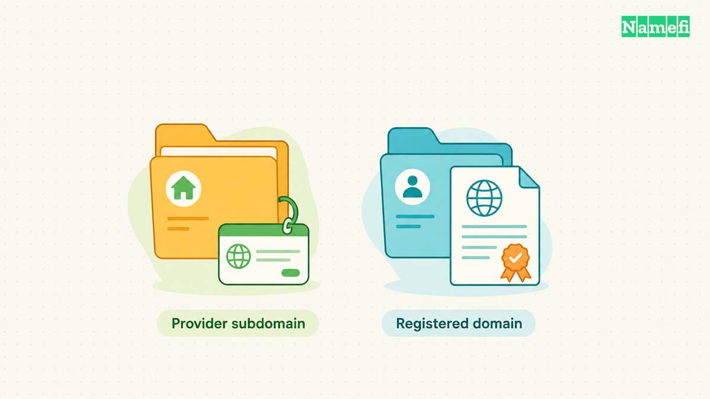
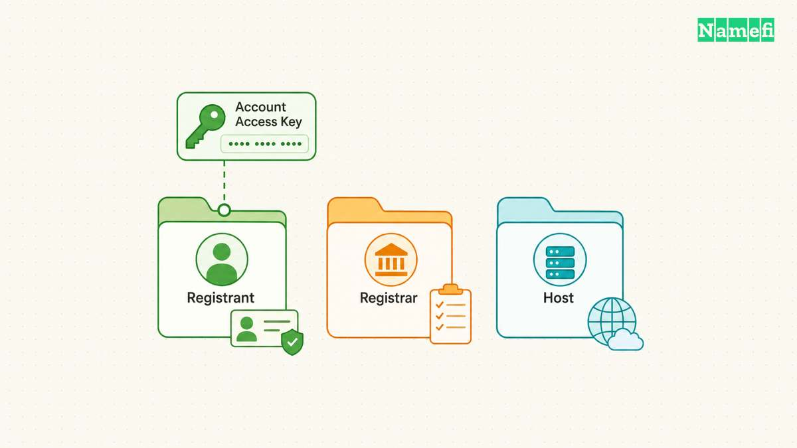

FreeDNS at afraid.org offers hosted subdomains, domain DNS hosting, and dynamic updates. [Its official site links to the shared-domain registry and signup route](#freedns-provides-hosted-names-and-dynamic-updates). Choose an available hosted name, point the record at your server's appropriate address, and verify the resulting DNS answer.

A hosted subdomain does not give you control over the parent domain's registration. FreeDNS explicitly warns about dependence on other members' shared domains. [Read the shared-domain rules before choosing a permanent address](#freedns-explains-shared-domain-control-and-configuration).

## The FreeDNS service has two distinct domain routes

Open the [FreeDNS registry](https://freedns.afraid.org/domain/registry/) to explore shared parent domains, or use a domain whose registration you already control. The first route creates a hosted name under another domain. The second route uses FreeDNS as the DNS operator for your own domain.

FreeDNS describes both shared-domain use and bringing your own domain. [The official feature list also distinguishes DNS from web forwarding](#freedns-provides-hosted-names-and-dynamic-updates). Keep those roles separate while setting up the record.

For a learning server or temporary project, a hosted subdomain can provide a usable name. For a durable public identity, review the risk of depending on another person's parent domain.

The [free domain offers guide](/en/blog/free-domain-offers/) explains the broader difference between a hosted address and a separate registration. FreeDNS hosting does not by itself register a custom domain for you.

## Shared-domain labels describe control rather than secrecy

FreeDNS uses public and private labels for shared domains. Public sharing allows users to create hostnames without the domain owner's approval. Private sharing reserves the owner's ability to reject certain hostnames. [The FAQ explains those labels](#freedns-explains-shared-domain-control-and-configuration).

Do not read the word private as a promise that a hostname or DNS record remains confidential. Choose the service based on the actual sharing rules and your access requirements.

The FAQ also explains that other members can own shared parent domains. A parent domain can leave the service. [FreeDNS warns against making permanent dependencies on an unfamiliar shared domain](#freedns-explains-shared-domain-control-and-configuration).

Before delegating a domain you control to FreeDNS, review the domain's sharing state. Public sharing permits other users to attach subdomains. Private sharing still lets queued hostnames function globally while the owner reviews the queue. FreeDNS identifies Stealth as its non-shared mode and lists Stealth as a premium option. [The own-domain rules explain those states](#freedns-defines-sharing-and-update-scope). If other users must not create hostnames under the domain, choose supported non-shared hosting or another DNS provider.

Before selecting the name, consider what would happen if the parent stopped resolving. A temporary demonstration can tolerate a different address. A customer-facing service or recovery email address can create a much larger continuity problem.

## Create the record through the account you control

Start at the official [FreeDNS signup page](https://freedns.afraid.org/signup/). Use an email address you can recover and complete the account's verification instructions. The official home page emphasizes keeping the recovery email current.

After signing in, open Subdomains and use the service's add-record workflow. Choose the record type, available parent domain, desired label, and destination. Follow the current form instructions when the interface labels differ.

For an IPv4 server, the relevant address record is A. Use AAAA for an appropriate IPv6 address. The [DNS A record guide](/en/blog/dns-a-record-guide/) explains how the address value differs from a website URL.

Use the address assigned for the actual deployment. Do not paste an internal-only address into a public-access plan without understanding the network arrangement. Do not paste a complete URL into a field that expects only an IP address.

For a domain you already control, the FAQ describes adding the domain and editing its record through Subdomains. [FreeDNS documents that separate route](#freedns-explains-shared-domain-control-and-configuration). Confirm the active nameserver delegation before expecting the provider's records to affect public DNS.

## Verify the saved answer before testing the application

Record the complete hostname after saving. Query the hostname for the actual record type through your resolver or [Google Admin Toolbox Dig](https://toolbox.googleapps.com/apps/dig/).

Compare the answer with the address you intended to publish. Keep the query result and test time in UTC. If the answer differs, inspect the saved record and the authoritative DNS before changing the application.

When a recent change shows different answers, use the [DNS propagation checker guide](/en/blog/dns-propagation-checker-guide/). Avoid repeatedly replacing the value while an earlier cached answer remains visible.

Then test the application with the hostname. A correct DNS answer does not establish that the server listens on the intended port, accepts the connection, or presents a valid certificate. Diagnose the failed layer specifically.

After saving or updating the hostname, query its exact name and record type in [Namefi's DNS lookup](https://namefi.io/domain-tools/dns). Compare the public resolver's answer with the intended destination. The lookup does not execute a FreeDNS update or confirm that a private update token is valid.

## Dynamic updates require a separate client configuration

A changing public address can make a static record stale. FreeDNS supports automated address updates and links to supported clients. [Its FAQ describes the dynamic update route](#freedns-explains-shared-domain-control-and-configuration).

Use the authenticated Dynamic DNS screen to obtain the configuration intended for your account and chosen hostname. Do not copy a public demonstration update URL into your own deployment. Keep any account-specific update token or URL private.

Choose one supported updater and verify its successful updates. Avoid running multiple clients that can overwrite the same record with different detected addresses. The [DDNS setup guide](/en/blog/dynamic-dns-setup/) explains the update cycle and operational checks.

Review linked updates before the first dynamic update. FreeDNS says linked updates are enabled by default. One update can therefore change other records with the same destination IP address. [The linked-update rules explain the scope](#freedns-defines-sharing-and-update-scope). Disable linked updates through the Dynamic DNS controls when each update must affect only one record. Confirm the affected record set before testing.

After a legitimate address change, compare the updater's result with the DNS answer. An updater success message and a recursive lookup can represent different stages of the change.

## Network reachability remains a separate access decision

A public name does not automatically make a private-network server reachable. No-IP explains that carrier-grade NAT can prevent ordinary incoming connections from reaching a subscriber's network. [Its remote-access guidance distinguishes that limitation from DDNS](#no-ip-distinguishes-dns-updates-from-remote-connectivity).

Decide who should reach the service before creating an access path. A personal administration service may need an authenticated private access method. Avoid exposing a management interface merely to test the new name.

If the address is correct but access fails, inspect the server, router, provider restrictions, and supported secure access method. Do not disable the firewall as a blanket diagnostic step.

The next action is to choose the parent domain deliberately, create one record, and verify the exact DNS answer. Keep the parent-domain dependency and server-access decision visible in the project notes.

## Sources and further reading

### FreeDNS provides hosted names and dynamic updates

[FreeDNS provides hosted names and dynamic updates](https://freedns.afraid.org/#:~:text=Free%20DNS%20Hosting) — checked 2026-10-30.

### FreeDNS explains shared-domain control and configuration

[FreeDNS explains shared-domain control and configuration](https://freedns.afraid.org/faq/#3) — checked 2026-10-30. Checked passages: FAQ items 2, 3, 8, and 13.

### No-IP distinguishes DNS updates from remote connectivity

[No-IP distinguishes DNS updates from remote connectivity](https://www.noip.com/faqs#:~:text=What%20is%20CGNAT) — checked 2026-10-30. Checked passages: How does Dynamic DNS work?, router configuration, and the CGNAT and remote-access questions.

### FreeDNS defines sharing and update scope

[FreeDNS FAQ 14 defines domain sharing](https://freedns.afraid.org/faq/#14). [FAQ 4 explains linked updates](https://freedns.afraid.org/faq/#4). Checked 2026-10-30.
