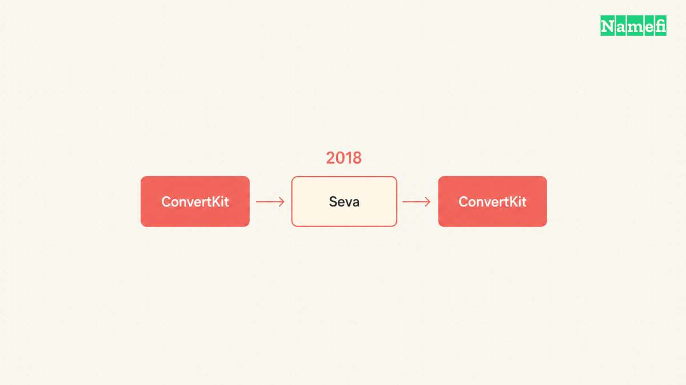
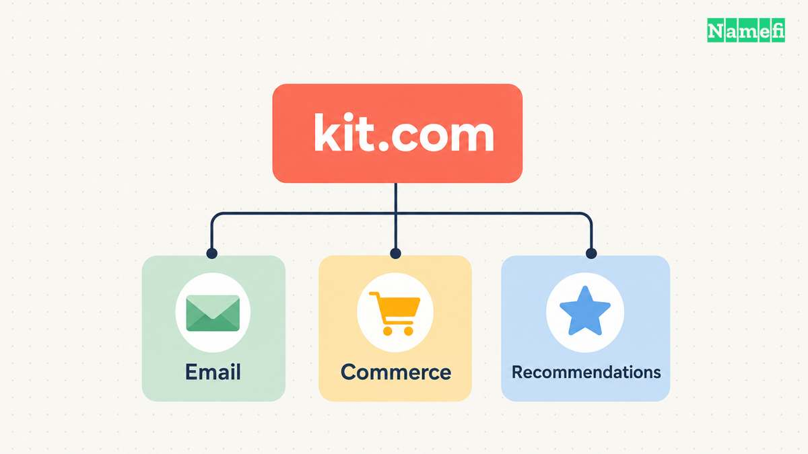

Yes. ConvertKit changed its name to Kit. The company [confirms the change on its own website](https://kit.com/resources/blog/convertkit-is-now-kit). Kit's [newsroom dates the public rebranding announcement to 6 June 2024](https://kit.com/news). The name belongs to the creator-business platform previously called ConvertKit.

The path to Kit included an earlier reversal, a new domain opportunity, and another round of creator research. The short address was part of the decision, rather than an accessory added after the naming work.

## ConvertKit had already reversed one name change

In 2018, ConvertKit tried the name Seva. The company later [recounted the cultural and religious concerns raised by creators](https://kit.com/resources/blog/rebranding-in-public-why-we-are-becoming-kit). The team reversed the decision and returned to ConvertKit.

That history gives the later rename a different context. The team had already experienced a public name change that did not last. A second announcement needed more than enthusiasm for a shorter word.

The company's account describes creator interviews before the Kit decision. The responses were not uniformly positive. The research helped the team assess the name before proceeding.

The useful lesson is limited and concrete. A company's intended meaning does not settle how an audience understands a name. Research can reveal concerns that a naming discussion inside the company may miss.

## The kit.com opportunity reopened the naming decision

The [founder's account places the opportunity to purchase kit.com in late 2023](https://kit.com/resources/blog/rebranding-in-public-why-we-are-becoming-kit). That date identifies the opportunity. The account does not supply an exact closing date or a domain purchase price.

The company wanted a single word that people could hear and spell easily. The team also wanted a name with less technical language. Kit offered a specific name and a matching destination to evaluate together.

That relationship gives the story its domain angle. Choosing a name in isolation leaves the address as a separate problem. Considering Kit alongside kit.com made the proposed identity concrete.

The company's explanation also describes a product broader than email. Recommendations and Commerce had become part of its creator-business offering. The team presented that wider scope as part of the reason to reconsider ConvertKit.

[TransferWise's change to Wise](/en/blog/from-transferwise-com-to-wise-com/) raises a similar naming question. A word that explains the first service can become less complete as a business adds uses. The histories differ, but both companies connected the new name to a broader product story.

## Kit gave the expanded creator business a shorter address

The final identity keeps the word Kit and gives the company the matching kit.com address. The [company's announcement explains the new identity through its continuing creator-business mission](https://kit.com/resources/blog/convertkit-is-now-kit).

The words make a simple comparison possible: convertkit.com includes the old two-part name. Kit.com uses the shorter name directly. The correspondence makes the address easier to explain without requiring a separate abbreviation.

The Seva episode prevents a simplistic reading of that compression. A short name still needs audience research and a reason to fit the business. Domain availability can make a candidate possible, but availability does not answer every naming question.

[Brevo's domain incident](/en/blog/from-sendinblue-com-to-brevo-com/) adds the operational sequel. After a company secures and adopts a new address, the company still needs to maintain the address. The acquisition decision and the ongoing work belong to the same domain story.

For someone searching for ConvertKit today, the direct answer remains Kit. For someone studying the rename, the more revealing sequence runs from the Seva reversal to the kit.com opportunity and the later public decision.

## These primary sources document the name change

- [Kit's account of the naming decision and kit.com opportunity](https://kit.com/resources/blog/rebranding-in-public-why-we-are-becoming-kit)
- [Kit's confirmation that ConvertKit is now Kit](https://kit.com/resources/blog/convertkit-is-now-kit)
- [Kit's newsroom entry for the June 2024 public rebranding announcement](https://kit.com/news)
