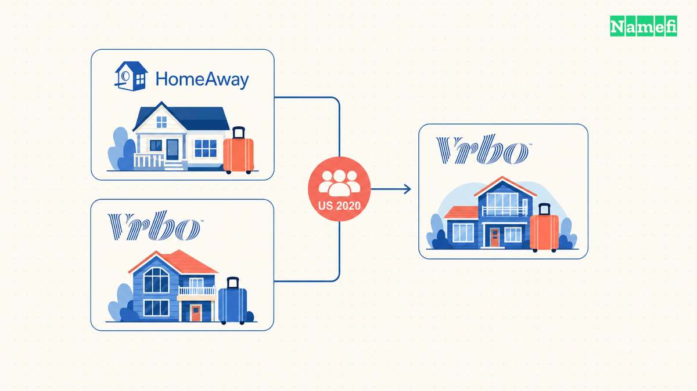
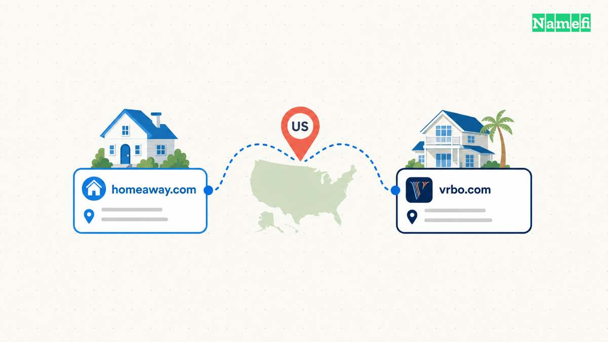
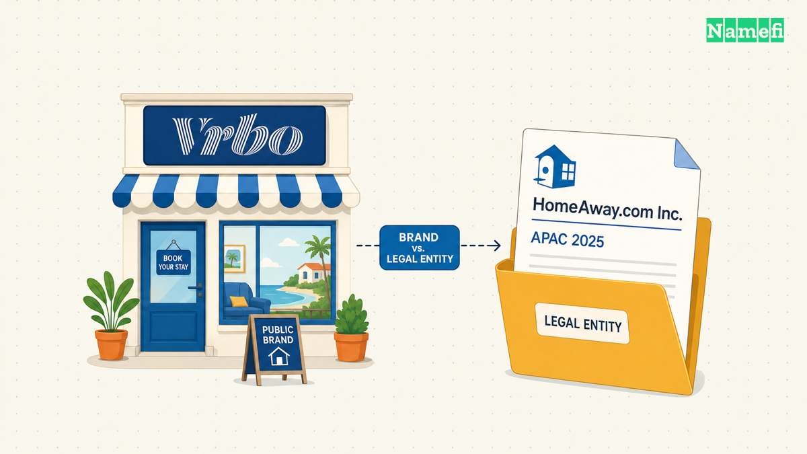

HomeAway is now Vrbo as a consumer brand. Vrbo's [own explanation confirms the connection](https://www.vrbo.com/travel/campaign/homeaway-vrbo). In the United States, Expedia announced HomeAway's retirement in June 2020. Expedia later confirmed that the company had moved HomeAway traffic to Vrbo.

The name did not simply vanish from every part of the business. HomeAway.com Inc still appears in some legal arrangements. The history makes more sense when the website, consumer brand, and contracting entity remain separate.

## Expedia retired the HomeAway brand in the United States

Expedia described the decision in its [second-quarter 2020 earnings release](https://www.sec.gov/Archives/edgar/data/1324424/000132442420000057/earningsrelease-q22020.htm). The company wanted to simplify its vacation-rental brands and concentrate resources behind Vrbo as its primary global alternative-accommodation brand.

The release identifies June as the announcement month and the United States as the affected market. Those details set the scope of the historical claim. The disclosure does not establish one worldwide retirement date for every HomeAway market.

The choice also explains why a familiar name could disappear without the company abandoning vacation rentals. Expedia was consolidating consumer identities around Vrbo. A smaller set of names was part of the company's stated simplification strategy.

Compare [The Priceline Group's change to Booking Holdings](/en/blog/from-priceline-group-to-booking-holdings/). That parent renamed itself while retaining Priceline as a consumer brand. Expedia's HomeAway decision changed the consumer destination itself.

## Vrbo received the traffic from the retired brand

The [30 July 2020 earnings-call transcript](https://www.sec.gov/Archives/edgar/data/1324424/000132442420000061/expediagroup2q20transcri.htm) supplies the next step. Expedia's CEO said the company had taken down HomeAway in the United States a few weeks earlier and moved the traffic to Vrbo.

The sequence separates intention from execution. The June announcement described the plan. The July statement reported that Expedia had carried out the US transition.

The domain story therefore concerns a destination with an existing name: Vrbo. HomeAway visitors were moving toward a surviving brand, rather than a newly invented name that every customer needed to learn from scratch.

Vrbo's [current HomeAway explanation](https://www.vrbo.com/travel/campaign/homeaway-vrbo) still answers the old-brand question. The page gives someone who remembers HomeAway a direct explanation of the relationship.

A brand decision can take one announcement. Explaining the old name remains useful afterward. A remembered address and a remembered brand can continue to generate questions long after a company changes its public presentation.

## The HomeAway name continued in some legal entities

A later document adds a different chapter. Vrbo's [APAC legal-entity notice](https://help.vrbo.com/category/undefined/articles/legal-entity-changes-APAC) describes changes effective on 1 August 2025. Some partner contracting arrangements moved to HomeAway.com Inc.

That notice concerns particular regional arrangements. The notice does not make HomeAway.com Inc the contracting entity for every Vrbo customer.

The practical distinction is the name's role. Vrbo identifies the consumer brand. HomeAway.com Inc can identify a legal counterparty in an applicable arrangement. Encountering the older name on paperwork does not, by itself, establish a separate HomeAway booking service.

[Sendinblue's change to Brevo](/en/blog/from-sendinblue-com-to-brevo-com/) provides another example of an older name remaining in billing documentation. A public rebrand and a legal-entity name answer different questions.

For readers asking what happened to HomeAway, the answer starts with the consumer transition to Vrbo. The domain and legal details explain why traces of HomeAway can still appear afterward.

## These primary sources document the name change

- [Vrbo's explanation of the HomeAway connection](https://www.vrbo.com/travel/campaign/homeaway-vrbo)
- [Expedia's Q2 2020 earnings release, filed with the SEC](https://www.sec.gov/Archives/edgar/data/1324424/000132442420000057/earningsrelease-q22020.htm)
- [Expedia's 30 July 2020 earnings-call transcript, filed with the SEC](https://www.sec.gov/Archives/edgar/data/1324424/000132442420000061/expediagroup2q20transcri.htm)
- [Vrbo's APAC legal-entity change notice](https://help.vrbo.com/category/undefined/articles/legal-entity-changes-APAC)
