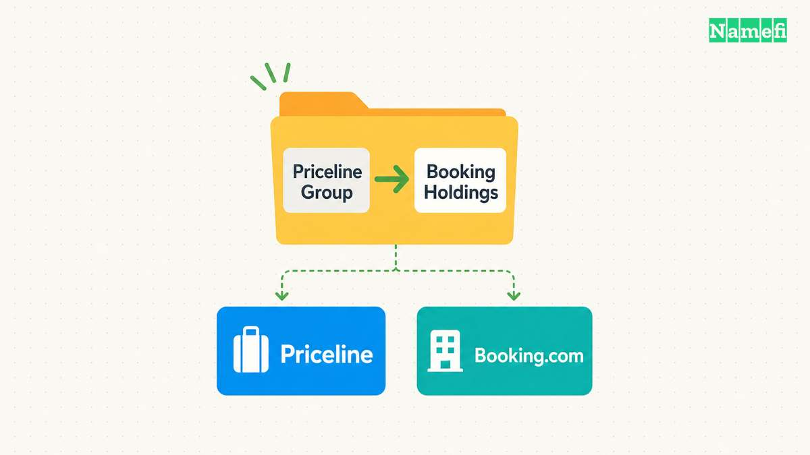
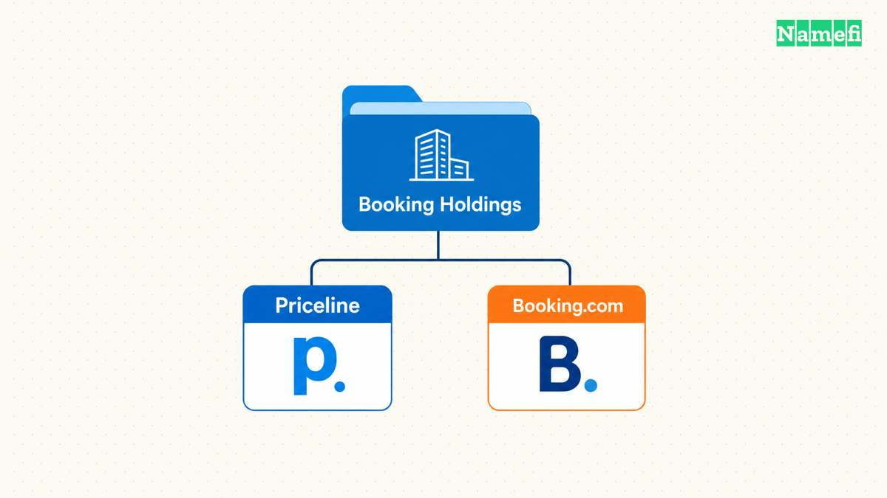
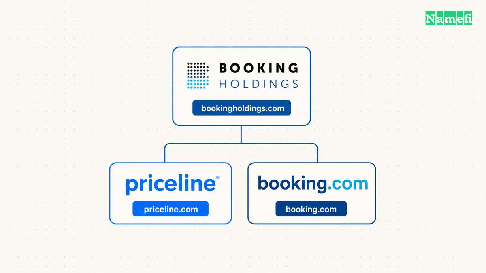

No. Priceline and Booking.com are separate consumer brands within Booking Holdings. The parent previously called The Priceline Group [became Booking Holdings on 21 February 2018](https://www.bookingholdings.com/press-releases/the-priceline-group-inc-nasdaq-pcln-announces-name-change-to-booking-holdings-inc/). The corporate rename did not turn Priceline into Booking.com.

The old parent name made the question understandable. A company called The Priceline Group appeared to place Priceline at the center of the business. The company wanted a corporate identity that better represented the wider group.

## Booking Holdings gave the parent a broader identity

The [2018 announcement explained the change in the company's own terms](https://www.bookingholdings.com/press-releases/the-priceline-group-inc-nasdaq-pcln-announces-name-change-to-booking-holdings-inc/). The group had expanded from priceline.com in the United States into a business with several brands. Booking.com had become its largest brand.

The new name acknowledged that development. Booking Holdings identified the parent without asking every customer-facing business to adopt one name.

The word Holdings does useful work. A reader can distinguish the organization that owns businesses from a particular service that accepts a reservation. Booking.com and Booking Holdings share a word, but the names answer different questions.

That distinction also explains why a corporate rename can matter without replacing a familiar consumer brand. The parent needs an identity for the group. Each business still needs an identity for the customer.

## Priceline and Booking.com continued as distinct brands

The separation continued well beyond the announcement. In May 2026, Booking Holdings [introduced BKNG Ads across Booking.com, Priceline, and Agoda](https://www.bookingholdings.com/press-releases/booking-holdings-unifies-global-advertising-solutions-with-introduction-of-bkng-ads/). The release identified the services as separate brands participating in a common advertising offering.

The parent could coordinate an initiative while retaining the brand names. A shared owner did not require a shared consumer name.

For a traveler, the practical answer is therefore specific: Priceline belongs to the same group as Booking.com. Priceline is not another spelling of Booking.com. The parent company's new name describes ownership, rather than a change to the name of every booking website.

[HomeAway's transition to Vrbo](/en/blog/from-homeaway-com-to-vrbo-com/) followed a different pattern. Expedia retired the HomeAway consumer brand in the United States and moved traffic to Vrbo. That story concerns consolidation of consumer destinations. The Booking Holdings announcement concerns the identity above several destinations.

## The corporate domain explains the scope of the rename

The company's [name-change announcement appears at bookingholdings.com](https://www.bookingholdings.com/press-releases/the-priceline-group-inc-nasdaq-pcln-announces-name-change-to-booking-holdings-inc/). The address matches the corporate name. The 2026 release separately identifies the consumer brands and links their websites.

That arrangement gives the domains different jobs. Bookingholdings.com communicates the identity of the parent. Priceline.com and booking.com identify consumer brands. An organizational relationship between the domains does not imply a redirect between the websites.

The case therefore needs more precision than a simple old-domain-to-new-domain arrow. Such an arrow could tell readers that Priceline.com became Booking.com. The announcement supports a different account: The Priceline Group became Booking Holdings.

[Square Inc.'s change to Block Inc.](/en/blog/from-square-inc-to-block-inc/) offers a useful comparison. Both cases separate a renamed corporate parent from a retained consumer brand. The first question for a domain story should be which identity changed. Only then can the domain explain the decision accurately.

## These primary sources document the name change

- [Booking Holdings' 2018 corporate name-change announcement](https://www.bookingholdings.com/press-releases/the-priceline-group-inc-nasdaq-pcln-announces-name-change-to-booking-holdings-inc/)
- [Booking Holdings' 2026 BKNG Ads announcement](https://www.bookingholdings.com/press-releases/booking-holdings-unifies-global-advertising-solutions-with-introduction-of-bkng-ads/)
