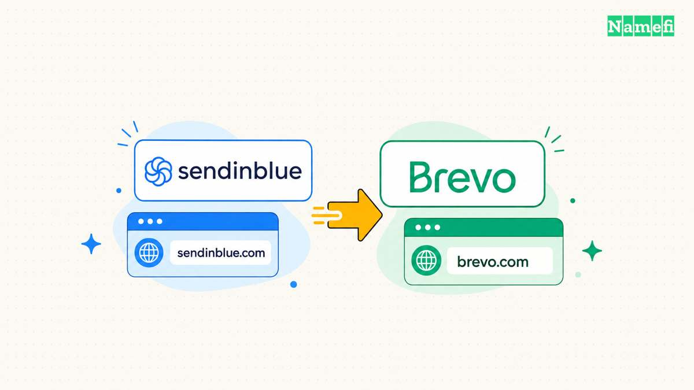
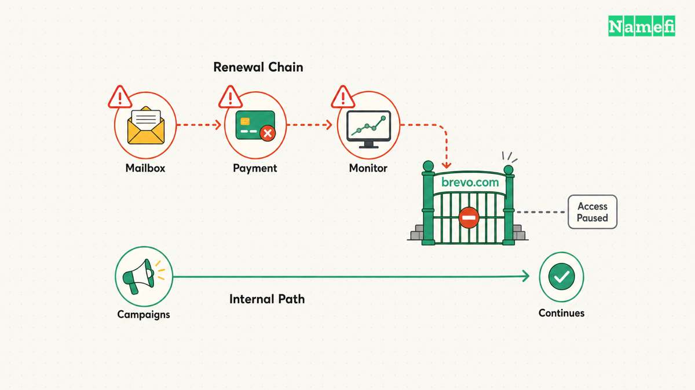
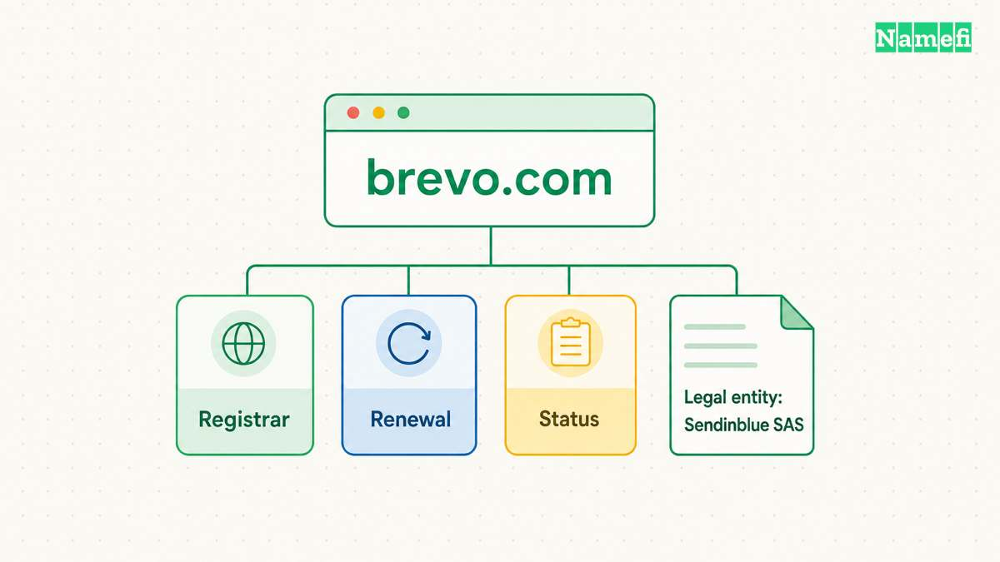

Yes. Brevo is the business previously known as Sendinblue. Brevo's [engineering team documents the rebrand and the 2023 acquisition of brevo.com](https://engineering.brevo.com/sept-11th-2023-brevo-com-domain-name-expiration/). The newer brand name does not mean every legal entity also changed its name.

The domain story has an unusually concrete second chapter. On 11 September 2023, the new domain expired. Brevo's own account explains how a naming asset became an operational dependency.

## Brevo replaced the Sendinblue brand and acquired brevo.com

The [incident report, published on 26 September 2023](https://engineering.brevo.com/sept-11th-2023-brevo-com-domain-name-expiration/), says Brevo acquired brevo.com earlier that year as part of the rebrand. The report establishes the connection between the new name and the domain acquisition.

The address gave the new identity a matching destination. That correspondence also created a practical obligation: the company needed the new domain to remain available for the services using the address.

A purchase and a continuing registration are different events. Acquiring the address can complete a naming decision. The acquisition does not complete the work needed to maintain the address.

That distinction sets Brevo apart from a story concerned only with a shorter name. The company's later postmortem lets readers follow the domain beyond the announcement.

## A renewal failure interrupted access to the new domain

Brevo's [postmortem identifies several contributing failures](https://engineering.brevo.com/sept-11th-2023-brevo-com-domain-name-expiration/). Renewal notices went to a disabled email alias. The payment method had expired. The new registrar was missing from automatic monitoring discovery.

The expired domain interrupted website access and affected brevo.com API and SMTP access. The report says the core platform continued processing scheduled campaigns. The older Sendinblue API and SMTP endpoints remained unaffected.

The scope matters. An unavailable public address does not necessarily mean every internal process stopped. Brevo described different outcomes for the affected access paths and the continuing platform.

The company renewed the domain. The report also discusses centralized registrar monitoring, a status page on an independent domain, and backup arrangements for critical services.

Those details turn the story into more than an embarrassing missed reminder. The new domain needed working contacts, payment arrangements, and monitoring coverage. The company's account shows how gaps in separate processes could combine around the same address.

## The domain story extends beyond the public name change

The public brand and the billing name also require separate explanations. Brevo's [invoice documentation lists Sendinblue SAS in France](https://help.brevo.com/hc/en-us/articles/209298225-View-and-download-your-invoices). The documentation also lists Sendinblue GmbH or Brevo GmbH for applicable German billing relationships.

A customer can therefore encounter the older name in billing information while using the Brevo brand. The relevant invoice documentation explains the applicable entity. The brand name alone does not settle that question.

[HomeAway's transition to Vrbo](/en/blog/from-homeaway-com-to-vrbo-com/) illustrates the same distinction between a consumer identity and an older legal name. [ConvertKit's change to Kit](/en/blog/from-convertkit-com-to-kit-com/) supplies a different comparison: the naming decision itself included a specific domain opportunity.

Together, the cases suggest a practical way to read a rebrand. First identify what changed: the public brand, corporate name, or customer destination. Then follow the obligations attached to the chosen domain.

Brevo's engineering account makes the final point tangible. The company had acquired the right address for its new name. Keeping that address working required continuing operational attention after the naming decision.

## These primary sources document the name change

- [Brevo Engineering's September 2023 domain-expiration postmortem](https://engineering.brevo.com/sept-11th-2023-brevo-com-domain-name-expiration/)
- [Brevo's invoice and legal-entity documentation](https://help.brevo.com/hc/en-us/articles/209298225-View-and-download-your-invoices)
