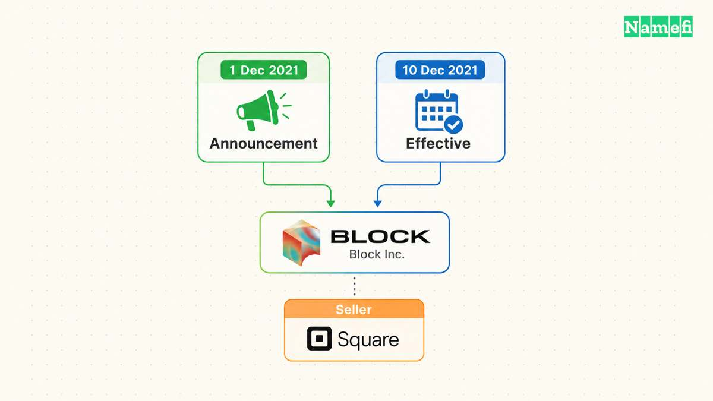
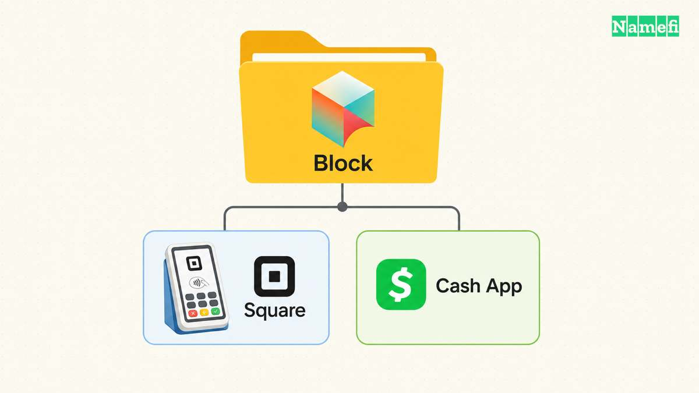
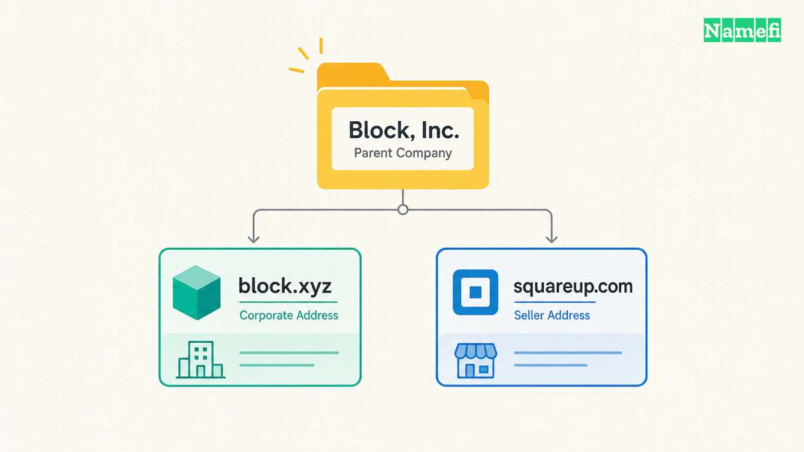

Square Inc. became Block Inc., but the Square seller brand kept its name. The company [announced the corporate rename on 1 December 2021](https://squareup.com/gb/en/press/square-changes-name-to-block). Its [annual report confirms that the legal change took effect on 10 December 2021](https://www.sec.gov/Archives/edgar/data/1512673/000162828022003825/sq-20211231.htm).

The distinction answers the apparent contradiction. Block names the corporate parent. Square continues to identify the seller business. A reader can encounter both names without encountering two competing accounts of the same rename.

## Block renamed the corporate parent of the Square business

The [announcement connected the decision to the company's growth](https://squareup.com/gb/en/press/square-changes-name-to-block). The company had added businesses beyond the original Square seller operation, including Cash App and TIDAL. The new corporate name would distinguish the parent from those businesses.

The company also described several meanings behind Block. Its explanation included building blocks, neighborhood businesses, music gatherings, blockchain, and code. The word offered associations across several activities rather than naming only the seller service.

Those were the company's stated associations. The announcement does not turn each association into a separate business or a promise about future products.

The timeline is equally specific. The December 1 announcement described an expected legal change. The later annual report records December 10 as the effective date. One source explains the public decision. The other confirms when the corporate name changed.

## Square retained the identity of its seller business

The [2021 announcement explicitly preserved the Square seller brand](https://squareup.com/gb/en/press/square-changes-name-to-block). The annual report also records Square as the name of the seller business and reportable segment.

That arrangement gave the corporate and consumer names separate jobs. Block could identify the group. Square could continue to identify the seller offering that had made the older corporate name familiar.

A name change therefore needs a precise subject. Saying Square became Block can describe the legal parent correctly while giving a customer the wrong impression about the product name. Adding Inc. and identifying the seller brand removes that ambiguity.

[The Priceline Group's change to Booking Holdings](/en/blog/from-priceline-group-to-booking-holdings/) follows a comparable structure. The parent adopted a new name while Priceline continued as a consumer brand. [TransferWise's change to Wise](/en/blog/from-transferwise-com-to-wise-com/) involved the customer-facing name and address instead.

The comparisons show why a single template cannot explain every rebrand. The reader first needs to know whether the company changed a product, a parent, or a destination.

## Block used block.xyz to distinguish the corporate identity

The [original announcement directed readers to block.xyz](https://squareup.com/gb/en/press/square-changes-name-to-block). Block's [current corporate website](https://block.xyz/) also links Square and Cash App as distinct businesses.

The domain makes the parent identity visible without requiring the Square seller address to carry the Block name. Squareup.com and block.xyz can represent different roles in the same group.

The sources do not provide a domain acquisition price or explain a decision about Block.com. The documented story concerns the corporate name and the address the company chose to publish.

That boundary leaves a useful domain lesson. A corporate address does not need to replace every product address in a group. The address needs to identify the organization readers are trying to find.

For a reader asking whether Square still exists as a name, the answer is yes: the seller business retained Square. For a reader looking for the renamed corporate parent, the announcement supplies Block and block.xyz.

## These primary sources document the name change

- [Square's 1 December 2021 corporate name-change announcement](https://squareup.com/gb/en/press/square-changes-name-to-block)
- [Block's 2021 annual report, including the effective date](https://www.sec.gov/Archives/edgar/data/1512673/000162828022003825/sq-20211231.htm)
- [Block's corporate website and business links](https://block.xyz/)
