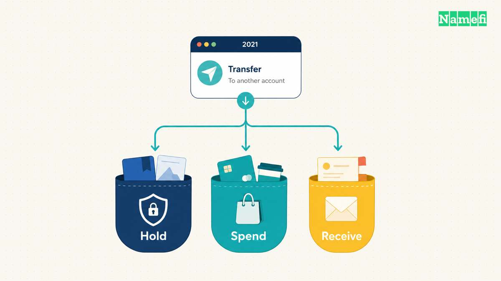
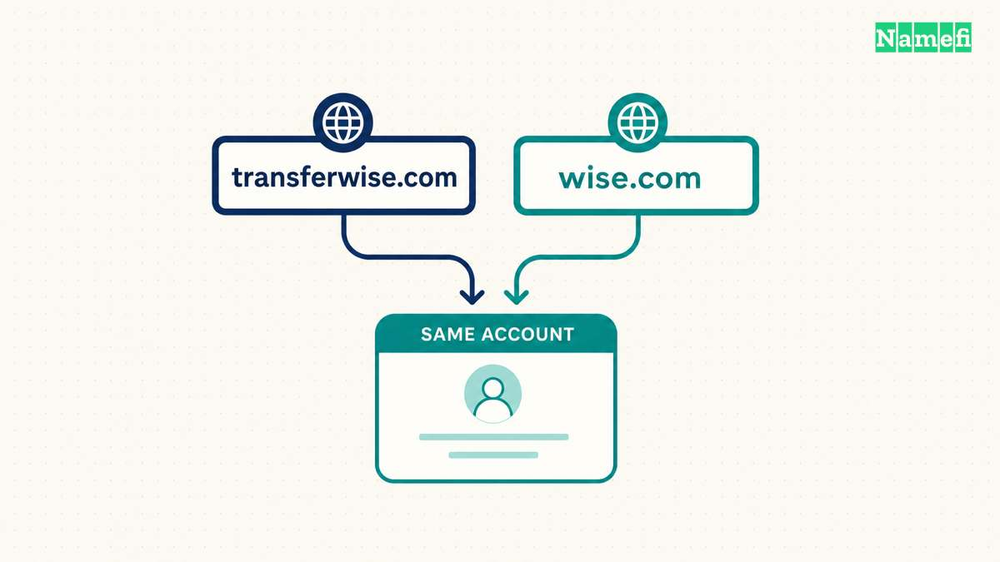
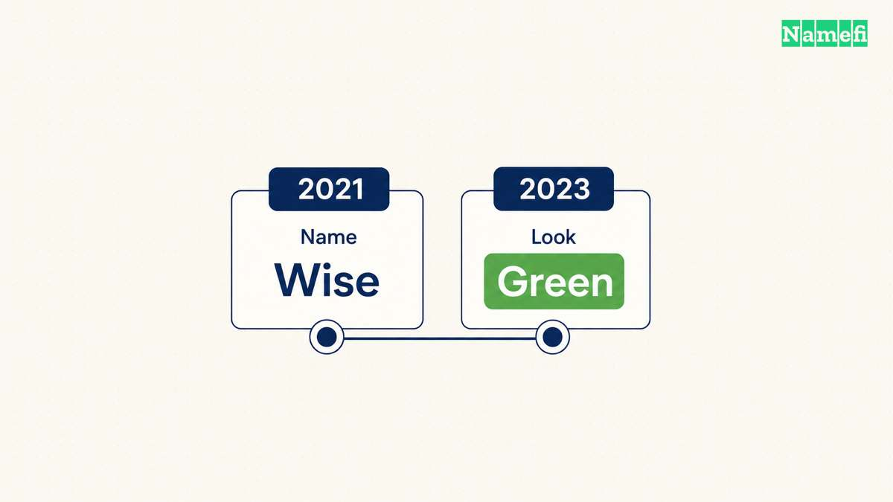

Yes. Wise is the same business previously called TransferWise. Kristo Käärmann [announced the new name on 22 February 2021](https://wise.com/us/blog/world-meet-wise). The announcement directed customers to wise.com and said existing account credentials would continue to work. Wise later introduced a separate visual refresh in 2023.

The name change answered a product question before it answered a design question. What should a money-transfer company call itself after customers start using the service for more than transfers?

## Wise expanded beyond the service named TransferWise

TransferWise described a specific activity. By the time of the rename, the company also helped customers hold, receive, and spend money internationally. Käärmann [presented those additional uses as the reason for choosing Wise](https://wise.com/us/blog/world-meet-wise).

The difference matters because a descriptive name makes a promise. TransferWise told a new customer what the service did. As the service expanded, the same precision could give an incomplete picture.

Wise kept part of the familiar name and removed the activity. The new word left more room for a broader product. That reading follows the company's explanation.

The matching address made the decision concrete. The business could introduce itself as Wise and direct customers to wise.com. The name and the destination no longer needed separate explanations.

## Wise connected the new name to the existing account

A new address can raise a more urgent question than branding: does the customer need a new account?

The [2021 announcement answered that question directly](https://wise.com/us/blog/world-meet-wise). Customers could use the same email address and password at wise.com. The announcement also said transferwise.com would begin redirecting visitors within a few weeks.

The account message gave the domain story its practical meaning. Wise was introducing a new name for an existing customer relationship. Customers needed to recognize the new destination without interpreting the new address as a request to start again.

Compare the structure with [Square Inc.'s change to Block Inc.](/en/blog/from-square-inc-to-block-inc/). Wise changed the customer-facing name and address. Block renamed the corporate parent while preserving the Square seller brand. Both stories involve new names, but the names identify different parts of a business.

## Wise separated the name change from the later visual refresh

The green identity belongs to another chapter. In March 2023, Wise [explained its new look and the change from navy to green](https://wise.com/us/blog/new-look-same-old-wise-dont-let-scammers-trick-you).

Wise also told customers that the visual refresh did not require a new account. The company's explanation warned customers about scammers and emphasized the correct wise.com address.

The sequence is straightforward: the 2021 decision introduced Wise and wise.com. The 2023 decision changed the visual presentation. A reader who remembers the old colors may be remembering a different stage of the same business.

For the domain story, continuity is the useful lesson. A shorter name needs a recognizable destination and a clear explanation for existing customers. The letters alone do not explain what customers should do next.

[Sendinblue's change to Brevo](/en/blog/from-sendinblue-com-to-brevo-com/) adds a second operational question: who keeps the new domain working after the announcement? Wise's public account instructions explain the transition. Brevo's later incident report explains the maintenance work behind a new address.

## These primary sources document the name change

- [Wise's 2021 name-change announcement](https://wise.com/us/blog/world-meet-wise)
- [Wise's 2023 visual-refresh explanation](https://wise.com/us/blog/new-look-same-old-wise-dont-let-scammers-trick-you)
