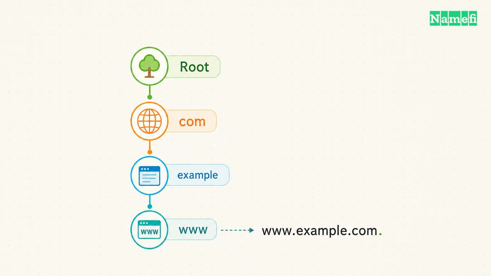
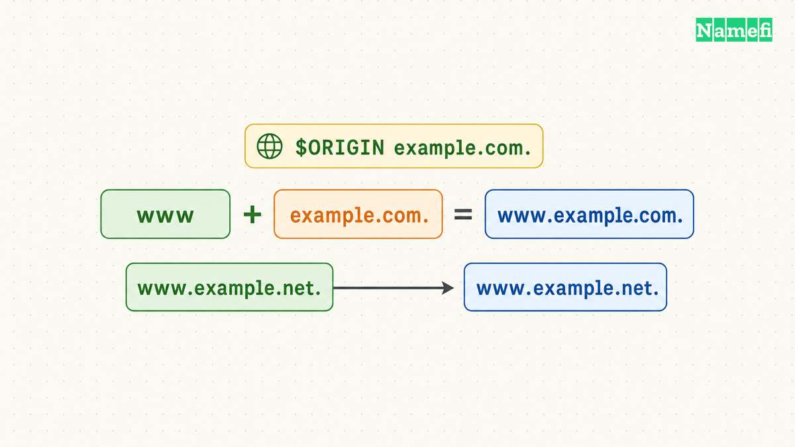

A fully qualified domain name, or FQDN, identifies a complete DNS name. In explicit DNS presentation, `www.example.com.` includes the terminating dot for the root. Everyday writing often omits the final dot and still calls `www.example.com` fully qualified. RFC 9499 recognizes both usages. [The current DNS terminology standard explains the ambiguity](#rfc-9499-defines-fully-qualified-domain-names).

The practical issue is context. A tool can interpret an incomplete name through a search list. A zone file can append its current origin. The resulting name can differ from the name the administrator intended.

This guide explains how to recognize that boundary. The examples use hypothetical configurations. The commands illustrate read-only questions and do not report live results.

## A complete DNS name includes the root

DNS arranges names in a hierarchy. For `www.example.com.`, read the components from right to left: the root, `com`, `example`, and `www`. The root has a zero-length label. RFC 1034 explains the label sequence and complete-name notation. [The naming standard defines that structure](#rfc-1034-explains-complete-and-relative-names).

The last dot represents the end of the name in presentation format. The dot is not another server. A name without an explicit final dot can still mean a complete name in ordinary writing, but the program interpreting the name determines the operational behavior.

An FQDN also does not require `www`. `example.com.` and `mail.example.com.` can each represent complete names. Qualification concerns completeness, not whether a particular label appears.

Keep terminology tied to the task. An administrator might ask for the FQDN of a mail server, a database service, or a website. The answer should identify the exact service name rather than the organization's domain alone.

Paste a DNS name, rather than a complete URL, into [Namefi's domain-name inspector](https://namefi.io/domain-tools/domain-name). Compare its absolute-name output and normalized ASCII and Unicode forms. Public-suffix information describes the parsed boundary when known, not whether the name can be registered.

## A hostname field differs from a URL field

For the hypothetical URL `https://shop.example.com/orders`, the hostname is `shop.example.com`. The protocol and path belong to the URL structure, rather than the DNS name. When a DNS tool asks for a name, enter the name required by the tool, without the page path.

As practical configuration advice, inspect the field description before copying a value. A hosting dashboard can ask for a hostname, a full URL, or a relative label. Those fields accept different forms. A complete DNS name can be correct for one field and wrong for another.

Do not add a trailing dot to every browser or application field merely because DNS presentation permits the dot. Check the application's supported syntax and retain the documented form. The [nslookup guide](/en/blog/nslookup-specific-dns-server/) shows a context where an explicit complete name clarifies the query.

A complete name also does not establish that a service exists. Qualification describes the name. DNS answers and application behavior require separate checks.

## Search lists can expand a name before a query

A short name such as `printer` lacks the context needed to identify one position in a DNS hierarchy. Local software can complete a relative name through an origin or search list. RFC 1034 describes relative names as context-dependent. [The naming standard explains that interpretation](#rfc-1034-explains-complete-and-relative-names).

In a hypothetical organization with a search suffix of `example.com`, a program might expand `printer` to `printer.example.com`. The word “might” matters because the program and its settings control the expansion.

Microsoft documents nslookup search behavior for names that lack a trailing period. The relevant settings include the default domain and search list. [The command reference describes that behavior](#microsoft-explains-nslookup-search-context).

For a precise nslookup comparison, use `nslookup -type=A printer.example.com.`. Keep the same name and type when selecting another DNS server. If the short-name lookup succeeds while the explicit name fails, inspect the actual name expansion rather than assuming both tests asked the same question.

## A zone-file origin can duplicate a domain suffix

DNS master files distinguish absolute names from names relative to an origin. RFC 1035 states that names ending in a dot are complete. A relative name combines with the current origin. [The master-file specification defines that rule](#rfc-1035-defines-zone-file-origins).

Consider a hypothetical zone with `$ORIGIN example.com.`. The relative owner `www` identifies `www.example.com.`. The absolute owner `www.example.com.` identifies the same complete name. The relative owner `www.example.com` instead expands to `www.example.com.example.com.` in that master-file context.

| Master-file value | Interpretation under `example.com.` |
| --- | --- |
| `www` | Relative name under the origin |
| `www.example.com.` | Explicit complete name |
| `www.example.com` | Relative name with the origin appended |
| `@` | The current origin |

These examples describe master-file syntax. A managed DNS dashboard can normalize field input differently. Read the provider's documentation and inspect the saved owner name instead of assuming that every web interface behaves like a raw zone file.

The same care applies when a record's data contains another domain name. A target name can require complete-name notation in a zone file. Verify the required representation before publishing a record.

## A diagnostic query should expose the exact name

When testing, record the exact fully expanded name, record type, selected DNS server, and time. An answer for `www.example.com.` does not establish an answer for `example.com.`. Separate queries can reveal a mistaken owner or missing record.

Dig also provides search-list controls, and its documented default differs from some other lookup contexts. ISC states that dig does not use the search list by default. [The dig reference explains the setting](#isc-defines-dig-search-behavior).

Therefore, do not assume that two tools interpret a short name identically. Compare complete names when the investigation concerns DNS data rather than local name-completion behavior.

For a production correction, inspect the saved record in the active authoritative service and query the intended complete name. Then test the original application. A correct FQDN prevents one class of naming mistake, while the application test verifies the complete user task.

Your next action is to inspect the context that consumes the name: a command, search list, master file, or application field. Confirm the fully expanded name before changing DNS records.

Example names use [reserved documentation domains](#rfc-2606-reserves-example-domain-names).

## Sources and further reading

### RFC 9499 defines fully qualified domain names

[RFC 9499: DNS Terminology](https://www.rfc-editor.org/rfc/rfc9499.html#section-2). Checked 2026-10-30.

### RFC 1034 explains complete and relative names

[RFC 1034: Domain Names — Concepts and Facilities](https://www.rfc-editor.org/rfc/rfc1034.html#section-3.1). Checked 2026-10-30.

### Microsoft explains nslookup search context

[Microsoft Learn: nslookup](https://learn.microsoft.com/en-us/windows-server/administration/windows-commands/nslookup#remarks). Checked 2026-10-30.

### RFC 1035 defines zone file origins

[RFC 1035: Domain Names — Implementation and Specification](https://www.rfc-editor.org/rfc/rfc1035.html#section-5.1). Checked 2026-10-30.

### ISC defines dig search behavior

[ISC BIND: dig and nslookup manuals](https://bind9.readthedocs.io/en/latest/manpages.html#dig-dns-lookup-utility). Checked 2026-10-30.

### RFC 2606 reserves example domain names

[RFC 2606: Reserved Example Domains](https://www.rfc-editor.org/rfc/rfc2606.html#section-3). Checked 2026-10-30.
