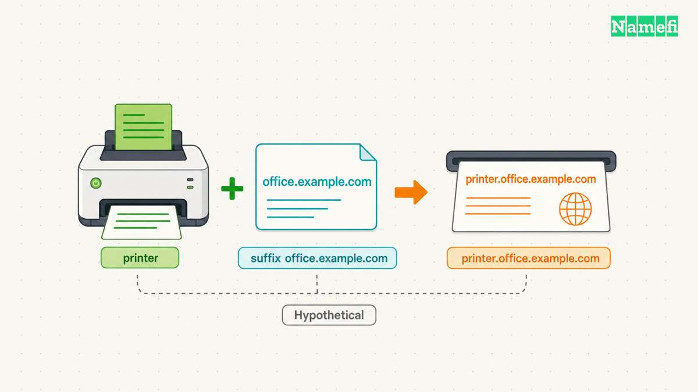
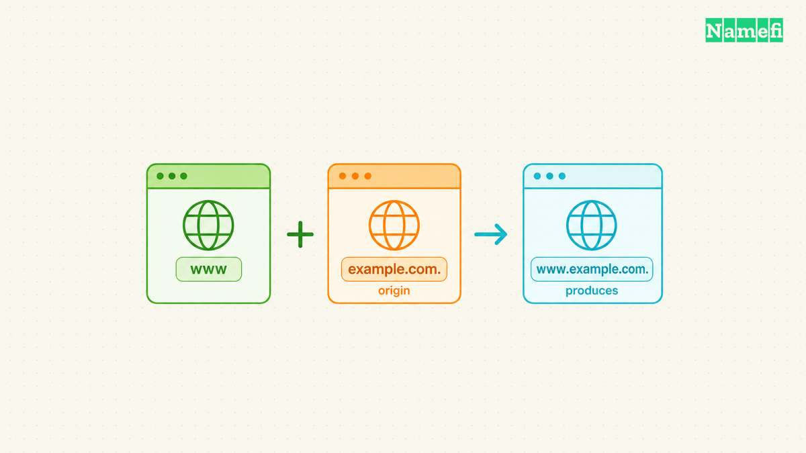
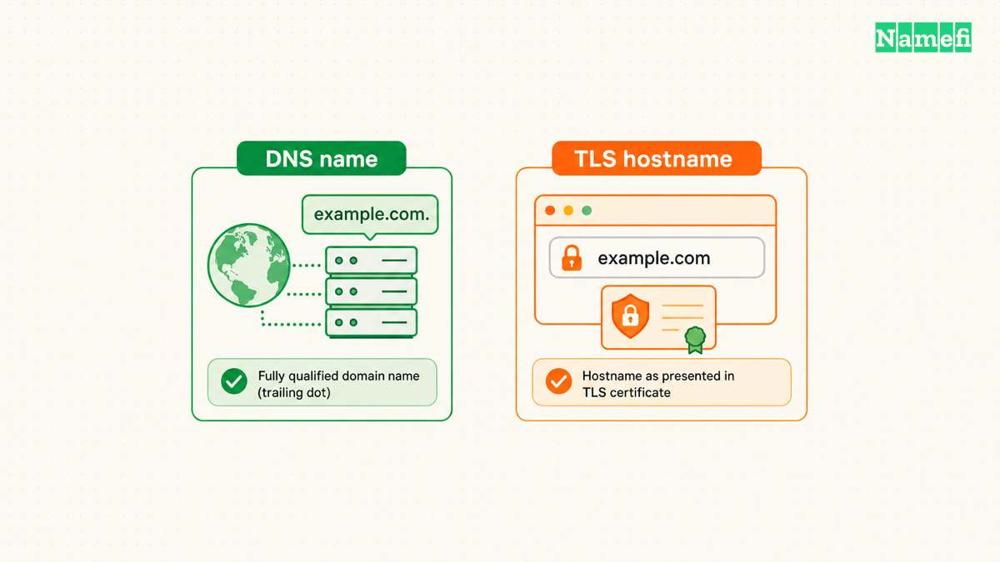

A fully qualified domain name identifies a complete DNS name, including the root. In explicit DNS presentation format, `www.example.com.` ends with a dot. Everyday writing usually omits the final dot and still calls `www.example.com` an FQDN. [RFC 9499 recognizes both conventions](https://www.rfc-editor.org/rfc/rfc9499.html#section-2).

The practical mistake comes later: people assume every program interprets a name without the final dot in the same way. A local search list or zone-file origin can change the resulting name. A browser address introduces additional application rules.

This guide explains how to identify the exact name a tool will use. The examples use hypothetical configurations under reserved example domains. The diagnostic commands read DNS information and do not modify records.

## A complete DNS name includes the root label


The [Domain Name System](/en/glossary/dns/) organizes names hierarchically. Read `www.example.com.` from right to left to follow the hierarchy: root, `com`, `example`, then `www`. The root has an empty label, so the printed form ends with a separator dot. [RFC 1034, section 3.1, defines that structure](https://www.rfc-editor.org/rfc/rfc1034.html#section-3.1).

The final dot does not add another server named after a punctuation mark. The final dot makes the endpoint of the name explicit. A useful configuration review asks whether the field contains a complete name or a name that needs context.

Consider a hypothetical support ticket containing only `api`. The ticket does not establish whether the intended service uses `api.example.com.` or `api.example.net.`. Both names contain the same first label. Ask the service owner for the complete intended name before investigating either destination.

An FQDN also need not begin with `www`. The names `example.com.` and `mail.example.com.` both include the root. A [subdomain](/en/glossary/subdomain/) adds hierarchy below another domain, but additional labels do not make a name more qualified. Qualification concerns completeness, not the number of labels.

A [root zone](/en/glossary/root-zone/) describes the top of the DNS hierarchy. The trailing dot expresses the root label in a name. Keep those meanings separate when reading a DNS diagram or requesting help.

The modern terminology reference distinguishes strict presentation format from common display format. Consequently, calling `example.com` an FQDN in an ordinary conversation is not automatically a technical error. [RFC 9499 explains the distinction](https://www.rfc-editor.org/rfc/rfc9499.html#section-2).

Use explicit notation when ambiguity matters. In a troubleshooting note, write the intended query as `api.example.com.` and record the input exactly. Preserve any spaces, punctuation, and suffix settings separately. A screenshot of a field can help, but a copied value makes comparisons easier.

Do not use the word “complete” as evidence of availability. A complete name describes the query target. The investigation must still establish whether the intended service publishes the required data and accepts the intended connection.

For example, a deployment review might record the intended hostname, required record type, expected service, and responsible team. That review gives a later investigator something concrete to compare. An entry that merely says “configure the FQDN” leaves the important decisions unstated.

## Local search lists can expand names before a lookup



A [DNS resolver](/en/glossary/dns-resolver/) obtains DNS information for applications. Local software can interpret a relative input using a configured search list. RFC 1034 explicitly allows implementation-dependent interpretation at the user interface. [The standard distinguishes search lists from a fixed origin](https://www.rfc-editor.org/rfc/rfc1034.html#section-3.1).

Suppose a hypothetical client has the search suffix `office.example.com`. A user enters `printer`. Search processing can produce the candidate `printer.office.example.com.`. Someone testing only `printer.` asks a different question. Compare the candidate names before comparing the answers.

A name containing dots can still require attention. Some lookup implementations use an `ndots` threshold when deciding whether to apply search processing. The BIND documentation describes the threshold for its lookup tools. The same documentation says `dig` does not use the search list by default. [Read the documented `dig` options](https://bind9.readthedocs.io/en/stable/manpages.html#dig-dns-lookup-utility).

That default creates a common testing gap. An engineer runs an ordinary `dig` command and obtains the expected answer. An application still fails. The command has not necessarily reproduced the application's name interpretation. Write down what each test actually checked before concluding that the two results conflict.

Kubernetes provides a concrete environment where context matters. Pod configuration can include DNS search domains and resolver options. The official documentation shows generated resolver configurations and discusses differences on Windows nodes. [Kubernetes documents Pod DNS configuration](https://kubernetes.io/docs/concepts/services-networking/dns-pod-service/#pod-s-dns-config).

For a hypothetical application running in a Pod, inspect the configuration inside the affected container. A successful lookup from a developer laptop does not document the container's settings. Compare the application input, container settings, and resulting query names as separate observations.

Use the following comparison when reviewing an incident. The entries describe what to investigate rather than promise one universal resolver sequence.

| Input | Context | Check |
| --- | --- | --- |
| `printer` | Search suffix configured | Expanded candidate names |
| `api.example.com` | Search behavior enabled | Threshold and query order |
| `api.example.com.` | Explicit DNS name | Exact intended query |
| `www` | Zone-file origin | Expanded record owner |

A useful incident note states the expected name first. Next, record the name the failing application supplied. Then collect evidence of the name the lookup process queried. Keep expected behavior and observed behavior in separate sentences.

If those names differ, investigate configuration before changing authoritative records. Adding a record for an unintended expanded name can hide the original mistake. Prefer a correction that makes the application's intended destination explicit and follows the application's supported configuration format.

## Zone files use an origin to complete relative names



DNS zone files have their own explicit name-completion rules. A name ending with a dot is absolute. A name without a final dot is relative to the current origin. [RFC 1035, section 5.1, defines these rules](https://www.rfc-editor.org/rfc/rfc1035.html#section-5.1).

Imagine a hypothetical zone file with `$ORIGIN example.com.`. An owner name of `www` denotes `www.example.com.`. An owner name of `www.example.com.` denotes the same name directly. However, the relative owner `www.example.com` expands to `www.example.com.example.com.`.

The following hypothetical zone-file excerpt makes the owner and target rules visible together. The records illustrate name expansion, not a deployable zone.

```text
$ORIGIN example.com.
www 300 IN CNAME app.example.net.
mail 300 IN CNAME app.example.net
```

| Field | Saved absolute name |
| --- | --- |
| First owner `www` | `www.example.com.` |
| First target `app.example.net.` | `app.example.net.` |
| Second owner `mail` | `mail.example.com.` |
| Second target `app.example.net` | `app.example.net.example.com.` |

The missing final dot changes the second target, even though both targets contain several labels. The same origin rule governs owners and domain-name record data. [RFC 1035, section 5.1, specifies the expansion](https://www.rfc-editor.org/rfc/rfc1035.html#section-5.1).


Domain names also appear inside record data. For a hypothetical CNAME line, `www IN CNAME app.example.net.` names an absolute target. Without the final dot, the target becomes `app.example.net.example.com.` under the example origin. The rule applies to domain-name fields, not arbitrary text or address fields. [RFC 1035 describes master-file domain names and CNAME data](https://www.rfc-editor.org/rfc/rfc1035.html#section-5.1).

The distinction between an owner and a target helps during review. The owner identifies the name carrying the record. The target identifies another name within the record data. Identify both fields before checking either value. The [record-types glossary](/en/glossary/dns-record-types/) provides context for the different jobs records perform.

A hosted DNS form may present fields differently from a raw zone file. Read the provider's instructions for the exact field before copying zone-file notation. Check the saved full name after the form processes the input. Treat a provider's preview or export as evidence to inspect, rather than assuming the interface preserves every typed character.

For example, a hypothetical form asks for a record name below `example.com`. The helpful question is whether the form expects `www`, `www.example.com`, or another supported representation. A generic rule to “always include the dot” cannot answer that product-specific question.

During a correction, preserve the current record before editing. Record the intended owner and target in full. Change only the field that differs from the intended configuration. Recheck the resulting saved record and query the intended owner.

If the interface produces a duplicated suffix, stop repeating the same input. Reopen the field instructions and inspect the displayed zone context. If the saved name looks correct but resolution fails, move to query diagnostics. A correct-looking form does not replace an observed DNS answer.

## Controlled lookups separate naming errors from application failures



Start with a read-only DNS test using BIND's `dig`, if the tool is available. Run `dig example.com. A +nosearch`. Keep the full output during diagnosis. Record the question, response status, returned data, and responding server. Do not invent an expected address for the example domain.

Look at the `QUESTION SECTION` before interpreting an answer. The question should contain `example.com.`, class `IN`, and type `A`. An answer at a different owner can follow an alias, so the answer alone does not identify the original question. [The BIND manual documents dig's question and answer output](https://bind9.readthedocs.io/en/stable/manpages.html#dig-dns-lookup-utility).

Next, test a hypothetical search suffix explicitly with `dig printer A +domain=office.example.com +showsearch`. The `+domain` option sets one search suffix and enables search processing. The `+showsearch` option displays intermediate results. These options let the test expose candidate names without editing the machine's resolver configuration. [BIND documents both options](https://bind9.readthedocs.io/en/stable/manpages.html#dig-dns-lookup-utility).

The example does not imply that `printer.office.example.com.` exists. Substitute an intended name and approved suffix from the actual environment. An unsuccessful result can still help establish which name the tool attempted.

Compare a controlled search test with `dig printer.office.example.com. A +nosearch`. Use the same environment for both tests. Keep the query type fixed. Change one input at a time so the comparison has a clear purpose.

Do not treat the second command as a complete simulation of an application. The commands isolate DNS naming behavior. An application investigation must also use the application's own configuration and supported diagnostics. Record the application's error before changing the test inputs.

A practical recovery sequence starts with a narrow question: did the application ask for the intended name? If the answer is unclear, collect the relevant lookup evidence. If the answer is no, correct the name or supported search configuration. If the answer is yes, continue investigating the returned data and service connection.

The final dot belongs in this DNS investigation because the dot makes name completion explicit. The DNS rule does not establish a universal rule for website addresses. Do not rewrite published links as `https://example.com./` merely because a DNS diagnostic used `example.com.`.

TLS illustrates the need for separate rules. The Server Name Indication extension specifies a DNS hostname without a trailing dot. A DNS presentation convention therefore cannot serve as a universal application-format requirement. [RFC 6066, section 3, defines the SNI hostname representation](https://www.rfc-editor.org/rfc/rfc6066.html#section-3).

When DNS succeeds but HTTPS fails, preserve the intended public URL and inspect the application's connection error. Check the service's supported hostname configuration. Do not disable certificate verification to make a naming experiment appear successful. A successful DNS query answers only the DNS part of the investigation.

Keep the test record useful for another operator. Include the timestamp, network context, command, and complete response. State whether the application ran locally, inside a container, or on another machine. Avoid a report that contains only an address without the question that produced the address.

Before closing the incident, repeat the original user action. A controlled DNS test can confirm the naming correction, while the original action confirms the intended workflow. Record both outcomes without treating either result as evidence for an untested environment.

Finish the incident note with the exact cause and correction. For example, state that a relative zone-file target acquired the zone suffix, or that an application relied on a missing search suffix. Include the observed names and the successful follow-up check. Those details explain the failure more clearly than “the FQDN was wrong.”

## Sources and further reading

- [RFC 9499: DNS Terminology](https://www.rfc-editor.org/rfc/rfc9499.html#section-2), section 2, “Global DNS” formats and “Fully Qualified Domain Name.” Fetched 2026-10-21.
- [RFC 1034: Domain Names — Concepts and Facilities](https://www.rfc-editor.org/rfc/rfc1034.html#section-3.1), section 3.1, labels, absolute names, and relative-name context. Fetched 2026-10-21.
- [RFC 1035: Domain Names — Implementation and Specification](https://www.rfc-editor.org/rfc/rfc1035.html#section-5.1), section 5.1, master-file origins and domain-name fields. See section 3.3.1 for CNAME data. Fetched 2026-10-21.
- [ISC BIND 9 manual: dig](https://bind9.readthedocs.io/en/stable/manpages.html#dig-dns-lookup-utility), query options `+domain`, `+ndots`, `+search`, and `+showsearch`. Fetched 2026-10-21.
- [Kubernetes: DNS for Services and Pods](https://kubernetes.io/docs/concepts/services-networking/dns-pod-service/#pod-s-dns-config), “Pod's DNS Config” and “DNS resolution on Windows nodes.” Fetched 2026-10-21.
- [RFC 6066: TLS Extension Definitions](https://www.rfc-editor.org/rfc/rfc6066.html#section-3), section 3, Server Name Indication and the `HostName` representation. Fetched 2026-10-21.
