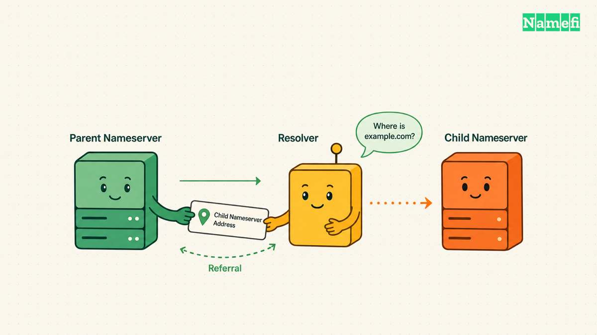
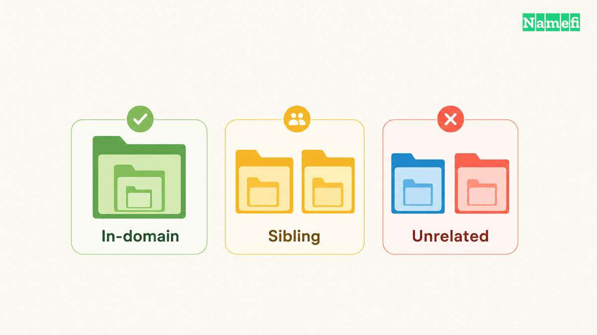
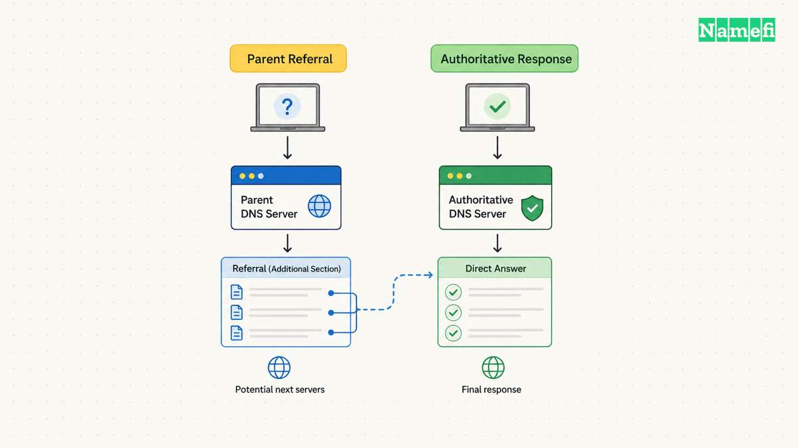

A DNS glue record supplies a nameserver address in the parent zone's referral. Glue lets a resolver reach a nameserver whose name sits inside the domain that the resolver is trying to resolve. Without the necessary address, the lookup can create a circular dependency.

Glue matters when running custom nameservers such as ns1.example.com for example.com. Glue usually does not require a separate customer task when a managed DNS provider supplies its own correctly configured nameservers. Check the actual delegation before changing anything.

The operational distinction is location. An ordinary A or AAAA record lives in the authoritative zone for the hostname. A glue address appears in the parent-side delegation context. A reliable setup keeps the relevant parent and child information consistent.

## Glue gives the resolver an address before the child can answer

Imagine a hypothetical delegation for example.com that lists ns1.example.com. A resolver needs the address of ns1.example.com before contacting that nameserver. Looking up that address through example.com would require reaching the same nameserver first.

[RFC 9499 describes glue as address information that resolves this dependency](https://www.rfc-editor.org/rfc/rfc9499.html#section-7). The parent referral can carry the address that the resolver needs for the next query. The nameserver must still run a working authoritative DNS service at that address.

Glue is therefore about reaching the DNS server. Glue does not specify the IP address of www.example.com unless www.example.com also happens to serve as a delegated nameserver. A normal website move often changes a web record without changing glue.

Keep the nameserver's name distinct from the nameserver's address. An NS record contains a hostname. An A record supplies an IPv4 address, and an AAAA record supplies an IPv6 address. Glue uses address records in the delegation context.

For an illustrative configuration, example.com uses ns1.example.com at 192.0.2.10. The documentation address 192.0.2.10 represents the DNS server, not an instruction to use that address in production. The operator must substitute an actual reachable server address.

| Configuration item | Location | Purpose |
| --- | --- | --- |
| Delegation NS record | Parent zone | Names the child's authoritative server |
| Glue A or AAAA record | Parent referral context | Supplies an address for reaching that server |
| Authoritative host address | Child's authoritative DNS data | Answers the hostname's address lookup |
| Website A or AAAA record | Website's authoritative zone | Directs clients to the website destination |

The distinction helps with dashboard terminology. A registrar might call the relevant function host registration, child nameservers, or glue records. Confirm that the function updates parent-side host information. A generic DNS record editor can operate on a different layer.

Before editing, draw the current delegation on one sheet. Include the parent, child zone, nameserver hostnames, and server addresses. A simple inventory often reveals whether the business needs glue at all.

## The nameserver relationship determines which glue case applies

Compare the delegated domain with the nameserver name. A nameserver below the delegated domain creates an in-domain relationship. A nameserver in another child of the same parent creates a sibling relationship. A name outside the parent's domain creates an unrelated relationship.

[RFC 9499 defines those relationships and gives examples](https://www.rfc-editor.org/rfc/rfc9499.html#section-7). For example.org under org, ns.example.org is in-domain. A nameserver under a different org child is a sibling. A nameserver under example.com is unrelated to the org parent.

Use those precise descriptions when contacting support. The older terms in-bailiwick and out-of-bailiwick can create ambiguity. State the actual delegated domain and nameserver hostname so support can identify the relationship directly.

[RFC 9471 distinguishes in-domain glue from sibling glue in referrals](https://www.rfc-editor.org/rfc/rfc9471.html#section-2). In-domain addresses solve the direct dependency described above. Sibling addresses can reduce additional lookups, while cyclic sibling dependencies create a more demanding case.

A beginner does not need to design a cyclic dependency. Prefer the DNS provider's documented nameserver arrangement. If a provider proposes custom nameservers, request the complete registration and zone setup rather than guessing which parent records the provider expects.

For a hypothetical company using ns1.dns-provider.example, first identify the real parent relationship. The presence of a provider name does not itself establish a glue requirement for the company's own domain. The resolver might obtain that nameserver address through another resolvable delegation.

Keep extension-specific administration in view. The registry and registrar determine the supported host-management interface. A procedure for one extension can use a different registration mechanism from another extension. Ask the sponsoring registrar which operation applies to the actual nameserver hostname.

[AWS documents separate steps for nameservers and glue in Route 53 domain registration](https://docs.aws.amazon.com/Route53/latest/DeveloperGuide/domain-name-servers-glue-records.html). That documentation supplies a provider-specific example. The Route 53 interface and limits should not become assumed rules for every registrar.

The decision is practical: identify the delegation relationship, locate the responsible parent-side interface, and confirm the intended addresses. Skip manual glue changes when the provider's managed configuration already supplies the required information.

## A safe address change updates the parent and child deliberately

Prepare the new authoritative server before changing the delegation information. Confirm that the new server can answer for the intended zone. Verify the zone data and required network reachability using the DNS operator's documented procedure.

Save the old hostnames, parent addresses, authoritative address records, and zone configuration. Record which account can change each layer. The registrar account may control parent-side information while a separate DNS hosting account controls the child zone.

Consider a hypothetical address change for ns1.example.com. Plan both parent-side glue and the authoritative host address. Those addresses are documentation examples. The change plan must use the business's actual server addresses.

Do not assume that changing the child A record automatically updates the registry's host information. Do not assume the reverse either. Confirm the provider's documented behavior and inspect the resulting DNS responses at both layers.

Maintain service at the old address during the planned overlap when possible. Cached delegation information can continue sending queries toward the old server. The [TTL and propagation guide](/en/blog/ttl-and-dns-propagation/) explains why a new value does not replace every cached copy immediately.

Review IPv6 separately when the nameserver publishes AAAA data. A correct IPv4 address does not repair an unreachable IPv6 endpoint. Keep the advertised address families aligned with the actual service configuration.

Changing glue also does not replace the [DNSSEC migration procedure](/en/blog/dnssec-for-domain-owners/). DNSSEC involves additional trust-chain information and signatures. If the migration changes DNSSEC arrangements, follow the DNS provider's documented sequence and verify validation separately.

Use a staged checklist:

1. Identify the actual delegated nameserver names.
2. Verify that the new server answers authoritatively.
3. Save the current parent and child address information.
4. Update the approved parent-side host information.
5. Update the corresponding authoritative address records.
6. Compare parent referrals with child answers.
7. Monitor both advertised address families.
8. Retire the old endpoint after the transition criteria pass.

A successful dashboard submission proves that the provider accepted a request. The DNS observations establish whether the expected parent and child data now appear. Keep those two conclusions separate in the change record.

## Referral checks distinguish glue failures from other DNS faults

Begin troubleshooting at the parent referral. Query a verified parent authoritative server for the delegated domain. Inspect the NS records in the authority section and relevant A or AAAA records in the additional section.

Use a diagnostic command shaped as `dig @PARENT_SERVER example.com NS +norecurse`. Replace PARENT_SERVER with the actual parent authoritative server. Save the full response, including flags, response code, and additional section.

Then query the intended child server directly by its known address. A command shaped as `dig @SERVER_ADDRESS example.com SOA +norecurse` checks whether that endpoint answers for the child zone. A reachable IP address alone does not prove authoritative service for the right zone.

Compare the referral addresses with the direct server results. An outdated parent address suggests a host-information problem. A correct address that returns no useful answer suggests a server, network, or zone configuration problem. Describe the observed failure precisely when escalating.

A recursive query from a working cache can hide a broken path. Compare direct parent and child queries rather than relying on one successful public-resolver answer. The [specific-server lookup guide](/en/blog/nslookup-specific-dns-server/) explains how selecting the server changes the evidence.

Inspect truncated responses carefully. [RFC 9471 requires all available in-domain glue or the truncation flag when message size prevents inclusion](https://www.rfc-editor.org/rfc/rfc9471.html#section-3.1). A truncated UDP response does not establish that the parent lacks the address data. Retrieve the complete response using the tool's supported transport behavior.

The RFC clarifies server response behavior. The RFC does not create a universal customer dashboard procedure or change registry data-registration requirements. Keep the protocol requirement separate from the registrar's administrative instructions.

When requesting support, include the domain, nameserver hostname, expected address, observed parent referral, and direct-query result. Exclude credentials and private account details from public tickets. The provider can request sensitive evidence through the provider's approved private channel.

Glue troubleshooting succeeds when the resolver can discover a usable server address and the server answers correctly for the child. Consistent parent and child data, verified reachability, and an orderly transition make that result observable.

## These sources support the article

- [IETF: RFC 9499 DNS Terminology](https://www.rfc-editor.org/rfc/rfc9499.html#section-7). Glue definitions and delegation relationships. Fetched 2026-10-21.
- [IETF: RFC 9471 DNS Glue Requirements in Referral Responses](https://www.rfc-editor.org/rfc/rfc9471.html). Sections 2 and 3 cover relationships and response requirements. Fetched 2026-10-21.
- [AWS: Adding or changing nameservers and glue records](https://docs.aws.amazon.com/Route53/latest/DeveloperGuide/domain-name-servers-glue-records.html). Provider-specific registration workflow and cautions. Fetched 2026-10-21.
