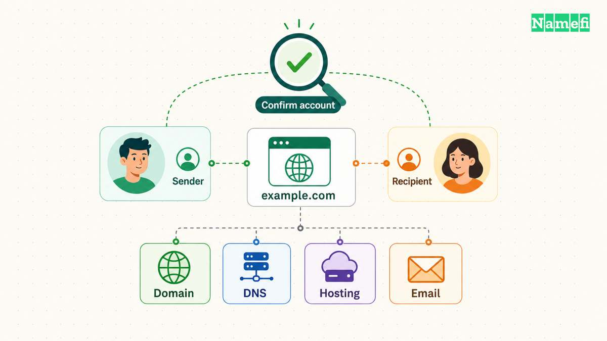
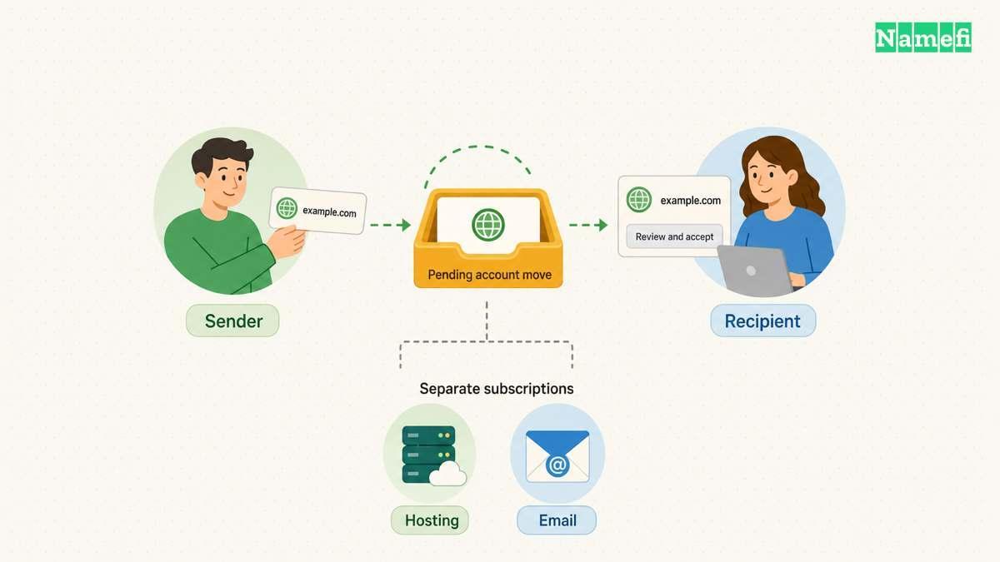
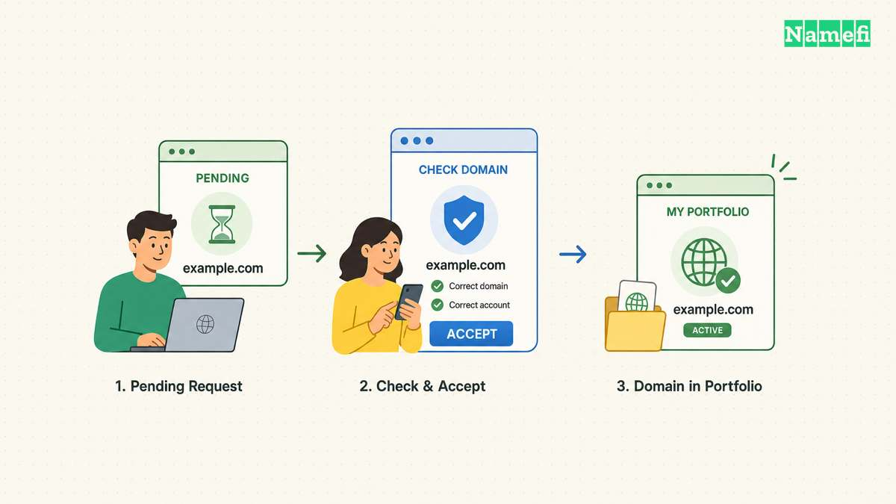

To move a domain between GoDaddy accounts, open the domain in your [GoDaddy Domain Portfolio](https://dcc.godaddy.com/), choose **Transfer to another GoDaddy account**, and identify the recipient. The recipient must accept the transfer. [GoDaddy documents the account transfer process](#godaddy-explains-account-transfers). This account change keeps the domain with GoDaddy.

Existing DNS settings remain with the transferred domain. Connected website and email products do not transfer with the domain. [GoDaddy states that service boundary explicitly](#godaddy-explains-account-transfers). Plan those services separately before handing over control.

## Both parties should agree on the handoff before sending a request

Confirm the exact domain and receiving account before opening the transfer form. As practical advice, ask the recipient for the account email address through an established contact channel. Check spelling carefully, especially if several client accounts have similar names.

Record whether the handoff includes only registration or a wider business asset transfer. A domain transfer can accompany a sale, agency handover, or internal account cleanup. Those situations require different paperwork and access changes.

For a sale, follow the agreed payment or escrow instructions before releasing control. This guide explains the account operation, rather than deciding the commercial order for a specific transaction. The [buyer handoff guide](/en/blog/how-to-transfer-a-domain-to-a-buyer/) covers the broader checklist.

Prepare an inventory that separates registration, authoritative DNS, hosting, email, and billing. Assign an owner to every service. The inventory helps both parties distinguish an accepted domain from a completed business handoff.

## GoDaddy checks domain eligibility before an account move

GoDaddy excludes domains with a pending contact update approval, domains within one day of expiration, expired domains, and domains already pending transfer. GoDaddy also describes a new-registration restriction for bundled domains. [Review the current eligibility notes before starting](#godaddy-explains-account-transfers).

If the transfer option is absent, inspect the domain's state before starting a different workflow. Save any exact message shown in the account. A lock or eligibility message needs its own resolution rather than repeated transfer submissions.

Do not apply every rule for a [registrar-to-registrar transfer](/en/blog/transfer-domain-to-godaddy/) to an internal account move. The operations use different workflows. If the receiving person wants a different registrar, consult the [registrar transfer guide](/en/blog/transfer-domain-to-another-registrar/) instead.

Keep the domain away from an expiration deadline while resolving the handoff. As practical advice, check renewal responsibility before proceeding. The two parties should know who pays the next bill and which account receives future notices.

## The sender selects the domain and names the recipient

Use GoDaddy's documented sequence for the sending account. [The account transfer instructions provide the current field names](#godaddy-explains-account-transfers).

1. Open the Domain Portfolio and select the domain.
2. Find the Transfer section in Domain Settings.
3. Select **Transfer to another GoDaddy account**.
4. Enter the recipient's email address twice.
5. Add the customer number if available.
6. Decide whether eligible existing contact information should accompany the domain.
7. Review the destination and send the transfer request.

If you enter a customer number, GoDaddy requires the entered email to match that account. Delegates need Transfer Access for the selected domain. Protected actions may also require identity verification. [GoDaddy explains those checks alongside the sender steps](#godaddy-explains-account-transfers).

Complete verification inside the official account interface. Do not give the recipient the sender's password, recovery codes, or authenticator codes. The receiving party needs the domain in their account, rather than access to the sending account.

Save the submitted request details without including sensitive verification information. A useful record includes the domain, receiving email, submission time, and visible status. The record will help support investigate a mismatch.

## The recipient must approve the domain in the receiving account

The recipient should open GoDaddy's [account transfer acceptance instructions](https://www.godaddy.com/help/accept-a-domain-account-transfer-1670). In the Transfers page, the documented route uses **Transfers In** and **Accept Transfer**. The recipient reviews the selected domains and contact information before beginning acceptance. [GoDaddy documents the recipient workflow](#godaddy-documents-recipient-approval).

If the incoming domain does not appear, GoDaddy also describes acceptance through the email notification. Confirm that the receiving account matches the intended recipient before accepting. An unexpected transfer notification deserves investigation through the account interface.

The recipient needs to accept within the period GoDaddy specifies. The current sender instructions set that period at ten days. An unaccepted request expires. [The acceptance deadline appears in the sender instructions](#godaddy-requires-recipient-acceptance).

Do not treat the sender's confirmation as proof that acceptance finished. Both parties should check the account status. The recipient should verify that the domain appears in the intended portfolio and that the listed details match the agreement.

## The final check includes services and account responsibility

After acceptance, compare the domain's DNS settings with the saved inventory. Test the actual website address and send a test message through the agreed email service. These checks are practical handoff advice, rather than a guarantee that an account transfer preserves every surrounding service.

Keep hosting and email subscriptions active until the agreed replacement or handoff finishes. GoDaddy's account transfer keeps DNS settings, but does not move those connected products. [The documented service boundary remains important after acceptance](#godaddy-explains-account-transfers).

The recipient should review renewal settings, billing details, and account recovery. The sender should remove obsolete access only after confirming that the new owner can administer each required service. Avoid deleting a shared hosting account that still serves other domains.

Close the handoff with a short written record: the recipient accepted the domain, both parties checked the domain details, and each separate service has an assigned owner. If a service still awaits migration, state that remaining task explicitly. A completed account transfer and a completed website handover are separate milestones.

## Sources and further reading

### GoDaddy explains account transfers

[GoDaddy explains account transfers](https://www.godaddy.com/help/transfer-my-domain-to-another-godaddy-account-822#:~:text=Domains%20transferred%20to%20another%20account). Checked 2026-10-30.

### GoDaddy requires recipient acceptance

[GoDaddy requires recipient acceptance](https://www.godaddy.com/help/transfer-my-domain-to-another-godaddy-account-822#:~:text=accepts%20the%20domain%20transfer). Checked 2026-10-30.

### GoDaddy documents recipient approval

[GoDaddy documents recipient approval](https://www.godaddy.com/help/accept-a-domain-account-transfer-1670#:~:text=Transfers%20In). Checked 2026-10-30.
