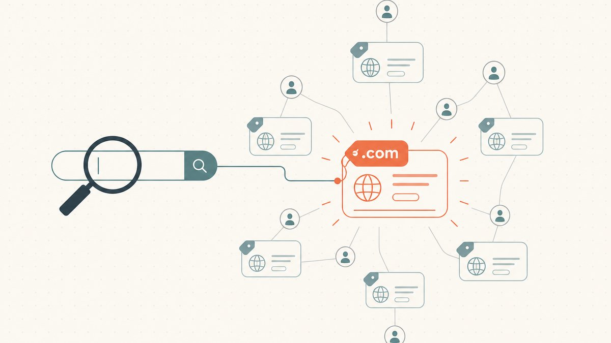
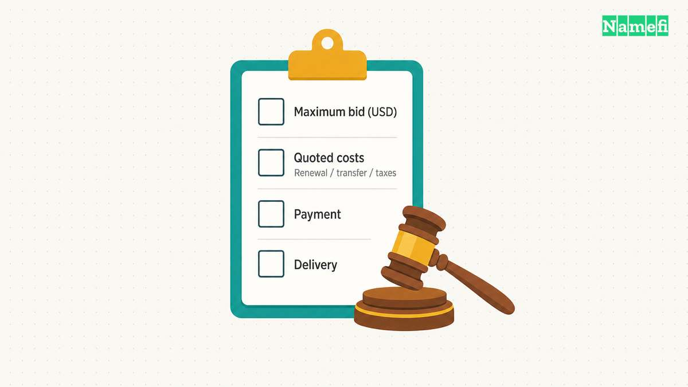
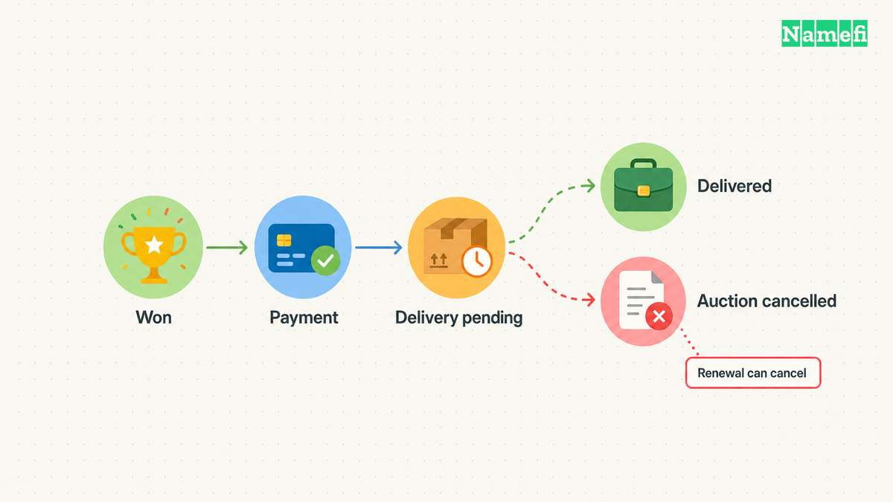

Open [GoDaddy Auctions](https://auctions.godaddy.com/) to search the marketplace, then inspect the exact listing before bidding. GoDaddy's help pages explain [proxy bidding, account requirements, and payment](#godaddy-documents-proxy-bidding-and-payment). A bid creates a purchase commitment, so decide your limit before submitting one.

An auction result does not guarantee immediate delivery of the domain. GoDaddy says an expiring domain's current registrant may renew the registration. That renewal can [remove the domain from the purchase process](#godaddy-explains-auction-commitments-and-delivery).

This guide covers the buyer's workflow. It does not display live inventory, execute bids, or claim that a particular domain remains available.

## Start at the official marketplace and inspect the exact listing

Use the official Auctions link and sign in through GoDaddy's account controls. Confirm the complete domain name before adding the listing to a watch list. Check the extension as carefully as the words before the dot.

GoDaddy documents a **Watching** list for tracking auction details. The list can show current price, bid activity, and the auction end time. [The bidding guide explains how to add and review watched domains](#godaddy-documents-proxy-bidding-and-payment).

Use the controls available on the actual listing. A search result, a saved screenshot, and a live auction page can show different states. Refresh the listing and review the current terms before committing.

As research advice, write down why you want the name before looking at other bidders. A project requirement, a realistic resale plan, and curiosity are different reasons. Only the first two provide a basis for a purchase budget.

For a broader research method, read [how to win domain auctions](/en/blog/how-to-win-domain-auctions/). The purpose is disciplined evaluation, rather than a promise of winning.

## Confirm the account requirements before the deadline

GoDaddy says an Auctions membership is required for bidding on expired and value-priced domains. The same help page distinguishes bidding from submitting an offer. [Check the requirements for the transaction you actually see](#godaddy-documents-proxy-bidding-and-payment).

Review the account's verification state and payment configuration before a time-sensitive bid. Resolve a missing country or other account error through the official account settings. Do not wait until the final moments to discover an incomplete account requirement.

As practical advice, enable the account-security features you can maintain reliably. Keep recovery access under the control of the person or organization buying the domain. Save the support route before starting the purchase.

Do not assume an existing GoDaddy login proves that every auction function is enabled. Follow the marketplace's current prompts and relevant account help.

## A proxy bid uses your maximum as an authorization limit

GoDaddy's proxy service can bid the minimum amount necessary to become the highest bidder. The service can increase the bid when another bidder competes, up to your maximum. [GoDaddy documents that automatic behavior](#godaddy-documents-proxy-bidding-and-payment).

The maximum is the amount you authorize the service to bid. Enter the number only after deciding that the potential purchase fits your budget. Treat every increase as a fresh commitment decision.

A hypothetical example illustrates the choice without inventing auction prices. Suppose a buyer has a fixed project budget and sees a lower current bid. The buyer should enter only an affordable maximum, even when the interface initially displays a lower amount.

GoDaddy states that bids cannot be canceled and that a submitted bid forms a binding purchase commitment. [The buying guide states the commitment explicitly](#godaddy-explains-auction-commitments-and-delivery).

Read the actual agreements and review screen before submitting. This guide summarizes operating steps and does not replace the agreements governing the transaction.

## Calculate the complete commitment before raising the maximum

GoDaddy says listings display prices in **USD**, even when the buyer pays in another currency. The buying guide also says certain purchases can include a renewal or transfer charge. [The exact purchase determines the included cost](#godaddy-explains-auction-commitments-and-delivery).

Create a purchase note with separate fields:

| Item | What to confirm |
| --- | --- |
| Domain | Exact spelling and extension |
| Bid authorization | Maximum amount in USD |
| Checkout costs | Any quoted renewal, transfer, taxes, or other charges |
| Ongoing registration | Renewal terms after acquisition |
| Payment | Available method and purchase deadline |
| Delivery | Listing-specific process and estimated handoff |

The table is an editorial budget checklist. Do not fill an unknown field with an assumed fee. Open the current review screen or ask GoDaddy to clarify the item.

Use a separate budget for later development and operations. Buying the domain does not create a functioning website or mailbox. The [domain versus hosting guide](/en/blog/domain-vs-hosting/) explains the additional services.

## The displayed end time can change during bidding

GoDaddy says bids near an auction's end can extend the auction. [The bidding instructions warn about that extension](#godaddy-documents-proxy-bidding-and-payment). Do not assume that a screenshot's countdown fixes the final closing time.

Watch the actual listing state and the account's bidding list. Avoid interpreting an email notification alone as the complete auction record. Check the marketplace before making another commitment.

As practical advice, do not raise a maximum merely because another bidder appeared. Revisit the purchase objective and complete budget. The presence of competition does not establish that the domain suits your project.

If another bidder exceeds your limit, preserve the original decision. Move to the next candidate instead of treating the auction as a contest that must end in ownership.

## Winning begins a payment and delivery process

GoDaddy's bidding guide says winners must submit payment within 48 hours. [Review the current payment instructions immediately after winning](#godaddy-documents-proxy-bidding-and-payment). Use the account's official purchase controls.

Track the domain in the account's **Won** section. GoDaddy says expired listings can show an estimated delivery date in the status column. The actual delivery process depends on the auction type and circumstances.

GoDaddy also explains that renewal by the previous registrant can prevent delivery. Keep that possibility separate from the auction's bidding outcome. Do not announce a launch around the name until the account actually receives control.

After delivery, confirm registration management, account access, renewal settings, and DNS control. Test website and email services separately when you connect the domain.

Start at the official marketplace, inspect the listing, and set an affordable maximum. Finish only after payment, delivery, and account control match the transaction you intended to complete.

## Sources and further reading

### GoDaddy explains auction commitments and delivery

[GoDaddy explains auction commitments and delivery](https://www.godaddy.com/help/what-is-godaddy-auctions-890#:~:text=Can%20I%20cancel%20my%20bid). Checked 2026-10-30.

### GoDaddy documents proxy bidding and payment

[GoDaddy documents proxy bidding and payment](https://www.godaddy.com/help/bidding-on-godaddy-auctions-domains-893#:~:text=Our%20Proxy%20Bidding%20Service). Checked 2026-10-30.
