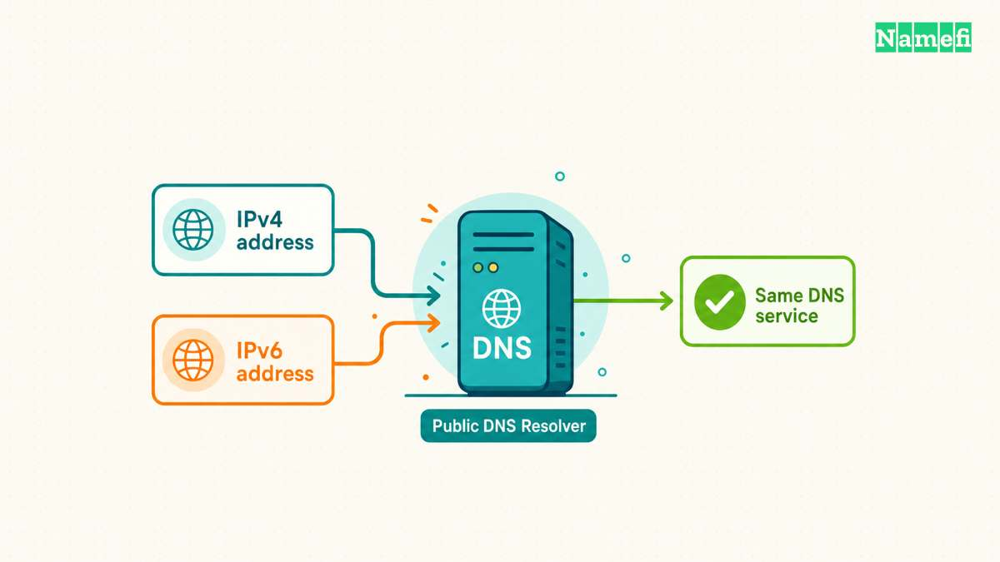
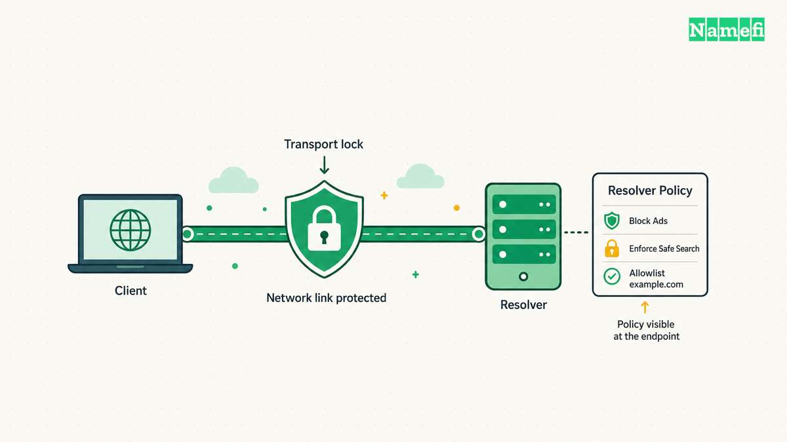

Google Public DNS is a public DNS resolver. Configure `8.8.8.8` and `8.8.4.4` in your device’s DNS settings to use the service. [Google lists the supported addresses and setup procedures](#google-publishes-the-resolver-addresses). Save your previous settings before changing anything.

Changing your resolver changes who answers DNS questions for that connection. The change does not transfer your domain, move your website, or replace your web host. Start with one device so you can test the result before changing a household or office router.

## Google provides separate IPv4 and IPv6 resolver addresses

Use the addresses for the connection types your network supports. [Google documents both address families](#google-publishes-the-resolver-addresses).

| Connection | First resolver address | Second resolver address |
| --- | --- | --- |
| IPv4 | `8.8.8.8` | `8.8.4.4` |
| IPv6 | `2001:4860:4860::8888` | `2001:4860:4860::8844` |

Google recommends configuring distinct resolver addresses. Do not enter `8.8.8.8` twice and assume the duplicate provides another server address.

An IP address belongs in a DNS server address field. Android’s Private DNS hostname field expects `dns.google` instead. Putting the IPv4 address into the hostname field mixes two different setup methods.

Google Public DNS also differs from authoritative DNS hosting. [Google explicitly says the public resolver cannot host your domain’s authoritative zone](#google-explains-the-services-boundaries). Keep your domain’s existing nameservers unless you separately intend to move DNS hosting.

Our [DNS guide](/en/glossary/dns/) explains the distinction between publishing records and asking a resolver to retrieve records.

## You should record a recovery path before changing the connection

Write down whether your device currently obtains DNS automatically. Record any manually configured server addresses. Google’s [before-you-start instructions recommend preserving the original settings](#google-publishes-the-resolver-addresses).

Choose the active connection. A laptop may have separate Wi-Fi and Ethernet configurations. Changing an inactive Ethernet adapter will not test the DNS behavior of the active Wi-Fi connection.

For a company device, ask the network administrator whether public resolvers fit the network policy. Internal services may depend on an organization’s DNS configuration. Treat a new failure to resolve an internal hostname as a reason to restore settings and investigate.

Do not change a company router merely to experiment with a personal device. A router change can affect other users. For a home test, start with the device configuration and keep the router’s configuration unchanged until the device test succeeds.

## Your operating system determines the exact setup controls

Google’s official [setup page](https://developers.google.com/speed/public-dns/docs/using#change_your_dns_servers_settings) covers desktop systems, routers, and mobile devices. Google warns that controls vary between operating system releases. Use your device vendor’s current documentation when menu labels differ.

For a desktop connection, follow this general sequence:

1. Open the active network connection’s settings.
2. Find the DNS server settings.
3. Record the current automatic or manual configuration.
4. Enter the Google resolver addresses for the supported address family.
5. Save the connection settings.
6. Test public websites and required local services.

For Android, Google documents the Private DNS provider hostname `dns.google`. The Private DNS method uses DNS over TLS. Search the device settings for “Private DNS” if the current Android version moves the control. [Google explains the hostname and encrypted transport](#google-publishes-the-resolver-addresses).

For a router, consult the router manufacturer’s instructions. Record whether the change affects the router’s resolver or the DNS addresses that the router distributes to clients. Reconnect a test client when required by the router’s documented workflow.

Avoid pasting instructions for one router model into another model’s interface. A field called “DNS” may appear in several unrelated configuration panels.

## A direct query and a normal connection test answer different questions

A direct query to Google checks whether the resolver answers that query from your connection. A normal device lookup checks the resolver path your device actually uses. A browser can also have its own secure DNS configuration.

On a device with `nslookup`, an illustrative diagnostic command is `nslookup example.com 8.8.8.8`. The command names Google’s resolver explicitly. The command does not prove that every application now uses Google Public DNS.

Next, open a public website through the browser and test the services you normally use. Include a required VPN, printer interface, or internal application when relevant. These are practical verification steps, rather than proof of universal compatibility.

If normal lookups fail, restore the original DNS configuration. Repeat the normal connection test before changing another setting. Record the hostname, resolver, error, connection type, and VPN state for further diagnosis.

A successful lookup also does not prove the website’s application or HTTPS certificate works. Our [HTTPS guide](/en/blog/what-is-https/) separates DNS resolution from connection and certificate checks.

## Public DNS changes involve privacy and policy choices

Entering a resolver IP address does not by itself select an encrypted transport. Android Private DNS and other supported encrypted configurations require their own setup. [Google describes those options in its setup guidance](#google-publishes-the-resolver-addresses).

Read [Google’s privacy documentation](#google-documents-dns-data-handling) before choosing the service. Google describes temporary logs and separate permanent logs. Do not describe a public resolver as anonymous merely because the resolver does not require an account.

Google also says Public DNS generally does not provide content filtering, apart from limited security and legal exceptions. [The FAQ explains the filtering policy](#google-explains-the-services-boundaries). A family filter or organization filter therefore requires a separate decision.

Do not assume a resolver change will lower in-game latency or increase download bandwidth. This guide makes no performance measurement for your connection. Keep the resolver change only when the change meets your actual DNS needs and passes your service checks.

## Restoring the original settings completes an unsuccessful test

Restore automatic DNS if the connection previously obtained DNS automatically. Otherwise, restore the exact server addresses you recorded. Save the change and test the same failed hostname again.

Keep a short configuration note if Google Public DNS works for the connection. Record the device, connection, addresses, encrypted DNS choice, and date. The note gives the next person a usable starting point when a VPN or network policy changes.

## Sources and further reading

### Google publishes the resolver addresses

[Google publishes the resolver addresses](https://developers.google.com/speed/public-dns/docs/using#:~:text=The%20Google%20Public%20DNS%20IP%20addresses%20%28IPv4%29%20are%20as%20follows%3A%208.8.8.8%208.8.4.4), checked 2026-10-30.

### Google explains the services boundaries

[Google explains the services boundaries](https://developers.google.com/speed/public-dns/faq#:~:text=Google%20Public%20DNS%20is%20not%20an%20authoritative%20DNS%20hosting%20service%20and%20cannot%20be%20used%20as%20one.), checked 2026-10-30.

### Google documents DNS data handling

[Google documents DNS data handling](https://developers.google.com/speed/public-dns/privacy#:~:text=Temporary%20logs%20are%20the%20only%20logs%20that%20store%20both%20your%20IP%20address%20and%20your%20DNS%20query.), checked 2026-10-30.
