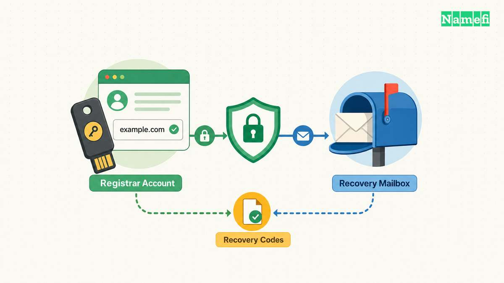
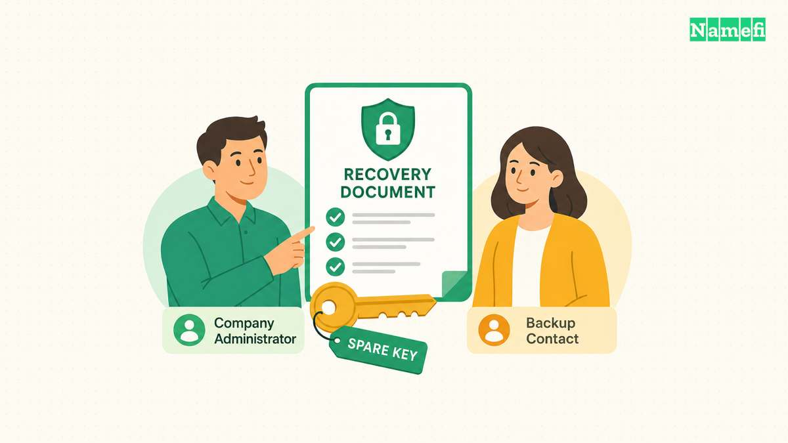
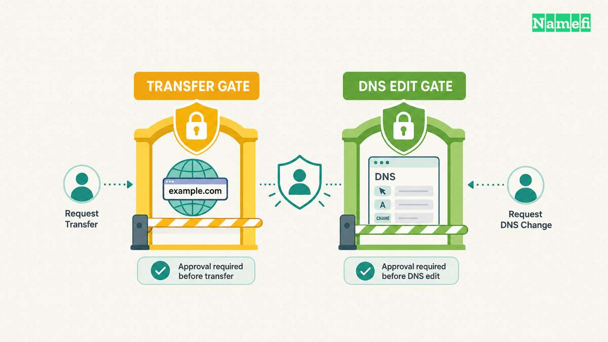
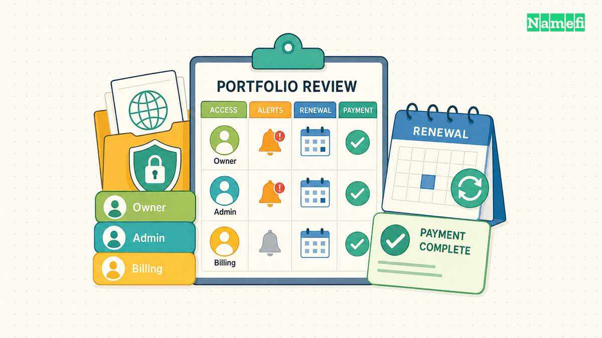

Harden a domain registrar account by securing login, recovery, delegated access, and domain-change controls together. A strong password covers only one route into the account. A business also needs a workable recovery process and clear responsibility for renewals.

Start with the account that controls the business's main domain. Record the registrar, account owner, recovery contacts, authentication methods, and active integrations. Then review the remaining portfolio with the same checklist.

This guide provides an operational review rather than a guarantee against account takeover. Registrar features and extension support vary. Verify the exact controls available for the account instead of assuming that every security label means the same thing.

## Login protection starts with the account and its recovery email

Use a dedicated, unique password when the registrar supports password login. Store the password through the team's approved password manager. Avoid sharing the password through chat or keeping the password inside an agent instruction file.

Enable the strongest suitable authentication method that the registrar supports. Prefer a phishing-resistant option when available, such as a supported WebAuthn security key or passkey. [NIST describes WebAuthn's verifier-name binding as a phishing-resistant mechanism](https://pages.nist.gov/800-63-4/sp800-63b.html#phishres).

Do not label every second factor phishing-resistant. A code that a person types into a fraudulent login page can face different threats from a credential bound to the legitimate service. NIST's cited publication supplies authentication guidance. The publication does not certify a particular registrar implementation.

Open the registrar through a saved, verified address when making sensitive changes. Check the actual hostname before entering credentials. Treat an urgent account-warning email as a reason to inspect the account through the known address.

Protect the email account that receives recovery messages. Review [email authentication](/en/blog/txt-records-spf-dkim-verification/), forwarding rules, recovery contacts, and active sessions. A carefully protected registrar login can still depend on a weak recovery mailbox.

Check whether account recovery depends entirely on the same domain that the account controls. For example, the owner of example.com might receive every recovery message at admin@example.com. If the domain's mail service fails, that arrangement can complicate access recovery.

Ask the registrar which independent recovery options the registrar supports. Keep accurate contact details and document a backup route that authorized staff can use. Do not replace required registration contact information with fictional details to reduce public exposure.

Register a backup authenticator when the service supports a backup authenticator. Keep the backup separately from the everyday device. Verify the backup through a normal login before relying on the backup during an emergency.

Finally, review the devices that can open the account. Remove obsolete browser profiles and sessions through the provider's supported controls. A strong login configuration deserves an equally careful review of already-authenticated devices.

## Recovery procedures must survive staff and device changes

Write a short recovery procedure while authorized staff still have access. Include the verified support address, account identifier, designated contacts, and the location of purchase records. Keep credentials and recovery codes outside the ordinary procedure document.

[NIST distinguishes account recovery from routine authentication](https://pages.nist.gov/800-63-4/sp800-63b.html#account-recovery). The distinction matters when evaluating a registrar. Ask how a customer proves authority after losing the normal authenticator, rather than assuming that adding a second factor settles recovery.

For a small company, appoint an accountable owner and a backup contact. Use individual administrator identities when the provider supports individual identities. Record who may request recovery, replace an authenticator, or approve a change of account ownership.

Consider a hypothetical company whose founder manages the account from a personal laptop. The founder leaves unexpectedly, and the company's receipts remain in the founder's personal mailbox. The company needs a documented registration relationship and an approved recovery contact before that event occurs.

Move business records into a location that authorized company staff can access. Save invoices, registration agreements, account identifiers, and relevant support correspondence. Restrict access to sensitive personal details rather than placing the entire recovery archive in a public repository.

If the provider issues recovery codes, store the recovery codes securely and separately from the routine login device. Review who can retrieve the codes and how retrieval gets recorded. Replace used or exposed codes through the provider's documented process.

Avoid an unplanned recovery test that disables every working authenticator. A desk review can establish the documented steps without causing an account lockout. A controlled live test needs a working backup and a clear restoration procedure.

Review recovery during onboarding and departures. Remove the departing person's administrator access, authenticators, API credentials, and relevant email forwarding. Then confirm that the remaining administrator can sign in and receive account notifications.

Use the review to identify dependencies. A registrar account may depend on a corporate identity provider, a recovery mailbox, and a password manager. List those dependencies so an outage in one service does not leave the team guessing where recovery must begin.

## Transfer restrictions and registry controls protect different operations

Inspect the domain's status codes alongside the account's security settings. [ICANN explains that clientTransferProhibited tells the registry to reject registrar-transfer requests](https://www.icann.org/resources/pages/epp-status-codes-2014-06-16-en#:~:text=clientTransferProhibited). That status addresses transfer between registrars.

A transfer restriction does not describe every permitted account action. The EPP domain mapping defines update restrictions separately from transfer restrictions. [RFC 5731 section 2.3 describes those distinct status values](https://www.rfc-editor.org/rfc/rfc5731.html#section-2.3).

Ask the registrar what the dashboard's lock feature actually controls. Record whether the feature restricts transfers, changes to registration data, nameserver changes, or another operation. Avoid interpreting a lock icon as evidence that all DNS edits are impossible.

| Control | Main question | Separate check |
| --- | --- | --- |
| Account authentication | Who can sign in? | Recovery and existing sessions |
| Role or API restriction | Which operations can an identity perform? | Actual enforcement and resource scope |
| Transfer restriction | Can another registrar receive the domain? | Updates and DNS hosting access |
| Registry lock service | Which registry changes require an additional process? | Availability and unlock procedure |
| Renewal controls | Can the business maintain the registration? | Billing and expiration monitoring |

For critical domains, ask whether a registry lock service is available for the exact extension. [ICANN notes that some registry operators offer additional protection through registry lock](https://www.icann.org/resources/pages/epp-status-codes-2014-06-16-en#:~:text=Registry%20Lock%20Service). Availability does not establish the provider's price or verification procedure.

Request the actual lock and unlock workflow. Ask which people can approve changes, which communication channels the service uses, and how the service handles emergencies. Save the answers with the account review.

Keep availability needs in the decision. A business must understand how a legitimate migration will proceed while stronger change controls remain active. Plan the required contacts and lead time before an urgent nameserver change.

Review DNS hosting access independently. A separate DNS provider can expose records even when registrar transfers remain blocked. The [DNS control-plane guide](/en/blog/dns-is-the-control-plane/) explains the operational importance of controlling both services.

Keep protective restrictions enabled during ordinary operation. Change a restriction only for an approved task under the provider's documented process. After the task, confirm the resulting status rather than assuming that the earlier protection returned automatically.

## Access reviews and renewal checks keep the account usable

Inventory every identity that can change the account or its domains. Include employees, contractors, resellers, automation services, and agent integrations. For each identity, record the current business need and the responsible owner.

Prefer limited credentials when the provider supports limited credentials. A monitoring task should not inherit purchase or transfer authority merely because a broad credential is easier to create. The [agent permission guide](/en/blog/delegate-domain-agent-permissions/) provides a task-based review method.

Remove unused integrations and obsolete API keys. Check whether revoking a key also removes active sessions or whether the provider treats those controls separately. Test the expected denial through a harmless authorized request when practical.

Enable useful account notifications. Review the provider's options for login alerts, contact changes, nameserver changes, transfers, and billing events. Send a permitted test notification, or inspect a recent legitimate notification, to confirm that the intended people receive alerts.

Assign responsibility for renewal checks. Verify the expiration date shown in the account, the renewal configuration, and the payment method. Save the renewal confirmation after payment. Treat automatic renewal as a configured process that still needs monitoring.

Keep a calendar reminder outside the registrar account. Choose a schedule that fits the business's response needs and provider terms. This guide supplies no universal number of days that guarantees recovery from a failed renewal.

Use the following sequence for a routine review:

1. Verify the account owner and backup contact.
2. Confirm the primary and backup authentication methods.
3. Review recovery routes and accessible business records.
4. Remove obsolete people, sessions, and credentials.
5. Check transfer restrictions and available registry controls.
6. Verify DNS hosting access and change notifications.
7. Reconcile renewal settings, billing, and expiration records.
8. Record exceptions with an owner and follow-up date.

If a review finds an unfamiliar login or configuration change, preserve the available evidence. Contact the provider through the verified support route. Follow the provider's containment process and restore the account's trusted contacts and authentication methods.

The completed review should leave the business with working access and documented controls. A secure account must support legitimate administration while making unexpected changes visible. Recovery, delegation, and renewal responsibility keep that protection useful after the initial setup.

## These sources support the article

- [NIST: SP 800-63B-4 Digital Identity Guidelines](https://pages.nist.gov/800-63-4/sp800-63b.html). Phishing resistance and account recovery. Fetched 2026-10-21.
- [ICANN: EPP Status Codes](https://www.icann.org/resources/pages/epp-status-codes-2014-06-16-en). Client transfer restrictions and registry lock descriptions. Fetched 2026-10-21.
- [IETF: RFC 5731](https://www.rfc-editor.org/rfc/rfc5731.html). Section 2.3, separate update and transfer status values. Fetched 2026-10-21.
