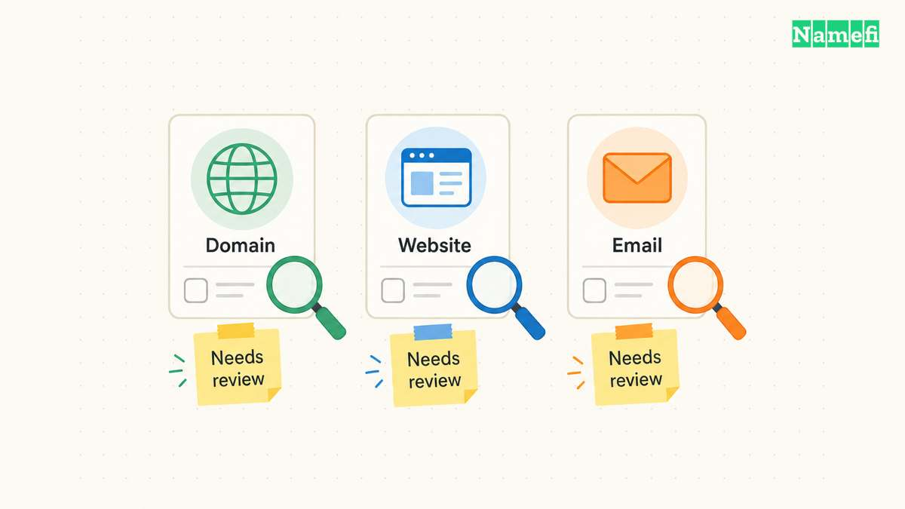

To find a cheap domain, compare the exact name's registration price and recurring renewal price at several registrars. Start with the official [Porkbun price list](https://porkbun.com/products/domains) and [Cloudflare Registrar](https://www.cloudflare.com/domains/). Then inspect the final checkout for your chosen name. A first-year promotion alone cannot identify the cheapest option for your needs.

Porkbun separates registration, renewal, and transfer prices. Cloudflare says it does not add registrar markup to registration and renewal prices. Cloudflare also requires its nameservers while the domain remains with Cloudflare Registrar. [The pricing pages](#porkbun-separates-registration-and-renewal) and [DNS restriction](#cloudflare-requires-its-nameservers) make those comparisons concrete.

## The same name must appear in every comparison

Choose the exact spelling and extension before comparing providers. A discount for a different extension answers a different purchasing question. If you prefer several names equally, compare those names separately rather than treating every search result as interchangeable.

Record the currency, registration term, renewal term, and whether the quote covers a standard or premium registration. Porkbun explicitly labels its published yearly registration and renewal prices as non-premium prices. [Its pricing notes establish that scope](#porkbun-separates-registration-and-renewal).

Use the search result as a lead. Recheck the name in checkout before paying. A general extension price does not prove that a particular name has that price. Save the quote date with the quote so that a later decision does not rely on an old promotion.

If another person already owns the name, separate the purchase price from the registrar's ongoing charges. A low renewal price does not determine what the current registrant will accept. The [domain valuation guide](/en/blog/how-to-value-a-domain-name/) covers that negotiation question.

## Renewal charges determine the cost of keeping the domain

For a hypothetical three-year comparison, use this worksheet. Enter real quoted amounts in one currency. The worksheet intentionally contains no invented market prices.

| Cost item | Provider A | Provider B |
| --- | --- | --- |
| Initial registration for the selected term | Enter quote | Enter quote |
| Renewals needed to reach the same end date | Enter quote | Enter quote |
| Required services and fees | Enter quote | Enter quote |
| Applicable taxes shown at checkout | Enter quote | Enter quote |
| Total through the chosen end date | Add the quoted costs | Add the quoted costs |

Do not multiply the first-year promotion by the whole holding period. Add the registration charge and the renewal charges separately. If a promotion requires a longer initial term, record the full amount due today.

Use the same period for both providers. A one-year registration and a multiyear bundle can create misleading monthly comparisons. Compare what you actually pay and the registration coverage that payment buys.

This worksheet supports a purchasing decision. It does not predict future registry or registrar price changes. Keep the quote and review the renewal price again before each renewal. For a portfolio, apply the same method across every name before committing the whole budget.

## Bundles need a second review before checkout

Registration, web hosting, and email are separate services. ICANN explains that a domain registration needs additional services to provide a functioning website or email. [Its domain basics page makes the distinction](#icann-distinguishes-registration-from-hosting).

As practical advice, write down the services the project actually needs. A personal landing page may use a hosted builder. A domain used only for email may not need a separate website plan. An unused name may need no paid hosting at all.

Inspect every cart line. Decide whether privacy, email, website building, security packages, or other additions solve a specific need. Compare each required product's renewal terms as carefully as the domain's renewal terms.

A bundled discount can still suit a project. The comparison should include the bundle's full ongoing bill and the consequences of canceling the surrounding plan. Ask who controls the domain and how the domain moves if you leave the host.

Avoid buying a service merely because the checkout marks that service as recommended. A useful purchase has a defined job, a responsible account owner, and an acceptable renewal charge.

## The lowest quote still needs to fit your DNS requirements

Cloudflare's registration and renewal pricing can justify adding Cloudflare to a shortlist. Its published model removes registrar markup. [Cloudflare explains its pricing model](#cloudflare-describes-its-registrar-pricing).

The DNS requirement can decide whether Cloudflare fits the project. Domains registered through Cloudflare must use Cloudflare nameservers. Customers cannot switch those domains to another provider's nameservers while keeping Cloudflare as registrar. [The registration documentation states the restriction](#cloudflare-requires-its-nameservers).

Keeping registration and hosting at separate providers does not automatically require separate authoritative DNS. Decide which DNS service the project needs before comparing the price difference. A workflow that depends on another provider's nameservers needs special attention.

For any candidate, review account recovery, access controls, and export options. These are selection criteria, rather than claims that one provider always performs better. The [registrar comparison guide](/en/blog/choose-domain-registrar/) provides a broader decision framework.

## Transfer and recovery costs belong in the risk budget

A transfer quote can differ from a registration quote. Do not assume an introductory registration discount applies when moving an existing name. Porkbun lists transfer pricing separately and describes the included registration or renewal coverage in its pricing notes. [Check those notes with the quote](#porkbun-separates-registration-and-renewal).

Treat recovery as an exception that you should plan to avoid. Check the registrar's restoration charge and expiration procedures before buying. Do not build a budget that assumes every missed renewal can be repaired cheaply.

Set an independent renewal reminder and confirm the account's billing method after purchase. Keep the registrant contact information accurate. These practical controls protect the time already invested in the domain.

The next step is to price one exact name at two suitable registrars. Save both renewal quotes, remove unwanted cart items, and compare the cost through the same end date. Buy the option that meets the project's requirements at the acceptable total.

## Sources and further reading

### Porkbun separates registration and renewal

[Porkbun separates registration and renewal](https://porkbun.com/products/domains#:~:text=Registration%20and%20renewal%20prices). Checked 2026-10-30.

### Cloudflare describes its registrar pricing

[Cloudflare describes its registrar pricing](https://www.cloudflare.com/domains/). Checked 2026-10-30.

### Cloudflare requires its nameservers

[Cloudflare requires its nameservers](https://developers.cloudflare.com/registrar/get-started/register-domain/#prerequisites-and-restrictions). Checked 2026-10-30.

### ICANN distinguishes registration from hosting

[ICANN distinguishes registration from hosting](https://www.icann.org/resources/pages/about-domain-names-2018-08-30-en#:~:text=You%20must%20purchase). Checked 2026-10-30.
