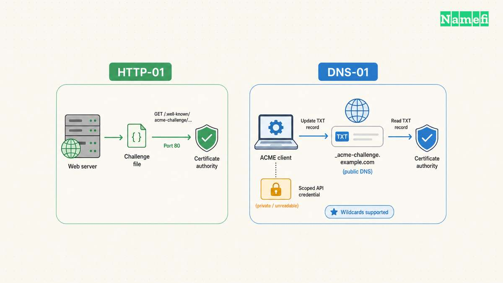

Install an SSL certificate through the service that handles HTTPS for your website. A managed host may issue and renew the certificate automatically. A server you administer needs a compatible certificate client and web-server configuration. [Let’s Encrypt distinguishes these two routes](#lets-encrypt-separates-hosted-and-self-managed-certificates).

Choose the route before buying a certificate or uploading a private key. The useful outcome is a working HTTPS website with a tested renewal process. A certificate file alone does not complete the installation.

## Your hosting arrangement determines who installs the certificate

Start in the account that serves the website. Your registrar, authoritative DNS provider, hosting provider, and reverse proxy may all be different services. Our [domain and hosting comparison](/en/blog/domain-vs-hosting/) explains the separate responsibilities.

| Website arrangement | Installation starting point |
| --- | --- |
| Managed website platform | The platform’s custom-domain and HTTPS instructions |
| Managed shared hosting | The host’s certificate panel or support documentation |
| Server you administer | An ACME client compatible with the server and operating system |
| Website behind a proxy | Both the public HTTPS endpoint and the proxy-to-origin configuration |

[Let’s Encrypt](/en/blog/lets-encrypt-certificate-setup/) says many hosting providers operate an ACME client for customers. The host may enable certificates automatically or expose an option. [Check the host’s documented workflow first](#lets-encrypt-separates-hosted-and-self-managed-certificates).

For a managed platform, add the exact hostname to the correct site. Complete the platform’s domain verification and DNS instructions. Wait for the platform to confirm certificate issuance, then test the hostname through HTTPS.

Do not upload a private key to an unrelated service or support ticket. Use the authorized account and the intended provider’s certificate controls. Keep a record of who manages renewal.

## You should prepare the destination before requesting validation

List every public hostname that needs HTTPS. For a hypothetical website, the list might include `example.com` and `www.example.com`. Do not assume a certificate request for one name automatically includes the other name.

Confirm that the host accepts the hostname and that DNS points toward the intended service. Check both IPv4 and IPv6 destinations when you publish both. An old destination can complicate diagnosis even when another destination works.

Back up the server configuration before permitting an installation tool to edit the configuration. Preserve a working recovery path through your hosting console or authorized server access.

Choose domain validation according to your environment. [Let’s Encrypt documents the challenge methods](#lets-encrypt-documents-domain-validation). The choice affects how issuance and future renewal will work.

| Validation method | Relevant boundary |
| --- | --- |
| HTTP-01 | Uses a challenge file and requires port 80 |
| DNS-01 | Uses a DNS TXT record and supports wildcard names |
| Provider-managed validation | Follows the provider’s custom-domain workflow |

These requirements do not justify disabling a firewall or exposing unrelated services. Configure only the documented challenge path and required service access.

## Certbot can configure a supported Nginx server

Use this route only when you administer the server. The following example assumes Nginx on a compatible Linux system with snap support. [EFF’s selected Certbot instructions](#eff-documents-the-nginx-workflow) contain the installation prerequisites and current commands.

Select your actual operating system and web server on Certbot’s instructions page. Do not reuse the Nginx route for an unrelated web server.

After completing the selected installation instructions, run `sudo certbot --nginx`. EFF documents this command as a way to obtain a certificate and let Certbot edit Nginx configuration. Review the selected hostnames and requested changes.

If you intend to manage configuration yourself, EFF documents `sudo certbot certonly --nginx`. That route obtains the certificate without the same automatic installation step. Certificate-only issuance leaves you responsible for completing the server configuration.

Test the resulting Nginx configuration with the server’s supported validation workflow before relying on a reload. Preserve the previous configuration until the application passes the checks below. Treat these as operational precautions, rather than a replacement for EFF’s installation instructions.

## DNS validation needs automation and limited credential access

DNS-01 publishes a value under `_acme-challenge` for the requested domain. Let’s Encrypt checks the TXT record to validate control. DNS-01 supports wildcard certificates and web servers that do not expose HTTP publicly. [The challenge documentation explains these capabilities](#lets-encrypt-documents-domain-validation).

A manual TXT record can help with a single validation, but repeated manual updates create an ongoing renewal task. Prefer a supported DNS integration when you need unattended renewal.

Let’s Encrypt warns that full DNS API credentials on a web server increase the impact of a compromise. Use narrowly scoped credentials where supported. The documentation also describes delegating challenge responses through CNAME or NS records.

Keep the public TXT value separate from the secret used to update DNS. Publish only the challenge value that the client requests. Do not place the provider’s API token in the DNS record.

Check the exact DNS-01 TXT owner name with [Namefi's DNS lookup](https://namefi.io/domain-tools/dns) after the client publishes the challenge. Compare the selected resolver's answer with the client's requested value. This check does not inspect the installed certificate, private key, or TLS chain.

## You should test the application and renewal after issuance

Open each intended hostname with `https://`. Inspect the certificate details for the hostname and validity. Test an actual content page and an important application action. A working homepage alone does not check every hostname or application path.

Then check the HTTP-to-HTTPS behavior. Confirm the destination address and watch for redirect loops. Review the browser console for failed resources and unexpected HTTP resource URLs.

For a Cloudflare proxy, verify the provider’s [origin-certificate requirements](/en/blog/cloudflare-ssl-setup/) separately. A working visitor-to-proxy connection does not complete your origin configuration review. Follow the proxy’s documented certificate validation mode.

For Certbot, run `sudo certbot renew --dry-run`. [EFF documents this renewal test and the scheduled renewal mechanism](#eff-documents-the-nginx-workflow). Inspect the installed timer or scheduled job, rather than assuming a successful manual issuance proves future renewal.

| Failure | First investigation |
| --- | --- |
| Validation fails | DNS destination and the selected challenge method |
| Browser shows a name mismatch | Requested hostname and selected server certificate |
| Some resources fail | Resource URLs and browser console errors |
| Renewal test fails | Client logs, challenge access, and DNS integration permissions |

Do not bypass certificate validation to hide an error. Record the exact error and repair the relevant configuration. Our [Chrome secure connection guide](/en/blog/fix-chrome-secure-connection-error/) provides a diagnosis path.

Assign an owner to certificate monitoring and renewal alerts. Finish the installation record with the hostnames, installation method, renewal mechanism, and last successful test. Those details make the next renewal failure easier to resolve.

## Sources and further reading

### Lets Encrypt separates hosted and self managed certificates

[Lets Encrypt separates hosted and self managed certificates](https://letsencrypt.org/getting-started/#:~:text=For%20many%20people%2C%20their%20hosting%20provider%20will%20get%20and%20manage%20certificates%20from%20Let%E2%80%99s%20Encrypt%20for%20them.), checked 2026-10-30.

### Lets Encrypt documents domain validation

[Lets Encrypt documents domain validation](https://letsencrypt.org/docs/challenge-types/#:~:text=The%20HTTP-01%20challenge%20can%20only%20be%20done%20on%20port%2080.), checked 2026-10-30.

### EFF documents the Nginx workflow

[EFF documents the Nginx workflow](https://certbot.eff.org/instructions?ws=nginx&os=snap#:~:text=get%20a%20certificate%20and%20have%20Certbot%20edit%20your%20nginx%20configuration%20automatically%20to%20serve%20it%2C%20turning%20on%20HTTPS%20access), checked 2026-10-30.
