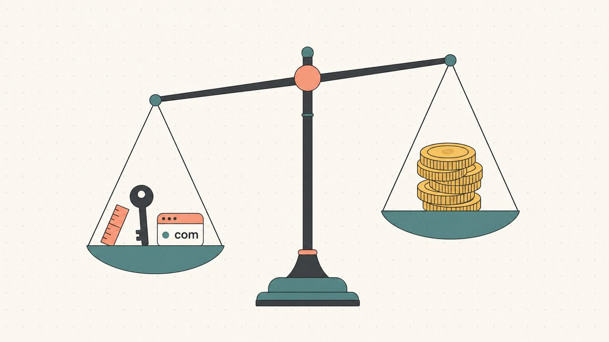
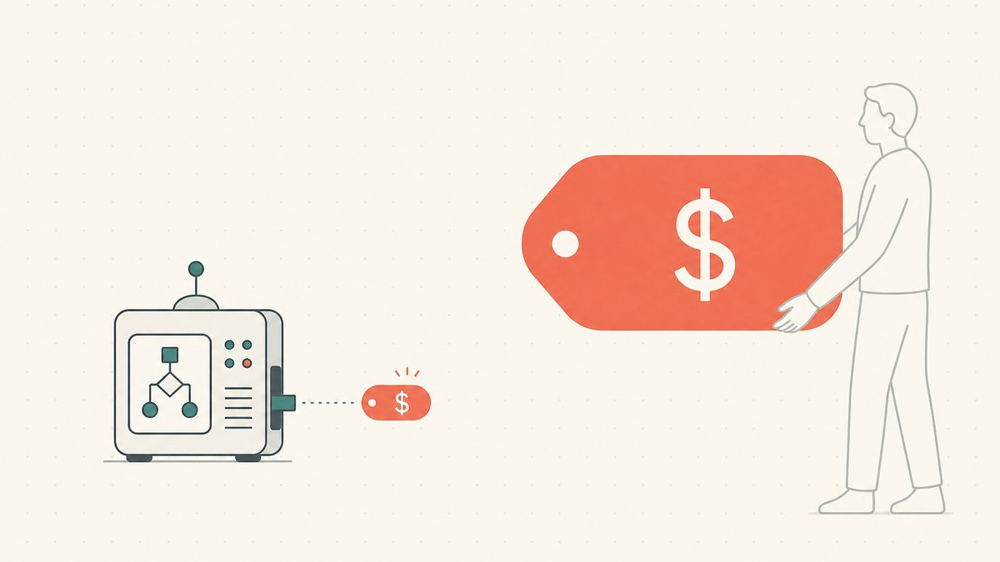

Estimate a domain's value by defining the buyer, reviewing comparable completed sales, and testing whether plausible buyers can use the name. Use an automated appraisal as one input, rather than a promised sale price. The official [GoDaddy appraisal tool](https://www.godaddy.com/domain-value-appraisal) offers a starting route, but its own documentation describes important limits. [Read the model's stated scope](#godaddy-explains-its-appraisal-model).

A useful estimate ends with a reasoned asking range and a review date. It also states what the estimate covers. A domain alone, a revenue-producing website, and an entire business need different evidence.

## The valuation question needs a buyer and a time horizon

Begin with the decision you need to make. Selling quickly to another domain investor differs from waiting for a business that wants the exact name. An asking price for a patient owner does not answer what a buyer will pay this week.

The following method is editorial advice for organizing evidence. It does not guarantee a buyer, a valuation, or an investment return. Keep assumptions visible so another person can challenge the estimate.

Write a one-sentence objective such as: “Estimate a negotiating range for the domain alone, aimed at a business buyer.” Add the intended holding period and the decision date. Avoid inventing a probability of sale merely to make the worksheet look precise.

For a business that already uses the domain, create a separate operational assessment. Rebranding, replacing addresses, and preserving customer recognition can matter to that owner. Those private costs do not automatically establish the domain's resale price to somebody else.

## Comparable sales need to match the asset being valued

Collect documented completed transactions with a traceable source. Record the domain, extension, reported price, currency, date, venue, and whether the transaction included a developed website. Keep asking prices in a separate list.

Do not choose a famous sale merely because the amount is large. Compare the name's structure, language, likely use, and extension. A short dictionary word and a long invented phrase can serve different buyers, even within the same extension.

Review outliers instead of averaging every reported result. Ask whether a transaction involved an unusual buyer, an existing relationship, or a wider asset package. If the public record cannot answer, mark the context as unknown.

The absence of close comparisons is useful information. It means the evidence supports less precision. State that limitation instead of manufacturing a narrow range from weak matches. The [comparable sales guide](/en/blog/how-to-read-comparable-domain-sales/) explains how to build a cleaner comparison set.

## A name needs a plausible use before a premium asking price

Write down what a buyer could do with the exact name. Name a product category, audience, language, or business function. Then identify evidence that businesses in that category actually use similar naming conventions.

Test spelling and pronunciation with people who have not seen the name. Ask those people to write the name after hearing it. Record actual confusion rather than replacing the test with personal enthusiasm.

Review whether the extension suits the intended use. Check eligibility and renewal terms for the exact name. A name that requires unusual explanation or an unexpectedly high recurring bill needs that limitation in the valuation record.

Do not turn a list of companies into a claim that those companies want the domain. A plausible buyer list is research. An inquiry or documented offer is a different kind of evidence. Label the distinction clearly.

Also flag potential naming conflicts for appropriate review before marketing the domain. Availability alone does not answer every question about a buyer's right to use a name. Avoid treating speculative outreach interest as legal clearance.

## Automated appraisals describe a model rather than a committed buyer

GoDaddy describes an appraisal model using machine learning and domain wording. GoDaddy also says the model performs best for common English-language domains. [Its FAQ identifies that language limitation](#godaddy-explains-its-appraisal-model).

GoDaddy does not include a developed website in its domain appraisal. The documented comparison uses domain sales without a developed website. [The provider states that boundary explicitly](#godaddy-excludes-developed-websites).

Use the tool for the exact domain and save the date, model result, and any comparable information the interface provides. Do not imply that this article ran a valuation. No live appraisal result appears here.

If two tools disagree, inspect the inputs and scope before averaging the outputs. Both tools might rely on assumptions that do not fit the name. Agreement can also reflect shared modeling limitations rather than independent buyer demand.

Keep the appraisal result on its own line in the worksheet. Put buyer inquiries, completed comparisons, and your own pricing decision on separate lines. That separation prevents an attractive automated number from silently becoming the whole argument.

## Holding and selling costs affect the decision to keep the domain

Obtain the exact renewal quote from the registrar. Add the renewals you expect during the chosen holding period. Include selling fees and any documented transaction costs in the scenario. Do not invent fees that the chosen marketplace has not quoted.

Use the [domain holding cost guide](/en/blog/how-much-is-a-domain-understanding-holding-cost/) to organize those charges. A gross sale amount and the amount remaining after costs are different values. State the currency and the included costs beside each result.

For a hypothetical worksheet, leave unavailable amounts marked unknown. An unknown renewal or commission is a missing input, rather than permission to use a convenient estimate. Revisit the keep-or-sell decision once the quote becomes available.

## The final valuation record should explain the asking range

Finish with a compact record: the exact domain, asset scope, buyer type, holding period, strongest comparisons, demand evidence, appraisal input, and known costs. Add the main limitation and the date for another review.

Choose an asking range that the evidence can defend. Set a separate minimum acceptable outcome if negotiations require one. The [end-user and reseller pricing guide](/en/blog/end-user-vs-reseller-domain-pricing/) helps distinguish those purposes.

The next action is to gather a small set of credible comparisons and the actual renewal quote. If the evidence remains thin, a broad range with clear uncertainty is more useful than an unsupported exact price.

## Sources and further reading

### GoDaddy explains its appraisal model

[GoDaddy explains its appraisal model](https://www.godaddy.com/domain-value-appraisal#:~:text=Does%20GoDaddy%20appraise%20domains). Checked 2026-10-30.

### GoDaddy excludes developed websites

[GoDaddy excludes developed websites](https://www.godaddy.com/domain-value-appraisal#:~:text=Does%20GoDaddy%20provide%20domain%20appraisals). Checked 2026-10-30.
