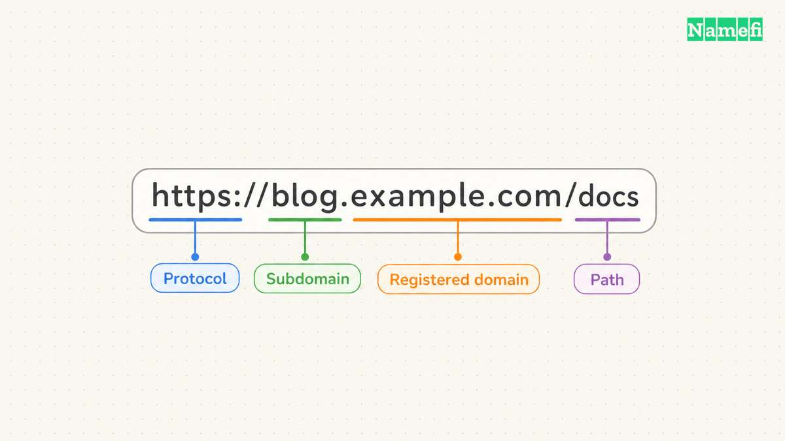
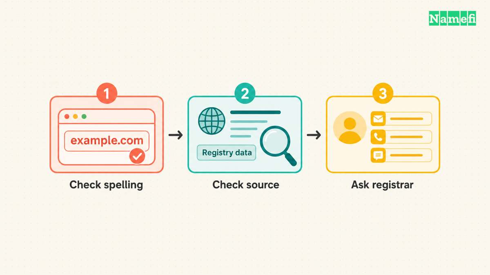
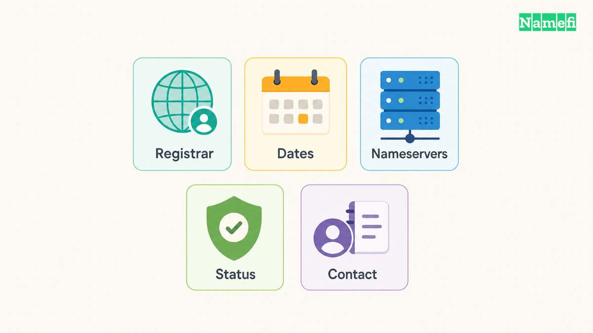
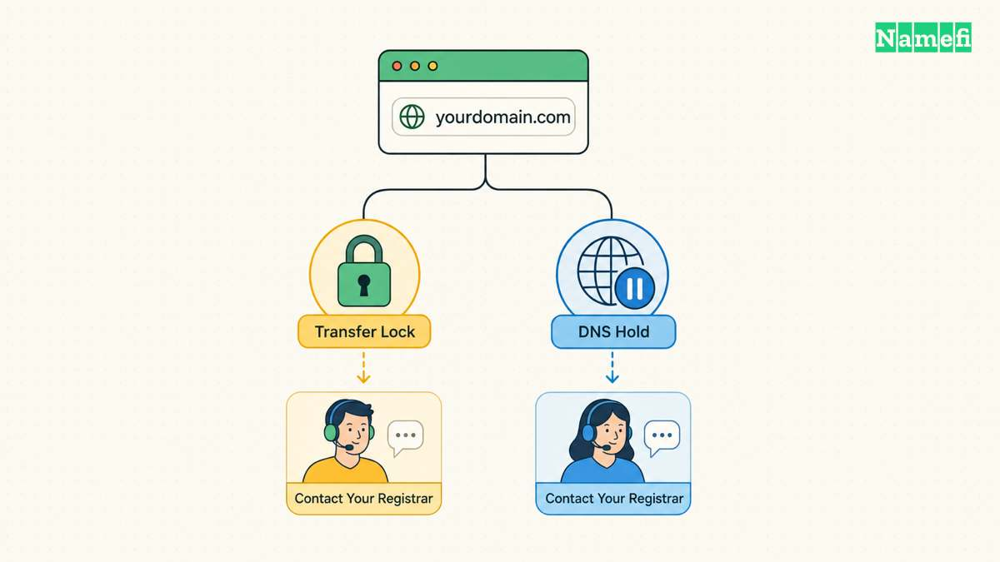
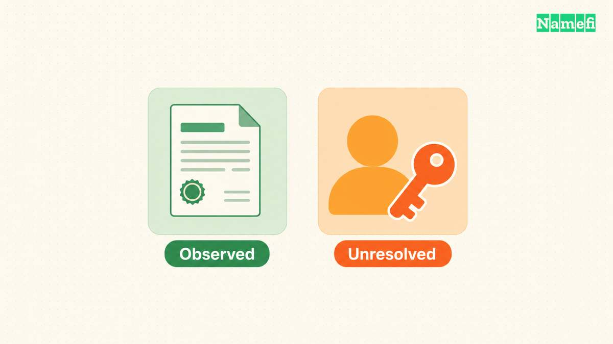

ICANN Lookup helps you inspect [current domain registration data](/en/blog/whois-and-rdap-public-data/). The result can identify the registrar, show registration events, and explain registration restrictions. The result cannot guarantee the identity of a seller or the availability of a domain.

Start at [ICANN Lookup](https://lookup.icann.org/en). Enter the registered domain, then read each field according to the question you need to answer. Keep the lookup date with your notes because the record can change.

A useful lookup separates three questions: who maintains the registration, what the registration record says, and what independent checks remain. Confusing those questions turns ordinary database fields into unsupported conclusions.

## A precise search starts with the registered domain

Use the domain spelling from your browser or registrar account. Remove the protocol, page path, query string, and email address prefix. For the hypothetical address `https://shop.example.com/orders?id=42`, start with `example.com`.

Keep `shop.example.com` separately if you need to investigate the website. A subdomain can identify a particular service, but the public registration normally concerns the registered domain. A registration lookup does not replace a DNS or website check.

ICANN describes its tool as a [free browser-based RDAP client](https://www.icann.org/en/contracted-parties/registry-operators/registration-data-access-protocol/information-for-rdap-users-31-08-2018-en#:~:text=free%20to%20use). RDAP means Registration Data Access Protocol. Readers may still encounter the familiar [WHOIS](/en/glossary/whois/) label elsewhere, but the protocol name matters when comparing tools and troubleshooting missing results.

Use the original spelling throughout your investigation. If a name includes international characters, preserve both the displayed spelling and the encoded spelling that the lookup returns. Do not replace a character with a visually similar character to make the search work.

Before pressing search, write one question. Examples include “Which registrar should receive the transfer request?” and “Which registration event supports the advertised age?” A focused question makes the output easier to interpret.

For your own domain, compare the result with your registrar dashboard. For another party's domain, treat the result as a public record, rather than proof of access to an account. A person can copy public registration data without controlling the domain.

If the tool returns no usable record, save the exact error or message. Repeat the search once after checking the spelling. Then investigate the relevant registry's public guidance, especially for a country-code extension.

Do not translate a failed request into “unregistered.” A missing result can reflect a spelling error, service failure, unsupported workflow, or an actual absence of registration data. Only the observed message belongs in your notes until another check resolves the uncertainty.

Avoid entering passwords, transfer authorization codes, or account recovery information. A public registration lookup needs a domain name. The public search field does not need the credentials that control a domain.

## A missing or incomplete result needs a separate check

A successful response can omit a contact field. A failed request can return no registration record at all. Record the difference.

| Observed result | Next check | Conclusion to avoid |
| --- | --- | --- |
| Record with redacted contacts | Read the notice and available contact route | The domain has no registrant |
| Error or timeout | Check spelling, preserve the message, and retry later | The domain is available |
| Different timestamps | Compare event labels and the objects containing those events | One timestamp must be false |
| Different registrar names | Check whether one name belongs to a reseller | An unfamiliar name proves an unauthorized transfer |

Treat the table as an investigation checklist, rather than a list of guaranteed causes. The public result alone may not explain the difference.

For missing nonpublic contact data, start with the [public lookup before requesting disclosure](https://www.icann.org/en/announcements/details/icann-update-launching-rdap-sunsetting-whois-27-01-2025-en). ICANN identifies RDRS and direct contact with the sponsoring registrar as request routes. A request does not guarantee disclosure.

## Registration fields answer different operational questions

Read the registrar field first when you need account help. The [registrar](/en/glossary/registrar/) manages the customer relationship for the registration. The [registry](/en/glossary/registry/) maintains the extension's registration infrastructure. Similar names in the result do not make the two roles interchangeable.

A reseller's brand may differ from the sponsoring registrar's name. Keep the name from the public record, then compare the billing emails and account records that you already trust. Do not move an account to an unfamiliar website merely because a search result displays a related company name.

Read dates together with their event labels. The [RDAP response standard](https://datatracker.ietf.org/doc/html/rfc9083#section-4.5) associates an event action with an event date. An update event and a registration event describe different actions.

The following reading checklist keeps a screenshot from becoming an ambiguous note:

| Field | Useful question | Conclusion to avoid |
| --- | --- | --- |
| Registrar | Which provider maintains the registration? | The provider also hosts the website |
| Registration event | When did the reported registration begin? | The current business began on that date |
| Last changed event | When did recorded information change? | The domain changed owners on that date |
| Expiration event | Which expiry timestamp does the record expose? | The domain will become available at that moment |
| Nameservers | Which servers appear in the registration? | Every DNS answer already matches the new configuration |
| Contact information | Which information does the public result expose? | The visible contact proves the seller's identity |

Use our [domain age guide](/en/blog/check-domain-age/) when a date affects a purchase decision. Registration history and website history answer separate questions. Save the event label before calculating an age.

Nameserver information also needs context. A registration result can help you identify a delegated DNS provider, but a website outage requires DNS queries and application checks. A nameserver label alone does not identify the cause of an outage.

If you recently changed providers, compare the registration result with the intended settings. Then follow a [nameserver change checklist](/en/blog/change-domain-nameservers/) to inspect the authoritative zone and live responses. Keep the lookup as one piece of evidence.

For a hypothetical handoff, record: “Lookup checked on October 21, 2026. The result lists Registrar A and two nameservers.” Add the actual provider names in your private operational record. Avoid writing “Registrar A owns the website.”

When an RDAP result includes nested contact or nameserver objects, check the object around a timestamp. The standard allows events on different objects. A contact object's update time should not become the domain's creation time.

## Status codes guide the next troubleshooting action

A domain can have several status codes at once. Read each code before changing settings. A transfer restriction can provide expected account protection, while a hold can affect DNS operation.

The interface may show spaced RDAP labels instead of compact EPP codes. ICANN's [status table provides the mapping](https://www.icann.org/resources/pages/epp-status-codes-2014-06-16-en#:~:text=RDAP%20Status%20Mapping).

| EPP code | RDAP label | Operation to investigate |
| --- | --- | --- |
| `clientTransferProhibited` | `client transfer prohibited` | Transfer to another registrar |
| `clientHold` | `client hold` | Domain activation in DNS |

Copy the displayed label exactly. Use the mapping to find the matching definition, rather than treating the spacing as a different restriction.

ICANN's [EPP status reference](https://www.icann.org/resources/pages/epp-status-codes-2014-06-16-en#:~:text=clientTransferProhibited) explains that `clientTransferProhibited` prevents a transfer to another registrar. The code does not by itself establish a website outage. If you intend to transfer your own domain, use your registrar's documented unlocking process.

The same reference explains that [`clientHold` prevents DNS activation](https://www.icann.org/resources/pages/epp-status-codes-2014-06-16-en#:~:text=clientHold). A hold calls for a registrar inquiry. Repeatedly changing an A record does not address a registration-level restriction.

Use a short sequence when the record and your intended action disagree:

1. Copy every displayed status code.
2. Identify the operation that failed.
3. Read the matching status definition.
4. Open the registrar through a trusted address.
5. Ask the registrar about the specific restriction.
6. Preserve the support response with your lookup note.

For example, a hypothetical owner wants to transfer a working domain. The result shows `clientTransferProhibited`. The practical question concerns transfer authorization, rather than web hosting. The owner should inspect the registrar's transfer controls.

A different owner sees a domain-wide outage and `clientHold`. The owner should ask the registrar why the hold exists. The public code describes an effect, but the public code does not establish the account-specific reason.

Avoid removing protections without a clear purpose. A restriction can prevent an unwanted account operation. If your website works and you do not intend to transfer, a transfer prohibition may require no action.

A status glossary also does not promise a purchase date. Domain deletion and restoration involve policy and account-specific circumstances. Ask the sponsoring registrar about an expiring domain that you already control. Treat aftermarket availability predictions separately.

Never pay an unsolicited “unlock fee” based solely on a lookup screenshot. Confirm the account, the provider, and the requested operation through a known channel. Public registration data gives scammers the same visible facts that you can read.

## A useful lookup report states the evidence gaps

A public lookup does not always expose a personal name, address, or direct email. Read any redaction notices and available contact mechanism. An absent contact field does not prove that the registrant has no identity or that the domain lacks an accountable registrar.

If privacy or proxy services complicate the result, review the [difference between domain privacy and proxy services](/en/blog/domain-privacy-vs-proxy/). Describe the service you can observe. Do not turn a hidden public field into a claim about misconduct.

For nonpublic registration information, consult ICANN's current [Registration Data Request Service guidance](https://www.icann.org/rdrs-en). Check eligibility, registrar participation, and the relevant request route before submitting anything. A public lookup and a nonpublic disclosure request serve different purposes.

A buyer needs additional evidence before paying a seller. Ask for a transaction process that verifies control and documents the agreed transfer. A public name, an old registration date, and a working website do not replace that process.

For an abuse investigation, preserve the suspicious URL separately from the registered domain. Record the time, relevant messages, and the exact conduct you observed. Then use the appropriate abuse contact or reporting channel. Avoid publishing personal information merely because a third-party search displays a field.

A compact lookup report can use five lines:

- Domain: the exact registered name you checked.
- Checked: the date and time of the lookup.
- Source: the tool and linked registration result, when available.
- Observed: the registrar, relevant events, status codes, and notices.
- Unresolved: identity, control, website history, or other unanswered questions.

Keep observations and conclusions on separate lines. “The record shows a registration event” states an observation. “The seller controls the account” requires different evidence. A clear report prevents the next reviewer from inheriting a stronger claim than the record supports.

For your own registration, retain the report alongside billing records and recovery instructions. Keep credentials in your approved password manager. Public registration data belongs in an operational note, while authorization codes and recovery secrets require separate protection.

Use ICANN Lookup as a starting point for a specific question. Follow the registrar field for account issues, event labels for registration dates, and status definitions for restrictions. Stop where the evidence stops.

## These sources support the article

Sources checked on October 21, 2026. The examples describe hypothetical workflows, rather than observed domain records.

- [ICANN: Information for RDAP Users](https://www.icann.org/en/contracted-parties/registry-operators/registration-data-access-protocol/information-for-rdap-users-31-08-2018-en). The lookup-client section documents the free browser tool.
- [RFC 9083, sections 4.5 and 5.3](https://datatracker.ietf.org/doc/html/rfc9083#section-4.5). The standard defines events and domain objects.
- [ICANN: EPP status codes](https://www.icann.org/resources/pages/epp-status-codes-2014-06-16-en). The client status table distinguishes transfer restrictions and holds.
- [ICANN: RDAP transition announcement](https://www.icann.org/en/announcements/details/icann-update-launching-rdap-sunsetting-whois-27-01-2025-en). The announcement separates public lookup from nonpublic data requests.
- [ICANN: Registration Data Request Service](https://www.icann.org/rdrs-en). Consult the current request guidance for nonpublic data.
