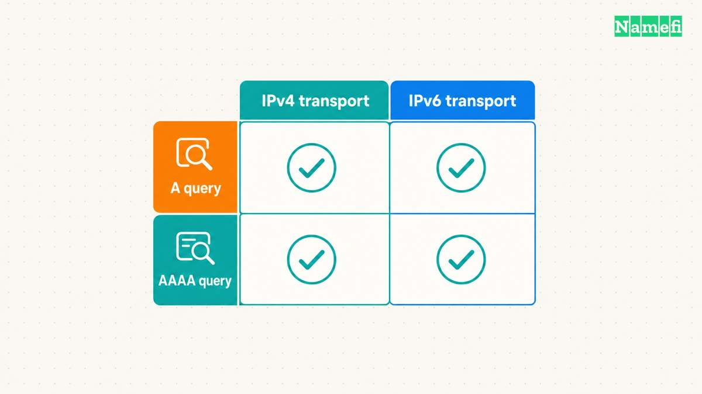
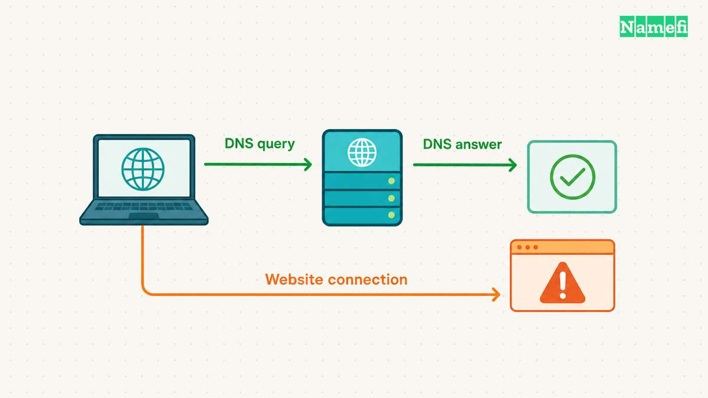

**An IPv6 DNS server address identifies a resolver that a client can contact over IPv6.** The address does not restrict the resolver to IPv6 answers. A client can request A or AAAA records over either IPv4 or IPv6. [RFC 3596 explicitly separates query transport from record content](https://www.rfc-editor.org/rfc/rfc3596.html#section-1).

For a quick distinction, `dig -6 @2001:4860:4860::8888 example.com. A` requests IPv4 address records through an IPv6 resolver connection. Conversely, `dig -4 @8.8.8.8 example.com. AAAA` requests IPv6 address records through an IPv4 connection. These commands are examples, not reported test results.

Use this guide when choosing an IPv6 resolver address or diagnosing a failing DNS connection. Use the [AAAA record guide](/en/blog/aaaa-record-explained/) when publishing your website's IPv6 destination.

## The resolver connection and the requested record answer different questions

Three choices matter during diagnosis. The client chooses a connection to a [DNS resolver](/en/glossary/dns-resolver/). The query specifies a [DNS record type](/en/glossary/dns-record-types/). Later, an application establishes its own connection to a destination.

| Choice | Example | What the choice establishes |
| --- | --- | --- |
| Resolver transport | IPv6 to Google's resolver | How the DNS query reaches that resolver |
| Requested record | AAAA for `example.com` | Which address records the client requests |
| Application connection | A browser connection to a website | Whether the application reaches the destination |

An AAAA answer alone proves neither IPv6 DNS transport nor working IPv6 access to the website. Likewise, an A answer over IPv6 does not mean that the DNS connection used IPv4. Keep the connection and the returned address separate when recording results.

The client's connection also does not determine every upstream connection. A recursive resolver can contact authoritative servers through different available transports. [RFC 3901 describes how an unreachable transport in the referral chain can prevent resolution](https://www.rfc-editor.org/rfc/rfc3901.html#section-1). Contacting a recursive resolver through IPv6 therefore does not prove an entirely IPv6 resolution chain.

IPv6 also does not automatically encrypt DNS. Traditional DNS over UDP or TCP lacks transport encryption. [Google documents DoH and DoT as separate encrypted transports](https://developers.google.com/speed/public-dns/docs/secure-transports). The example `dig` commands in this article do not enable either encrypted transport.

## Public resolver operators publish separate IPv6 addresses

The following addresses come from the operators' documentation, checked on October 21, 2026. The table identifies specific service variants. The table does not rank speed or guarantee reachability from a particular network.

| Service | IPv6 resolver addresses | Corresponding IPv4 addresses |
| --- | --- | --- |
| [Google Public DNS](https://developers.google.com/speed/public-dns/docs/using#google_public_dns_ip_addresses) | `2001:4860:4860::8888`, `2001:4860:4860::8844` | `8.8.8.8`, `8.8.4.4` |
| [Cloudflare standard, without content filtering](https://developers.cloudflare.com/1.1.1.1/ip-addresses/) | `2606:4700:4700::1111`, `2606:4700:4700::1001` | `1.1.1.1`, `1.0.0.1` |
| [Quad9 Secure, with threat blocking](https://docs.quad9.net/services/#9999-secure) | `2620:fe::fe`, `2620:fe::9` | `9.9.9.9`, `149.112.112.112` |

Copy both IPv6 addresses from the chosen service's official instructions. Preserve the complete address, including every colon. Cloudflare and Quad9 publish other variants with different addresses and policies. An address from a neighboring table row can select a different service.

Choose the operator and policy before changing settings. The [public resolver guide](/en/blog/choose-public-dns-resolver/) compares privacy, filtering, validation, and recovery requirements. An IPv6 address does not replace that decision.

Before changing a device, save the existing automatic or manual configuration. [Google recommends preserving the previous DNS settings](https://developers.google.com/speed/public-dns/docs/using#important_before_you_start). Follow the current device documentation because fields and configuration scope differ across platforms.

Test direct queries before changing the network default. A public IPv6 resolver needs a usable IPv6 path from the testing device. Entering a resolver address cannot supply missing IPv6 connectivity. On a managed network, preserve required private DNS behavior and involve the network administrator.

## Paired queries isolate failures in the resolver connection

Start with one provider and one public hostname. Keep the hostname and query type unchanged while comparing transports. The [BIND dig manual documents server selection, record types, and the `-4` and `-6` options](https://bind9.readthedocs.io/en/latest/manpages.html#dig-dns-lookup-utility).

Run `dig -4 @8.8.8.8 example.com. A`, then `dig -6 @2001:4860:4860::8888 example.com. A`. Repeat with `AAAA` instead of `A`. Each command directly selects a resolver without changing stored DNS settings. The four queries test transport and record type independently.

Keep the complete output. Record the command, time, response status, answer section, and reported server. Avoid `+short` during the first diagnosis because compact output omits context.

Use the following table to decide which boundary needs investigation. The table gives diagnostic leads, not confirmed causes.

| Observation | Next investigation |
| --- | --- |
| IPv4 responds, but IPv6 times out for both record types | Check the IPv6 route, resolver address, and network access rules |
| Both transports return an AAAA answer, but the website fails | Check the website connection separately |
| The resolver returns `NXDOMAIN` | Check the exact queried name |
| A response lacks the requested record type | Inspect the full answer and authoritative configuration |
| Direct queries work, but the application fails | Inspect the application's actual resolver path |

A timeout differs from a negative DNS response. `NXDOMAIN` indicates a name error. A response can also report an existing name without data for the requested type. [RFC 2308 distinguishes name errors from missing-type answers](https://www.rfc-editor.org/rfc/rfc2308.html#section-2). A missing AAAA answer does not establish a broken IPv6 connection to the resolver.

For an IPv6 timeout, check the device's assigned IPv6 connectivity and the route toward the exact resolver address. Review relevant firewall or VPN rules with the network operator. Do not publish or delete website AAAA records to repair a client-to-resolver connection.

If direct queries succeed while a browser fails, identify the browser's configured resolver and encrypted-DNS mode. The direct command proves only the tested command's path. The [DoH and DoT guide](/en/blog/dns-over-https-vs-dns-over-tls/) explains application scope and fallback checks.

If both DNS paths work while the website fails, continue with separate application tests in the [AAAA record guide](/en/blog/aaaa-record-explained/). A correct DNS answer does not configure the website's listener, certificate, or routing.

For a [self-hosted resolver](/en/blog/run-your-own-dns-resolver/), distinguish the client's IPv6 listener from the resolver's upstream connectivity. A local listener can answer cached queries while an upstream problem remains. Preserve the query evidence and inspect the operating configuration before changing several settings together.

Finish with a short incident record: resolver address, transport, queried name, record type, result, and next failed boundary. The record should explain the observed failure without treating every IPv6 symptom as an AAAA problem.

## These sources support the guide

All sources were opened on October 21, 2026, America/Los_Angeles. Commands describe checks to perform, not measurements from a particular network.

- [RFC 3596, section 1](https://www.rfc-editor.org/rfc/rfc3596.html#section-1): query transport and record content remain independent.
- [RFC 3901, sections 1 and 4](https://www.rfc-editor.org/rfc/rfc3901.html): referral reachability and mixed-transport DNS operations.
- [Google Public DNS setup](https://developers.google.com/speed/public-dns/docs/using): resolver addresses and configuration recovery.
- [Cloudflare resolver addresses](https://developers.cloudflare.com/1.1.1.1/ip-addresses/): standard and filtered service variants.
- [Quad9 services](https://docs.quad9.net/services/): service variants and IPv6 endpoints.
- [BIND dig manual](https://bind9.readthedocs.io/en/latest/manpages.html#dig-dns-lookup-utility): query syntax and transport options.
- [Google secure transports](https://developers.google.com/speed/public-dns/docs/secure-transports): encryption requires a separate transport choice.
- [RFC 2308, section 2](https://www.rfc-editor.org/rfc/rfc2308.html#section-2): negative response interpretation.
