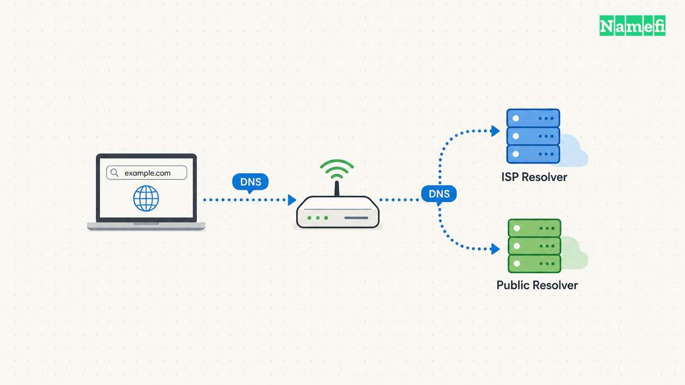
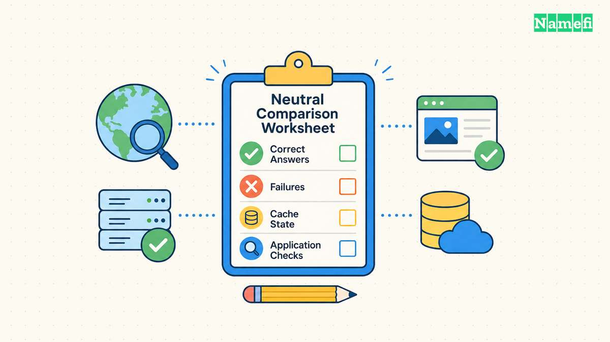

ISP DNS uses a resolver supplied through your internet provider's network configuration. Public DNS uses a resolver available from another operator. Neither category guarantees the fastest or most suitable result for every connection.

Keep the current resolver if the current resolver meets your needs. Consider a public resolver when you can identify a specific goal, such as a different privacy policy, a supported encrypted connection, or more reliable answers on your network.

Test one device before changing a router. Preserve the original settings, compare useful tasks, and check private network names. A DNS change should solve an observed problem without creating a larger one.

## Resolver choice changes the lookup operator and its dependencies

A [DNS resolver](/en/glossary/dns-resolver/) obtains answers for the names your device requests. The resolver may answer from a cache or perform further queries. Your device's visible DNS address can also belong to a router that [forwards requests elsewhere](/en/blog/run-your-own-dns-resolver/).

Google describes a public DNS change as [changing the DNS operator from the ISP to Google](https://developers.google.com/speed/public-dns/docs/using#configure_your_network_settings_to_use_google_public_dns). That example identifies a change in who handles queries. The change does not transfer domain registration or modify the authoritative DNS records for your website.

Start by identifying the active path. Record the device's DNS settings, router settings, browser secure-DNS settings, and any VPN. A comparison can fail before the first measurement if an application uses a different resolver from the resolver you intended to test.

Ask the network administrator before changing a managed device. Corporate and school networks can depend on internal DNS behavior. An outside resolver cannot automatically reproduce a private service's naming configuration.

For a hypothetical home office, the router might supply its own local address as the DNS server. The router might then forward queries to an ISP resolver. A device setting that displays the router address does not identify every upstream dependency.

Use a small comparison worksheet:

| Question | ISP resolver | Public resolver |
| --- | --- | --- |
| Which operator handles requests? | Confirm through ISP or router information | Confirm through provider documentation |
| Which privacy terms apply? | Read the current ISP terms | Read the current resolver policy |
| Which private names must work? | Test the current network behavior | Test before changing all devices |
| Which filtering policy applies? | Confirm the plan and network settings | Confirm the exact service variant |
| Which encrypted transport works? | Check provider and device support | Check endpoint and device support |
| How can you revert? | Save the existing automatic or manual setting | Restore the recorded baseline |

A resolver comparison differs from a list of famous addresses. For provider-selection criteria, see our [public DNS resolver guide](/en/blog/choose-public-dns-resolver/). The task here is to compare a specific replacement against the service your connection currently uses.

Record the reason for the experiment in one sentence. “The current resolver times out on several ordinary names” gives the test a concrete target. “Public DNS must be better” does not.

## ISP equipment determines where you can change the resolver

A search for “Spectrum DNS servers,” “Comcast DNS,” “Xfinity DNS,” or “AT&T DNS servers” can hide two different tasks.
Some readers need the current ISP addresses. Other readers want to replace the ISP resolver.
Identify the task before copying addresses from a list.

For the current ISP configuration, begin with automatic network settings and the provider's documentation for your equipment.
Record the device, gateway model, and active connection.
A router's local address can represent a forwarding service rather than the final recursive resolver.
Do not treat an address from another subscriber's setup as a verified setting for your connection.

For a replacement, check whether the gateway supports an editable DNS setting.
Xfinity's [advanced-settings documentation](https://www.xfinity.com/support/articles/xfi-advanced-settings) describes its DNS Server entry as a way to view the home network's DNS configuration.
A visible DNS page therefore does not establish that the gateway offers a replacement control.
Check the exact model's supported controls before planning a router-wide change.

Start with a device-level comparison when the operating system supports the change.
Google's [setup guide](https://developers.google.com/speed/public-dns/docs/using) supplies separate device and router procedures.
The guide lists `8.8.8.8` and `8.8.4.4` as Google's IPv4 resolver addresses.
Those addresses belong to Google Public DNS. Those addresses are not Spectrum, Comcast, or AT&T resolver addresses.
A manual address setting alone does not establish that the device uses encrypted DNS.

Use the provider's current instructions if the task requires ISP-specific addresses or gateway controls.
Keep a working automatic configuration until a test demonstrates a reason to change the configuration.
This article compares resolver behavior. This article does not maintain an ISP address directory.

## Privacy depends on the operator and the actual transport

Changing the DNS operator changes a trust relationship. The resolver receives queries that reach the resolver. An encrypted connection protects part of the route, but the resolver still needs to process the query.

The IETF's [DNS privacy analysis](https://datatracker.ietf.org/doc/html/rfc9076#section-6.1.4.1) explicitly distinguishes transport protection from the information visible to the recursive resolver. Do not describe a public resolver or encrypted DNS as complete anonymity.

Read the current policy for each candidate. Look for the data collected, retention periods, exceptions, purposes, and third-party handling. A marketing phrase such as “private DNS” does not answer those questions by itself.

For example, Google's [Public DNS privacy policy](https://developers.google.com/speed/public-dns/privacy) describes temporary and permanent logging practices. The policy also states limits on advertising use. Treat those statements as provider policy, rather than evidence that every public resolver follows the same rules.

Keep the provider and the protocol on separate lines in your notes. A device can send ordinary unencrypted queries to a public resolver. A device can also use an encrypted DNS service when the operator and client support the required configuration.

Cloudflare's [encryption documentation](https://developers.cloudflare.com/1.1.1.1/encryption/) lists its DNS over HTTPS and DNS over TLS options. The existence of an endpoint does not prove that your device uses that endpoint. Verify the active configuration after changing settings.

Our [DoH and DoT comparison](/en/blog/dns-over-https-vs-dns-over-tls/) explains the transport distinction. Choose a method your device and network support. Avoid changing several privacy controls at once because several changes make a failure harder to isolate.

Filtering adds another policy choice. A service can intentionally block certain categories or threat-related names. Confirm the exact service variant before testing, especially when a provider offers several endpoints with different behavior.

Do not assume two addresses from different operators form a predictable privacy policy. A device may select among configured servers according to its implementation. Both selected operators need acceptable policies and compatible behavior.

For a household, record whether the resolver supports the intended parental or security controls. For a business, record whether the change fits the network's approved policy. A technically successful lookup can still violate the intended operational requirements.

## A local test compares reliability and useful tasks before speed claims

A public benchmark cannot tell you exactly what happens on your connection. Routing, cache state, record type, and the queried name affect a lookup. Google's [performance explanation](https://developers.google.com/speed/public-dns/docs/performance) discusses network latency and cache misses as separate contributors.

Use the same device and connection for both candidates. Avoid comparing the ISP resolver on home Wi-Fi with a public resolver on mobile data. Keep background network conditions reasonably similar and write down the test time.

Choose a small set of names that represent your work. Include ordinary public sites and any private names you need. Use names you are authorized to query, and avoid unnecessary bulk traffic.

Test the current resolver first. Record successful answers, timeouts, and error codes. A speed number without answer correctness gives an incomplete result. A resolver that responds quickly with an unwanted block does not meet the same requirement as a resolver that returns the intended answer.

Then test the candidate directly. Our [nslookup guide](/en/blog/nslookup-specific-dns-server/) explains how to query a specified server. Direct queries help compare a resolver without changing the entire device's network configuration.

Use repeated observations rather than a single attractive result. Keep the first query separate from later queries when cache state matters. Describe the results as observations from your test, rather than a universal ranking.

A practical log can contain the following fields:

- Resolver address or documented endpoint.
- Name and record type.
- Checking date, time, and network.
- Response code and returned answer.
- Reported query duration, when the tool provides a duration.
- Relevant application outcome.

Do not invent a precision that the test does not support. A few manual lookups can reveal a reproducible failure. A few manual lookups cannot establish a provider's global reliability or future performance.

After direct queries, check the actual user tasks. Open the websites, connect to the VPN, reach the printer by name, and use the applications that matter. Preserve an error message if a task fails.

Compare application behavior separately from DNS timing. Website loading involves more than name resolution. A faster DNS response does not guarantee a faster download, lower game latency, or a more responsive application.

If both resolvers behave well and the observed timing difference is small, prefer the configuration with the policy and maintenance burden you accept. A change needs a practical benefit, rather than a winning number from one query.

## A reversible rollout protects local services and future troubleshooting

Save the original DNS configuration before editing anything. Google's [setup instructions](https://developers.google.com/speed/public-dns/docs/using#important_before_you_start) explicitly recommend preserving the current settings so the user can revert. Record whether the original mode was automatic, rather than copying only a visible address.

Change one device first. Use the operating system's supported network settings instead of editing generated files without understanding the network manager. Follow the current device documentation for encrypted-DNS configuration.

Check both IPv4 and IPv6 behavior when the network uses both families. An IPv4-only edit can leave another resolver path active. Keep browser and VPN settings in the test record because those settings can change which queries follow the system path.

Use a short rollout checklist:

1. Save the original configuration and network name.
2. Change the test device through supported settings.
3. Verify the intended resolver path.
4. Repeat public and private name checks.
5. Test normal work tasks.
6. Disconnect and reconnect the network.
7. Confirm that the settings remain correct.
8. Restore the baseline if required tasks fail.

If only private names fail, preserve the evidence before reverting. The network may require an internal resolver or a managed split-DNS configuration. Ask the responsible administrator instead of trying random public addresses.

If every public query fails, inspect the endpoint and connectivity. A mistyped server address or unsupported encrypted transport can prevent resolution. Revert first when the device needs immediate connectivity, then troubleshoot the candidate separately.

After a successful device test, consider whether a router-wide change is appropriate. A router change affects other people and devices. Printers, televisions, work devices, and guest devices may have different requirements from your test laptop.

Document the chosen addresses, operator, reason, and rollback method. Our [primary and secondary DNS guide](/en/blog/primary-secondary-dns/) explains why a second address is not always a strict standby. Prefer a coherent configuration over an unexplained mixture of providers.

Revisit the decision when the connection, device, VPN, or privacy policy changes. A resolver that works well today can require a fresh comparison on a different network. Keep the test small and repeatable.

Choose between ISP DNS and public DNS through a local, reversible comparison. Check correct answers, required services, operator policy, and actual encrypted transport. Keep the change only when the observed result meets your needs.

## These sources support the article

Sources checked on October 21, 2026. The article contains no measured resolver rankings or promised performance gains.

- [Xfinity: Changing advanced WiFi settings](https://www.xfinity.com/support/articles/xfi-advanced-settings). The DNS Server entry documents viewing the current configuration.
- [Google Public DNS: Get started](https://developers.google.com/speed/public-dns/docs/using#important_before_you_start). The instructions explain operator changes and rollback preparation.
- [Google Public DNS: Privacy](https://developers.google.com/speed/public-dns/privacy). The policy describes Google's collection and retention practices.
- [Google Public DNS: Performance benefits](https://developers.google.com/speed/public-dns/docs/performance). The explanation discusses network latency and caching.
- [Cloudflare: Encrypt DNS traffic](https://developers.cloudflare.com/1.1.1.1/encryption/). The documentation links the supported encrypted transport options.
- [RFC 9076, sections 5 and 6](https://datatracker.ietf.org/doc/html/rfc9076#section-5). The analysis distinguishes network observers and resolver visibility.
