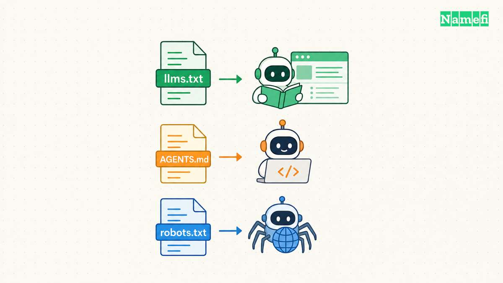
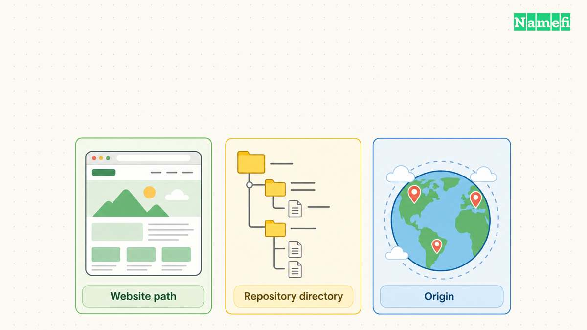
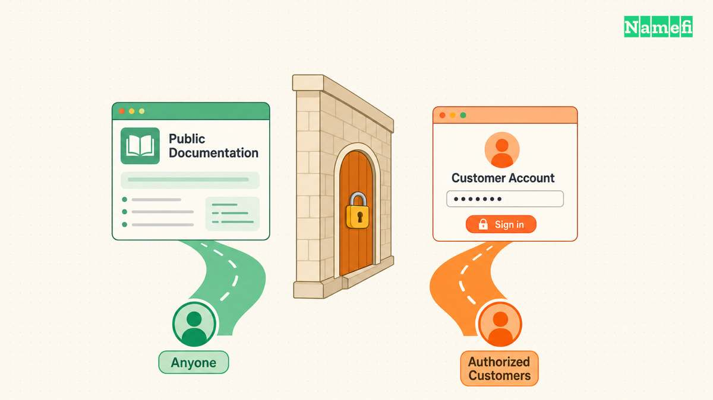
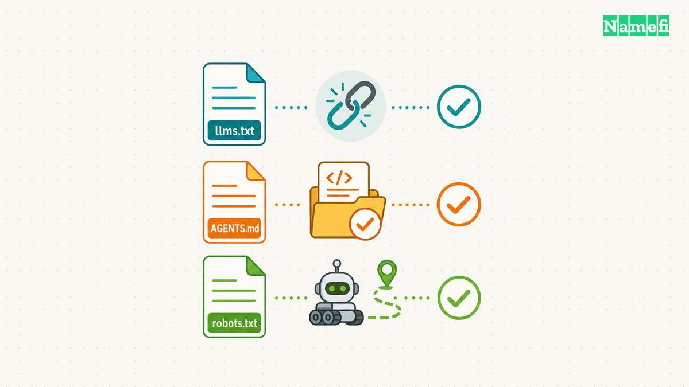

Use llms.txt for a website reading guide, AGENTS.md for project instructions, and robots.txt for crawler rules. None of those files replaces server-side access control. The useful comparison concerns who reads each file, where each file applies, and which system enforces the resulting behavior.

A domain business can need all three files. Public API documentation can expose a concise reading index. A repository can explain its build process. A website can tell cooperating crawlers which paths to avoid. Those functions should remain separate during implementation and review.

This guide focuses on operational boundaries. The [llms.txt introduction](/en/blog/llms-txt/) covers the file's basic format and a documentation example. The comparison below explains how to avoid turning [discovery guidance](/en/blog/dns-records-for-ai-agent-authority/) into an unsupported claim about permissions or search visibility.

## The three files answer different operational questions

The [llms.txt proposal describes a Markdown guide that helps agents use a website](https://llmstxt.org/#proposal). The guide can link to more detailed material. Treat the proposal as a documentation convention, rather than proof that every agent automatically retrieves the file.

The [AGENTS.md project describes a predictable place for coding-agent context and instructions](https://agents.md/). A repository can use the file to explain build commands, tests, conventions, and project-specific requirements. Actual loading behavior depends on the agent application.

The [Robots Exclusion Protocol defines crawler rules](https://www.rfc-editor.org/rfc/rfc9309.html#section-1). The protocol explicitly states that those rules do not provide access authorization. A crawler that ignores the rules can still request a public URL unless another control blocks the request.

| File | Primary question | Typical location | Important limit |
| --- | --- | --- | --- |
| llms.txt | Which documentation should an agent read? | Website root or documentation path | Does not grant API access |
| AGENTS.md | How should a coding agent work in this project? | Repository root or relevant subdirectory | Depends on client instruction handling |
| robots.txt | Which paths should a cooperating crawler request? | Origin root | Does not secure private content |

Consider a hypothetical registrar with public documentation at docs.example.com and an application at app.example.com. The documentation reading guide can help an agent locate an API reference. The application must still authenticate and authorize registration requests.

A repository instruction can tell a development agent to run validation before committing a documentation change. That instruction does not authorize the agent to purchase a domain from the registrar. The purchasing authority comes from the customer and the system that enforces the transaction.

A crawler rule can discourage crawling an expensive generated page. That rule does not make the generated page confidential. Private customer orders need authenticated access regardless of which files the website publishes.

Start a review by writing the desired outcome in one sentence. “Help agents find our renewal API documentation” points toward documentation discovery. “Prevent anonymous access to customer orders” points toward application authorization. The distinction prevents a well-formed file from solving the wrong problem.

## File scope follows the host and the client's documented rules

A filename alone does not establish universal scope. Check the host, path, and consuming application. Keep the actual discovery mechanism in the implementation record so a reviewer can reproduce the result.

The current [llms.txt proposal permits files at the root or a subpath](https://llmstxt.org/#format). The proposal describes coverage below that path and selection of the most specific applicable file. A documentation team should still verify whether the intended client implements that behavior.

For a hypothetical documentation site, docs.example.com/llms.txt can describe the documentation site. A separate example.com/llms.txt can describe the main website. Avoid assuming that one file controls unrelated hosts or discovers every subdomain automatically.

The proposal also describes discovery through HTML links or HTTP Link headers. [The discovery guidance uses alternate Markdown representations and describedby links](https://llmstxt.org/#proposal). A team can inspect those links directly when testing the documentation path.

AGENTS.md uses repository structure rather than website origin as its usual context. The project describes nested files for subprojects. [The project's usage guidance discusses the closest file in the directory tree](https://agents.md/#how-to-use-agents-md). Check the chosen agent's implementation before treating that description as identical across products.

A monorepo might place general rules at the root and package-specific instructions beside a service. Keep global rules short enough to remain useful on every task. Put detailed operational references beside the files or systems that need those references.

For robots.txt, [RFC 9309 specifies the top-level robots.txt path](https://www.rfc-editor.org/rfc/rfc9309.html#section-2.3). The protocol also defines request handling and caching behavior. Test the exact origin that serves the content instead of checking a convenient neighboring hostname.

A staging host deserves its own review. A production file does not establish the staging host's access policy. Use authentication for private staging content, and inspect the staging response independently.

Record the application version during a reproducible test. A client update can change which instruction files the client discovers or how the client handles nested instructions. A successful test establishes observed behavior for that client and configuration.

## Documentation guidance does not replace transaction or privacy controls

Keep public reading material separate from secrets. An llms.txt guide can link to an authentication overview, but the guide should not contain a live API token. AGENTS.md can identify the approved credential mechanism without embedding credential values.

For the hypothetical registrar, publish the request format and authentication requirements in public documentation. Keep credentials in the customer's approved credential store. Require the API to check the customer's authority before registering a domain or changing DNS records.

A documentation sentence such as “agents may purchase domains” cannot define the authority of every customer. The service must determine which customer, account, domain, payment method, and operation the request concerns. The [agent permission guide](/en/blog/delegate-domain-agent-permissions/) describes that distinction in more detail.

A repository file also cannot safely decide every authorization question in advance. Project instructions can explain a workflow. A real purchase or deployment must still satisfy the user's current authorization and the applicable enforcing controls.

Treat remotely fetched text as content from the source that supplied the text. A page can describe an API, but a page should not silently rewrite the customer's spending policy. Keep instructions from trusted project configuration separate from untrusted product listings and fetched pages.

Crawler rules require a similar distinction. [Google explains that a URL blocked by robots.txt can still appear in search results](https://developers.google.com/search/docs/crawling-indexing/robots/intro#understand-the-limitations-of-a-robotstxt-file). Google also states that crawler cooperation determines whether rules affect requests. Neither property supplies confidentiality.

If a page should remain private, require authentication and appropriate authorization. If a public page should stay out of Google Search, review the supported indexing controls for that content. Do not use a crawler restriction as a substitute for the indexing decision.

The same separation applies to AI visibility. Publishing a reading guide demonstrates that the guide exists. A successful agent retrieval demonstrates one retrieval. Neither observation proves a ranking improvement, a recommendation advantage, or universal model-training treatment.

Keep claims narrow in customer-facing documentation. Describe the files as navigation, project guidance, and crawler rules. Describe actual authentication, authorization, and indexing controls in their own terms.

## A small test matrix reveals whether each file serves its purpose

Test one outcome at a time. Save the host, URL or repository path, response status, relevant content, client version, and observation time. Those fields let another person reproduce the review without relying on a vague statement that agent support works.

For llms.txt, open the guide anonymously if the guide targets public documentation. Follow the links a reader actually needs. Confirm that the linked content matches the current product and explains authentication without exposing secrets.

Check the Markdown alternatives separately when the website advertises those alternatives. A correct index with broken destination links creates an incomplete reading path. A clean Markdown page that describes an obsolete endpoint creates an accuracy problem rather than a discovery problem.

For AGENTS.md, start the intended coding agent in a controlled repository. Ask the agent to summarize the applicable instructions and perform a harmless documented check. Confirm the result through the actual files and command output.

Do not insert a destructive instruction to test compliance. A harmless formatting rule or a documented read-only command can establish loading behavior. Review a nested directory separately if the repository relies on nested instructions.

For robots.txt, fetch the file from the exact origin. Review the applicable user-agent group and intended path rules. Use the crawler's documented testing tools where available, and inspect real crawl observations when the business needs production evidence.

A practical maintenance checklist follows:

1. Assign an owner to each published file.
2. Record the intended reader and supported client.
3. Check the actual host and path boundaries.
4. Verify linked documentation after API changes.
5. Keep secrets and customer data outside public files.
6. Test crawler rules separately from indexing controls.
7. Record observed behavior without promising universal adoption.
8. Review client changes before relying on instruction precedence.

Choose maintenance triggers that match the content. API changes should trigger a documentation-guide review. Build changes should trigger a repository-instruction review. Website restructuring should trigger a crawler-rule review.

The three files work well when each file has a precise responsibility. A concise reading guide helps discovery, clear project instructions help development, and accurate crawler rules guide cooperative access. Verified application controls continue to decide who may perform protected operations.

## These sources support the article

- [llms.txt: The /llms.txt file, v2](https://llmstxt.org/). Proposal, format, scope, and discovery guidance, modified August 10, 2026. Fetched 2026-10-21.
- [AGENTS.md project](https://agents.md/). Purpose and repository usage guidance. Fetched 2026-10-21.
- [IETF: RFC 9309](https://www.rfc-editor.org/rfc/rfc9309.html). Sections 1 and 2.3 cover authorization limits and access location. Fetched 2026-10-21.
- [Google Search Central: Introduction to robots.txt](https://developers.google.com/search/docs/crawling-indexing/robots/intro). Crawling, indexing, and cooperation limits. Fetched 2026-10-21.
