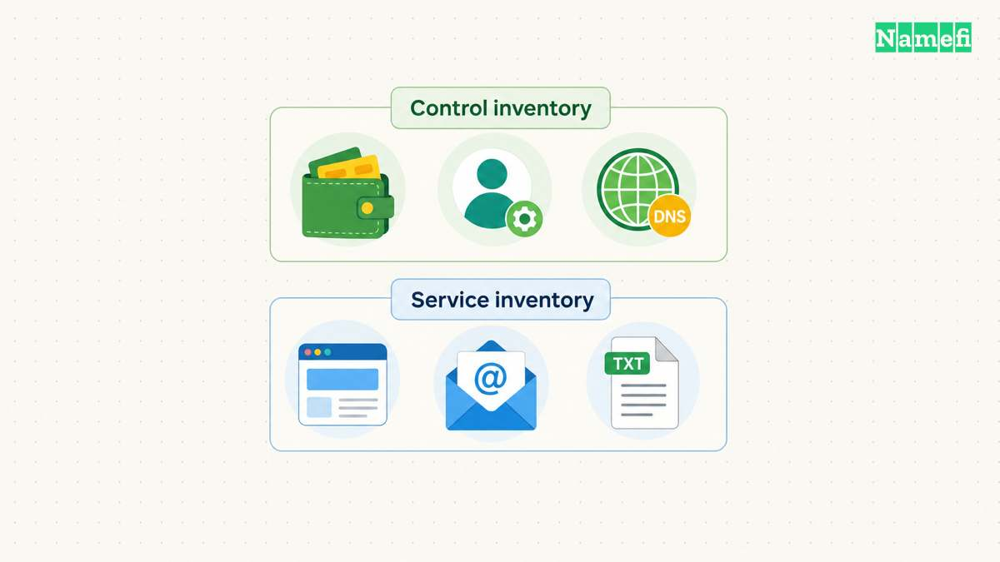
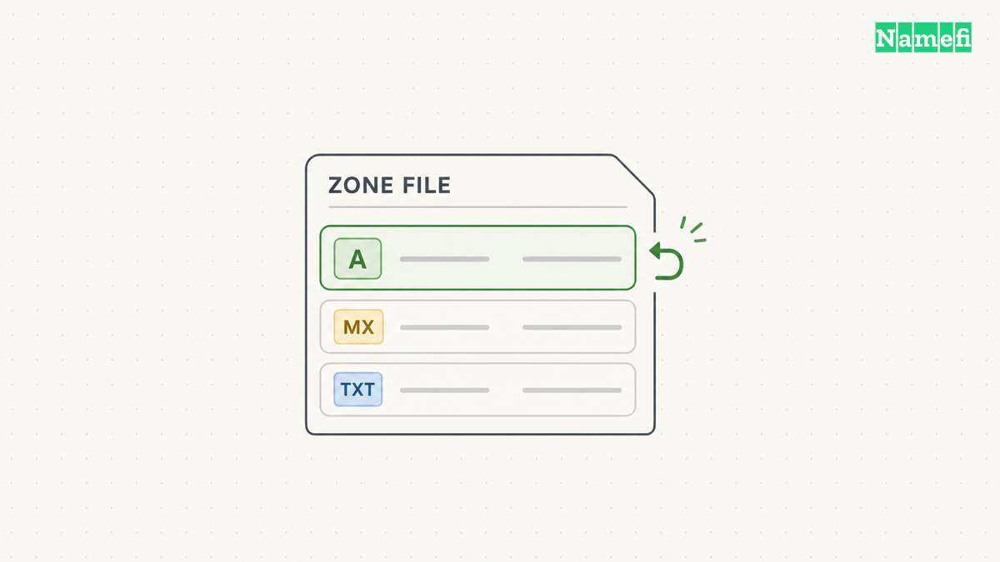
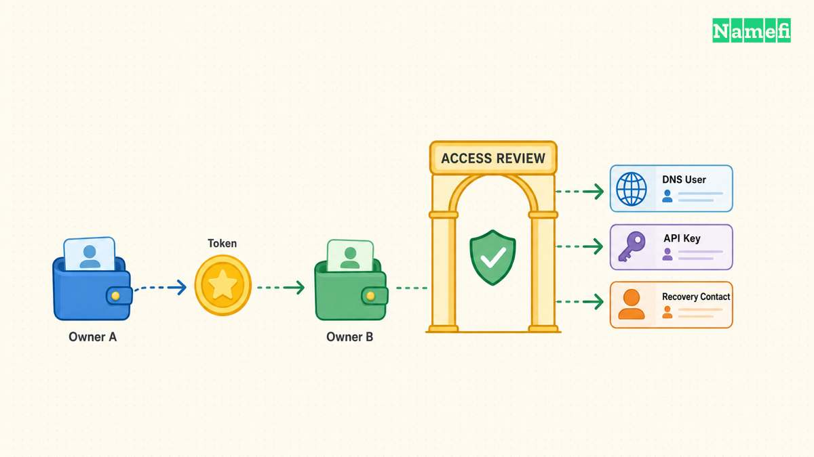
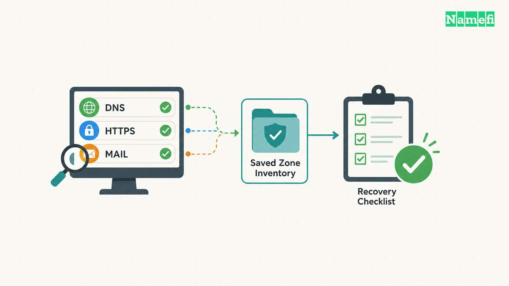

A tokenized domain needs an operating record as well as a wallet. The wallet can identify the token owner, while separate accounts and services manage the domain's DNS dependencies. Maintenance requires checking both sets of controls.

This checklist focuses on routine operation after tokenization. The conceptual [DNS on tokenized domains guide](/en/blog/dns-on-tokenized-domains/) explains the broader relationship. The operating task is more concrete: preserve the working zone, identify every authorized administrator, and verify each change through public DNS and application tests.

The examples use a hypothetical `example.com` domain. Platform procedures vary, so confirm the actual provider's supported controls before treating a checklist item as a product feature.

## An operating inventory identifies every control point

Begin with the registered domain, token network, token contract, token identifier, and current owner address. Keep those identifiers together. An NFT display name alone does not identify the exact on-chain asset. [ERC-721](https://eips.ethereum.org/EIPS/eip-721#specification) defines ownership queries and token transfer interfaces.

Next record the registrar, authoritative DNS operator, parent delegation, and account that can change nameservers. The authoritative service may differ from the tokenization platform. Ask who controls each account and how the domain owner authorizes routine changes.

DNS delegation determines which servers supply authoritative answers for the zone. [RFC 1034, section 4.2.1](https://www.rfc-editor.org/rfc/rfc1034.html#section-4.2.1) describes zone boundaries and delegation. A record edited in a dashboard outside the active delegation may have no effect on public answers.

Create one inventory for control and another inventory for service dependencies. The control inventory identifies people, wallets, accounts, and credentials. The service inventory identifies DNS records, websites, mail providers, verification challenges, and certificate workflows. Connect each service to a named administrator.

| Control point | Information to preserve |
| --- | --- |
| Domain token | Network, contract, identifier, owner |
| Registrar | Account owner and recovery process |
| DNS operator | Active zone and authorized users |
| Delegation | Public nameserver set |
| Applications | Hostnames, providers, and owners |

Export the active zone before a major change. Preserve full owner names, record types, values, and TTLs. Include the purpose of each TXT record and the service behind each mail or website record. A raw export without ownership notes leaves future cleanup decisions uncertain.

Keep the inventory free of secret values. Store API credentials, private keys, and recovery phrases in the approved credential system. The operating record should identify where authorized administrators obtain credentials without containing the credentials themselves.

For a team-owned domain, identify a backup administrator and an escalation contact. Test whether the backup administrator can reach the necessary account recovery procedures. Avoid relying solely on email hosted under the domain that the administrator may need to repair.

The inventory should also identify unsupported assumptions. If the team has not confirmed whether a token approval permits a DNS action, mark the permission as unknown. ERC-721 defines token permissions rather than a DNS authorization policy.

## Routine changes preserve the active zone and service owners

Define one intended outcome before editing. A website migration changes website destinations. A mail migration changes mail routing and authentication. A nameserver migration changes the authoritative service. Separate those operations when possible so verification remains understandable.

Read the current platform instructions for the exact operation. [Namefi's DNS operations documentation](https://docs.namefi.io/docs/03-getting-started/05-dns-operations) describes reading records and changing individual records by identifier. The documentation also connects DNS mutations to domain ownership and authentication. Those controls describe Namefi's documented API, not every tokenization platform.

For each proposed change, record the previous value, replacement value, owner name, record type, and business purpose. Ask the relevant service owner to confirm the replacement. A plausible address copied from another environment can still send users to the wrong service.

Check the active authoritative zone before saving. If the domain uses an external DNS operator, confirm that the external zone remains authoritative. Editing a similarly named inactive zone creates a misleading change record without changing the public service.

Preserve unrelated records. A website address update should not remove MX, DKIM selectors, verification tokens, or certificate policy. A mail administrator should review mail-related edits. The [record types guide](/en/blog/dns-record-types-guide/) explains the separate dependencies.

Treat parking and reset controls as potentially broad changes. Namefi's documentation distinguishes parking operations that can replace existing records from operations configured to preserve records. Read the current operation and options before using a convenience control on a production domain.

Prefer a specific record update when a specific record update satisfies the task. A broad delete-and-recreate operation makes unrelated service loss harder to detect. Preserve record identifiers when the API expects identifiers rather than guessing which row an update will target.

After saving, compare the active zone with the proposed change. Confirm that only the intended records changed. Then query the authoritative nameservers and inspect the application's behavior. The dashboard, DNS answer, and application test each supply different evidence.

Keep a rollback value for every changed record. If the website fails, restore the relevant website records rather than replacing the entire zone with an old export. An old export can overwrite unrelated legitimate changes made after the export date.

## Ownership changes require a separate access review

A domain token transfer changes the on-chain owner. The transfer does not, by itself, document the status of every off-chain administrator or credential. Review DNS accounts, platform API keys, registrar access, and application ownership as separate handoff items.

Do not assume that a successful NFT transfer proves a complete operational handover. A buyer needs to confirm the intended domain token and the platform relationship. The buyer also needs to verify access to supported DNS and domain-management functions through the platform's actual authorization procedure.

Record a before-and-after ownership check using the correct network, contract, and token identifier. Preserve the transaction reference and the observed current owner. A transaction notification from the wrong network does not establish ownership of the intended asset.

Then review standing access. Identify old DNS users, shared API keys, automation accounts, monitoring integrations, and recovery contacts. Decide which access the new owner should retain. Rotate or revoke access through the relevant service where the ownership change requires that action.

| Handoff item | Evidence of completion |
| --- | --- |
| Token ownership | Correct asset shows intended owner |
| DNS management | Authorized account can perform supported operation |
| Old access | Administrator records retirement or retention |
| Service continuity | Website and email tests pass |
| Recovery | New owner knows the supported procedure |

Separate token transfer approvals from DNS editing rights. ERC-721 defines approved token controllers and operators. The standard does not define a DNS editor role. Check the platform's implementation before claiming that a marketplace approval can edit records or that revocation removes DNS credentials.

For Namefi API access, the current documentation instructs users to associate the API key with the wallet that owns the domain. Recheck that association after an ownership change. Do not continue using an old owner's credential merely because the credential still appears in a local configuration file.

Preserve continuity while replacing access. Keep the zone and required application records intact unless the handoff explicitly includes a service migration. A domain sale can complete while a website migration remains pending. The handoff record should state that boundary clearly.

Before closing the handoff, confirm renewal responsibility through the platform's current procedure. Record the responsible person, payment arrangement, and reminder source. Do not assume that a token transfer automatically settles all future service charges or renewal obligations.

## Monitoring and recovery verify the complete service

Monitor the public outcomes that matter to the domain. Useful checks include authoritative availability, expected address records, website response, certificate validity, and mail functionality. Select checks that match actual services rather than creating an alert for every record type.

Add an alert for unexpected delegation changes when the domain's monitoring system supports that check. Review unexpected DNS edits against the change log. A valid signature or an authorized account action does not prove that an edit matches the owner's business intent.

Keep [DNSSEC](/en/blog/dnssec-for-domain-owners/) in the operating plan. A DNS provider migration can require coordination between the old signer, new signer, and parent DS state. [RFC 6781, section 4.3.5](https://www.rfc-editor.org/rfc/rfc6781.html#section-4.3.5) explains why operator changes need a defined transition procedure. A copied zone does not automatically preserve the trust relationship.

Test recovery against a limited scenario before a crisis. For example, ask the backup administrator to locate the correct provider account and the last verified zone export. The exercise need not change production records. The exercise should establish whether the written instructions identify a usable route.

If a website fails after a record edit, investigate the changed hostname and destination first. If public resolution fails after a nameserver move, inspect delegation and validation. If an API denies a write after a token transfer, inspect the current owner and credential association.

Keep those investigations separate until evidence connects the failures. Repeatedly changing DNS, moving tokens, and rotating credentials together can obscure the cause. Preserve diagnostic output and timestamps before attempting a correction.

A recovery record should identify the incident, affected services, verified cause, corrective action, and resulting checks. Include public transaction references when relevant. Exclude private keys, API secrets, and sensitive recovery material from ordinary support messages.

After recovery, review whether the inventory prevented confusion. Add the missing service owner, credential relationship, or migration step that delayed the repair. Remove stale instructions when the platform changes its documented procedure.

The practical result is an operating file that another authorized administrator can use. The file links the token to the correct domain controls and the domain controls to working services. Tokenization adds an ownership mechanism, while disciplined DNS maintenance preserves day-to-day availability.

## These sources support the article

- Ethereum — [ERC-721](https://eips.ethereum.org/EIPS/eip-721#specification), ownership, token approval, and operator interfaces. Fetched 2026-10-21.
- IETF — [RFC 1034](https://www.rfc-editor.org/rfc/rfc1034.html#section-4.2.1), section 4.2.1: authoritative zones and delegation. Fetched 2026-10-21.
- Namefi — [DNS operations](https://docs.namefi.io/docs/03-getting-started/05-dns-operations), ownership checks, record identifiers, parking options, and credential troubleshooting. Fetched 2026-10-21.
- IETF — [RFC 6781](https://www.rfc-editor.org/rfc/rfc6781.html#section-4.3.5), section 4.3.5: DNSSEC during operator changes. Fetched 2026-10-21.
