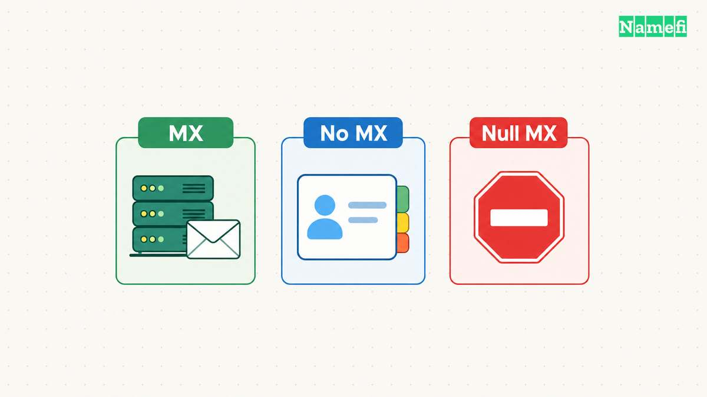
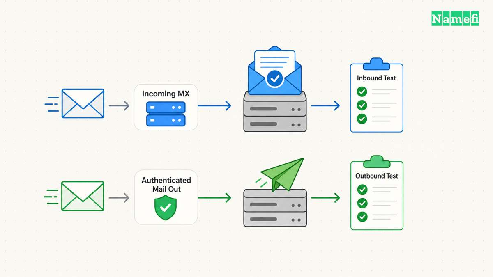

Use [Zoho's MX Lookup](https://www.zoho.com/toolkit/mx-lookup.html) to query a domain's published mail-exchange records. Enter the domain after the `@` sign, rather than a complete email address. The tool helps identify the [mail-server hostnames and priorities published in DNS](#zoho-provides-an-mx-lookup-tool).

An MX lookup shows routing information. A lookup does not prove that a specific mailbox exists or that a message will reach the inbox. Finish troubleshooting with an actual delivery test and the email provider's account checks.

This guide covers MX diagnosis. For initial service configuration, read [how to set up custom-domain email](/en/blog/set-up-email-with-your-own-domain/).

## Query the exact domain used by the recipient address

For a hypothetical address such as `person@example.com`, query `example.com`. If the address instead uses `person@mail.example.com`, investigate the exact domain `mail.example.com`. Do not assume that every subdomain shares the parent domain's mail configuration.

Open the official lookup tool and enter the domain. Record the query time, returned hostnames, priority values, and any error message. Keep the tool's actual output rather than reconstructing a result from memory.

Zoho says its MX tool checks the records for a supplied domain and helps troubleshoot delivery issues. [The tool's help text explains the input and output](#zoho-provides-an-mx-lookup-tool).

You can also use a local command when the operating system supplies the tool. The command `dig MX example.com` illustrates the query form. Replace the hypothetical domain with your own domain before running the test.

The command is an instruction, not a live lookup result. Do not treat an example hostname in an article as a provider-issued MX target.

In [Namefi's DNS lookup](https://namefi.io/domain-tools/dns), choose Mail exchange (MX) and enter the domain after the recipient address's `@`. Save the selected resolver, complete answer, and timestamp. The tool distinguishes a missing MX answer from null MX, but it does not test whether a mailbox accepts a message.

## Read priority as a routing preference

An MX record has a mail-server hostname and a preference value. Lower preference values receive priority when the sender selects among mail exchangers. [RFC 5321 defines MX selection](#rfc-5321-defines-mx-selection-and-fallback).

A lower number does not mean a faster server, a stronger security level, or a higher-quality email provider. Read the value only in the context of mail-routing preference.

For a hypothetical example, imagine two mail exchangers with different priorities. The lower-numbered exchanger receives preference. The example does not establish that either server is reachable or that the provider intends the combination.

Copy the actual provider's full MX set when configuring mail. Do not combine records from unrelated providers as an improvised backup. Ask the chosen provider to explain any required coexistence arrangement.

## An absent MX answer differs from a null MX answer

This distinction prevents a common diagnosis error. Under SMTP's rules, an empty MX list can trigger an implicit-MX fallback to the domain's address records. [RFC 5321 describes the fallback](#rfc-5321-defines-mx-selection-and-fallback).

A null MX explicitly declares that the domain accepts no mail. RFC 7505 defines the record with preference `0` and exchange `.`. [The standard also prohibits additional MX records beside a null MX](#rfc-7505-defines-the-null-mx-declaration).

| Observed result | Meaning to investigate | Next action |
| --- | --- | --- |
| Ordinary MX records | Published receiving routes | Compare with the email provider's expected set |
| Empty MX answer | No explicit MX in the observed answer | Investigate fallback and the intended service |
| `0 .` | Explicit declaration that the domain accepts no mail | Confirm that the declaration matches the domain's purpose |
| NXDOMAIN | The queried name did not resolve as an existing DNS name in that response | Check spelling and authoritative DNS |
| SERVFAIL or timeout | The lookup did not produce a usable answer | Investigate DNS failure rather than declaring no email service |

[The DNS format distinguishes server-failure and name-error responses](#rfc-1035-defines-dns-error-responses). The table is a troubleshooting aid. Save the actual DNS response code and answer section when available. An empty-looking screen does not distinguish these outcomes reliably.

## Compare the answer with the current email provider's instructions

Open the email provider's domain setup page in the correct account. Find the expected MX hostnames and priorities for that domain. Compare every returned record with that expected set.

As practical advice, check the authoritative DNS account next. A correct-looking edit in an account that no longer serves the domain does not establish the public configuration.

Review the [nameserver migration guide](/en/blog/change-domain-nameservers/) if the domain recently moved DNS providers. The migration inventory should preserve the email records as well as the website records.

If multiple providers appear in the answer, identify why each record exists. A deliberate migration may require a documented procedure. An unexplained leftover record needs investigation with the provider before deletion.

Preserve the old values and change only the records required by the approved mail configuration. Keep unrelated TXT records and service-verification records intact.

## A valid MX target still needs a usable receiving service

RFC 5321 requires an MX target to resolve to a usable address record. The standard also distinguishes unusable explicit MX records from the no-MX fallback case. [An unusable explicit MX set is an error](#rfc-5321-defines-mx-selection-and-fallback).

If the published MX matches the provider's instructions, inspect the account's domain-verification state and recipient configuration. Confirm that the intended mailbox or routing rule exists. DNS cannot create an absent mailbox account.

As diagnostic advice, separate a failure for one recipient from a failure for every recipient. Save any bounce message, delivery timestamp, and provider status information. Those details help the provider distinguish routing from account or message-handling problems.

Do not change the website's A record merely because an email delivery test failed. Identify the failed dependency before editing unrelated DNS records.

## Finish with an external delivery test and a separate sending test

Send a message from an external mailbox you control to the target address. Confirm receipt in the intended destination. If the service forwards mail, verify the forwarding destination as well.

Then send a message from the domain through the normal sending application. Inspect the received message's authentication results. MX handles incoming routing, while [SPF covers a separate sender-authorization question](/en/blog/txt-records-spf-dkim-verification/).

Record both outcomes with the DNS query result. A successful MX lookup and successful delivery establish different parts of the service. Keep the evidence separate so the next administrator can identify which layer changed.

Start with the exact recipient domain, interpret the actual answer, and compare the result with the provider's current configuration. Declare the problem resolved only after the intended mailbox receives a real test message.

## Sources and further reading

### Zoho provides an MX lookup tool

[Zoho provides an MX lookup tool](https://www.zoho.com/toolkit/mx-lookup.html#:~:text=What%20does%20the%20priority%20denote). Checked 2026-10-30.

### RFC 5321 defines MX selection and fallback

[RFC 5321 defines MX selection and fallback](https://www.rfc-editor.org/rfc/rfc5321.html#section-5.1). Checked 2026-10-30.

### RFC 7505 defines the null MX declaration

[RFC 7505 defines the null MX declaration](https://www.rfc-editor.org/rfc/rfc7505.html#section-3). Checked 2026-10-30.

### RFC 1035 defines DNS error responses

[RFC 1035 defines DNS error responses](https://www.rfc-editor.org/rfc/rfc1035.html#section-4.1.1). Checked 2026-10-30.
