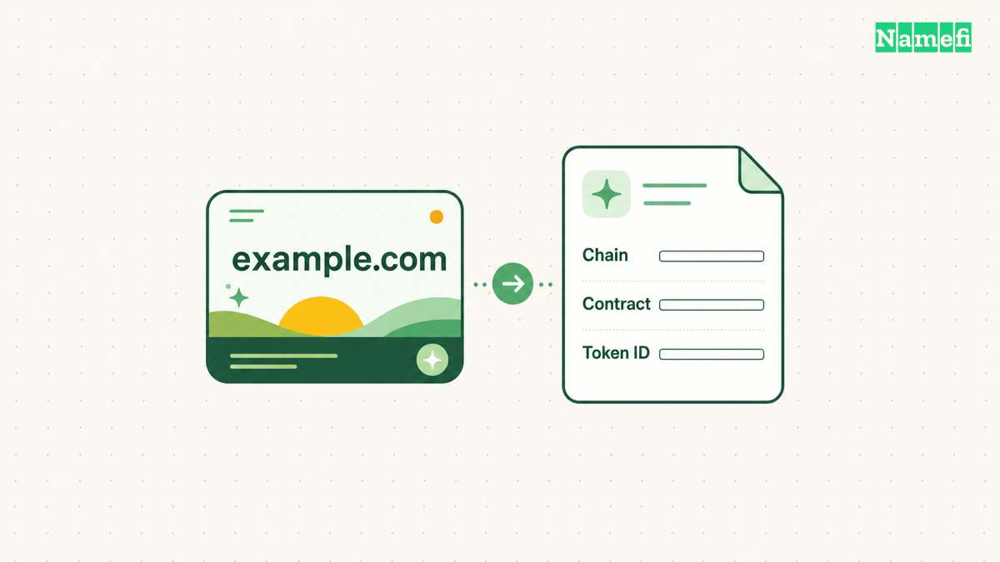
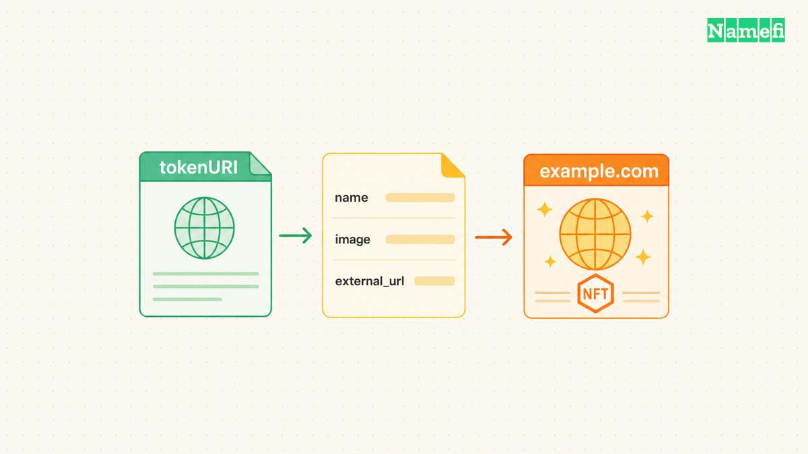
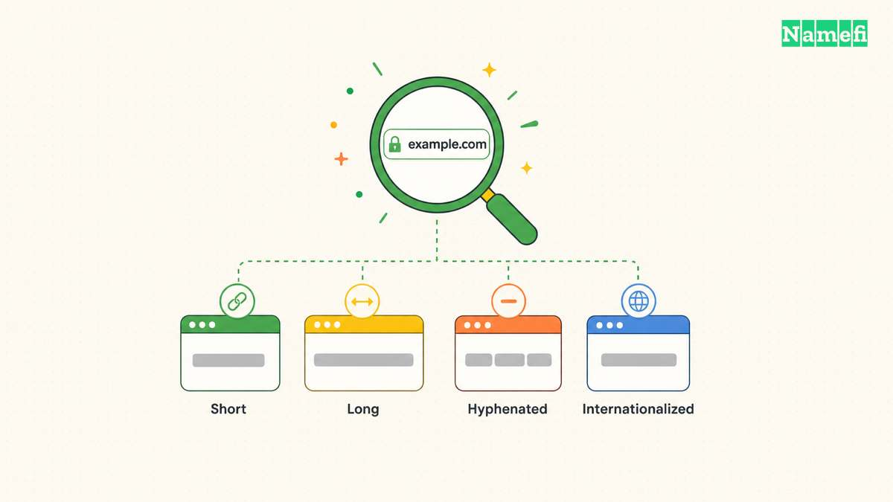
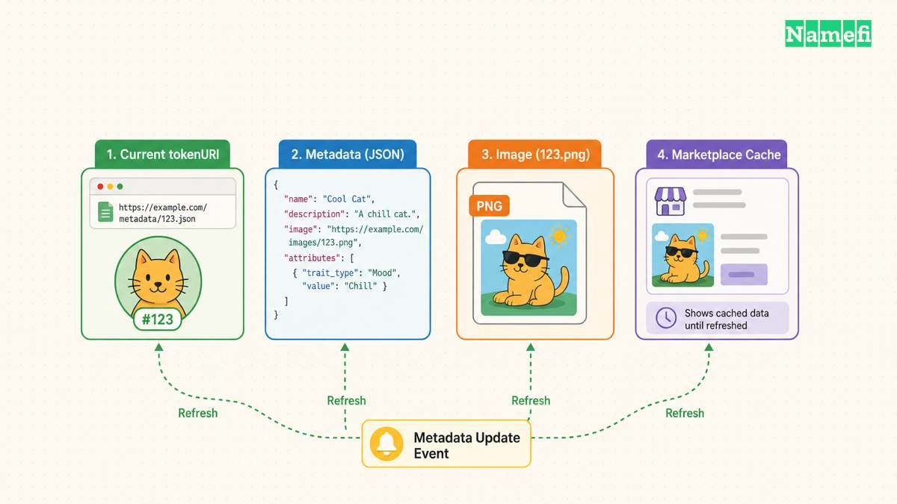

A domain NFT should show the domain clearly. A marketplace card that hides the suffix, truncates the name, or confuses the collection with the asset makes verification harder. Naming and metadata need a deliberate display policy.

A readable title still does not prove ownership. The token's network, contract, and identifier establish which asset a viewer is inspecting. The display name helps a viewer recognize the asset without replacing those identifiers.

This guide covers domain names as NFT display content. The guide does not describe a universal wallet naming system or promise that every marketplace renders identical metadata. The examples use hypothetical assets and a proposed editorial policy.

## The domain label and the token identity serve different jobs

Start by separating the registered domain, collection name, token display name, and token identifier. A collection name describes the contract's group of assets. An individual domain identifies the represented name. A token identifier distinguishes the asset inside the contract.

[ERC-721](https://eips.ethereum.org/EIPS/eip-721#specification) defines an optional metadata extension with collection naming and token metadata interfaces. The standard also identifies a token through its contract and token identifier on a chain. A human-readable display label does not replace that relationship.

A sensible domain display policy can use the complete domain as the individual asset name. For example, a hypothetical token representing `example.com` could display `example.com`. Put explanatory information in the description rather than appending promotional claims to the asset name.

Preserve the suffix in the visible label. `example.com` and `example.net` describe different domain names. An image that shows only “example” forces a viewer to search elsewhere for an essential distinction. A useful card makes the entire intended name legible at normal display size.

| Field | Recommended responsibility |
| --- | --- |
| Collection name | Identify the collection or protocol |
| Asset name | Identify the complete domain |
| Description | Explain representation and limits |
| Token identifier | Identify the contract-specific asset |
| External link | Lead to the relevant asset page |

Keep the same domain spelling across the name, description, image, and external page. A discrepancy should trigger a review before publication. Do not quietly choose the spelling that looks better if the underlying asset record identifies a different domain.

For internationalized names, adopt an explicit review policy. Show the representation that the product can verify and explain any alternate representation on the asset page. Ask a qualified reviewer to check ambiguous characters. The editorial goal is recognizable identity, not a claim that typography proves authenticity.

Avoid adding unsupported ownership claims to the name. Phrases such as “official,” “verified,” or “guaranteed” require a defined issuer and evidence. A creator-controlled metadata field cannot certify the creator's own claim merely by displaying a badge-like word.

## Metadata connects the readable label to the displayed asset

A marketplace needs a way to retrieve the individual token's metadata. [OpenSea's metadata documentation](https://docs.opensea.io/docs/metadata-standards) describes reading an ERC-721 token's metadata from the URI returned by `tokenURI`. The retrieved data supplies display information such as the name and media.

For a domain project, document which system generates the metadata and which system verifies the domain-to-token relationship. A metadata service can format a label without establishing the legal or operational rights represented by the token. State those rights in the product's actual documentation.

A minimal hypothetical metadata object might include `name: "example.com"`, a plain-language description, and an image URI. The external page can show the network, contract, token identifier, domain status, and management links. Treat the object as a display example rather than a ready-to-deploy contract implementation.

OpenSea also documents `external_url` and `attributes` as display fields. [The media and traits reference](https://docs.opensea.io/docs/media-and-traits) explains those fields and their types. A project can use supported traits for meaningful domain properties if the metadata producer has verified those properties.

Choose traits that a viewer can interpret. A suffix trait can show the represented suffix. A length trait needs a documented counting rule. A registration-related date needs a clear definition and reliable source. Avoid combining acquisition date, registration date, and token mint date under one ambiguous label.

Do not put a changing valuation into a trait without explaining the valuation source and date. A creator-selected number can look authoritative in a marketplace filter. Keep estimates separate from verified descriptive fields and label estimates as estimates on the external page.

Check the metadata URI anonymously. A service that works only with the project administrator's login does not provide a reliable public display path. Verify that the response contains the intended asset's data and that the image link opens independently.

Review the external destination as carefully as the image. A link should lead to a useful page for the specific asset. Avoid a destination that silently changes a viewer's task from inspection to signing a wallet request. A display page can offer actions while keeping inspection available without a signature.

## A consistent image layout keeps complete names readable

Design the display image around the domain label's expected length. A short domain and a long multi-label name need different typography constraints. Use a layout that retains readable text rather than applying the same large font to every token.

Test the image at the sizes where viewers will encounter the image. Inspect a marketplace grid, a detail page, and a narrow mobile view. A full-resolution preview can hide clipping that appears in a small card. Keep a screenshot record for the supported product surfaces.

Use the exact domain as the primary text. Keep decorative marks and supporting copy away from the name. A background pattern should not resemble characters or punctuation beside the domain. A viewer should not need to infer whether a dot belongs to the label or the artwork.

Compare several representative labels before releasing a template. Include a short name, a long name, a hyphenated name, and an internationalized name if the product supports internationalized names. A template that handles one demonstration asset does not establish complete coverage.

| Display test | Failure to look for |
| --- | --- |
| Small grid | Suffix becomes unreadable |
| Narrow screen | Name clips or overlaps |
| Long label | Text shrinks below useful size |
| Light and dark backgrounds | Contrast disappears |
| Alternate spelling | Image disagrees with metadata |

Keep accessibility information in surrounding metadata and the external page. An image containing the domain label can help recognition, but machine-readable text still matters. The product should expose the name as text wherever the product controls the interface.

Respect each renderer's actual media requirements. OpenSea publishes supported media fields and recommendations in its documentation. Other wallets and marketplaces can apply different cropping, caching, and rendering rules. Test the intended destinations instead of promising universal compatibility from one successful preview.

Avoid simulated platform badges and third-party logos that imply endorsement. A project can use its own identity when authorized, but the project should distinguish brand artwork from a marketplace's verification interface. A clear domain label supplies more useful information than a fabricated seal.

The final image review should compare the rendered label against the source asset record character by character. Record the image version and metadata version together. That pairing makes a later stale-image report easier to investigate.

## Display updates need verification across separate caches

A metadata change can leave different interfaces showing different versions. Start by checking the contract's current metadata URI and the data returned by that URI. Then check the image at the published image URI. Finally inspect the destination marketplace or wallet.

Keep those checks separate. Correct JSON with an old image points to a different problem from a stale metadata response. A marketplace thumbnail can also lag behind the underlying public response. Record which layer still shows the old content before retrying an update.

[ERC-4906](https://eips.ethereum.org/EIPS/eip-4906#specification) defines optional metadata update events for ERC-721. Supporting contracts can notify third-party systems that token metadata changed. The extension does not promise that every viewer refreshes instantly or implements the same indexing behavior.

If the contract supports an update mechanism, use the documented mechanism and preserve the transaction reference. If the display platform offers a refresh procedure, follow the current platform instructions. Do not invent an update event for a contract that lacks the necessary interface.

Treat asset transfers separately from display edits. A new owner can receive the token while a cached image still shows an old description. Confirm ownership through the contract's current state. Do not transfer the asset again merely to make a thumbnail refresh.

A changed display name also does not rename the registered domain. If the asset represents `example.com`, editing a metadata field to `example.net` creates a misleading display. The project must preserve the verified relationship between the token and the represented domain.

Maintain an update log with the reason, affected tokens, source data, metadata version, image version, and checked destinations. The log should identify whether an edit corrects presentation or changes a substantive documented property. Review substantive changes against the product's actual rights and procedures.

For a domain owner evaluating an unfamiliar listing, compare the visible name with the external asset record and on-chain identifiers. Confirm the represented domain through the relevant platform. The [tokenized domain guide](/en/blog/what-are-tokenized-domains/) explains why the underlying arrangement matters beyond a recognizable NFT card.

Good display metadata makes inspection easier while preserving that distinction. The domain stays readable, the identifiers stay accessible, and the description explains the representation. A polished image should help verification rather than substitute for verification.

## These sources support the article

- Ethereum — [ERC-721](https://eips.ethereum.org/EIPS/eip-721#specification), optional metadata extension and token identifiers. Fetched 2026-10-21.
- OpenSea — [Metadata standards](https://docs.opensea.io/docs/metadata-standards), token metadata retrieval and display data. Fetched 2026-10-21.
- OpenSea — [Media and traits](https://docs.opensea.io/docs/media-and-traits), supported display fields and attribute formats. Fetched 2026-10-21.
- Ethereum — [ERC-4906](https://eips.ethereum.org/EIPS/eip-4906#specification), optional metadata update events. Fetched 2026-10-21.
