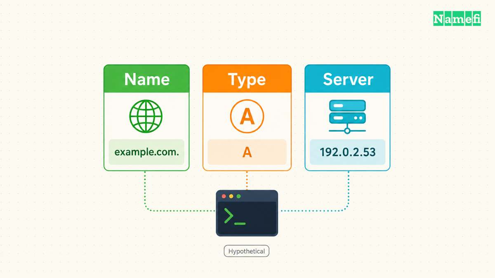
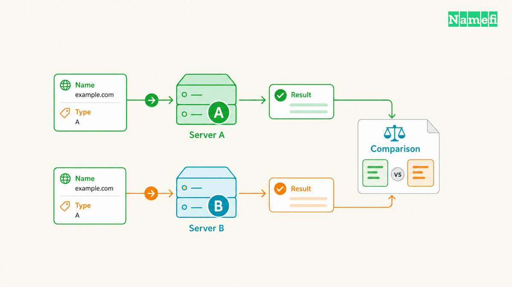
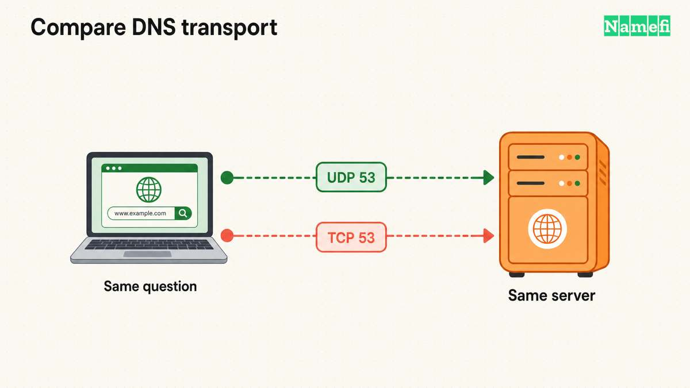
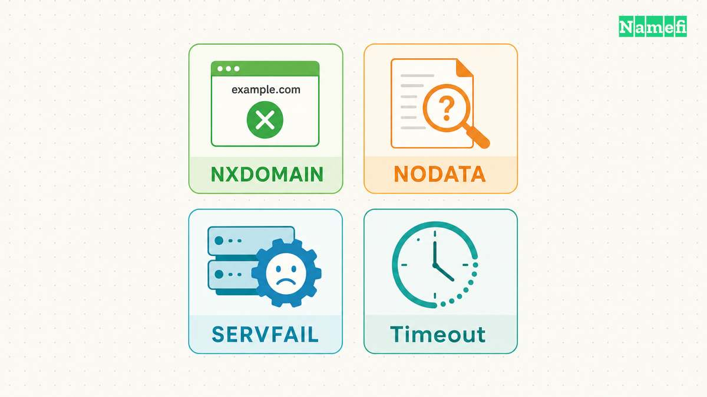

To query a specific DNS server, put the server address after the name: `nslookup -type=A example.com. SERVER_IP`.
Replace `SERVER_IP` with the address of the DNS server under investigation.
The name comes first, and the server comes second.
Microsoft documents that argument order for Windows, and ISC documents the same order for BIND nslookup.
[Microsoft's command reference](https://learn.microsoft.com/en-us/windows-server/administration/windows-commands/nslookup#remarks) explains the Windows syntax.

That small change makes a useful troubleshooting question precise: what answer does a particular server return for a particular name and record type?
A successful lookup does not establish that every visitor receives the same answer.
A failed lookup does not automatically establish that the domain has disappeared.

This guide covers targeted, read-only [DNS](/en/glossary/dns/) queries.
The commands below illustrate syntax and diagnostic choices, rather than report measured results.
Documentation addresses such as `192.0.2.53` represent hypothetical servers, so replace those addresses before running a useful test.

## An explicit server and record type define the test



Start with one fully specified question:

```text
nslookup -type=A example.com. 192.0.2.53
```

Here, `example.com.` is the queried name, `A` requests an IPv4 address record, and `192.0.2.53` represents the chosen server.
The final period makes the queried name absolute.
That period prevents a search suffix from turning the intended question into a different name.
Microsoft describes suffix handling in its [nslookup remarks](https://learn.microsoft.com/en-us/windows-server/administration/windows-commands/nslookup#remarks).

Use the literal server address when the server's own name resolution could be part of the problem.
A server hostname needs an address before the query can reach that server.
For example, `nslookup example.com. ns1.example.net.` introduces a preliminary dependency on resolving `ns1.example.net.`.
Microsoft's [server command documentation](https://learn.microsoft.com/en-us/windows-server/administration/windows-commands/nslookup-server) confirms that the interactive `server` command uses the current server for that lookup.

Record the server address from an established configuration or provider record.
Do not guess an address from a nameserver's spelling.
If an administrator supplies several addresses for one server name, record which address the test uses.
Otherwise, two apparently identical tests may target different endpoints.

Specify the record type even when an unqualified command seems to work.
Microsoft lists A as the [default Windows query type](https://learn.microsoft.com/en-us/windows-server/administration/windows-commands/nslookup-set-type#parameters).
The current [BIND nslookup manual](https://bind9.readthedocs.io/en/latest/manpages.html#nslookup-query-internet-name-servers-interactively) describes default A and then AAAA lookups.
BIND documents that an explicit alternative selects one query type.
Local versions can differ, so explicit types make comparisons clearer.

Change the type to match the service under investigation:

```text
nslookup -type=AAAA example.com. 192.0.2.53
nslookup -type=MX example.com. 192.0.2.53
nslookup -type=TXT example.com. 192.0.2.53
```

An A test cannot establish that a mail record exists.
A TXT test at `example.com.` cannot establish that a verification record exists at `_verify.example.com.`.
Write down the exact owner name from the service's instructions before testing a verification record.
The [record-type reference](https://learn.microsoft.com/en-us/windows-server/administration/windows-commands/nslookup-set-type#parameters) explains the Windows type selector.

For repeated questions, enter interactive mode with a selected server:

```text
nslookup - 192.0.2.53
set type=A
example.com.
set type=MX
example.com.
exit
```

Run the first line in the shell and the remaining lines at the nslookup prompt.
The selected type persists within the session until another `set type` command changes the type.
An interactive session therefore needs a clear note of its settings.
For a support report, separate commands with explicit types usually make the evidence easier to reproduce.

Use familiar commands across implementations, but do not assume every subcommand exists everywhere.
The BIND manual marks several historical subcommands as unimplemented.
Check the installed implementation before adopting a larger Windows-oriented diagnostic script.

## The server's role determines what an answer can show


A [DNS resolver](/en/glossary/dns-resolver/) answers recursive requests using available data and further lookups when necessary.
An authoritative [nameserver](/en/glossary/nameserver/) answers for zones under that server's authority.
Choosing an explicit server does not turn a recursive answer into an authoritative answer.
The DNS header distinguishes authority from recursion in [RFC 1035, Section 4.1.1](https://www.rfc-editor.org/rfc/rfc1035.html#section-4.1.1).

Choose the server according to the question:

| Question | Server | Useful comparison |
| --- | --- | --- |
| What does this network resolve? | Its configured resolver | Another permitted resolver |
| What does the zone publish? | A verified authoritative server | Another authoritative server |
| Does an internal view differ? | The internal resolver | The relevant external view |
| Does one endpoint fail? | Its literal address | Another verified endpoint |

For a hypothetical zone, an administrator might supply `192.0.2.53` as a recursive resolver and `198.51.100.53` as an authoritative server.
The addresses identify different diagnostic roles even when both commands return the same A record.
Write the role beside each address in the test record.

A direct authoritative test can explicitly avoid requesting recursion:

```text
nslookup -
server 198.51.100.53
set norecurse
set type=A
example.com.
exit
```

Microsoft documents `set norecurse` as disabling the recursion request in its [recursion settings reference](https://learn.microsoft.com/en-us/windows-server/administration/windows-commands/nslookup-set-recurse).
The option does not grant authority over an unrelated zone.
A server that does not serve the requested zone may return a referral or reject the request.

An NS lookup can help identify candidate authoritative nameservers:

```text
nslookup -type=NS example.com. 192.0.2.53
```

Treat that result as a lead when investigating a delegation problem.
Cross-check the candidate names against the intended DNS configuration before selecting a direct endpoint.
An NS answer from a resolver can reflect cached information.
A direct query to the wrong provider cannot establish what the intended provider currently publishes.

Read authority indicators as protocol information.
A non-authoritative response does not automatically mean an incorrect response.
The authoritative-answer flag identifies authority for the queried name, while recursion flags describe recursion behavior.
[RFC 1035's header definitions](https://www.rfc-editor.org/rfc/rfc1035.html#section-4.1.1) make those meanings separate.

Consider a hypothetical change from `192.0.2.10` to `192.0.2.20`.
Suppose the verified authoritative endpoint returns the new address while a recursive resolver returns the old address.
That comparison supports investigating caching at the recursive path.
The comparison alone does not prove that every authoritative endpoint agrees or that every resolver will update simultaneously.

## Controlled comparisons isolate useful differences



Change one variable at a time.
For a resolver comparison, preserve the exact name and type while changing only the server address:

```text
nslookup -type=A www.example.com. 192.0.2.53
nslookup -type=A www.example.com. 192.0.2.54
```

Record the UTC time, network connection, query name, query type, server address, and result.
Save the complete output when requesting help.
A copied answer address without the queried server and record type leaves too many possible explanations.

Compare record sets rather than the order of displayed addresses.
For a hypothetical service that publishes two addresses, a reversed display order does not establish a record change.
Likewise, compare the queried owner name before comparing values.
An apex lookup and a `www` lookup ask different questions.

Next, compare the same question against the verified authoritative endpoint.
If authoritative endpoints disagree, investigate publication at the DNS provider before blaming a particular visitor's resolver.
If authoritative endpoints agree, the recursive comparisons become more informative.
Keep each conclusion narrower than the tests that support the conclusion.

Caching includes more than old positive answers.
[RFC 2308, Section 5](https://www.rfc-editor.org/rfc/rfc2308.html#section-5) specifies caching for negative answers.
A resolver can retain an earlier absence after an administrator adds a record.
The relevant [TTL](/en/glossary/ttl/) depends on the cached response, so avoid assuming one universal waiting period.

Suppose a hypothetical verification workflow queried `_verify.example.com.` before the administrator created the TXT record.
A later authoritative TXT lookup might succeed while the original resolver still returns an absence.
Save both results and their times.
Repeat the same lookup after the relevant cache interval, rather than changing several DNS settings at once.

Internal and external answers also need context.
An internal resolver and an external resolver can serve different intended views of the same name.
Investigate that possibility before treating every difference as stale data.
Our [enterprise DNS discussion](/en/blog/dns-over-https-vs-enterprise-split-horizon-dns/) examines that deployment pattern.

Keep the application test separate from the DNS test.
An A answer does not test an HTTPS certificate or an HTTP redirect.
An MX answer does not demonstrate successful mail delivery.
After DNS answers match the intended configuration, test the affected application through its actual connection path.

A support report should state an observation and a bounded conclusion.
For example: “Resolver A returned the previous A record.
Authoritative endpoint B returned the intended A record at the recorded times.”
That statement helps an operator choose the next check without asserting a global outage or a completed update.

Before escalating, organize the comparisons into a short incident record.
Start with the expected record and the source of that expectation, such as an approved configuration change.
Then list the observed result for each endpoint.
Keep expectations separate from observations so another operator can challenge either part.

Include the last known successful test when that information exists.
Avoid inventing a change time from the first complaint.
A customer report establishes when the customer noticed a problem, rather than when the DNS data changed.
If the record owner differs between screenshots and commands, reconcile the names before requesting a provider investigation.

For a hypothetical email incident, compare the domain-level MX question before investigating a particular mail host's address.
That sequence helps distinguish a missing mail destination from an address lookup problem for an already identified destination.
Keep the mail delivery test as a separate result.

## The port and transport narrow a timeout investigation



The server address alone does not describe the complete test.
Record the destination port and transport when a query times out.
Microsoft documents port 53 as the [default TCP/UDP DNS port](https://learn.microsoft.com/en-us/windows-server/administration/windows-commands/nslookup-set-port).
Use another port only when the server administrator confirms that configuration.

For a controlled TCP test, start a fresh interactive session:

```text
nslookup - 192.0.2.53
set type=A
set port=53
set vc
example.com.
exit
```

The first line starts nslookup from the shell.
The remaining lines select the type, port, and TCP transport before submitting the name.
Microsoft calls the [TCP selector a virtual circuit](https://learn.microsoft.com/en-us/windows-server/administration/windows-commands/nslookup-set-vc).
Check the installed BIND manual before carrying session settings between implementations.

Compare the result with the earlier query to the same address, name, type, and port.
If TCP succeeds while the earlier request times out, investigate transport-specific reachability before editing DNS records.
The comparison does not identify which firewall or endpoint caused the difference.
[RFC 9520, Section 3.1](https://www.rfc-editor.org/rfc/rfc9520.html#section-3.1) treats another DNS transport as a distinct retry path.

A chosen server affects the nslookup test.
The command does not establish which resolver a browser or another application uses.
Preserve the separate application test when reporting a recovery.

## Error categories guide the next recovery check



Read the response category before changing the domain configuration.
An empty answer, a negative answer, and an unanswered request require different investigations.
[RFC 9520, Section 2](https://www.rfc-editor.org/rfc/rfc9520.html#section-2) distinguishes useful negative responses from resolution failures.

**NXDOMAIN means the queried name does not exist in the returned DNS view.**
Check spelling, search suffixes, the selected server, and the exact owner name.
If a response contains a CNAME chain, the missing name can be the final alias target.
[RFC 2308's terminology and name-error sections](https://www.rfc-editor.org/rfc/rfc2308.html#section-2.1) describe that distinction.

**NODATA means the name exists but lacks the requested record type.**
A missing AAAA record does not establish that an A record is absent.
NODATA is a response interpretation, rather than a separate DNS response code.
Check the requested type before creating or replacing records.
[RFC 2308, Section 2.2](https://www.rfc-editor.org/rfc/rfc2308.html#section-2.2) explains the response structure.

**SERVFAIL means the server could not complete the query.**
Investigate the resolver's upstream path, authoritative availability, and validation diagnostics.
Do not interpret SERVFAIL as permission to register the queried name.
[RFC 9520](https://www.rfc-editor.org/rfc/rfc9520.html#section-2.1) describes server failures and several underlying causes.

A [DNSSEC](/en/glossary/dnssec/) validation failure can also prevent a resolver from returning usable data.
An authoritative answer alone does not establish that a validating resolver can verify the answer.
If direct authoritative tests succeed while a validating resolver fails, request validation diagnostics before disabling security controls.
[RFC 9520, Section 2.6](https://www.rfc-editor.org/rfc/rfc9520.html#section-2.6) covers validation failures.

**A timeout means the client received no response within the relevant wait.**
Check the literal endpoint address and whether the current network permits the intended DNS traffic.
Try another verified endpoint with the same question.
Increasing a timeout cannot repair an incorrect address or a blocked path.
The [timeout discussion in RFC 9520](https://www.rfc-editor.org/rfc/rfc9520.html#section-2.3) separates missing responses from DNS answers.

**REFUSED means the server rejected the request.**
Check whether the server permits recursive requests from the current network or serves the queried zone.
Use an authorized resolver for recursive tests and a verified authoritative endpoint for zone tests.
[RFC 9520, Section 2.2](https://www.rfc-editor.org/rfc/rfc9520.html#section-2.2) describes those policy-related cases.

Finish the investigation by repeating the original failing question after the relevant correction.
Preserve the same server, owner name, and type so the before-and-after comparison remains meaningful.
Then test the application separately.
The useful outcome is a documented answer to a specific question, with enough context for another operator to reproduce the result.

## Sources and further reading

- Microsoft Learn, [nslookup](https://learn.microsoft.com/en-us/windows-server/administration/windows-commands/nslookup), “Remarks” and error table. Fetched 2026-10-21.
- Microsoft Learn, [nslookup set type](https://learn.microsoft.com/en-us/windows-server/administration/windows-commands/nslookup-set-type), “Syntax” and “Parameters.” Fetched 2026-10-21.
- Microsoft Learn, [nslookup server](https://learn.microsoft.com/en-us/windows-server/administration/windows-commands/nslookup-server), opening description and “Syntax.” Fetched 2026-10-21.
- Microsoft Learn, [nslookup set recurse](https://learn.microsoft.com/en-us/windows-server/administration/windows-commands/nslookup-set-recurse), “Parameters.” Fetched 2026-10-21.
- ISC, [BIND nslookup manual](https://bind9.readthedocs.io/en/latest/manpages.html#nslookup-query-internet-name-servers-interactively), “Arguments” and “Interactive Commands.” Fetched 2026-10-21.
- RFC Editor, [RFC 1035](https://www.rfc-editor.org/rfc/rfc1035.html#section-4.1.1), Section 4.1.1, header flags and response codes. Fetched 2026-10-21.
- RFC Editor, [RFC 2308](https://www.rfc-editor.org/rfc/rfc2308.html), Sections 1, 2.1, 2.2, and 5, negative responses and caching. Fetched 2026-10-21.
- RFC Editor, [RFC 9520](https://www.rfc-editor.org/rfc/rfc9520.html#section-2), Sections 2.1–2.6, resolution failure conditions. Fetched 2026-10-21.

- Microsoft Learn, [nslookup set port](https://learn.microsoft.com/en-us/windows-server/administration/windows-commands/nslookup-set-port), default port and syntax. Fetched 2026-10-21.
- Microsoft Learn, [nslookup set vc](https://learn.microsoft.com/en-us/windows-server/administration/windows-commands/nslookup-set-vc), virtual-circuit selector. Fetched 2026-10-21.
