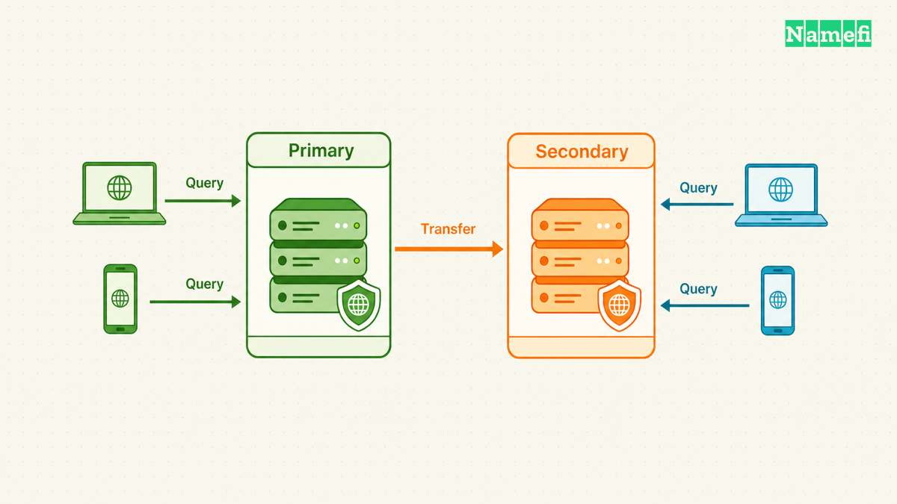
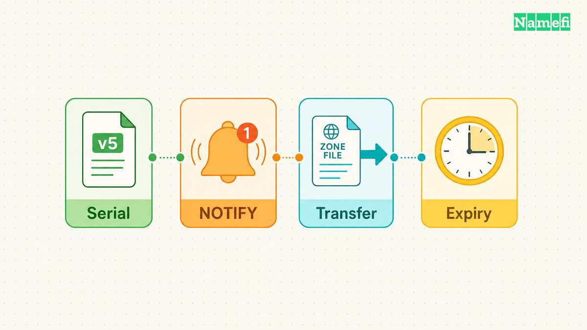
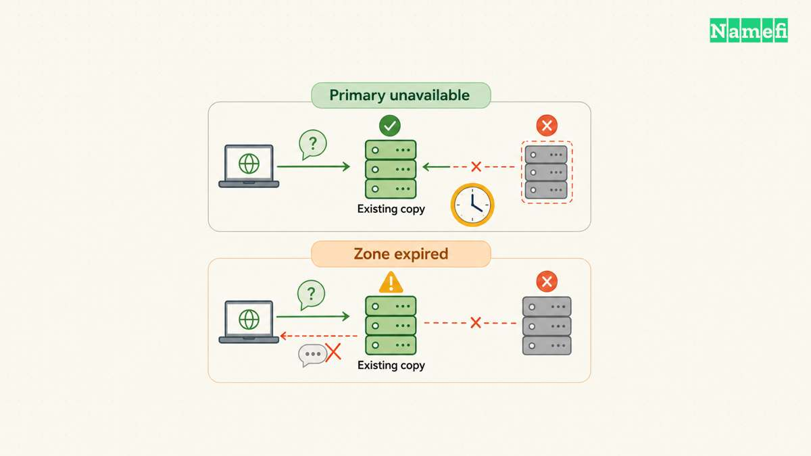
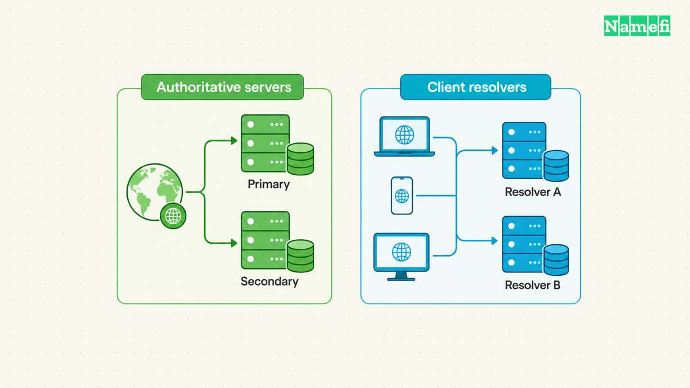

A secondary DNS server holds an authoritative copy of a zone and answers queries from that copy. The secondary does not wait for the primary to fail before answering.

The labels describe how servers obtain zone data. A primary supplies zone transfers. A secondary retrieves zone data through transfers. Both servers can publish authoritative answers for the same names. [RFC 9499 defines these roles](https://www.rfc-editor.org/rfc/rfc9499.html#section-6).

A router's “primary DNS” and “secondary DNS” fields usually describe a different relationship: the resolvers that a client can contact. Those fields do not configure authoritative zone replication.

This guide follows a hypothetical `example.com` zone. The examples explain replication, failure checks, and operational choices. The examples do not supply production configuration values.

## Primary and secondary servers both answer authoritative queries

An authoritative [nameserver](/en/glossary/nameserver/) answers from the zone data that the server serves. A [DNS resolver](/en/glossary/dns-resolver/) finds answers for clients, often by consulting several authoritative servers. A server's replication role belongs to a particular zone.

For `example.com`, imagine that an administrator maintains records on `ns1.example.com`. A second server, `ns2.example.net`, obtains the same zone through a transfer. The primary holds the update source, and the secondary holds a transferred copy. The secondary can answer a query for `www.example.com` without consulting the primary for each request.

Public delegation does not assign a first-choice server and an emergency server. Resolvers see the authoritative server set and can select a server using their own selection behavior. [RFC 2182 explains that the primary-secondary distinction does not establish query priority](https://www.rfc-editor.org/rfc/rfc2182.html#section-3). Naming a server `ns1` does not create a universal preference.

That distinction changes how you investigate inconsistent answers. If one authoritative server publishes an old address, some resolvers can obtain the old address during normal operation. A healthy primary does not prevent the secondary from answering. A secondary with outdated data can therefore cause intermittent symptoms before any server fails.

The two servers also need not share the same role for every zone. A server can supply transfers for one zone and retrieve another zone from a different server. Inventory the zone-specific relationship instead of labeling the entire machine “the backup.” [RFC 1996 describes transfer relationships between authoritative servers](https://www.rfc-editor.org/rfc/rfc1996.html#section-2).

A hidden primary separates updates from public query service. Public secondary servers retrieve zone data from the hidden primary. The hidden primary does not appear in the public NS record set. [RFC 9499 describes the hidden-primary arrangement](https://www.rfc-editor.org/rfc/rfc9499.html#section-6). The public servers still need working replication and complete authoritative data.

The word “secondary” creates another common misunderstanding in network settings. A computer can list two recursive resolvers without hosting any zone. The two resolvers need not transfer zones between each other.

| Label | Relationship | Main check |
| --- | --- | --- |
| Authoritative primary | Supplies zone transfers | Correct update source |
| Authoritative secondary | Retrieves zone transfers | Current zone copy |
| Client DNS server list | Offers resolution endpoints | Client retry behavior |

Do not assume that a client always asks the alternate resolver after an unwelcome answer. Microsoft's documented Windows behavior stops after a Name Error response, including with two configured servers. The documented retry sequence addresses missing responses. [Microsoft describes the distinction between negative answers and unreachable servers](https://learn.microsoft.com/en-us/troubleshoot/windows-server/networking/dns-client-resolution-timeouts#what-is-the-default-behavior-of-a-dns-client-when-two-dns-servers-are-configured-on-the-nic).

An alternate public resolver therefore cannot reliably repair a private-name answer from another resolver. Examine the client's actual resolver policy when configuring private and public DNS together.

## Zone transfers distribute changes after a serial check

An administrator changes records at the intended update source. The primary must load the revised zone before a secondary can retrieve the revision. A modified file on disk does not prove that the running server publishes the modification.

The SOA record carries a serial number that identifies the zone version. The secondary compares the primary's serial with the serial in the secondary's copy. Operators must advance the serial when changing the zone. [RFC 1035 defines the serial field and its comparison rules](https://www.rfc-editor.org/rfc/rfc1035.html#section-3.3.13).

Consider a hypothetical change from serial `2026102101` to `2026102102`. The administrator changes `www.example.com` from `192.0.2.10` to `192.0.2.20`, advances the serial, and loads the zone. A secondary that detects the newer serial requests updated zone data. The date-like serial is an example convention, not a protocol requirement.

AXFR transfers the zone contents. IXFR can transfer the differences between versions when the transfer server retains the required history. An IXFR request can receive a full-zone response when incremental transfer is unavailable. [RFC 5936 defines AXFR](https://www.rfc-editor.org/rfc/rfc5936.html#section-2), while [RFC 1995 defines incremental transfer and full-transfer fallback](https://www.rfc-editor.org/rfc/rfc1995.html#section-2).

The secondary checks periodically, but the primary can also send NOTIFY after an update. NOTIFY prompts the secondary to check for changed data sooner. NOTIFY does not deliver an instruction to replace records with the notification's contents. [RFC 1996 separates notification from retrieval](https://www.rfc-editor.org/rfc/rfc1996.html#section-3).

A successful notification therefore proves less than a successful transfer. A secondary can acknowledge NOTIFY while a transfer subsequently fails. Monitor completed transfers and resulting answers, rather than treating notification logs as proof of synchronization.

ISC's BIND documentation shows the configuration distinction directly. A primary zone uses `type primary`. A secondary zone uses `type secondary` and identifies transfer sources through `primaries`. The secondary obtains the zone instead of requiring an administrator to maintain a separate hand-edited copy. [ISC provides authoritative server examples](https://bind9.readthedocs.io/en/stable/chapter3.html#authoritative-name-servers).

For an initial deployment, check four separate conditions. The primary must serve the intended zone. The secondary must accept the configured transfer source. The primary must authorize the secondary's transfer request. The network must carry the required traffic.

Ordinary AXFR uses TCP. A firewall that permits only UDP DNS traffic can allow simple queries while blocking full zone transfers. [RFC 5936 specifies AXFR transport](https://www.rfc-editor.org/rfc/rfc5936.html#section-4). Test the transfer path separately from an ordinary address lookup.

## Independent servers limit outages but cannot preserve freshness forever

Multiple authoritative servers help when one server or network path fails. Two machines in one room still share important failure risks. A shared power supply, network connection, or site outage can remove both machines together.

Choose server placement by the failures that the deployment must tolerate. [RFC 2182 recommends geographic and network diversity](https://www.rfc-editor.org/rfc/rfc2182.html#section-3.1). Adding another server name provides little protection when both names lead to the same vulnerable infrastructure.

Separate query availability from update availability. A public secondary can keep answering from an existing zone copy during a primary outage. New changes at an unreachable update source cannot automatically reach the secondary. The service can therefore remain reachable while the published data becomes increasingly old.

The SOA refresh, retry, and expire fields control different maintenance intervals. Refresh schedules a normal update check. Retry governs a later attempt after a failed refresh. Expire limits how long the secondary can continue treating an unrefreshed zone as authoritative. [RFC 1034 describes the maintenance sequence](https://www.rfc-editor.org/rfc/rfc1034.html#section-4.3.5).

Expiry prevents a disconnected secondary from publishing an old zone indefinitely. A secondary that cannot refresh through the expiry interval must stop serving the obsolete copy authoritatively. The exact operational response depends on the server implementation and configuration. Diagnose expiry before promising that a secondary will sustain an unlimited primary outage.

A record's [TTL](/en/glossary/ttl/) answers a different question: how long a cache may retain that record. Lowering a website record's TTL does not repair a failed transfer or extend the secondary's authority. Track cache behavior separately from zone maintenance.

Use a small failure table during incident response. The table identifies the next observation to collect rather than prescribing a blind configuration change.

| Observation | Possible cause | Next check |
| --- | --- | --- |
| Secondary shows old serial | Replication failed | Transfer logs and access |
| Servers show matching serials | Data may still differ | Actual record answers |
| Primary fails, secondary answers | Existing copy remains usable | Refresh and expiry state |
| Secondary loses authority later | Zone may have expired | Last successful refresh |
| All public servers time out | Shared failure may exist | Independent network tests |

Replication also distributes mistakes. An incorrect address or accidental record removal can reach every secondary through a successful transfer. Preserve a reviewed recovery copy and a change history outside the live replication path.

Plan recovery as another controlled update. Restoring old record values may be appropriate, but restoring a numerically older serial can prevent secondaries from recognizing the correction. [RFC 2182 discusses serial maintenance and recovery](https://www.rfc-editor.org/rfc/rfc2182.html#section-7). Use the DNS software's documented serial procedure when a serial mistake requires repair.

## Operators must verify data and protect transfer access

Start verification at the authoritative servers. Query each published server directly for the zone's SOA and for the records that changed. Request a nonrecursive answer when the diagnostic tool supports that option. Record the responding server, response status, authority flag, serial, and returned data.

For the hypothetical migration, compare `www.example.com` on both authoritative servers. Also check an unchanged mail-related record and the apex NS records. A website-only check cannot establish that the rest of the zone survived the change.

Matching serials help identify expected versions, but matching serials do not independently prove identical content. A mistaken manual edit can reuse a serial. Compare the relevant record values as well as the version marker.

Then test through a recursive resolver. A direct authoritative answer checks the published source. A recursive answer also reflects the resolver's cache and resolution path. If authoritative servers agree while a resolver returns an older address, investigate caching before changing the primary again. [RFC 1034 distinguishes authoritative zone data and cached data](https://www.rfc-editor.org/rfc/rfc1034.html#section-4.3.1).

Protect the transfer interface separately from ordinary query service. A server can permit public record queries while restricting complete zone transfers to authorized secondaries. ISC's examples use `allow-transfer` for transfer authorization. [ISC documents that separation](https://bind9.readthedocs.io/en/stable/chapter3.html#primary-authoritative-name-server).

TSIG adds message authentication through a shared secret. Administrators can use TSIG to authenticate server-to-server exchanges, including zone transfers. [RFC 8945 defines TSIG](https://www.rfc-editor.org/rfc/rfc8945.html#section-1.2), and [ISC describes BIND's TSIG support](https://bind9.readthedocs.io/en/stable/chapter7.html#tsig). Keep the secret outside public zone files and shared diagnostic output.

Authentication does not encrypt the zone contents. If the transfer path needs confidentiality, evaluate an encrypted transfer mechanism that both endpoints support. [RFC 9103 specifies zone transfers over TLS](https://www.rfc-editor.org/rfc/rfc9103.html#section-7). Confirm the deployment's authentication policy and fallback behavior before relying on transport protection.

Before adding a second provider, ask whether both services support compatible authoritative transfers. A dashboard that accepts NS records does not establish AXFR or IXFR interoperability. Document the update source, transfer authorization, refresh monitoring, and recovery owner before changing delegation.

Treat the deployment as ready only after a controlled update reaches every intended authoritative server. Follow that check with an independent query test and a documented recovery procedure. A second server becomes useful redundancy when the second server publishes correct data through an independently reachable service.

## Sources and further reading

- [RFC 9499: DNS Terminology](https://www.rfc-editor.org/rfc/rfc9499.html#section-6), section 6, server roles and hidden primaries. Fetched 2026-10-21.
- [RFC 2182: Selection and Operation of Secondary DNS Servers](https://www.rfc-editor.org/rfc/rfc2182.html), sections 3, 3.1, and 7. Fetched 2026-10-21.
- [RFC 1034: Domain Names — Concepts and Facilities](https://www.rfc-editor.org/rfc/rfc1034.html), sections 4.3.1 and 4.3.5. Fetched 2026-10-21.
- [RFC 1035: Domain Names — Implementation and Specification](https://www.rfc-editor.org/rfc/rfc1035.html#section-3.3.13), section 3.3.13, SOA fields. Fetched 2026-10-21.
- [RFC 5936: DNS Zone Transfer Protocol](https://www.rfc-editor.org/rfc/rfc5936.html), sections 2, 4, and 5. Fetched 2026-10-21.
- [RFC 1995: Incremental Zone Transfer in DNS](https://www.rfc-editor.org/rfc/rfc1995.html#section-2), section 2, incremental transfer and fallback. Fetched 2026-10-21.
- [RFC 1996: DNS NOTIFY](https://www.rfc-editor.org/rfc/rfc1996.html), sections 2 and 3. Fetched 2026-10-21.
- [ISC BIND: Configurations and Zone Files](https://bind9.readthedocs.io/en/stable/chapter3.html#authoritative-name-servers), section 3.2, authoritative server examples. Fetched 2026-10-21.
- [Microsoft: DNS client resolution timeouts](https://learn.microsoft.com/en-us/troubleshoot/windows-server/networking/dns-client-resolution-timeouts), two-server client behavior and Name Error handling. Fetched 2026-10-21.
- [RFC 8945: Secret Key Transaction Authentication for DNS](https://www.rfc-editor.org/rfc/rfc8945.html#section-1.2), protocol overview. Fetched 2026-10-21.
- [ISC BIND: TSIG](https://bind9.readthedocs.io/en/stable/chapter7.html#tsig), section 7.5, authentication and server communication. Fetched 2026-10-21.
- [RFC 9103: DNS Zone Transfer over TLS](https://www.rfc-editor.org/rfc/rfc9103.html#section-7), sections 7 and 9, transfer transport and authentication. Fetched 2026-10-21.
