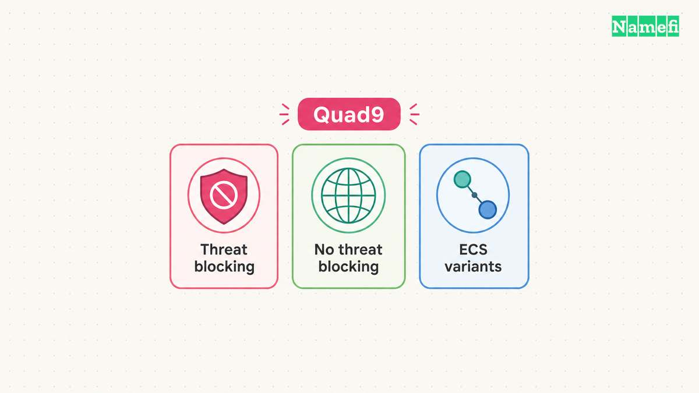

For Quad9's standard threat-blocking service, use **9.9.9.9** and **149.112.112.112** as the IPv4 resolver addresses. The matching IPv6 addresses are **2620:fe::fe** and **2620:fe::9**. Quad9 publishes the complete [service and endpoint list](#quad9-lists-resolver-services-and-addresses).

Choose the service variant before changing settings. Quad9 offers variants with different threat-blocking and client-subnet behavior. Similar addresses do not necessarily provide the same policy.

This guide focuses on the usual secure service and a reversible device setup. The [public resolver guide](/en/blog/choose-public-dns-resolver/) provides a broader provider-selection method.

## The secure service has matching address and encryption endpoints

Quad9 describes its `9.9.9.9` service as a threat-blocking recursive resolver. The [official services page lists the matching endpoints](#quad9-lists-resolver-services-and-addresses).

| Setting | Secure-service value |
| --- | --- |
| Preferred IPv4 | `9.9.9.9` |
| Alternate IPv4 | `149.112.112.112` |
| Preferred IPv6 | `2620:fe::fe` |
| Alternate IPv6 | `2620:fe::9` |
| DNS over TLS hostname | `dns.quad9.net` |
| DNS over HTTPS URL | `https://dns.quad9.net/dns-query` |

Use an IP address in an address field, a hostname in a Private DNS hostname field, and a full URL in a DoH URL field. Do not substitute one format for another because all formats refer to Quad9.

As practical advice, use matching primary and alternate entries when consistent filtering matters. A resolver from another policy can produce different outcomes. Write the chosen service name beside the saved configuration.

## Choose another variant only for a named requirement

Quad9 also documents a no-threat-blocking service at `9.9.9.10`, plus variants with EDNS Client Subnet support. [The services page explains the intended distinctions](#quad9-lists-resolver-services-and-addresses).

Do not change variants merely because another address looks newer. Start with the requirement: threat blocking, a particular network behavior, or a controlled troubleshooting comparison. Use the complete endpoint set for the selected variant.

This guide does not measure Quad9 latency on your network. A public resolver's result can depend on the actual connection and query. Treat a performance claim as a testable question rather than a reason to promise faster gaming or downloads.

If your main concern is a blocked domain, investigate the particular result before replacing the whole network's policy. Keep a record of the domain, time, network, and observed error.

## Save the current DNS configuration before the trial

Record the current automatic or manual DNS setting, active adapter, and any existing addresses. Keep the record outside the settings screen you will edit. The previous configuration supplies the rollback target.

Use one device first. Test the browser and important applications after the change. Do not start by replacing settings across an organization whose private DNS requirements you have not reviewed.

Quad9 notes that VPN clients can override ordinary system or router DNS settings. Quad9 also warns that browser DNS configuration can affect the result. [The Windows guide calls out both cases](#quad9-documents-encrypted-dns-on-windows).

As practical administration advice, identify the active control before editing more settings. Ask the VPN or device administrator which configuration governs DNS when a managed client is active.

## Windows 11 can use Quad9 with DNS over HTTPS

Quad9's Windows 11 guide configures encrypted DNS through the active network adapter. [The guide provides separate IPv4 and IPv6 steps](#quad9-documents-encrypted-dns-on-windows).

1. Open **Network & internet settings**.
2. Select the active Ethernet or Wi-Fi connection.
3. Select **Edit** beside **DNS server assignment**.
4. Change **Automatic (DHCP)** to **Manual**.
5. Enable IPv4 and enter `9.9.9.9` as preferred DNS.
6. Enter `149.112.112.112` as alternate DNS.
7. Set DNS over HTTPS to **On (automatic template)** for each entry.
8. Save the changes.

Configure the matching IPv6 values when the device actually uses IPv6. Quad9 warns that adding an IPv6 DNS server to a device without an IPv6 address can cause resolution failure.

Review any plaintext fallback choice deliberately. Decide whether your priority is maintaining encrypted DNS or maintaining connectivity on a network that blocks the encrypted path. Record the decision instead of assuming that the fallback preserves the same privacy property.

## Android Private DNS uses dns.quad9.net

Quad9 documents Android 9 and later's Private DNS feature for DNS over TLS. The provider hostname is **`dns.quad9.net`**. [The official Android instructions describe the setup](#quad9-documents-android-private-dns).

1. Open the Android **Settings** application.
2. Search for **Private DNS**.
3. Select **Private DNS provider hostname**.
4. Enter `dns.quad9.net`.
5. Save the setting.

Use the hostname without an `https://` prefix or `/dns-query` path. Those additions belong to a different endpoint format.

Quad9 says the Private DNS function does not work while the Quad9 Connect app is installed and enabled. The guide also explains that a VPN can change which DNS configuration applies. Follow the relevant app or VPN documentation when either condition exists.

## Verification should check both the provider and transport

Quad9's Android guide directs users to [on.quad9.net](https://on.quad9.net/) to verify use of the service. [The verification instruction appears in the device guide](#quad9-documents-android-private-dns). Open the check from the configured device and network.

For Windows encrypted-DNS verification, Quad9 documents the PowerShell command `Resolve-DnsName -Type txt proto.on.quad9.net.`. The expected transport indication is `doh` when the documented DoH setup works. [The Windows verification section explains that result](#quad9-documents-encrypted-dns-on-windows).

Those are instructions and expected results. This article has not run a live query from your device. Save the actual output with the trial notes.

If the provider or transport differs from your intention, review the active adapter, browser, and VPN configuration. Restore the original settings if essential applications fail. Keep certificate validation and unrelated security protections enabled.

Expand the configuration to other devices only after the trial succeeds. Keep the endpoint list, verification result, and rollback instructions together so a future operator can understand the DNS choice.

## Sources and further reading

### Quad9 lists resolver services and addresses

[Quad9 lists resolver services and addresses](https://docs.quad9.net/services/#9999-secure). Checked 2026-10-30.

### Quad9 documents encrypted DNS on Windows

[Quad9 documents encrypted DNS on Windows](https://docs.quad9.net/Setup_Guides/Windows/Windows_11_(Encrypted)/#instructions). Checked 2026-10-30.

### Quad9 documents Android Private DNS

[Quad9 documents Android Private DNS](https://docs.quad9.net/Setup_Guides/Android/Android_9%2B_(Encrypted)/#instructions). Checked 2026-10-30.
