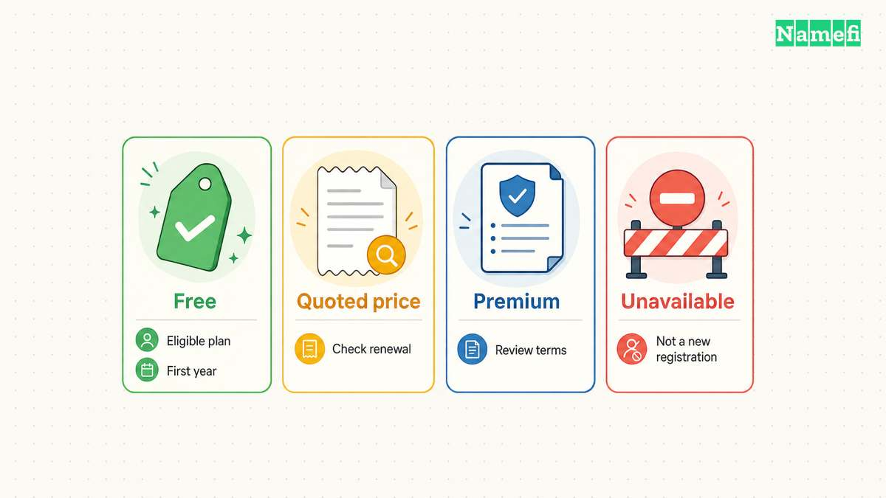
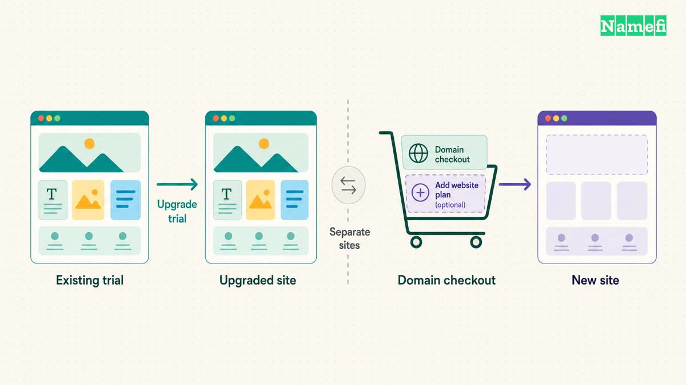

You can register a domain through Squarespace with or without a Squarespace website. Start with the official [domain-only registration guide](https://support.squarespace.com/hc/en-us/articles/217963508-Register-a-domain-without-a-site), or follow the [existing-site registration guide](https://support.squarespace.com/hc/en-us/articles/205812318-Register-a-domain-for-an-existing-site) for a domain attached to a site.

Review the renewal price before checkout. Squarespace says promotional discounts apply to the first year and directs buyers to the Cart Overview for renewal pricing. [The purchase instructions explain the displayed labels](#squarespace-explains-the-purchase-workflow).

## Your starting point depends on whether a website already exists

A domain registration and a website subscription provide different services. Squarespace explicitly says a domain’s price does not include web hosting. [The registration guide makes that distinction](#squarespace-explains-the-purchase-workflow).

| Your situation | Official route |
| --- | --- |
| You need only a new domain | Register a domain without a site |
| You have a trial or active Squarespace site | Register from the existing site’s domain controls |
| You already registered the domain elsewhere | Evaluate connecting or transferring the existing domain |
| You want a different name | Search the exact new name before checkout |

Registering an already-owned domain again is not the same task as connecting the domain. Our [domain and hosting guide](/en/blog/domain-vs-hosting/) explains the separate services.

Squarespace’s domain-only guide says no website subscription is required. A domain that is not attached to a website can show a parking page. [Read the domain-only conditions](#squarespace-supports-registration-without-a-website) before buying a website plan merely to reserve a name.

## You should search the exact name and inspect the result label

Open the official route for your situation. For an existing site, Squarespace directs customers to the domains dashboard or the eligible site’s Domains panel. Select **Get a domain** and search for the intended name.

Review the full spelling and extension. A suggested alternative may not match the name you typed. The result label affects the next decision.

| Result label | What to check |
| --- | --- |
| Free | Whether the account and selected name qualify for the first-year offer |
| A specific price | Registration term and later renewal price |
| Premium | Initial premium conditions and the full quote |
| Unavailable | The name cannot be purchased through the normal available-name flow |

Squarespace documents these labels in the [purchase workflow](#squarespace-explains-the-purchase-workflow). An unavailable result does not promise that the present holder will sell the name or respond to an inquiry.

For a country-code extension, read the registration requirements before payment. The same registrar can sell extensions with different eligibility rules. Availability and applicant eligibility are separate checks.

## The cart should make the complete obligation clear

Select the desired domain and open checkout. Review the registration term length for each domain. Remove spelling variants or extra extensions that you do not intend to maintain.

Squarespace says pricing varies by TLD, premium status, and applicable one-time premium fees. Taxes can also appear at checkout. [Use the actual cart rather than a general advertised price](#squarespace-supports-registration-without-a-website).

Record these details before confirming the purchase:

- The exact domain and holder.
- The initial registration term.
- The amount due and currency.
- The renewal date and renewal price.
- Any premium fees or eligibility conditions.
- Every separately selected subscription.

The checklist is practical purchase advice. The actual checkout and agreement control the purchase.

An eligible annual website plan may include a first-year domain offer. Squarespace describes eligibility in the registration instructions. The offer does not establish a permanently free registration. Compare the ongoing domain and website obligations separately.

## Optional plans can create an unintended second purchase

Review Google Workspace and website suggestions before selecting any plan. A custom email subscription serves a different need from domain registration.

A particularly useful warning appears in Squarespace’s existing-site guide. If you already designed a trial site, upgrade the trial separately. A website plan purchased in the domain checkout creates a new site and does not apply to that trial. [Squarespace states the distinction in the purchase steps](#squarespace-explains-the-purchase-workflow).

That detail matters when the intended website already contains work. Check the account’s site list and the domain’s intended destination before adding another website subscription.

Squarespace also describes Whois privacy for eligible domains and DNS controls. [The domain feature guide explains those features](#squarespace-describes-domain-management-features). Do not treat privacy protection as permission to provide inaccurate holder information.

## Contact information and verification complete the registration

Enter the intended holder’s correct contact information. Read the agreement and final fee summary. Confirm the purchase only after the exact name and term match the intended purchase.

After purchase, check the registration email and domain dashboard. Squarespace says a contact-verification link may arrive and requires customers to complete the verification within the stated deadline. Previously verified contact details may verify automatically. [Follow the official verification instructions](#squarespace-supports-registration-without-a-website).

Use the official account to investigate a suspicious or unexpected message. Do not treat every domain-related invoice or email as part of the authorized purchase.

Save the confirmation receipt. A charge alone does not replace a registration-status check. Squarespace documents a pending **Registration In Progress** status and later shows renewal information when the domain completes the workflow.

## You should check renewal and service configuration after purchase

Squarespace says domains auto-renew at the end of the registration term. [The domain-only guide documents automatic renewal](#squarespace-supports-registration-without-a-website). Review the payment method, renewal date, and renewal price in the account.

If the domain remains parked, decide when and where to connect the domain. If the domain should serve a website, follow the intended platform’s custom-domain setup. Do not change email records merely to connect a website.

Finally, record who controls the account and who receives renewal notices. Keep recovery access available even when a domain mailbox stops working. A domain purchase becomes useful when the business can maintain the registration and connect the services the business actually needs.

## Sources and further reading

### Squarespace explains the purchase workflow

[Squarespace explains the purchase workflow](https://support.squarespace.com/hc/en-us/articles/205812318-Register-a-domain-for-an-existing-site#:~:text=Your%20domain%E2%80%99s%20price%20includes%20domain%20hosting%2C%20but%20doesn%27t%20include%20web%20hosting.), checked 2026-10-30.

### Squarespace supports registration without a website

[Squarespace supports registration without a website](https://support.squarespace.com/hc/en-us/articles/217963508-Register-a-domain-without-a-site#:~:text=Buy%20Squarespace%20domains%20at%20any%20time%20with%20no%20website%20subscription%20required.), checked 2026-10-30.

### Squarespace describes domain management features

[Squarespace describes domain management features](https://support.squarespace.com/hc/en-us/articles/205812198-Registering-Squarespace-domains#:~:text=All%20eligible%20Squarespace%20domains%20include%20free%20Whois%20privacy%20protection.), checked 2026-10-30.
