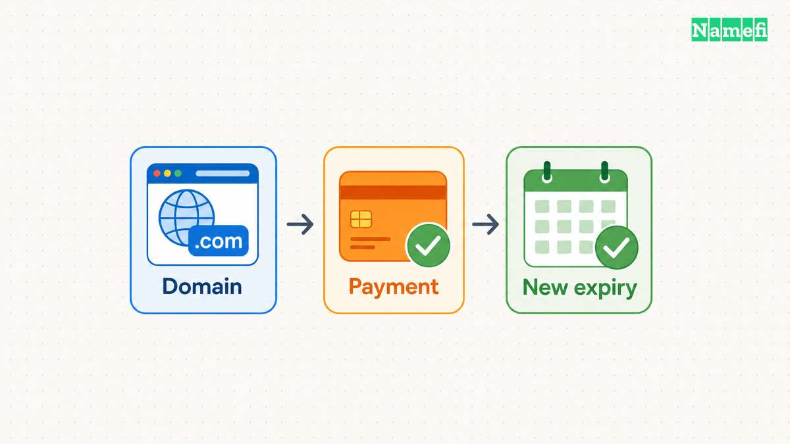
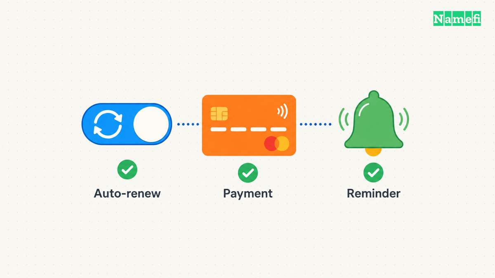

**Renew your domain through the registrar or reseller account that manages the registration, then confirm the new expiration date.** If the domain has already expired, contact that provider immediately for the available renewal or restoration operation and deadline. ICANN advises renewal before expiration and warns that a lapse can cause temporary or permanent loss. [Read ICANN's renewal guidance.](#icann-explains-registration-renewal)

Do not use a working website as your renewal receipt. The task ends with a confirmed registration extension, a payment record, and an updated reminder.

This guide concerns keeping a domain you already control. For spending decisions, read the [domain holding cost guide](/en/blog/how-much-is-a-domain-understanding-holding-cost/).

## Renew through the account that controls the registration

Sign in through the provider's known website or your saved bookmark. Check the complete domain spelling before authorizing a charge. If an agency manages the account, ask the agency to identify the renewal owner and confirm completion.

Follow this practical sequence:

1. Open the domain's registration details.
2. Confirm the current expiration date and renewal deadline.
3. Read the renewal quote and registration term.
4. Complete the provider's renewal payment.
5. Wait for the operation to finish.
6. Confirm the new expiration date in the account.
7. Save the receipt and completion notice.

For a concrete example, Cloudflare's instructions use **Manage domains → Manage → Registration → Renew/Extend Domain**. Its workflow changes the status to **Renewal Pending** after payment validation and **Active** after completion. [Follow Cloudflare's manual procedure when Cloudflare is your registrar.](#cloudflare-documents-manual-renewal-and-auto-renew)

Cloudflare adds renewed years to the current expiration date. [Its documentation states that behavior.](#cloudflare-documents-manual-renewal-and-auto-renew) Check another provider's current procedure rather than assuming identical labels and billing behavior.

If payment appears successful but the registration remains pending, save the order reference and contact support. Avoid repeated payments while the order outcome remains unclear. Ask support for completion status and the resulting expiration date.

## Auto renew needs a valid payment method and a completion check

As an operating recommendation, enable auto renew for a domain the organization intends to retain. Then check the exact domain setting, payment method, and notice destination.

Cloudflare warns that billing failures and registry downtime can prevent automatic renewal. Its first attempt occurs approximately 30 days before expiration. [Read the automatic-renewal conditions.](#cloudflare-documents-manual-renewal-and-auto-renew)

That schedule illustrates why the expiration date and billing attempt date require separate attention. Check your provider's schedule before the first attempt. Leave time to recover account access, replace an invalid payment method, or resolve a billing problem.

Keep an independent reminder before the attempt and another reminder to verify the result. Assign a person rather than relying on an unattended mailbox.

| Record | Information to keep |
| --- | --- |
| Domain | Exact spelling and extension |
| Account | Provider and authorized account owner |
| Deadline | Provider's applicable renewal cutoff |
| Billing | Auto-renew setting and expected attempt date |
| Completion | Receipt, provider status, and new expiration date |
| Recovery | Contact route for account or payment problems |

Consider a notice address that remains reachable if the renewing domain stops working. Review the record whenever an employee or agency leaves. The [registrar account security guide](/en/blog/harden-domain-registrar-account/) covers account protection.

## Act on expiration according to the current registration status

If the domain has expired, open the account immediately. Ask the provider four concrete questions: what status applies, which operation restores the domain, what total charge applies, and when the opportunity ends.

Do not assume a universal free extension or a fixed post-expiration renewal window. ICANN's Expired Registration Recovery Policy permits registrars to delete expired registrations under applicable rules. [Read the post-expiration provision.](#icann-specifies-expiration-and-redemption-protections)

Use the provider's response to choose the next action:

| Situation | Action to confirm |
| --- | --- |
| Ordinary renewal remains available | Complete renewal and verify the extension |
| The registration entered redemption | Request restoration through the deleting registrar |
| A restoration request is pending | Ask what documentation or action remains |
| The status is unclear | Request the exact registry and registrar status before paying |
| The former registration is no longer recoverable | Ask about any remaining provider-supported options |

Keep all quoted deadlines in the provider's stated timezone. Ask support to resolve ambiguous dates before the final cutoff. A date without a timezone can leave the operational deadline unclear.

For country-code domains, obtain the extension-specific registry and registrar procedure. The gTLD recovery policy does not establish one timetable for every country-code extension.

## Redemption follows deletion under the covered gTLD policy

ICANN's policy requires a 30-day Redemption Grace Period immediately after deletion for covered gTLD registries, with exceptions for sponsored registries and applicable add-grace deletions. [Read the precise scope.](#icann-specifies-expiration-and-redemption-protections)

The period runs from the relevant deletion event, not universally from the expiration date. During redemption, the policy requires disabled DNS resolution and prohibits attempted transfers, subject to its stated bulk-transfer exceptions. [The same policy defines those conditions.](#icann-specifies-expiration-and-redemption-protections)

Contact the deleting registrar for restoration. Ask for the current fee and deadline. ICANN requires renewal, post-expiration, and restoration fees to be reasonably available. [Read the fee-disclosure provision.](#icann-specifies-expiration-and-redemption-protections)

If a lookup shows `pendingDelete`, read the full combination of status codes. ICANN explains that `pendingDelete` alongside redemption or restoration differs from `pendingDelete` after an uncompleted redemption period. [Check the status explanation.](#icann-explains-pending-registration-operations) Ask the registrar which options remain.

Do not assume ICANN can return an expired name on request. ICANN's renewal guidance states that ICANN lacks authority to transfer expired domains back to a former holder. [Read that limit.](#icann-explains-registration-renewal)

## Verify services after the registration returns to normal

After renewal or restoration, confirm the new expiration date and provider completion notice. Then test the website and email separately. Keep support involved if a service remains unavailable.

Covered gTLD registrants receive required expiration reminders approximately one month and one week before expiration. [ICANN's policy specifies those notices.](#icann-specifies-expiration-and-redemption-protections) Treat provider notices as additional prompts alongside your own completion check.

The next action is concrete: open the correct registrar account, complete the available operation, and save evidence that the registration term changed. Update the reminder only after verifying that result.

## Sources and further reading

### ICANN explains registration renewal

[renew official source](https://www.icann.org/resources/pages/renew-domain-name-2018-12-07-en#:~:text=If%20you%20want%20to%20keep%20using%20it) — fetched 2026-10-30 UTC.

### Cloudflare documents manual renewal and auto renew

[renew-cf official source](https://developers.cloudflare.com/registrar/account-options/renew-domains/#renew-a-domain-manually) — fetched 2026-10-30 UTC.

### ICANN specifies expiration and redemption protections

[errp official source](https://www.icann.org/en/contracted-parties/consensus-policies/expired-registration-recovery-policy/expired-registration-recovery-policy-21-02-2024-en#:~:text=3.1.) — fetched 2026-10-30 UTC.

Checked passages: [Section 2.1: expiration reminders](https://www.icann.org/en/contracted-parties/consensus-policies/expired-registration-recovery-policy/expired-registration-recovery-policy-21-02-2024-en#:~:text=2.1.1.), [Section 2.2: renewal after expiration](https://www.icann.org/en/contracted-parties/consensus-policies/expired-registration-recovery-policy/expired-registration-recovery-policy-21-02-2024-en#:~:text=2.2.1.), [Section 3: redemption after deletion](https://www.icann.org/en/contracted-parties/consensus-policies/expired-registration-recovery-policy/expired-registration-recovery-policy-21-02-2024-en#:~:text=3.1.), [Section 4: disclosed fees](https://www.icann.org/en/contracted-parties/consensus-policies/expired-registration-recovery-policy/expired-registration-recovery-policy-21-02-2024-en#:~:text=4.1.).

### ICANN explains pending registration operations

[epp official source](https://www.icann.org/resources/pages/epp-status-codes-2014-06-16-en#pendingDelete) — fetched 2026-10-30 UTC.
