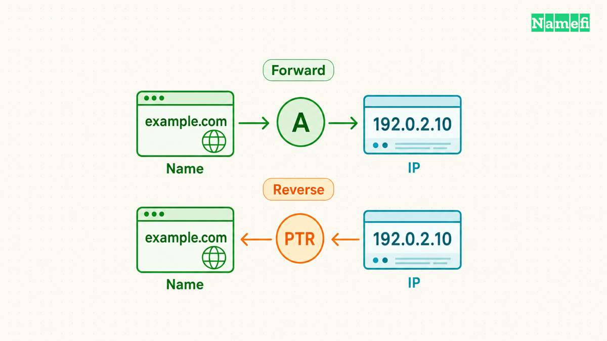
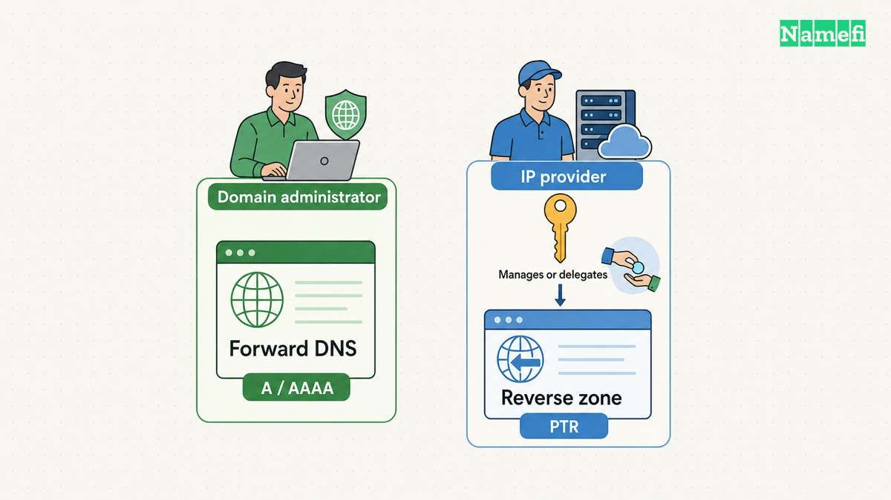
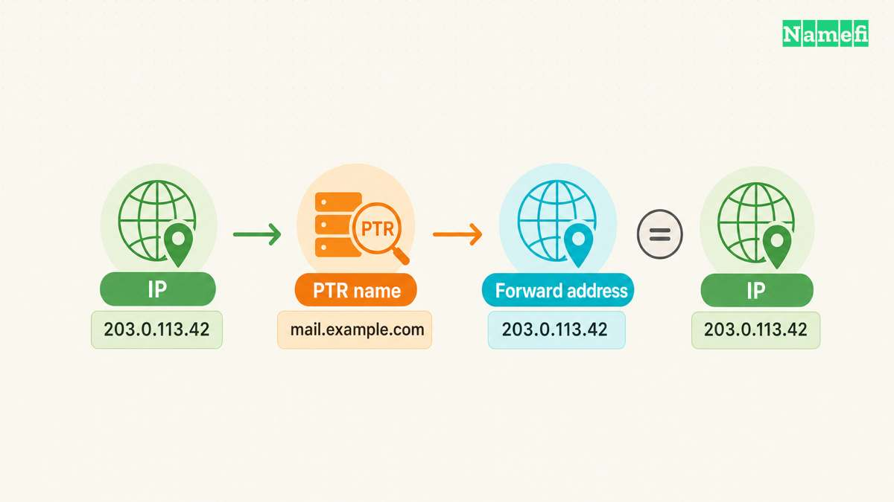

[Reverse DNS](/en/blog/reverse-dns-lookup/) looks up a hostname from an IP address. The answer usually comes from a PTR record in a reverse DNS zone. [ARIN explains the address-to-name lookup](#arin-explains-reverse-dns-and-delegation-control). Reverse DNS can help diagnose a server, but a returned hostname does not prove legal ownership or authenticate an email message.

The key operational distinction concerns control. The organization that manages your domain's ordinary DNS records may not control reverse DNS for your server's address. Find the IP provider before trying to edit a PTR record.

The examples are hypothetical. [IANA maintains example domains for documentation](#iana-maintains-example-domains-for-documentation). [RFC 5737 reserves the illustrated IPv4 address range](#rfc-5737-reserves-documentation-ipv4-addresses).

## Forward and reverse DNS answer different questions

A forward lookup starts with a name and requests an address. An A record supplies an IPv4 address. An AAAA record supplies an IPv6 address. A reverse lookup starts with an address and requests a name.

Consider a hypothetical server named `mail.example.com` at `192.0.2.10`. The forward relationship would point the name to the address. The reverse relationship would point the address to the name. These are separate records, rather than one automatically reversible entry.

RFC 1035 defines PTR data as a domain name and explains the IPv4 reverse namespace. [The protocol does not define PTR as a registration ownership certificate](#rfc-1035-defines-ptr-and-reverse-lookup-names). Treat the answer as DNS data with a particular administrative source.

The [DNS record guide](/en/blog/dns-record-types-guide/) places PTR alongside the other record types. Do not substitute a website's A record when a receiving mail system asks for reverse DNS.

## The reverse zone follows the address delegation

IPv4 reverse DNS uses `in-addr.arpa`. IPv6 reverse DNS uses `ip6.arpa`. [ARIN documents both namespaces and their delegation](#arin-explains-reverse-dns-and-delegation-control).

For IPv4, the lookup reverses the address octets before adding the suffix. The documentation address `192.0.2.10` therefore corresponds to `10.2.0.192.in-addr.arpa`. [RFC 1035 explains that structure](#rfc-1035-defines-ptr-and-reverse-lookup-names).

A domain DNS dashboard can contain forward records without authority over that reverse name. Adding a PTR entry to an unrelated forward zone does not establish the reverse delegation.

Ask the server or IP provider where it manages reverse DNS. The provider might offer an address settings screen or a support process. Organizations that directly manage delegated address space can have a different administrative route. [ARIN explains delegation authority and shared-authority arrangements](#arin-explains-reverse-dns-and-delegation-control).

For a shared outbound email service, begin with the email provider. Do not assume the domain owner can select a unique PTR hostname for a shared IP address. Ask the provider which server name it expects receivers to see.

## A reverse lookup gives you an answer to verify

A local command such as `dig -x 192.0.2.10` requests reverse DNS. [BIND documents the reverse lookup option](#bind-documents-reverse-lookups-with-dig). Replace the example address with the actual public address under investigation.

Keep the answer, response status, responding resolver, and query time in UTC. Do not treat an empty answer, an error response, and a timeout as identical outcomes. Query another resolver when a recent authorized change produces inconsistent results.

A PTR answer can return a hostname that differs from a website brand. That observation alone does not prove a configuration error. Compare the answer with the provider's documented server identity and the task you are diagnosing.

If the result is missing or incorrect, send the IP provider the exact address and intended hostname. Include the current query result. A precise request is more useful than asking the domain registrar to fix unspecified DNS.

## Forward confirmation checks consistency across both directions

After receiving a PTR name, query that name for the appropriate address record. For the hypothetical IPv4 server, run `dig A mail.example.com`. Compare the returned address set with the original sending address.

Google's sender requirements describe this relationship explicitly. [The PTR hostname must also resolve forward to the public sending IP](#google-requires-matching-forward-and-reverse-mail-records). Use AAAA for the corresponding IPv6 check.

A mismatch can require action in two administrative places. The domain DNS administrator controls the forward record. The IP provider controls or delegates the reverse record. Confirm both responsibilities before changing either value.

Forward confirmation supports a consistency conclusion. The matching records do not establish who legally owns the domain, whether the sender has permission to use a visible From address, or whether a message contains safe content.

## Mail troubleshooting needs more than a matching PTR

PTR configuration can matter for outbound mail, but email authentication remains separate. Check SPF authorization, DKIM signatures, and DMARC alignment through the actual receiving system's results.

The [DMARC guide](/en/blog/dmarc-record-setup/) explains that separate domain alignment check. A server can have matching forward and reverse DNS while a particular message fails authentication.

Also separate the SMTP identity from the reverse lookup. A server greeting or EHLO name comes from the mail server configuration. A PTR name comes from reverse DNS. Compare those values with the sending provider's requirements instead of calling every difference an ownership problem.

When escalating a delivery failure, collect the sending IP, PTR answer, forward answer, relevant server identity, recipient's error, and authentication results. Redact private message content that the provider does not need.

## A useful completion check names the responsible operator

Finish the investigation with a specific conclusion. State which organization controls the reverse record, which hostname the PTR returns, and whether the forward lookup includes the original address.

If mail still fails, continue with the receiver's actual error and authentication results. If the reverse record is wrong, ask the address operator to correct that record through its supported process.

The next action is to identify the server's public sending IP and run one reverse lookup. The returned name gives you the next forward query, rather than a final verdict about ownership or message safety.

## Sources and further reading

### ARIN explains reverse DNS and delegation control

[ARIN explains reverse DNS and delegation control](https://www.arin.net/resources/manage/reverse/#who-can-manage-dns-delegations) — checked 2026-10-30.

### RFC 1035 defines PTR and reverse lookup names

[RFC 1035 defines PTR and reverse lookup names](https://www.rfc-editor.org/rfc/rfc1035.html#section-3.5) — checked 2026-10-30. Checked passages: Sections 3.3.12, 3.4.1, 3.5, 4.1.1, and 4.1.3.

### Google requires matching forward and reverse mail records

[Google requires matching forward and reverse mail records](https://support.google.com/a/answer/81126?hl=en#:~:text=The%20public%20IP%20address%20of%20a%20sending%20SMTP%20server) — checked 2026-10-30.

### BIND documents reverse lookups with dig

[BIND documents reverse lookups with dig](https://bind9.readthedocs.io/en/latest/manpages.html#dig-dns-lookup-utility) — checked 2026-10-30. Checked passages: The dig manual: Simple Usage, the -x option, and the +recurse/+norecurse query option.

### IANA maintains example domains for documentation

[IANA maintains example domains for documentation](https://www.iana.org/help/example-domains#:~:text=for%20documentation%20purposes) — checked 2026-10-30.

### RFC 5737 reserves documentation IPv4 addresses

[RFC 5737 reserves documentation IPv4 addresses](https://www.rfc-editor.org/rfc/rfc5737.html#section-3) — checked 2026-10-30.
