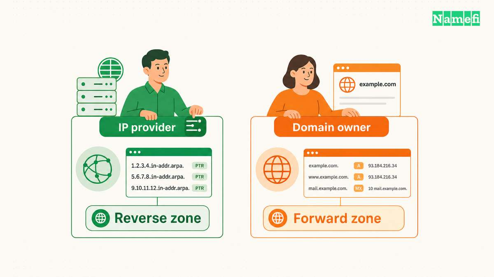
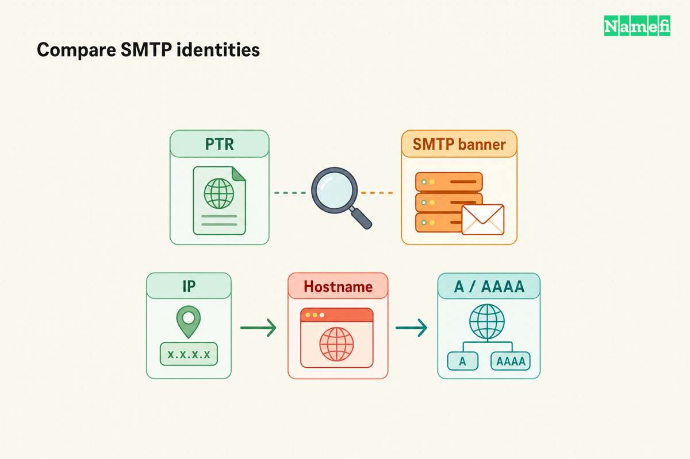
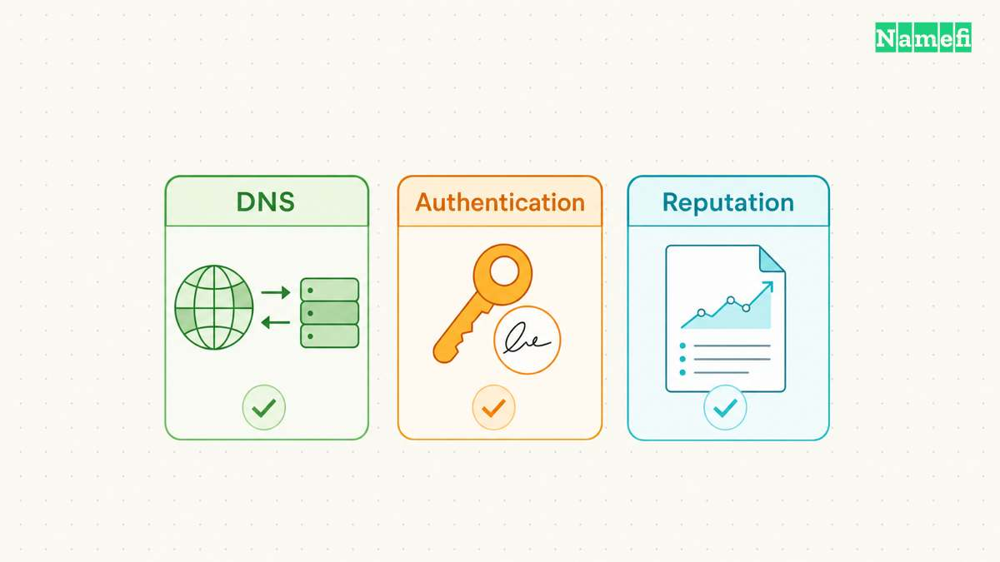

A PTR record supplies a name for an IP address. A successful reverse lookup does not establish legal ownership of that name. A matching forward lookup adds a consistency check, but the pair still does not authenticate an email message.

The practical problem usually concerns responsibility. A domain administrator can publish a forward record and still lack permission to change the corresponding reverse record. The reverse record follows the IP address delegation, rather than the domain registration.

This guide explains the difference, then walks through a hypothetical mail-server configuration. Every example uses reserved documentation addresses and example domains. The examples describe expected relationships rather than live DNS results.

## PTR records answer an address-to-name question

Ordinary [DNS](/en/glossary/dns/) lookups often start with a name. An application asks for an A record or AAAA record and receives an address. Reverse DNS starts with the address and asks for a PTR record.

The two directions use different names in DNS. For IPv4, the query reverses the four address octets and adds `in-addr.arpa`. [RFC 1035, section 3.5](https://www.rfc-editor.org/rfc/rfc1035#section-3.5), defines that structure. For the hypothetical address `192.0.2.25`, the reverse query name becomes `25.2.0.192.in-addr.arpa.`

The terminal dot marks an absolute DNS name. A hypothetical answer associates that reverse name with `mail.example.com.` The PTR value contains a domain name, rather than another IP address. [RFC 1035, section 3.3.12](https://www.rfc-editor.org/rfc/rfc1035#section-3.3.12), defines the record data.

A corresponding forward A record associates `mail.example.com.` with `192.0.2.25`. These records perform separate jobs among the available [DNS record types](/en/glossary/dns-record-types/). Publishing the A record does not automatically create the PTR record.

IPv6 uses a different reverse namespace. The reverse query expands the address into hexadecimal digits, reverses the digits, and separates each digit with a dot. The query ends with `ip6.arpa`, as [RFC 3596, section 2.5](https://www.rfc-editor.org/rfc/rfc3596#section-2.5), specifies. Each digit represents four address bits, also called a nibble.

An administrator should let a lookup tool construct long IPv6 reverse names. The task usually requires checking the returned hostname, rather than manually editing thirty-two hexadecimal labels. Keep the original IPv6 address in the investigation record so another administrator can repeat the query.

Reverse DNS also differs from a search for every website on an address. Consider a hypothetical server hosting `shop.example.com` and `news.example.net`. A reverse result naming `host.example.com` does not provide an inventory of those hosted names. The result answers the PTR question for the address.

Treat the returned hostname as a configured label. A familiar company name inside a PTR answer does not establish a business relationship. A missing company name does not establish misconduct. Further investigation needs evidence suited to the actual question.

## IP address delegation determines who can change reverse DNS

The [nameserver](/en/glossary/nameserver/) serving `example.com` does not automatically control `2.0.192.in-addr.arpa`. The forward domain and reverse namespace have separate delegation paths. That distinction explains why adding a PTR row to a normal domain dashboard often fails to change public reverse DNS.

Start with the organization supplying the sending IP address. Ask whether the organization provides a reverse DNS setting, accepts support requests, or delegates a reverse zone. Confirm the actual account and address before requesting a change. Access to the domain account alone does not answer that question.

AWS provides a concrete operator example. Its EC2 documentation describes reverse DNS management for Elastic IP addresses through the address settings. AWS also requires a corresponding forward A record before the change. These are [AWS-specific requirements](https://docs.aws.amazon.com/AWSEC2/latest/UserGuide/Using_Elastic_Addressing_Reverse_DNS.html), rather than rules for every hosting service.

A useful support request names the allocated address and desired hostname. Include the current forward answer and explain which server uses the address. Ask the provider to confirm whether the provider publishes the PTR or delegates the reverse namespace. Avoid asking the domain registrar to repair an unrelated IP provider's zone.

| Situation | Contact | Verify first |
| --- | --- | --- |
| Provider manages the address | IP provider | Reverse DNS setting |
| Provider delegates a reverse zone | Reverse zone administrator | Parent delegation |
| Mail service manages outbound servers | Mail service | Actual sending address |
| Administrator controls only the domain | IP provider | Address allocation |

Organizations with address blocks can sometimes administer delegated reverse zones. Smaller IPv4 blocks need special handling because normal reverse labels follow whole octets. [RFC 2317, section 4](https://www.rfc-editor.org/rfc/rfc2317#section-4), describes classless delegation using parent CNAME records and delegated child zones.

The parent points individual reverse names toward the child namespace. The child serves the corresponding PTR records. Both administrators must configure their parts. Creating a child zone without the parent's participation does not make ordinary reverse queries reach the child.

RFC 2317 also permits alternative child naming arrangements. Do not infer the child zone name from a prefix alone. Obtain the provider's exact delegation instructions and compare those instructions with the published parent records. An unusual child name can follow a valid arrangement.

For a hypothetical migration, list the old and new addresses separately. Identify the reverse administrator for each address before moving outbound traffic. Preserve access to the old configuration until the migration checks finish. A domain transfer does not itself settle either provider relationship.

## Forward confirmation checks consistency across two lookups

Forward-confirmed reverse DNS checks a specific relationship. Start with an address, retrieve its PTR hostname, and resolve that hostname forward. The forward answer must include the original address for the relationship to match.

[RFC 1912, section 2.1](https://www.rfc-editor.org/rfc/rfc1912.html#section-2.1), recommends consistent forward and reverse records. The document provides operational guidance and does not define every receiver's acceptance policy. Prefer a stable hostname with a direct address record for the server's intended identity.

With BIND's `dig` tool available, run `dig -x 192.0.2.25`. BIND documents the `-x` option as a [simplified reverse lookup](https://bind9.readthedocs.io/en/latest/manpages.html#dig-dns-lookup-utility). The tool constructs the reverse name and selects PTR automatically.

For this hypothetical configuration, expect a PTR answer naming `mail.example.com.` Next, run `dig mail.example.com. A`. The forward answer should include `192.0.2.25`. For an IPv6 sender, use its actual IPv6 address with `-x`, then query the returned hostname for AAAA.

Keep the complete command output during troubleshooting. A [DNS resolver](/en/glossary/dns-resolver/) can return a failure, an empty answer, or an address that differs from expectations. A short-output display can hide useful status information. Record the queried server, time, query type, and answer.

Suppose the PTR returns `mail.example.com`, but the A record returns only `192.0.2.26`. The records fail the original-address check. Determine which server should send before changing either record. Copying the unexpected address into another record could preserve the wrong server identity.

Suppose the reverse lookup returns no PTR answer. First confirm that the query used the public sending address. Next, ask the reverse administrator to verify the authoritative record and delegation. Repeatedly changing the forward A record cannot repair an absent reverse delegation.

Suppose the provider dashboard shows the new hostname, while a recursive lookup shows the old hostname. Compare the published authoritative answer with the recursive answer. Record TTL information and allow existing caches to expire according to the actual records. [DNS propagation](/en/glossary/dns-propagation/) does not follow one universal completion deadline.

Record an empty answer separately from a timeout. An empty answer reports a DNS result, while a timeout reports a missing response. DNS also permits caching negative answers under [RFC 2308, section 5](https://www.rfc-editor.org/rfc/rfc2308.html#section-5). A newly created PTR can therefore require another check after an earlier negative cache entry expires. Avoid treating every failed lookup as evidence of the same fault.

A delegated classless reverse zone adds another check. Confirm that the parent CNAME reaches the intended child name. Confirm that the child provides the PTR answer. A correct child PTR cannot compensate for a parent reference pointing somewhere else.

Use an explicit acceptance checklist for a hypothetical server handover. The address must match the intended outbound server. The reverse answer must name the agreed hostname. The hostname's forward answer must include the original address. The operator must also verify the server's real traffic after the change.

Store the successful results alongside the change request. A later administrator needs the expected pair, not merely a statement that DNS worked once. Keep separate results for every sending address and address family. A passing IPv4 check says nothing about a different IPv6 sender.

## SMTP banner warnings require a separate identity check

A checker may report “[reverse DNS does not match SMTP banner](https://mxtoolbox.com/problem/smtp/smtp-banner-check).” Start with the checker's recorded IP address and greeting. Do not assume the checker tested the server that sent a rejected message.

The SMTP banner is the receiving server's initial `220` greeting. The sending client identifies itself separately with `EHLO` or `HELO`. [RFC 5321, sections 3.1 and 3.2](https://www.rfc-editor.org/rfc/rfc5321.html#section-3.1), describes the two directions. A test of an incoming mail server can therefore concern a different connection from an outbound delivery failure.

For a hypothetical server, compare these values:

| Check | Hypothetical value | Administrator responsible |
| --- | --- | --- |
| IP address under test | `192.0.2.25` | Server or mail-service operator |
| PTR answer for that address | `mail.example.com.` | Reverse DNS administrator |
| A answer for the PTR hostname | `192.0.2.25` | Forward DNS administrator |
| Hostname in the incoming SMTP greeting | `mail.example.com` | Mail-server administrator |
| Identity used during outbound EHLO | `mail.example.com` | Outbound mail-server administrator |

An online banner test does not establish the outbound EHLO value. Obtain the outbound identity from the sending server's configuration or a controlled receiver's connection log.

If the PTR and forward address agree but the banner names `oldmail.example.com`, investigate the server's greeting configuration. If the intended server name is `mail.example.com`, ask the mail-server administrator to update the greeting. If the PTR names the wrong server, ask the IP provider to correct reverse DNS. Keep the forward record consistent with the intended address.

[MxToolbox's mismatch documentation](https://mxtoolbox.com/problem/smtp/smtp-reverse-dns-mismatch) recommends a PTR that matches the mail server hostname. Treat the checker result as a configuration finding. The checker result does not identify every receiver's policy or establish a delivery failure.

RFC 5321 permits an SMTP server to check the client's EHLO name against the client IP. The RFC prohibits refusal solely because that particular check fails. [Section 4.1.4](https://www.rfc-editor.org/rfc/rfc5321.html#section-4.1.4) states the narrow rule. Gmail separately publishes forward-and-reverse DNS requirements. Preserve the actual rejection response when diagnosing delivery.

## Mail receivers evaluate PTR records alongside authentication and reputation

Gmail's sender guidelines require sending servers to have matching forward and reverse DNS. The [IP addresses guidance](https://support.google.com/a/answer/81126?hl=en) describes a PTR hostname whose A or AAAA record resolves to the sending public address. Gmail also imposes independent authentication and other sender requirements.

This distinction matters when diagnosing rejected messages. Passing the DNS consistency check does not establish that a message passes authentication. A receiver can still reject or filter a message for other reasons. PTR configuration cannot guarantee inbox placement or delivery.

[SPF](https://www.rfc-editor.org/rfc/rfc7208.html#section-2.1) lets a domain authorize sending hosts for specified SMTP identities. A PTR record alone does not publish that authorization. The SPF specification also discourages publishing the SPF `ptr` mechanism in [section 5.5](https://www.rfc-editor.org/rfc/rfc7208.html#section-5.5). Configuring reverse DNS does not require adding that mechanism to an SPF policy.

[DKIM](https://www.rfc-editor.org/rfc/rfc6376.html#section-1) associates a signing domain with a message through a digital signature. A reverse hostname supplies no equivalent message signature. A server can have matching forward and reverse answers while producing unsigned messages.

[DMARC identifier alignment](https://www.rfc-editor.org/rfc/rfc9989.html#section-4.4) connects the visible From domain with an authenticated SPF or DKIM identifier. That relationship differs from the address-to-hostname relationship. A passing reverse check cannot replace the required authenticated identity.

For a hypothetical rejection, begin with the receiver's exact response and the server's actual sending address. Check reverse DNS only when the evidence indicates an address or hostname problem. Check authentication results when the response identifies an authentication failure. Preserve the distinction throughout the repair.

A mail service may send through infrastructure outside the customer's direct control. Ask the service to identify the outbound address involved in the rejected attempt. The website address, incoming mail destination, and outbound sending address may describe different systems. Investigate the server that made the rejected connection.

After a PTR repair, send a controlled test to a destination the administrator manages. Record the connection address and receiver response. Confirm authentication independently, then monitor delivery behavior. A successful test establishes the observed result for that attempt, rather than a permanent acceptance guarantee.

The same evidence boundary applies outside email. A PTR value can help an investigator identify an administrator's chosen hostname. Forward confirmation adds evidence that the forward and reverse configurations agree. Neither result supplies a registration contract, legal title, or proof that the hostname identifies a trustworthy operator.

When someone presents a PTR answer as ownership evidence, ask what ownership question needs an answer. Domain registration, IP allocation, server administration, and message authorization describe different relationships. Check the relevant account records, contracts, or protocol results. Use reverse DNS to answer the narrower naming question that reverse DNS actually addresses.

## Sources and further reading

- RFC Editor, [RFC 1035](https://www.rfc-editor.org/rfc/rfc1035#section-3.3.12), sections 3.3.12 and 3.5, PTR format and IPv4 reverse names. Fetched 2026-10-21.
- RFC Editor, [RFC 3596](https://www.rfc-editor.org/rfc/rfc3596#section-2.5), section 2.5, IPv6 reverse names. Fetched 2026-10-21.
- RFC Editor, [RFC 2317](https://www.rfc-editor.org/rfc/rfc2317#section-4), sections 4 and 5.2, classless delegation and alternative naming. Fetched 2026-10-21.
- RFC Editor, [RFC 1912](https://www.rfc-editor.org/rfc/rfc1912.html#section-2.1), section 2.1, forward and reverse consistency guidance. Fetched 2026-10-21.
- AWS, [Create a reverse DNS record for email on Amazon EC2](https://docs.aws.amazon.com/AWSEC2/latest/UserGuide/Using_Elastic_Addressing_Reverse_DNS.html), Considerations and Create a reverse DNS record. Fetched 2026-10-21.
- Google, [Email sender guidelines](https://support.google.com/a/answer/81126?hl=en), Sender requirements and IP addresses. Fetched 2026-10-21.
- ISC, [BIND 9 manual pages](https://bind9.readthedocs.io/en/latest/manpages.html#dig-dns-lookup-utility), dig synopsis and the `-x` option. Fetched 2026-10-21.
- RFC Editor, [RFC 7208](https://www.rfc-editor.org/rfc/rfc7208.html#section-2.1), sections 2.1 and 5.5, SPF identities and the discouraged `ptr` mechanism. Fetched 2026-10-21.
- RFC Editor, [RFC 6376](https://www.rfc-editor.org/rfc/rfc6376.html#section-1), section 1, DKIM domain responsibility. Fetched 2026-10-21.
- RFC Editor, [RFC 9989](https://www.rfc-editor.org/rfc/rfc9989.html#section-4.4), section 4.4, DMARC identifier alignment. Fetched 2026-10-21.
- RFC Editor, [RFC 2308](https://www.rfc-editor.org/rfc/rfc2308.html#section-5), section 5, negative answer caching. Fetched 2026-10-21.
- RFC Editor, [RFC 5321](https://www.rfc-editor.org/rfc/rfc5321.html#section-3.1), sections 3.1, 3.2, and 4.1.4, SMTP greetings, client identity, and EHLO verification limits. Fetched 2026-10-21.
- MxToolbox, [SMTP Reverse DNS Mismatch](https://mxtoolbox.com/problem/smtp/smtp-reverse-dns-mismatch), forward/reverse mismatch explanation and administrator action. Fetched 2026-10-21.
- MxToolbox, [SMTP Banner Check](https://mxtoolbox.com/problem/smtp/smtp-banner-check), greeting and PTR-name comparison. Fetched 2026-10-21.
