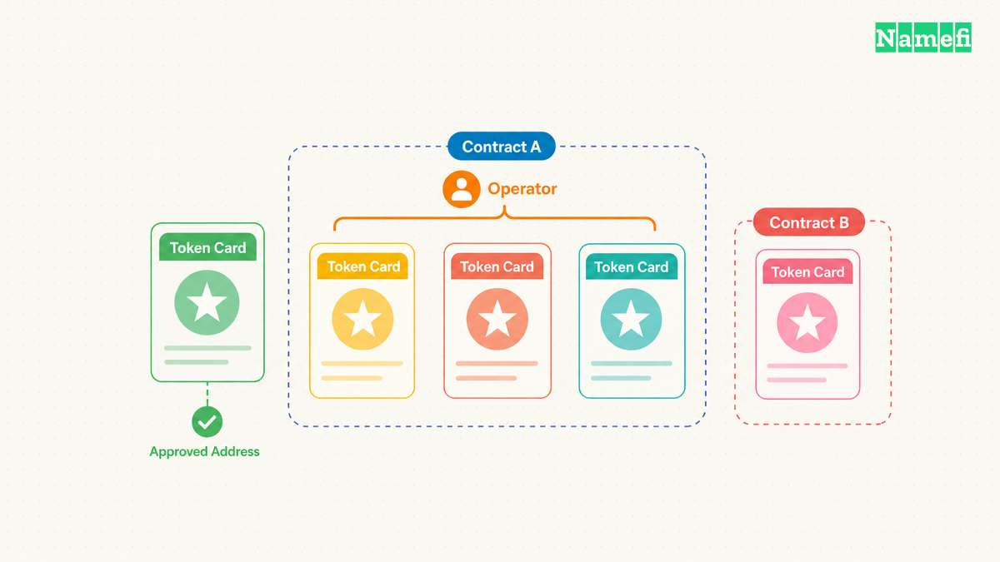
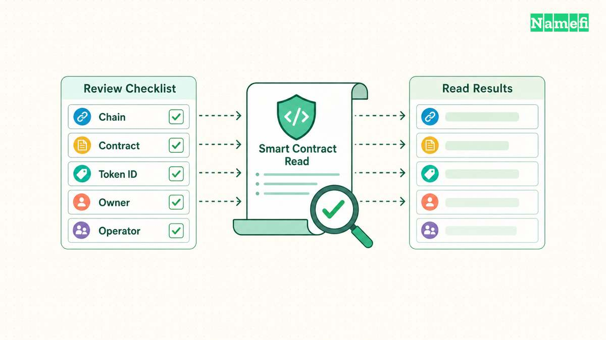
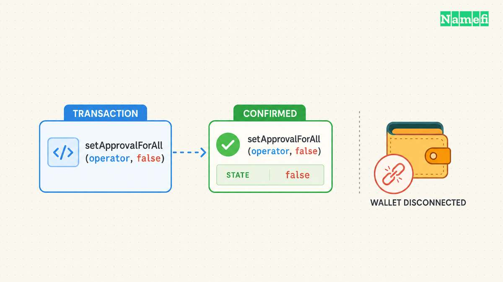
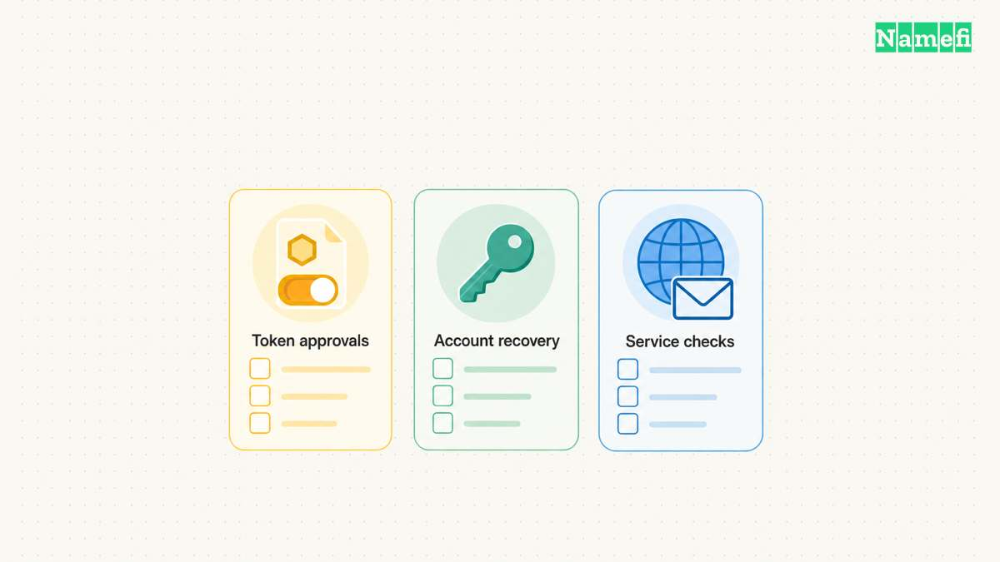

A domain NFT can remain in a wallet while another address holds permission to transfer the token. Reviewing that permission is part of domain ownership. Disconnecting a website does not necessarily remove the permission recorded in the token contract.

The review starts with the actual token standard and implementation. This guide explains ordinary ERC-721 approvals and a cautious verification procedure. A platform can add restrictions or separate management roles, so confirm the domain contract before applying the interface examples.

The guide does not rank approval abuse against other causes of theft. Approvals represent one control to review alongside wallet keys, platform accounts, and DNS access. A complete incident response needs evidence about the actual failure.

## Token approvals and operator approvals grant different scope

[ERC-721](https://eips.ethereum.org/EIPS/eip-721#specification) defines a single-token approved address and owner-wide operators within a token contract. A permitted address can transfer a token under the contract's rules. The owner should understand that authority before granting access to a marketplace or another application.

A single-token approval applies to one token identifier. The standard's `getApproved(tokenId)` query returns the approved address. The zero address represents no approved address for that token. Use the correct contract and identifier rather than a marketplace's display name.

An operator approval has broader scope within the same token contract. The `isApprovedForAll(owner, operator)` query checks whether the operator has permission for the owner's tokens under that contract. “For all” does not mean all unrelated tokens across every contract or chain.

| Permission | Scope | Relevant query |
| --- | --- | --- |
| Single-token approval | One token in one contract | `getApproved` |
| Operator approval | Owner's tokens in one contract | `isApprovedForAll` |
| Wallet connection | Application connection state | Wallet interface |
| DNS API access | Platform-specific operations | Platform access controls |

Keep the scopes separate during review. A DNS service API key does not become an ERC-721 operator approval. An operator approval does not define a standard DNS editor role. The [DNS maintenance checklist](/en/blog/maintain-dns-on-tokenized-domains/) covers the separate off-chain operating controls.

The standard resets the single-token approval when the token transfers. The owner should still inspect owner-wide operator permissions. A token transfer clears the token approval, while owner-wide permissions remain a separate state. Record the present owner and approval state from the intended chain.

A platform may restrict transfers beyond the basic standard. Check the deployed contract and the platform's supported procedure before using a generic contract-write interface. A failed transaction can indicate implementation rules rather than an incorrect token identifier.

For a team, maintain an approval register with the contract, operator, purpose, granting date, and responsible person. An unfamiliar address should prompt identification. Do not infer legitimacy solely from a label supplied by an explorer or an approval-checking interface.

## A review identifies the exact asset and current permission

Start with the network, domain token contract, token identifier, and current owner address. Confirm those identifiers through the domain platform's official asset page and the appropriate chain explorer. A matching symbol or image alone does not establish the correct asset.

Inspect recent approval and transfer transactions where the explorer provides those records. Historical events help explain how a permission arose. Current contract reads determine whether the permission remains active. Preserve both observations when an incident requires a timeline.

Use a reputable approval interface or the verified contract's read functions. [MetaMask's approval guidance](https://support.metamask.io/more-web3/learn/how-to-revoke-smart-contract-allowances-token-approvals/) describes explorer approval checkers and other revocation tools. Check that the selected tool supports the actual network and NFT permission type.

A permission list can depend on the interface's indexing and network coverage. If an expected approval does not appear, inspect the relevant contract directly or use another supported source. An empty dashboard should not become a universal claim that the account has no permissions anywhere.

For each operator, identify the application and purpose through verified documentation or the original transaction context. A legitimate marketplace operator may support an active listing. An abandoned application may no longer need access. The owner decides which continuing purpose justifies the permission.

Record the full operator address in the private operating record. Compare the address with the application documentation before revoking or reauthorizing. A similar-looking address or an unofficial search result does not establish identity. Avoid following unsolicited “urgent revoke” links from direct messages.

Separate a suspicious approval from a compromised signing key. If an attacker controls the wallet key, the attacker can potentially authorize new actions as the owner. Removing one operator does not remove the attacker's knowledge of the key. The recovery procedure must address that broader compromise.

Before an ordinary cleanup, confirm the account can submit the required transaction and pay the relevant network fee. Do not add funds to a suspected compromised account without reviewing the incident guidance. An active theft situation requires more care than routine permission maintenance.

## Revocation must change the intended contract state

For an ordinary ERC-721 single-token approval, clearing the approval uses the zero address through the supported approval function. For an operator, revocation sets the operator's approved state to false. [OpenZeppelin's ERC-721 reference](https://docs.openzeppelin.com/contracts/5.x/api/token/erc721#ERC721-approve-address-uint256-) documents those interfaces and their permission requirements.

Use the wallet or platform's supported revocation flow when available. Confirm the network, destination contract, function, and arguments in the transaction review. A request labeled “revoke” in a website interface still needs a correct underlying transaction.

For an operator revocation, the intended logical call is `setApprovalForAll(operator, false)` on the NFT contract. The boolean must remove permission. A request that instead sets approval to true grants permission. Inspect the decoded operation rather than relying only on the page title.

For a single-token approval, verify that the operation concerns the intended token identifier. Do not copy a token identifier from a different contract. A domain's human-readable label and numeric token identifier may not have an obvious relationship.

The approval change requires an on-chain transaction in this ordinary ERC-721 model. MetaMask distinguishes revocation from disconnecting an application and notes the associated network fee. Closing a browser tab or removing a wallet connection does not substitute for that state change.

After signing, wait for the transaction result under the network's supported confirmation process. Record the transaction reference and whether execution succeeded. A submitted or pending transaction does not establish that the contract state changed. A failed transaction needs investigation before a second attempt.

Then repeat the relevant read. Confirm that `isApprovedForAll(owner, operator)` returns false for an operator revocation. Confirm the expected cleared single-token state when removing a token approval. Check the same network, contract, account, and token used before the change.

Keep a compact before-and-after record. Include the purpose of the cleanup, permission type, transaction reference, and resulting contract read. A screenshot of the wallet's connection list does not document an approval revocation. The evidence should describe the actual permission removed.

## Cleanup and incident recovery require separate follow-up

Routine cleanup can remove access that no longer serves a purpose. Review approvals after an abandoned listing, a service migration, or a team access change. Choose a schedule that matches the asset's importance and the frequency of marketplace use.

A listing may stop completing after the owner removes the operator permission that the marketplace needs. Treat that effect as a workflow dependency. If the owner later resumes the listing, verify the marketplace's current documented operator before granting permission again.

Do not assume that removing an on-chain approval cancels every signed marketplace order. Orders and approvals can use separate mechanisms. Follow the marketplace's supported cancellation procedure for outstanding orders, and verify the order status separately. The token contract's approval read answers only the token permission question.

If a token already transferred away, revoking an old approval does not reverse the transfer. Preserve the transaction details and contact the domain platform through verified support channels. Ask which supported domain-specific measures remain available without assuming that the platform can reverse an on-chain transaction.

If wallet keys or a recovery phrase may be exposed, use a broader recovery procedure. [MetaMask's compromised-account guidance](https://support.metamask.io/stay-safe/protect-yourself/ive-been-hacked-scammed-unauthorized-transactions-on-my-account/) recommends discontinuing the compromised wallet and using a new wallet setup. The guidance also warns about adding funds when a sweeper may operate.

For a domain token, coordinate any supported move with the domain platform's operating requirements. Confirm the intended destination can receive and manage the actual asset. A generic transfer interface does not establish the complete recovery policy for every domain platform.

Review off-chain access after a suspicious event. Check platform API keys, DNS users, registrar accounts, recovery contacts, and automation credentials. A clean token approval state does not prove that the website and email remain under the intended administrator's control.

Finish with public service checks. Verify the active delegation, critical DNS records, website, and mail service. Compare changes against the incident timeline. An attacker could have changed a service before an administrator removed an approval or repaired account access.

The completed review should state exactly what the owner verified. Name the contract and permission removed, the remaining access relationships, and any unresolved incident questions. Precise evidence gives the owner a useful security record without making an unsupported promise that every risk has disappeared.

## These sources support the article

- Ethereum — [ERC-721](https://eips.ethereum.org/EIPS/eip-721#specification), token approvals, operators, ownership, and approval reset on transfer. Fetched 2026-10-21.
- OpenZeppelin — [ERC-721 API](https://docs.openzeppelin.com/contracts/5.x/api/token/erc721#ERC721-approve-address-uint256-), approval queries and clearing permissions. Fetched 2026-10-21.
- MetaMask — [Revoke token approvals](https://support.metamask.io/more-web3/learn/how-to-revoke-smart-contract-allowances-token-approvals/), revocation versus connection state and network fees. Fetched 2026-10-21.
- MetaMask — [Compromised account guidance](https://support.metamask.io/stay-safe/protect-yourself/ive-been-hacked-scammed-unauthorized-transactions-on-my-account/), account replacement and sweeper precautions. Fetched 2026-10-21.
