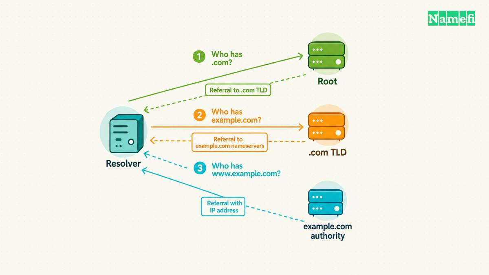
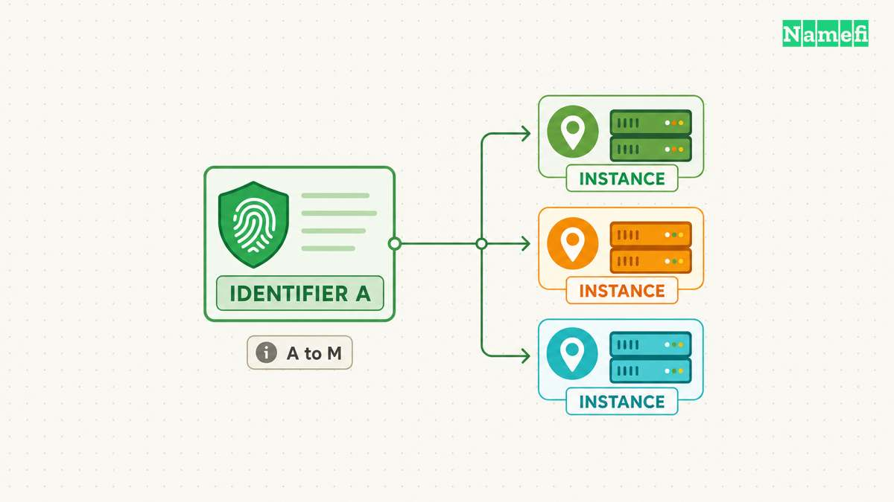
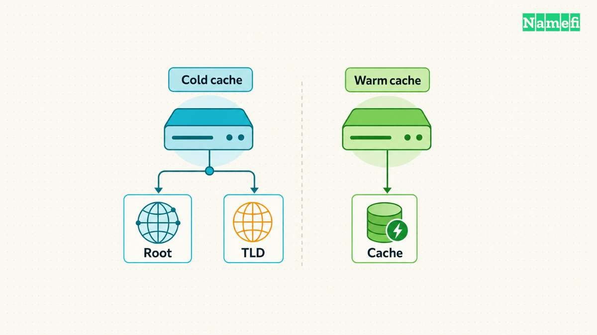
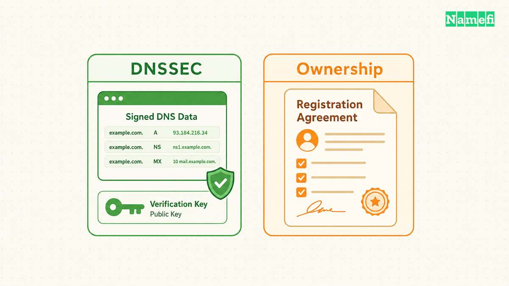
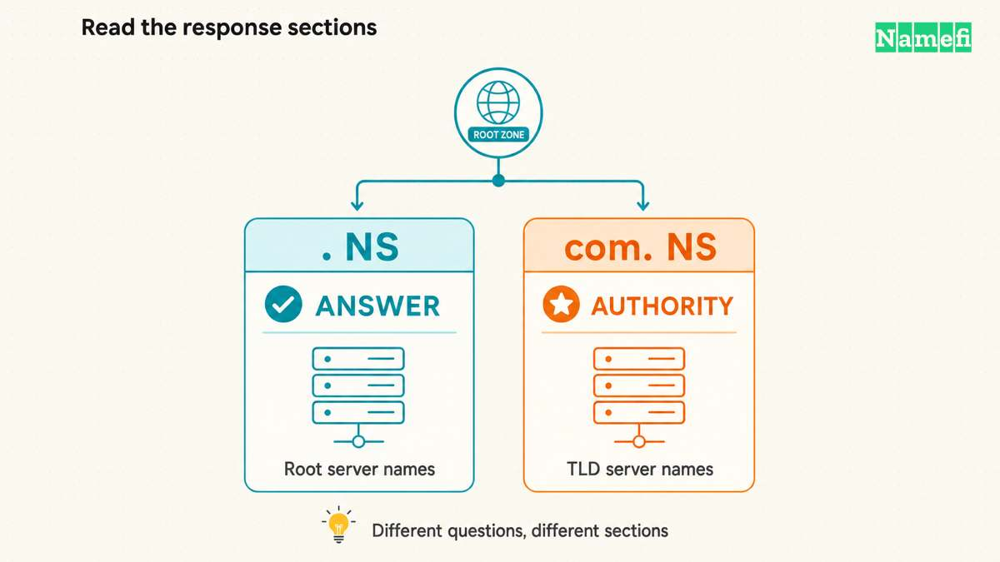

Root DNS servers help a resolver find the servers responsible for a top-level domain, such as `.com` or `.org`. The root zone primarily contains those delegations. Root servers do not store every website address or perform every lookup on a visitor's behalf. [IANA describes the root zone's scope.](https://www.iana.org/domains/root)

The familiar number thirteen describes named authorities, from `a.root-servers.net` through `m.root-servers.net`. The number does not describe thirteen individual machines. [IANA lists the names, addresses, and operators.](https://www.iana.org/domains/root/servers)

For a domain owner, the practical distinction concerns responsibility. A website record belongs in the domain's authoritative zone. A root-server setting belongs to the infrastructure that discovers delegation information. Confusing those jobs can send a troubleshooting effort toward a service that cannot repair the affected record.

## Root servers provide referrals to the next authority



The [Domain Name System](/en/glossary/dns/) divides responsibility across a hierarchy. The [root zone](/en/glossary/root-zone/) occupies the highest level. A [top-level domain](/en/glossary/tld/), or TLD, sits immediately below the root. IANA records technical delegation information for TLDs and identifies their managers. [Its root-zone overview explains those responsibilities.](https://www.iana.org/domains/root)

Consider a hypothetical lookup for `www.example.com.`. The final dot explicitly marks the DNS root. A [DNS resolver](/en/glossary/dns-resolver/) gathers the information needed to answer the client's question. An authoritative server answers from the zone information under the server's responsibility. [RFC 9499 distinguishes resolver and server roles.](https://www.rfc-editor.org/rfc/rfc9499.html#section-6)

With no useful cached delegation, the resolver can ask a root server how to proceed toward `.com`. The root server returns a referral naming the `.com` servers. The resolver then asks a `.com` server about `example.com`, receives another delegation, and approaches the domain's authoritative servers.

A referral normally carries the child zone's NS records in the authority section. The response can also include useful server addresses in the additional section. DNS calls certain supporting address records glue. [RFC 1034 describes referral construction in Section 4.3.2.](https://www.rfc-editor.org/rfc/rfc1034.html#section-4.3.2)

The resolver follows the referral. The root server does not forward the visitor's website request to the TLD server. The website's content also travels separately from DNS responses. This distinction helps explain why working root service cannot establish that an application works.

Use the following comparison when deciding which layer deserves inspection. The roles describe a simplified public lookup, rather than every possible deployment.

| Layer | Main job | Useful question |
| --- | --- | --- |
| Recursive resolver | Finds or caches answers | Can clients resolve names? |
| Root server | Serves root-zone data | Can the resolver discover the TLD? |
| TLD server | Provides domain delegations | Does the parent list the intended servers? |
| Domain authority | Serves the domain's records | Does the requested record exist? |

The same word, “nameserver,” can refer to different roles. Before contacting support, write down the queried name, record type, server, and response. A statement such as “DNS failed” leaves the failing layer unclear.

For example, a correct `.com` referral does not confirm the A record for `www.example.com`. The referral establishes a next step. The domain's authoritative response answers the later address question. Keep both observations when comparing a successful lookup with a failed lookup.

## Thirteen identifiers represent a distributed service



The root server identifiers use the letters A through M. Each identifier has an IPv4 address and an IPv6 address. Multiple physical instances can provide service behind an identifier. The operators' FAQ explicitly separates identifiers, operators, and instances. [Read its three counting questions.](https://root-servers.org/faq/)

An identifier therefore differs from an address, and an address differs from a machine. A list of thirteen identifiers does not imply thirteen total addresses. Nor does a copied address list reveal the physical deployment behind each address.

Anycast makes a service address available from multiple locations. Network routing directs a packet toward one available location. Anycast does not require the client to choose a physical instance from a global menu. [RFC 9499 defines anycast and instances.](https://www.rfc-editor.org/rfc/rfc9499.html#section-6)

The root operators publish instance locations and operational information on their shared site. Instance counts change as operators modify deployments. A fixed total quickly becomes a historical snapshot, so a current operational question deserves a fresh check. [The root-server site publishes the current inventory.](https://root-servers.org/)

The distinction matters during an incident. A timeout from one address, on one network, documents one failed observation. The timeout alone cannot establish that every instance of that identifier failed. The observation says even less about all other root identifiers.

For an investigation, record the source network and observation time alongside the destination address. Compare results from another approved network before describing the failure as global. Treat a changed response time as a measurement requiring context, rather than proof that the nearest physical machine changed.

An office network might permit its approved recursive resolver while blocking direct external DNS traffic. In that hypothetical environment, a direct-root diagnostic can fail while ordinary name resolution succeeds. The useful follow-up concerns network policy and the permitted query path.

The root system also has a shared namespace. Distributed instances do not create independent versions of `.com` that a customer chooses between. The operators commit to serving the IANA global root namespace with complete, unmodified DNS data. [Their FAQ states that commitment.](https://root-servers.org/faq/)

A domain owner should consequently avoid treating root identifiers like competing DNS hosting plans. Selecting an authoritative provider for `example.com` changes a different part of the hierarchy. Choosing a recursive resolver changes the service that performs lookups for clients.

## Caches and minimized queries change the lookup path



A resolver does not restart every lookup at the root. The resolution algorithm first checks available local information and can reuse cached delegation information. Cached records carry time-to-live limits, or TTLs. [RFC 1034 describes the cache and resolver algorithm.](https://www.rfc-editor.org/rfc/rfc1034.html#section-5.3.2)

Suppose a resolver already knows the `.com` servers but lacks the answer for `www.example.com`. The resolver can begin with the known delegation. If the resolver already holds a usable final answer, the resolver can return the answer without repeating that delegation path.

This behavior separates the logical hierarchy from the packets sent for one request. A diagram that always shows root, TLD, and domain servers explains responsibility. The same diagram does not prove that every visit sends packets to every layer.

A resolver still needs a starting configuration. Root hints provide root-server names and addresses, often through the resolver software distribution. IANA publishes access to root hints, the root zone, and trust-anchor files as distinct resources. [Its Root Files page identifies each file's purpose.](https://www.iana.org/domains/root/files)

Priming refreshes the resolver's knowledge of the root servers. A priming query requests NS records for `.`. The response supplies the root server set and address information. The resolver performs priming when needed, including startup with an empty cache or expiration of the root NS set. [RFC 9609 specifies priming behavior.](https://www.rfc-editor.org/rfc/rfc9609.html#section-3)

Root hints are therefore starting information, rather than a permanent substitute for discovery. Addresses can change. RFC 9609 explains why resolvers must cope with changes and retry another configured target when a priming query receives no response. Operators should use the update process for their actual resolver software.

Query name minimization changes how much of the requested name an upstream server sees. A minimizing resolver can ask the root about `com.` while resolving `www.example.com.`. The resolver need not expose the complete original name at the root step. [RFC 9156 explains the method.](https://www.rfc-editor.org/rfc/rfc9156.html#section-2)

Minimization reduces unnecessary disclosure to authoritative servers. Minimization does not make the full query invisible to the recursive resolver that handles the client's request. The protocol also needs implementation limits and compatibility behavior. A single idealized packet sequence cannot describe every resolver configuration.

These details change privacy and performance questions. Ask which resolver receives the original request, which delegation information the resolver already holds, and whether the resolver minimizes upstream names. Avoid inferring a complete browsing history from a root-server traffic count.

For troubleshooting, preserve cache state when possible. An investigator who [clears caches](/en/blog/flush-dns-cache/) changes the conditions under investigation. Record the first failure before restarting a resolver or flushing useful information. A later successful lookup can otherwise obscure whether the original failure involved discovery, cached data, or another layer.

## DNSSEC and diagnostics answer different questions



[DNSSEC](/en/glossary/dnssec/) adds origin authentication and integrity checks for DNS data. A validating resolver starts from a configured trust anchor and builds an authentication chain. DNSSEC does not encrypt DNS questions or guarantee service availability. [RFC 4033 explains the services and limits.](https://www.rfc-editor.org/rfc/rfc4033.html#section-4)

The root key signing key provides a trust anchor for root validation. IANA publishes trust-anchor information and rollover guidance for resolver operators. A resolver operator should follow current guidance rather than copy an old key value from a tutorial. [IANA maintains that operational information.](https://www.iana.org/dnssec/files)

A root trust anchor concerns the authenticity of DNS data. The trust anchor does not identify a domain's legal owner or grant control over a registrar account. A successful validation result answers a narrower technical question than a registration document or account authorization.

Keep diagnostic questions equally narrow. Start by checking ordinary resolution through the approved resolver. Then inspect delegation separately when the evidence points toward discovery. Operators who have `dig` installed can inspect the root NS set with the following read-only query:

```bash
dig . NS
```

The command asks the configured resolver. The response can come from the resolver's cache. A successful answer therefore does not prove a fresh direct exchange with a root instance. Save the response flags, TTLs, server information, and timestamp before drawing a conclusion.

### Direct queries distinguish a root answer from a TLD referral

Use direct queries only where network policy permits external DNS traffic. The following address belongs to A-root in [IANA's root-server list](https://www.iana.org/domains/root/servers). The address selects a service endpoint, not one physical instance.

First, ask that endpoint for the root zone's own NS records:

```bash
dig @198.41.0.4 . NS +norecurse
```

Next, ask the same endpoint for the `.com` delegation:

```bash
dig @198.41.0.4 com. NS +norecurse
```

The `@` argument selects the server. The `+norecurse` option clears the recursion-desired flag. [BIND documents the option and query syntax.](https://bind9.readthedocs.io/en/stable/manpages.html#dig-dns-lookup-utility) Keep the full output, including response sections and flags.



The table describes expected protocol behavior, not captured command output. Actual results depend on reachability and the responding service.

| Query | Expected successful response | Interpretation |
| --- | --- | --- |
| `. NS` | Root NS records in `ANSWER`, with `aa` | The server answers authoritatively for the root name |
| `com. NS` | Delegation NS records in `AUTHORITY`, usually with address records in `ADDITIONAL` and no `aa` | The server directs the next query toward `.com` servers |

The `aa` flag means authoritative answer for the queried name. A root server can answer authoritatively for `.` while referring a `.com` question elsewhere. [RFC 1035 defines AA.](https://www.rfc-editor.org/rfc/rfc1035.html#section-4.1.1) The heading `AUTHORITY` names a response section. The heading does not establish that the response has the `aa` flag.

Read the response status as well as the section counts. A successful referral can have `NOERROR` and an empty `ANSWER` section. The empty section alone does not mean `NXDOMAIN`. [RFC 1034 puts referral NS records in the authority section](https://www.rfc-editor.org/rfc/rfc1034.html#section-4.3.2), while [RFC 1035 defines the Name Error response code](https://www.rfc-editor.org/rfc/rfc1035.html#section-4.1.1).

A timeout supplies no DNS response status. Compare the timeout with the approved resolver's result and network policy before reporting a root-service failure.

### Iterative tracing follows the delegation path

For a separate delegation investigation, use a reserved example name:

```bash
dig +trace example.com. A
```

BIND documents `+trace` as iterative tracing from the root. The tool follows referrals and prints the responses along the path. The trace represents the diagnostic tool's exchanges, rather than a replay of the browser's earlier lookup. [See the BIND dig manual.](https://bind9.readthedocs.io/en/latest/manpages.html#dig-dns-lookup-utility)

Interpret the stopping point before changing configuration. A trace that reaches the domain's authoritative servers has progressed beyond the root referral. A failure at the final record deserves inspection at that layer. A trace that cannot start deserves comparison with network policy and ordinary recursive resolution.

For a hypothetical incident report, write: “The approved resolver answered, but direct iterative tracing timed out from the office network.” That statement preserves evidence. “The root servers are down” asserts a wider conclusion that the two observations cannot support.

A useful support report includes one successful comparison as well as the failure. Include whether the same name resolves through the approved resolver. Include whether unrelated names fail too. Keep observations from separate networks distinct, because different source networks can take different paths. These details help support teams reproduce the conditions without assuming a global outage.

Recovery should match the confirmed fault. Correct a domain record at the authoritative DNS provider. Investigate parent delegation when the parent lists unexpected servers. Investigate resolver configuration when priming or validation fails across otherwise reachable authoritative services. Preserve the original evidence before each change.

Root servers provide an important shared discovery layer. Practical troubleshooting works better when each observation identifies the exact responsibility under test. A root referral, a cached answer, a validated signature, and a working website each establish a different result.

## Sources and further reading

- IANA, [Root Zone Management](https://www.iana.org/domains/root), opening description and delegation responsibilities. Fetched 2026-10-21.
- IANA, [Root Name Servers](https://www.iana.org/domains/root/servers), introduction and named-authority table. Fetched 2026-10-21.
- Root Server Technical Operations Association, [FAQ](https://root-servers.org/faq/), identifier, instance, caching, and namespace questions. Fetched 2026-10-21.
- Root Server Technical Operations Association, [root-server inventory](https://root-servers.org/), map and operator listings. Fetched 2026-10-21.
- IETF, [RFC 9499, Section 6](https://www.rfc-editor.org/rfc/rfc9499.html#section-6), resolvers, authoritative servers, anycast, and instances. Fetched 2026-10-21.
- IETF, [RFC 1034](https://www.rfc-editor.org/rfc/rfc1034.html), Sections 4.3.2 and 5.3.2–5.3.3, referrals and cached resolution. Fetched 2026-10-21.
- IANA, [Root Files](https://www.iana.org/domains/root/files), Root Zone Files. Fetched 2026-10-21.
- IETF, [RFC 9609, Sections 2–3](https://www.rfc-editor.org/rfc/rfc9609.html#section-2), hints and priming queries. Fetched 2026-10-21.
- IETF, [RFC 9156, Sections 1–3](https://www.rfc-editor.org/rfc/rfc9156.html#section-2), minimization and cache behavior. Fetched 2026-10-21.
- IETF, [RFC 4033, Sections 2–4](https://www.rfc-editor.org/rfc/rfc4033.html#section-2), trust anchors and DNSSEC limits. Fetched 2026-10-21.
- IANA, [Trust Anchors and Rollovers](https://www.iana.org/dnssec/files), introduction and Root Zone Trust Anchors. Fetched 2026-10-21.
- Internet Systems Consortium, [BIND dig manual](https://bind9.readthedocs.io/en/latest/manpages.html#dig-dns-lookup-utility), query syntax and `+trace`. Fetched 2026-10-21.

- IETF, [RFC 1035, Section 4.1.1](https://www.rfc-editor.org/rfc/rfc1035.html#section-4.1.1), AA flag and response codes. Fetched 2026-10-21.
- Internet Systems Consortium, [BIND stable dig manual](https://bind9.readthedocs.io/en/stable/manpages.html#dig-dns-lookup-utility), server selection and `+norecurse`. Fetched 2026-10-21.
