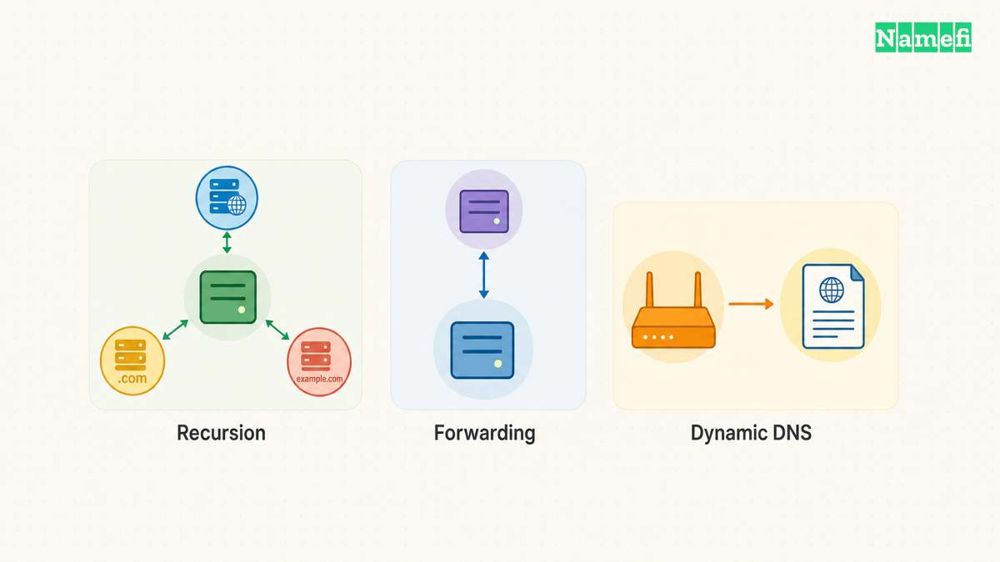
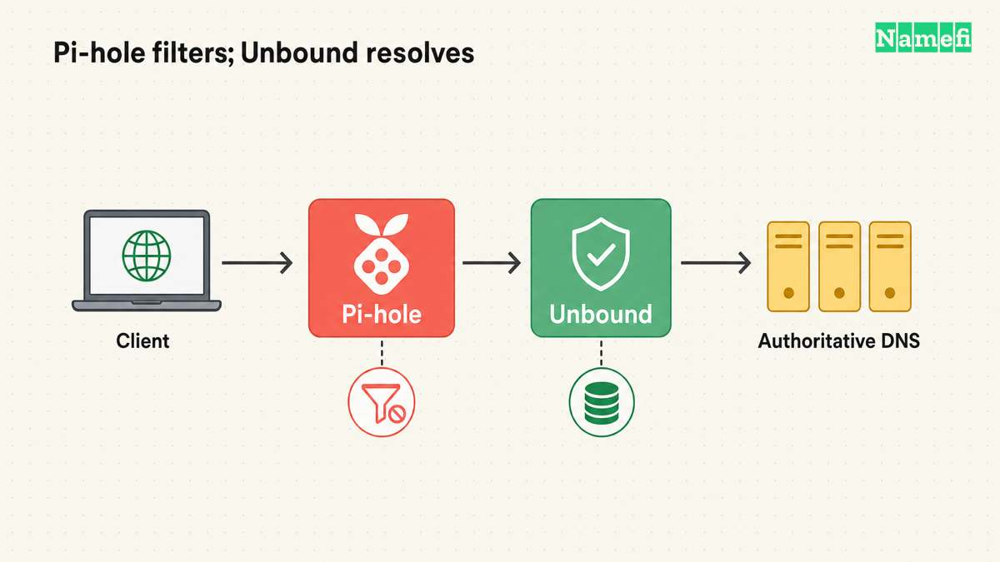
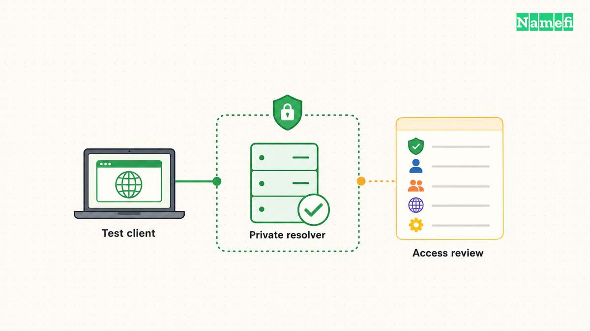
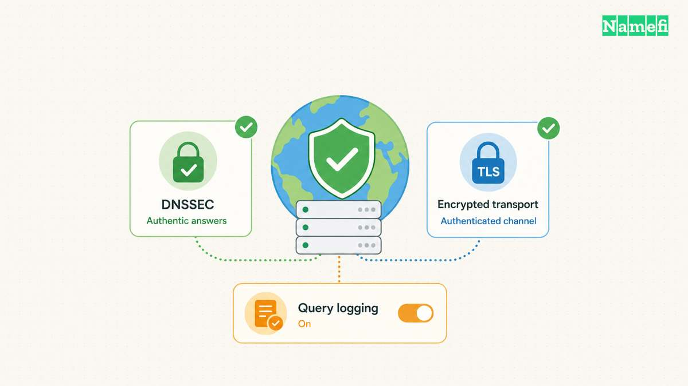
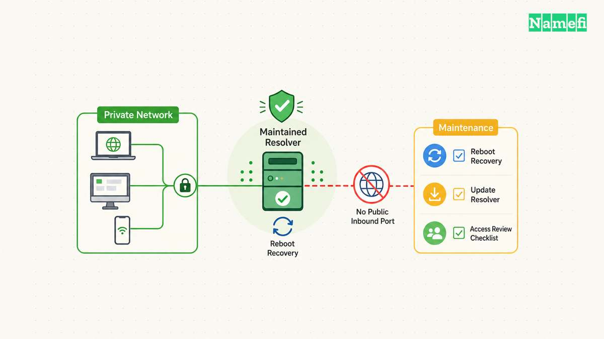

Running your own DNS resolver gives you responsibility for the service that answers your devices' name queries. The work includes configuration, access control, updates, monitoring, and recovery.

Start with one device and a private listener. Decide whether the resolver will perform recursion or forward requests to another operator. Keep a working rollback path before you change the network's default DNS service.

Dynamic DNS services such as DuckDNS solve a different problem. Dynamic DNS updates a hostname's address. Dynamic DNS does not replace the resolver that looks up other people's domain names.

## Recursion and forwarding create different operating responsibilities

A recursive resolver obtains answers through the DNS hierarchy and caches useful results. A forwarder passes queries to another resolver. A local service can provide a cache while still depending on a [public upstream operator](/en/blog/isp-dns-vs-public-resolver/).

NLnet Labs describes [Unbound as a validating, recursive, caching resolver](https://unbound.docs.nlnetlabs.nl/en/latest/use-cases/home-resolver.html). The software can support a private home-network service. The official example uses a particular operating system, so adapt instructions through your platform's supported package and service tools.

Choose the architecture before installing anything. If the goal is to reduce direct dependence on one public recursive operator, full recursion is relevant. If the goal is a controlled local entry point with a selected encrypted upstream, forwarding may fit better.

Neither architecture removes all outside observation. The IETF's [DNS privacy analysis](https://datatracker.ietf.org/doc/html/rfc9076#section-6.2) discusses information visible at authoritative servers as well as recursive resolvers. A self-hosted resolver is not a guarantee of anonymity.

Use an architecture note with explicit boundaries:

| Design | Local responsibility | Outside dependency |
| --- | --- | --- |
| Recursive resolver | Local cache, validation, service health, outbound resolution | Authoritative DNS infrastructure and internet connectivity |
| Forwarding resolver | Local listener, access controls, chosen forwarding policy | The upstream resolver and its policy |
| Router forwarding to a local resolver | Router settings plus resolver maintenance | The selected recursive or forwarding design |
| Dynamic DNS updater | Updating a hostname's address record | The dynamic DNS provider's update service |

The final row is separate from the resolver designs. DuckDNS's [HTTP API specification](https://www.duckdns.org/spec.jsp) documents address updates for the user's DuckDNS names. Updating a name that points toward a home server does not make the server a recursive resolver.

For a hypothetical home lab, a dynamic DNS name might help the owner find a changing public address. A private Unbound service might answer DNS queries inside the home network. The two services can coexist, but each service needs separate configuration and access decisions.

Do not open inbound DNS service merely because a dynamic DNS hostname exists. Remote access needs an intentional design. A VPN to an authorized network can provide a different access path from an openly reachable recursive service.

Write down the users, networks, host, architecture, and recovery owner. A personal experiment has different availability requirements from a resolver that every household device will depend on.

## Technitium and Pi-hole support different setup paths

Choose software after choosing the DNS path. [Technitium DNS Server](https://technitium.com/dns/) combines recursive resolution, authoritative zones, block lists, and a browser management console. Technitium also supports encrypted forwarding. Those features do not mean that every deployment needs public authoritative service or a public administration interface.

[Pi-hole's Unbound guide](https://docs.pi-hole.net/guides/dns/unbound/) describes a different arrangement. Pi-hole filters client queries, then sends allowed queries to a local Unbound instance for recursive resolution. Pi-hole can also use an external upstream. Installing Pi-hole alone does not establish that Unbound performs recursion.

| Starting requirement | Relevant option | Decision to verify |
| --- | --- | --- |
| Recursive cache without a filtering dashboard | Unbound | Listener, access rules, validation, and service recovery |
| Filtering with a separate recursive component | Pi-hole with Unbound | Both services and the actual upstream path |
| Recursion, filtering, and zone management in one console | Technitium | Enabled roles, recursion policy, and management access |
| A hostname that follows a changing public address | DuckDNS | Address updates, separate from client DNS resolution |

For a Pi-hole and Unbound pilot on the same host, the official guide uses Unbound on `127.0.0.1:5335`. Pi-hole's custom upstream field represents that endpoint as `127.0.0.1#5335`. The guide disables other upstream selections so queries use the intended Unbound path. The host's loopback address does not identify a separate container or a second machine.

Test Unbound directly before changing Pi-hole's upstream. Then test through Pi-hole and confirm both filtering and ordinary resolution. Keep the two services' ports distinct. Do not configure Unbound to forward back to Pi-hole, which would create a forwarding loop.

Use the official guide's paired DNSSEC tests: a deliberately invalid name should produce `SERVFAIL`, while the valid comparison should produce `NOERROR`. A timeout does not demonstrate successful validation. Preserve the exact commands and results with the deployment notes.

## A private pilot starts with supported installation and limited access

Choose a host that you can keep available and maintain. Record the host's address, operating system, update method, and service manager. Check whether another local service already uses the intended DNS port.

Use the platform's supported package source or the project's documented build process. Confirm the installed version with the software's version command. Avoid copying a version number from an old tutorial as proof that your host matches the tutorial.

Read the current [Unbound configuration manual](https://unbound.docs.nlnetlabs.nl/en/latest/manpages/unbound.conf.html#description) before editing the service. Configuration paths and package defaults can differ. Keep a copy of the original files and identify how the package starts the service.

Begin with access limited to the test host. A network rollout should follow a successful local test. Broad listening addresses and broad access rules should never arrive as unexplained defaults copied from an example.

The configuration manual distinguishes the listener from access-control rules. A listening interface defines where the service accepts traffic. An access rule defines which clients can use the service. Verify both settings, along with host and network firewall rules.

Use a pilot checklist:

1. Identify the intended host and service owner.
2. Record the current DNS path and rollback settings.
3. Install through a supported source.
4. Confirm the installed version and service status.
5. Limit the listener to the intended test scope.
6. Review client access rules and firewalls.
7. Check the configuration before restarting.
8. Test a direct query to the local resolver.

Unbound provides [`unbound-checkconf`](https://unbound.docs.nlnetlabs.nl/en/latest/manpages/unbound-checkconf.html) to check configuration files. Use the command with your actual configuration path. A syntax check does not establish that the upstream route works or that access rules match your intent.

Test the service directly before making the service the system default. Our [specific-server nslookup guide](/en/blog/nslookup-specific-dns-server/) explains the basic comparison. Keep the baseline resolver available until the pilot answers ordinary names consistently.

If the service fails to start, inspect the service log and the exact error. A port conflict, file permission problem, or configuration error calls for a different correction from an upstream lookup failure. Change one relevant setting at a time.

Do not suppress an error by disabling every protection. Preserve the failing query, response code, and log context. A narrow diagnosis keeps the eventual configuration understandable.

## Validation and privacy settings need separate verification

DNSSEC validation checks DNS authenticity according to the relevant chain of trust. DNSSEC does not encrypt the query route. Keep validation and transport encryption as separate requirements.

If you choose Unbound for validation, follow the installed package's trust-anchor and timekeeping guidance. Check the actual validation behavior with a documented test appropriate to your setup. Do not treat a running process as proof that validation works.

If you choose forwarding, identify the exact upstream service. Record the provider's addresses, transport, certificate-authentication requirements, and privacy policy. An encrypted setting without authenticated endpoint verification gives an incomplete design.

The [Unbound forwarding configuration](https://unbound.docs.nlnetlabs.nl/en/latest/manpages/unbound.conf.html#forward-zone-options) documents `forward-tls-upstream` and the certificate trust configuration. Read the current option descriptions together. Do not enable a single option and assume every remaining query path uses authenticated TLS.

Our [DNS over HTTPS and DNS over TLS guide](/en/blog/dns-over-https-vs-dns-over-tls/) explains the transport distinction. Choose the architecture first, then verify the actual traffic path. A browser or VPN can use a separate resolver path from the system setting.

Compare at least four outcomes during the pilot:

| Check | Evidence to keep |
| --- | --- |
| Ordinary public answer | Query name, record type, response code, and answer |
| Repeated query | Observed cache behavior without a promised speed gain |
| Validation test | The documented test and actual result |
| Upstream interruption | The resulting failure and successful rollback |

A local cache can help repeated queries, but the result depends on query patterns and cache state. Avoid promising faster browsing before you measure useful tasks. A cold cache and a warm cache do not provide the same comparison.

Review logs as part of the privacy design. A self-hosted service can create a detailed local query history if you enable broad logging. Set a defined purpose and retention practice for any logs you keep.

Restrict access to the resolver's management interface as well as the query listener. A private query service still needs safe administration. Keep configuration backups and operational instructions available without exposing secrets.

For a hypothetical forwarding pilot, document: “The laptop reaches the local resolver, and the local resolver forwards to the selected operator.” Do not write “All device DNS is private” unless the actual test scope supports that claim.

## A network rollout needs availability and abuse controls

A resolver becomes infrastructure when other devices depend on the resolver. A sleeping laptop, a changing local address, or an unplanned reboot can then become a network-wide name-resolution problem.

Give the host a stable, documented network identity through the network's supported configuration. Test the resolver after a reboot. Confirm that the service starts automatically and that required network dependencies become available.

Expand client access only to the intended networks. The IETF's [recursive-server guidance](https://datatracker.ietf.org/doc/html/rfc5358#section-4) recommends restricting recursive service and separating recursive and authoritative roles where practical. An open recursive resolver can contribute to reflection abuse.

Check inbound exposure from the appropriate network boundary. A successful local query proves local reachability, rather than the absence of internet exposure. Review router port forwarding, IPv6 firewall behavior, and any cloud firewall if the host runs remotely.

Do not use an unrestricted allow rule as a shortcut for a troublesome client. Identify the client's address range and intended access path. Grant only the access the operating plan requires.

Roll out through a controlled sequence:

1. Test one client with manual settings.
2. Test required public and private names.
3. Confirm recovery after a host reboot.
4. Verify query and management access boundaries.
5. Document an outage recovery procedure.
6. Update network-provided DNS settings when ready.
7. Check representative devices after renewal or reconnection.
8. Review logs and failures after rollout.

If you supply a second DNS address, understand the client's selection behavior. A second address is not always an idle standby. Our [primary and secondary DNS guide](/en/blog/primary-secondary-dns/) explains the naming trap.

Choose a fallback that matches your goals. A public fallback can restore some availability while bypassing local filtering or privacy expectations. A second locally maintained resolver adds another system to update. Record the tradeoff instead of hiding the dependency.

Keep a short maintenance schedule for software updates, configuration backups, access review, and restore tests. Recheck the setup after a router replacement, address-plan change, or VPN change.

Run your own resolver when the operational control justifies the maintenance. Keep recursion, forwarding, and dynamic DNS distinct. Verify the private pilot, preserve access limits, and treat recovery as part of the service.

## These sources support the article

Sources checked on October 21, 2026. The article provides a planning workflow rather than a universal copy-and-paste configuration.

- [NLnet Labs: Resolver for Home Networks](https://unbound.docs.nlnetlabs.nl/en/latest/use-cases/home-resolver.html). The guide describes Unbound's home-network use case.
- [Unbound configuration manual](https://unbound.docs.nlnetlabs.nl/en/latest/manpages/unbound.conf.html). The manual defines listeners, access controls, forwarding, and TLS options.
- [Unbound configuration checker](https://unbound.docs.nlnetlabs.nl/en/latest/manpages/unbound-checkconf.html). The command checks a configuration file.
- [Technitium DNS Server](https://technitium.com/dns/). The project describes recursion, authoritative zones, filtering, and encrypted forwarding.
- [Pi-hole: Unbound guide](https://docs.pi-hole.net/guides/dns/unbound/). The guide documents the local upstream endpoint, separate ports, and validation tests.
- [DuckDNS: HTTP API specification](https://www.duckdns.org/spec.jsp). The specification documents dynamic address updates.
- [RFC 5358, section 4](https://datatracker.ietf.org/doc/html/rfc5358#section-4). The guidance covers restricted recursive service.
- [RFC 9076, section 6](https://datatracker.ietf.org/doc/html/rfc9076#section-6). The analysis distinguishes resolver and authoritative-server visibility.
