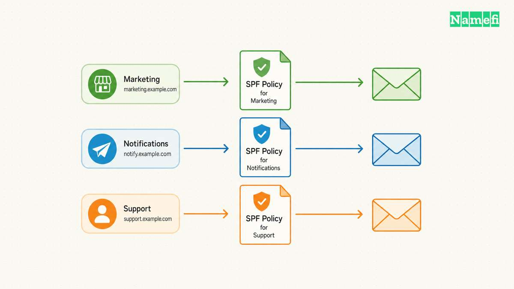
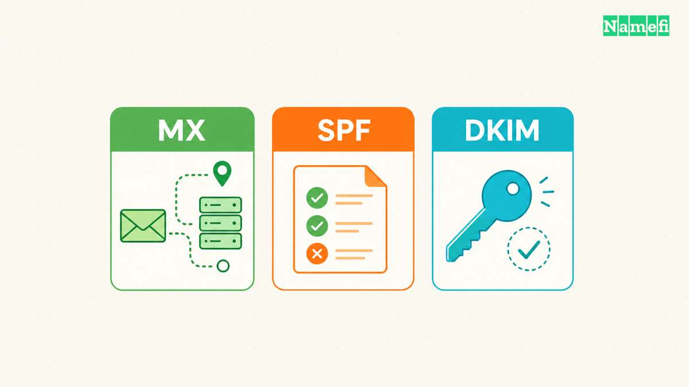

To check an SPF record, query the TXT records at the domain used by the message's SMTP sender identity. Confirm that the lookup returns one SPF policy, then evaluate the policy for the actual sending IP address. [RFC 7208 defines record selection and evaluation](#rfc-7208-defines-spf-checks). A visible `v=spf1` string alone does not prove that a message passes.

Use this guide to diagnose a live configuration. For publishing and maintaining TXT records, read the [SPF, DKIM, and verification guide](/en/blog/txt-records-spf-dkim-verification/).

The examples are hypothetical. [IANA maintains example domains for documentation](#iana-maintains-example-domains-for-documentation). [RFC 5737 reserves the illustrated IPv4 address range](#rfc-5737-reserves-documentation-ipv4-addresses).

## The message identifies which domain needs checking

SPF checks an SMTP identity, rather than simply trusting the visible From address. The relevant domain can differ from the address that a recipient sees. [The SPF standard distinguishes MAIL FROM and HELO identities](#rfc-7208-defines-spf-checks).

Start with a message sent through the service you want to test. Inspect the receiving system's authentication results and record the evaluated SPF domain and sending IP address. Use the provider's message-header instructions when the mail interface hides those fields.

Do not paste a full private message into an unfamiliar checker. Record only the fields necessary for the diagnosis. Avoid publishing customer addresses or message content in support screenshots.

For a hypothetical sender using `bounce.example.com`, check that domain. Checking only `example.com` can answer a different question. The example domains and addresses in this guide are documentation examples, not live test results.

## The TXT answer must contain one selected SPF policy

Open [Google Admin Toolbox Dig](https://toolbox.googleapps.com/apps/dig/#TXT/) and select TXT. Enter the actual domain under investigation. [Google's tool exposes DNS record queries](#google-provides-a-public-dns-lookup-tool). The tool does not need your mail account password.

A local diagnostic command can provide the same type of lookup: `dig TXT bounce.example.com`. Compare the complete answer rather than only the first line that contains a familiar provider name.

A domain can have unrelated TXT records for other purposes. The relevant selection question concerns records that start with the SPF version marker. [No selected policy produces `none`; multiple selected policies produce `permerror`](#rfc-7208-defines-spf-checks).

Two separately published SPF records do not combine into one policy. A single TXT record can also contain multiple quoted strings. The standard concatenates those strings without inserting spaces. [The SPF record rules distinguish records from strings](#rfc-7208-defines-spf-checks).

Before editing, save the existing DNS value. Compare the policy with every active sending service's current official instructions. Do not delete an unfamiliar include until the service owner identifies whether the include still supports legitimate mail.

Run the sending domain through [Namefi's email-authentication configuration checker](https://namefi.io/domain-tools/email-auth) to inspect the published SPF policy and reachable include or redirect targets. Treat incomplete branches as incomplete. The result is a configuration inspection, not an SPF verdict for a particular sender IP and message.

## Policy evaluation needs the actual sender and its dependencies

Consider this hypothetical policy: `v=spf1 ip4:192.0.2.10 -all`. The `ip4` mechanism names a documentation IPv4 address. The final `-all` provides an explicit fail result for an unmatched sender. [The standard defines mechanism evaluation and the final match](#rfc-7208-defines-spf-checks).

The example is intentionally narrow. Do not copy the documentation address into production. Replace the example only with information that your sending service or server administrator has verified.

For a policy containing `include`, inspect the referenced policy as well. An include can create further evaluations. Counting the includes visible in the top-level text does not establish the complete dependency count.

RFC 7208 limits DNS-query-causing terms during evaluation. [The limit includes nested evaluation and can produce `permerror`](#rfc-7208-defines-spf-checks). A checker should explain the evaluated path and the reason for an error, rather than showing only a green or red badge.

Do not replace provider-managed dependencies with a copied address list merely to silence a warning. That change creates a maintenance obligation. Ask the sending provider for the supported correction and confirm which service owns each dependency.

## The result determines the next diagnostic action

Use the receiver's result and the checker explanation together:

| Result | Practical next action |
| --- | --- |
| `none` | Verify the evaluated domain and whether an SPF policy exists there |
| `pass` | Confirm the tested IP and identity match the real message |
| `fail` | Check whether the sender should have authorization |
| `softfail` or `neutral` | Read the policy before assuming the sender has authorization |
| `temperror` | Investigate the transient DNS failure and repeat the check |
| `permerror` | Correct the reported policy or evaluation error |

[The standard defines these distinct SPF outcomes](#rfc-7208-defines-spf-checks). A permanent error needs a different response from a temporary lookup failure.

If DNS answers differ, compare the authoritative record with the resolver used by the checker. Record the query time and the response. The [propagation checker guide](/en/blog/dns-propagation-checker-guide/) explains how to interpret that difference without repeatedly changing the policy.

## A clean DNS check still needs a real-message test

After an authorized correction, send a new message from each legitimate service. Inspect the receiving system's results again. Include ordinary mail, newsletters, transactional mail, support tools, and website forms that use the domain.

SPF pass does not establish DMARC pass. DMARC also needs the appropriate domain alignment. [Google documents that distinction for direct email](#google-distinguishes-sender-authentication-requirements). Use the [DMARC check guide](/en/blog/dmarc-record-check/) when SPF passes but DMARC fails.

Keep a short change record: previous policy, revised policy, authorized services, query results, and message results. That record makes the next provider migration easier to diagnose.

The useful completion criterion is specific: the correct domain publishes one valid SPF policy, and the intended sending services authenticate as expected. A checker supports that conclusion, but a checker does not replace the actual message evidence.

## Sources and further reading

### RFC 7208 defines SPF checks

[RFC 7208 defines SPF checks](https://www.rfc-editor.org/rfc/rfc7208.html#section-4.5) — checked 2026-10-30. Checked passages: Sections 2.6, 3.1–3.3, 4.5–4.6.4, and 5.1–5.2.

### Google provides a public DNS lookup tool

[Google provides a public DNS lookup tool](https://toolbox.googleapps.com/apps/dig/#TXT/) — checked 2026-10-30.

### Google distinguishes sender authentication requirements

[Google distinguishes sender authentication requirements](https://support.google.com/a/answer/81126?hl=en#:~:text=Email%20authentication%20requirements) — checked 2026-10-30.

### IANA maintains example domains for documentation

[IANA maintains example domains for documentation](https://www.iana.org/help/example-domains#:~:text=for%20documentation%20purposes) — checked 2026-10-30.

### RFC 5737 reserves documentation IPv4 addresses

[RFC 5737 reserves documentation IPv4 addresses](https://www.rfc-editor.org/rfc/rfc5737.html#section-3) — checked 2026-10-30.
