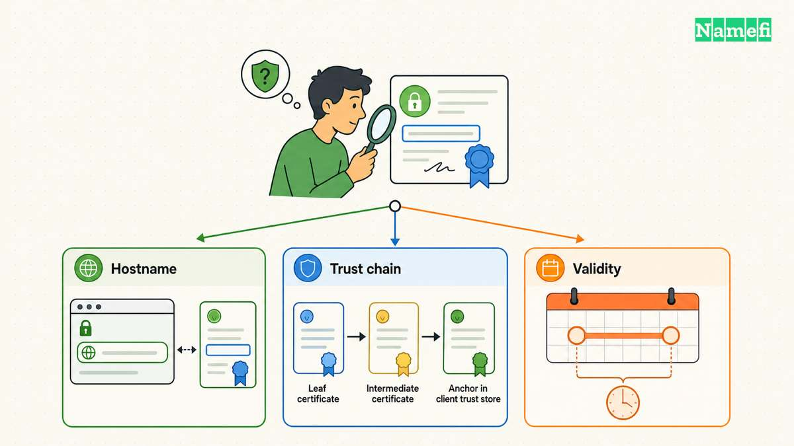

Check an SSL certificate against the exact hostname that users open. Inspect the presented certificate, verify the hostname and validity dates, and confirm that the client trusts the chain. A successful connection alone does not prove successful certificate verification.

For a technical check, use the [official OpenSSL s_client documentation](https://docs.openssl.org/3.6/man1/openssl-s_client/). OpenSSL warns that its test client can continue after verification errors unless the caller enables error-return behavior. [The manual explains that boundary](#openssl-explains-verification-error-handling).

## The hostname and endpoint define the check

Write the complete hostname before testing. The apex domain, a `www` hostname, and an application subdomain require separate attention. Check the public URL that the user actually visits rather than an unrelated server address.

If a reverse proxy handles public HTTPS, the browser-facing certificate and origin connection describe separate endpoints. Cloudflare explains that public DNS can return a proxy address instead of the origin address. [Cloudflare describes the address distinction](#cloudflare-explains-proxy-addresses).

As operating advice, identify where TLS terminates before changing a certificate. Replacing an origin certificate cannot repair an unrelated browser-facing certificate selection error. A public checker also cannot establish the state of a private origin connection that the checker never reaches.

Record the hostname, endpoint, test time, and client. Keep the failure message exactly as displayed. A precise error is more useful than the general phrase “SSL is broken.”

## A browser provides a useful first client view

Open the intended HTTPS URL in the affected browser. Inspect the browser’s connection and certificate information. Record the names, issuer, validity dates, and warning details that the browser exposes.

Repeat with another maintained client when the symptom may depend on the device. Differences can guide further investigation, but do not dismiss the affected client merely because another browser succeeds.

As diagnostic guidance, check the device’s date and time and whether an authorized network inspection service affects the connection. Do not disable verification or install an unknown trust certificate to remove the warning.

A public checker can provide another network viewpoint. Use a public hostname only when disclosure is appropriate. Do not submit private keys, private hostnames, or confidential URLs to an unrelated diagnostic service.

## OpenSSL needs explicit verification options

For a documented command example, use `openssl s_client -connect example.com:443 -servername example.com -verify_hostname example.com -verify_return_error`.

Replace `example.com` with the authorized hostname under review. The example reports no live result. Check the installed OpenSSL version and local documentation before relying on an option.

The `-connect` argument chooses the destination. The `-servername` argument supplies the TLS server name. The hostname verification option checks the expected name. The error-return option makes verification failures stop the handshake rather than merely appear in diagnostic output. [OpenSSL documents those controls](#openssl-explains-verification-error-handling).

Read the entire verification result. A negotiated protocol or cipher does not erase a preceding certificate error. When scripting a check, inspect the command outcome rather than extracting only a line that looks successful.

Trust also depends on the client’s configured trust material. A local OpenSSL result and a browser result can differ. Treat the difference as a question about the client and chain rather than proof that one tool has tested every other client.

## Certificate details and chain verification answer different questions

The OpenSSL `x509` tool can inspect a certificate file. Its `-dates` option prints the start and expiration dates. [The official manual documents date output](#openssl-documents-certificate-dates).

For a public certificate saved as `certificate.pem`, the example `openssl x509 -in certificate.pem -noout -dates` reads those dates. Inspect the certificate’s relevant names through the client’s certificate view or supported extension output.

A readable certificate file does not prove that the live server presents that file. Likewise, a certificate with a future expiration date can still fail a hostname or chain check.

OpenSSL also warns that `-showcerts` displays the certificate list sent by the server rather than a verified chain. [The manual explains that distinction](#openssl-distinguishes-presented-and-verified-chains). Do not report a chain as trusted merely because the server returned several certificates.

Use this practical evidence table:

| Evidence | Question answered |
| --- | --- |
| Certificate dates | Does the certificate fall within its stated validity period? |
| Expected hostname check | Does the certificate match the intended name? |
| Chain verification | Can this client establish trust through the configured trust material? |
| Live endpoint result | Which certificate does the service currently present? |

## Repairs should follow the specific failure

For an expired certificate, investigate renewal and deployment. For a name mismatch, inspect the requested hostname and server certificate selection. For a chain error, compare the deployed chain with the issuer’s current installation instructions.

Those are troubleshooting directions, not guarantees that one action fixes every error. Preserve the original configuration and make one understood change at a time.

The [free certificate guide](/en/blog/free-ssl-certificate/) explains managed issuance and ACME. The [HTTPS guide](/en/blog/what-is-https/) explains how the certificate fits the connection.

After a repair, repeat the exact public-hostname check and test the affected browser. Confirm that the presented certificate changed when deployment required a change. Document the client, hostname, timestamp, and verification result.

A complete certificate check states what passed and for which client. Continue application checks separately after TLS succeeds. A valid certificate does not by itself establish that sign-in, forms, or the underlying website work correctly.

## Sources and further reading

### OpenSSL explains verification error handling

[OpenSSL explains verification error handling](https://docs.openssl.org/3.6/man1/openssl-s_client/#:~:text=but%20returns%20verification%20errors%20instead%20of%20continuing.). Supporting passage: “but returns verification errors instead of continuing.” Checked 2026-10-30.

### Cloudflare explains proxy addresses

[Cloudflare explains proxy addresses](https://developers.cloudflare.com/fundamentals/concepts/cloudflare-ip-addresses/#:~:text=visitors%20who%20look%20up%20your%20domain%20receive%20a%20Cloudflare%20IP%20address%20instead%20of%20your%20origin%20se). Supporting passage: “visitors who look up your domain receive a Cloudflare IP address instead of your origin server's real IP address.” Checked 2026-10-30.

### OpenSSL documents certificate dates

[OpenSSL documents certificate dates](https://docs.openssl.org/3.6/man1/openssl-x509/#:~:text=Prints%20out%20the%20start%20and%20expiry%20dates%20of%20a%20certificate.). Supporting passage: “Prints out the start and expiry dates of a certificate.” Checked 2026-10-30.

### OpenSSL distinguishes presented and verified chains

[OpenSSL distinguishes presented and verified chains](https://docs.openssl.org/3.6/man1/openssl-s_client/#:~:text=Displays%20the%20server%20certificate%20list%20as%20sent%20by%20the%20server%3A%20it%20only%20consists%20of%20certificates%20the%20server%20has%20sent%20%28in%20the). Supporting passage: “Displays the server certificate list as sent by the server: it only consists of certificates the server has sent (in the order the server has sent them). It is not a verified chain.” Checked 2026-10-30.
