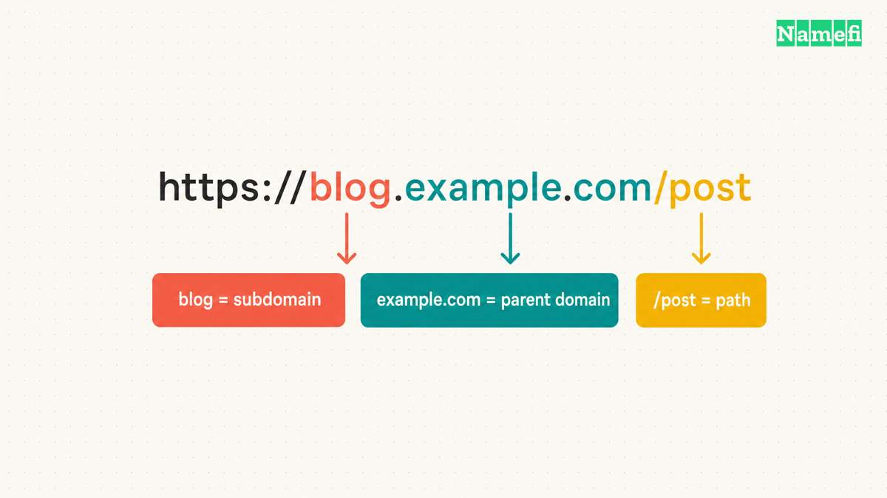
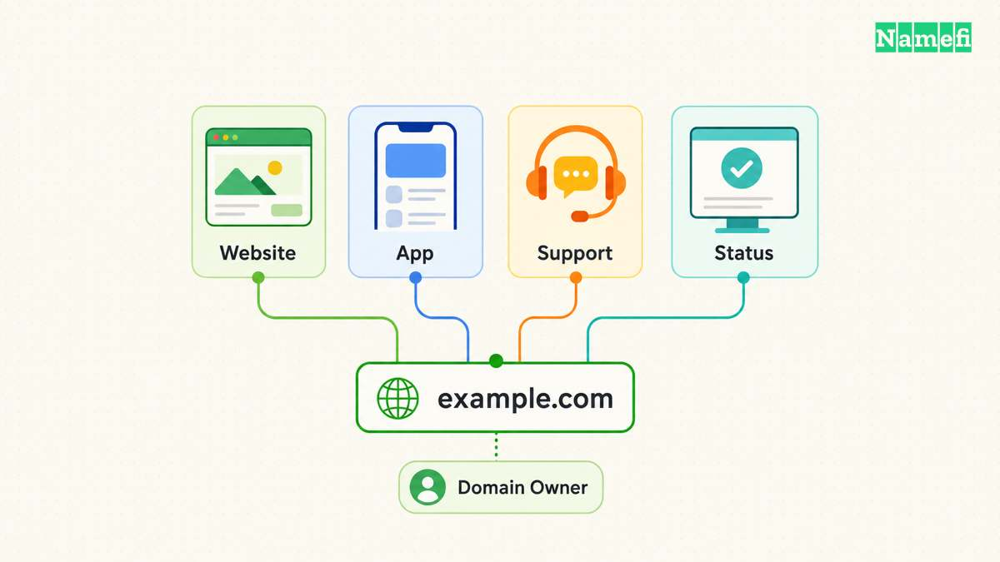
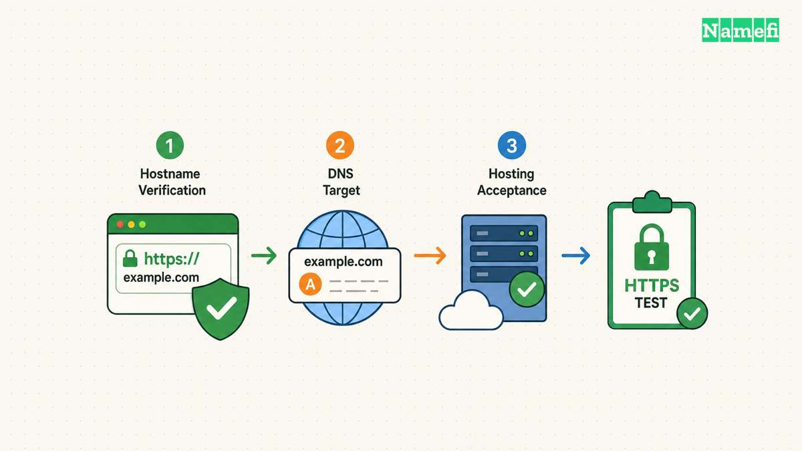
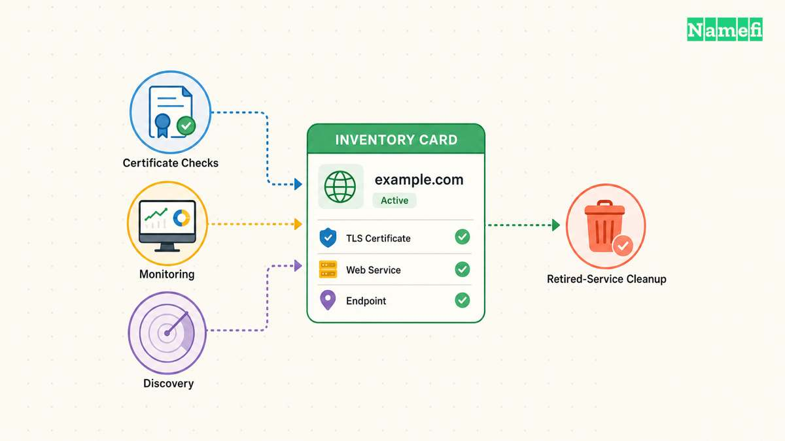

A subdomain is a domain beneath another domain in the DNS hierarchy. In the hypothetical address `blog.example.com`, `blog.example.com` is a subdomain of `example.com`. The familiar names `www`, `shop`, `app`, and `support` often identify different services. [The DNS standard defines subdomains through whole labels](#the-dns-standard-defines-subdomain-relationships).

A useful label does not create a website by itself. The hostname still needs suitable DNS records, a destination that accepts the hostname, and the required HTTPS configuration. Choose the name according to the service you intend to operate.

## A complete address separates the hostname from the path

Consider the hypothetical URL `https://blog.example.com/articles/start`.

| Part | Value | Responsibility |
| --- | --- | --- |
| Scheme | `https` | The connection protocol |
| Hostname | `blog.example.com` | The named website endpoint |
| Subdomain label | `blog` | The label beneath `example.com` |
| Parent domain | `example.com` | The containing domain |
| Path | `/articles/start` | The resource selected by the website |

The path `/articles/start` does not become part of the DNS name. [MDN explains the URL path and hostname components](#mdn-explains-url-anatomy). A website can place a blog at `example.com/blog/` without creating `blog.example.com`.

Our [subdomain and subdirectory comparison](/en/blog/subdomain-vs-subdirectory/) examines that architecture choice. This guide focuses on recognizable examples and the responsibilities attached to each name.

A nested name also follows the hierarchy. `api.eu.example.com` sits beneath `eu.example.com`, which sits beneath `example.com`. The number of labels alone does not identify which part a registrar sells.

## Common examples describe intended services rather than automatic features

The following addresses are hypothetical naming examples. Each address requires a configured service.

| Subdomain | Possible use | Operational decision |
| --- | --- | --- |
| `www.example.com` | Main website | Which hostname should be the primary public address? |
| `blog.example.com` | Publishing application | Who maintains the publishing platform? |
| `shop.example.com` | Storefront | Which service handles checkout? |
| `app.example.com` | Customer application | Which authentication controls apply? |
| `support.example.com` | Help center | Who manages the external support platform? |
| `status.example.com` | Service status page | Which dependencies remain during an outage? |
| `api.example.com` | Application interface | Which clients depend on the hostname? |
| `staging.example.com` | Test environment | Who may access the environment? |

`www.example.com` is a subdomain of `example.com`. The label `www` does not require a different website from the parent domain. The website configuration decides whether the addresses serve content or redirect.

Similarly, the name `secure.example.com` does not secure a service. A label describes an intended use. Authentication, authorization, TLS, and application behavior require their own configuration.

For a small site, one application with paths can be easier to maintain. Consider a separate hostname when a different provider, deployment workflow, or operational owner creates a real need.

## You should read the complete hostname before trusting a link

Subdomain relationships use complete DNS labels. The standard explicitly distinguishes names that merely share a character sequence. [RFC 9499 gives the whole-label rule](#the-dns-standard-defines-subdomain-relationships).

For example, `ooo.example.com` is not a subdomain of `oo.example.com`. In the hypothetical address `https://example.com.login.attacker.example/`, the hostname ends in `attacker.example`. The initial `example.com` text does not place the address beneath `example.com`.

Read the hostname through the final labels before entering credentials. A familiar word at the beginning of an address can create a misleading impression. The same caution applies to labels such as `billing`, `support`, and `login`.

Do not infer control of a service from its label alone. Check the intended organization’s official route when the action involves account access or payment.

## A working subdomain needs an accepting service and DNS records

Cloudflare’s setup instructions begin by confirming that the hosting provider can serve the selected hostname. The instructions then describe A, AAAA, and CNAME records. [The provider documents the sequence and targets](#cloudflare-explains-subdomain-configuration).

| Host supplies | Typical record type | What belongs in the target |
| --- | --- | --- |
| IPv4 address | A | The host’s actual IPv4 address |
| IPv6 address | AAAA | The host’s actual IPv6 address |
| Another DNS hostname | CNAME | The host’s actual destination hostname |

Use only the record types the destination requires. Do not add all record types because a tutorial lists alternatives. Do not enter `https://` or a page path into a field that expects a DNS target.

A practical setup sequence is:

1. Add the hostname in the destination service.
2. Complete the service’s domain verification.
3. Copy the requested DNS record to the active zone.
4. Inspect the saved name and destination.
5. Test DNS resolution for the exact hostname.
6. Test the exact HTTPS URL and an important page.

Check how the DNS interface handles the parent domain. Some interfaces append the domain automatically. A repeated suffix can create an unintended record.

Our [CNAME and A record guide](/en/blog/cname-vs-a-record/) explains target differences. Preserve unrelated mail and verification records while adding the new hostname.

## Security and retirement need explicit owners

A staging subdomain needs access controls when the environment contains private material. A difficult hostname does not replace authentication. Decide the intended audience before publishing the service.

A separate subdomain also does not guarantee complete browser isolation. MDN explains that a cookie’s `Domain` attribute can make the cookie available to subdomains. [The cookie scope documentation describes the behavior](#mdn-explains-cookie-domain-scope).

Review cookie settings with the application owner when a marketing site and customer application share a parent domain. Do not broaden cookie scope merely to hide a login problem.

Check HTTPS for each intended hostname. Let’s Encrypt’s challenge documentation distinguishes wildcard issuance from ordinary hostname validation. [The certificate guidance explains the validation choices](#lets-encrypt-documents-hostname-validation). DNS success and certificate success are separate checks.

Maintain a hostname inventory with the destination, account owner, certificate workflow, and retirement plan. When retiring an external service, review the DNS record and provider-side hostname configuration together. Avoid leaving a published address attached to an abandoned service configuration.

Choose a subdomain when the name supports a clear service boundary. Finish the task by verifying DNS, HTTPS, application behavior, and ownership of the ongoing maintenance.

## Sources and further reading

### The DNS standard defines subdomain relationships

[The DNS standard defines subdomain relationships](https://www.rfc-editor.org/rfc/rfc9499.html#:~:text=Note%20that%20the%20comparisons%20here%20are%20done%20on%20whole%20labels), checked 2026-10-30.

### Cloudflare explains subdomain configuration

[Cloudflare explains subdomain configuration](https://developers.cloudflare.com/dns/manage-dns-records/how-to/create-subdomain/#:~:text=first%20ensure%20that%20your%20hosting%20provider%20can%20serve%20content%20for%20the%20given%20hostname), checked 2026-10-30.

### MDN explains cookie domain scope

[MDN explains cookie domain scope](https://developer.mozilla.org/en-US/docs/Web/HTTP/Guides/Cookies#:~:text=The%20Domain%20attribute%20specifies%20which%20server%20can%20receive%20a%20cookie.%20If%20specified%2C%20cookies%20are%20available%20on%20the%20specified), checked 2026-10-30.

### Lets Encrypt documents hostname validation

[Lets Encrypt documents hostname validation](https://letsencrypt.org/docs/challenge-types/#:~:text=The%20HTTP-01%20challenge%20can%20only%20be%20done%20on%20port%2080.), checked 2026-10-30.

### MDN explains URL anatomy

[MDN explains URL anatomy](https://developer.mozilla.org/en-US/docs/Learn_web_development/Howto/Web_mechanics/What_is_a_URL#:~:text=%2Fpath%2Fto%2Fmyfile.html%20is%20the%20path%20to%20the%20resource%20on%20the%20Web%20server.), checked 2026-10-30.
