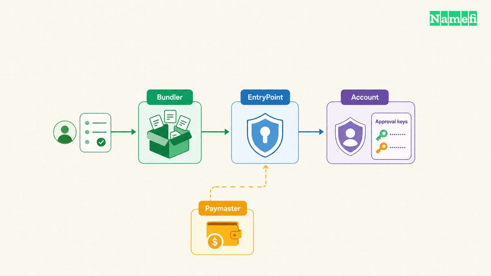
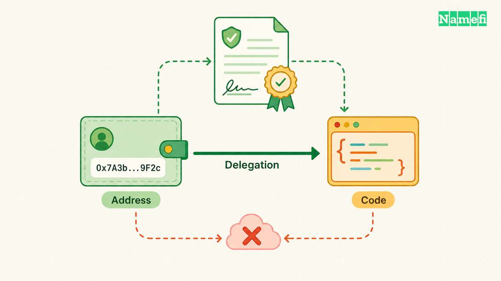
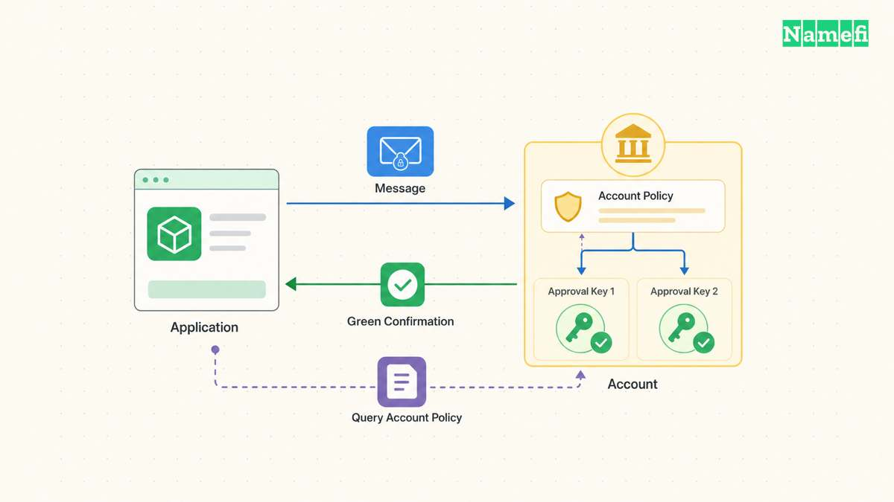
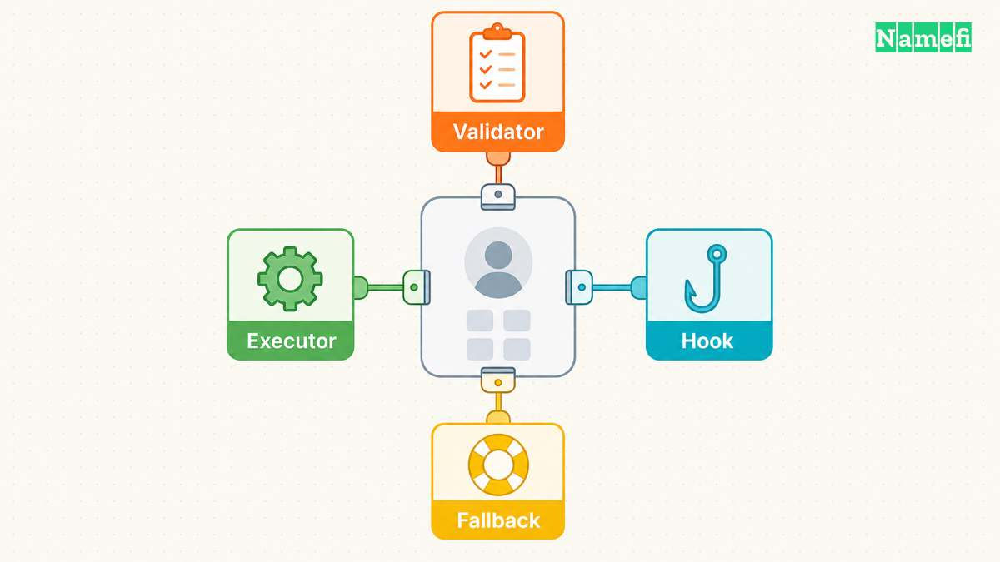

A wallet comparison becomes confusing when one product advertises ERC-4337 and another advertises EIP-7702. The names describe different parts of an account architecture. ERC-4337 organizes operation submission. EIP-7702 enables code delegation at an existing externally owned account, or EOA. ERC-1271 defines contract signature checks. ERC-7579 describes modular account interfaces ([4337 abstract](https://eips.ethereum.org/EIPS/eip-4337#abstract), [7702 abstract](https://eips.ethereum.org/EIPS/eip-7702#abstract), [1271 abstract](https://eips.ethereum.org/EIPS/eip-1271#abstract), [7579 abstract](https://eips.ethereum.org/EIPS/eip-7579#abstract)).

Consider a team that wants two approvals for asset transfers, sponsored routine transactions, and a restricted automation key. Treat those requirements as separate acceptance tests. A standard number alone cannot demonstrate that a [wallet](/en/glossary/wallet/) meets the requirements.

This comparison groups the four standards by the integration question each standard answers. The examples describe design choices and suggested tests, rather than named wallet implementations. Specification status also matters: on October 21, 2026, the official pages label ERC-4337, EIP-7702, and ERC-1271 **Final**, and ERC-7579 **Draft** ([4337](https://eips.ethereum.org/EIPS/eip-4337), [7702](https://eips.ethereum.org/EIPS/eip-7702), [1271](https://eips.ethereum.org/EIPS/eip-1271), [7579](https://eips.ethereum.org/EIPS/eip-7579)).

## ERC-4337 separates operation submission from account policy

ERC-4337 supplies an account-abstraction route without consensus-layer changes. A bundler submits `UserOperation` requests through an `EntryPoint` contract. The account validates the request before execution. Optional paymasters can sponsor gas under their own acceptance rules ([ERC-4337 specification](https://eips.ethereum.org/EIPS/eip-4337#specification)).

For product evaluation, separate the authorization decision from the submission service. Ask which account code accepts the requested action. Then ask which bundler will deliver the request, and who funds the operation. Successful authorization does not answer the availability or payment questions.

| Integration question | Relevant component | Evidence to request |
| --- | --- | --- |
| Who approves the action? | Account validation | Tests for accepted and rejected requests |
| Who delivers the operation? | Bundler and EntryPoint | Supported network and contract versions |
| Who funds execution? | Account or paymaster | Funding policy and rejection behavior |

Imagine a business onboarding flow that promises sponsored transactions. The acceptance test should cover an eligible operation and an ineligible operation. Add cases for an exhausted sponsorship budget and an unavailable service. The application should explain whether the user can retry, fund the account, or choose another supported route.

The same approach helps evaluate recovery features. Specify the intended policy before choosing infrastructure. For example, require two independent approvers to replace a lost key. Test whether the old key remains usable after recovery and whether a pending operation can still execute. Those tests examine the implementation rather than the standard label.

A **paymaster is optional**, and sponsorship requires a willingness and ability to pay. ERC-4337 defines checks for a paymaster's deposit and approval of the operation ([paymaster extension](https://eips.ethereum.org/EIPS/eip-4337#extension-paymasters)). Avoid treating a successful demonstration as evidence of unlimited future subsidy.

For a purchasing checklist, request the exact deployment addresses, supported operation format, and upgrade procedure. Record the tested combinations in the integration documentation. Recheck the combinations after a wallet or infrastructure upgrade. A team needs a reproducible configuration, not an unqualified claim of compatibility.

**Threat-model exercise:** assume an attacker controls the application frontend but lacks the account's approval keys. Try to replace the recipient, enlarge an approval, and add an unexpected call. The desired result is rejection under the team's stated account policy. Record whether the interface presents every authorized action clearly enough for a reviewer to detect the change.

ERC-4337 also explicitly supports EIP-7702 authorizations on networks that enable EIP-7702 ([authorization support](https://eips.ethereum.org/EIPS/eip-4337#support-for-eip-7702-authorizations)). Therefore, a comparison should not force a choice between the two standards. Evaluate the account's behavior and the delivery route together.

## EIP-7702 preserves an address while delegating execution to code

EIP-7702 introduces signed authorizations that set a delegation indicator at an EOA. Execution follows the indicator to another contract's code. The delegation persists until a valid authorization changes or clears the delegation. A failed execution does not roll back a processed delegation indicator ([behavior](https://eips.ethereum.org/EIPS/eip-7702#behavior), [persistence rationale](https://eips.ethereum.org/EIPS/eip-7702#persistence-of-code-delegation)).

That persistence changes the review question. Ask what code will control later interactions with the account, rather than considering only the visible transaction. For an existing account, inventory assets and permissions before approving a delegation. Treat the delegation decision as an account configuration change.

The specification warns that delegated code has unrestricted account access. Applications should not ask users to sign arbitrary delegations. Wallets must closely audit the delegated code ([wallet interaction](https://eips.ethereum.org/EIPS/eip-7702#interaction-with-applications-and-wallets)). Limited permissions need a correctly designed system above the delegation mechanism.

| Decision | Suggested review | Failure scenario to test |
| --- | --- | --- |
| Select delegated code | Verify the intended code and address | Interface substitutes another target |
| Initialize account policy | Check authorized setup data | Another caller attempts initialization |
| Replace delegation | Review the replacement procedure | New code misreads existing configuration |

Suppose a team wants to retain an address already used by customers. Write an acceptance test that begins with the existing account configuration. Perform the proposed upgrade, then test incoming transfers, authorized actions, and rejected actions. Include a documented way to inspect the resulting delegation after the transaction.

A failed transaction needs a separate test. Deliberately trigger a failure in a controlled environment, then inspect the account configuration. The interface should report the resulting configuration clearly. A red failure message should not encourage the operator to assume that every preceding configuration change disappeared.

An implementation review should also cover initialization and storage assumptions. The EIP identifies front-running initialization and storage management as security concerns ([security considerations](https://eips.ethereum.org/EIPS/eip-7702#security-considerations)). Ask the implementer to demonstrate the relevant protections with the actual delegated code.

**Operational checklist:** verify the network, delegated address, intended account, and resulting configuration. Document who can authorize a replacement. Practice the replacement procedure before placing important assets under the configuration. Avoid promising that replacement can recover losses from actions that already executed.

EIP-7702 suits the question of adding programmable behavior at an existing EOA address. A separate implementation must still define approval thresholds, session permissions, and user-facing recovery procedures. Evaluate those requirements individually instead of inferring the requirements from address continuity.

## ERC-1271 lets applications ask contracts to validate signatures

ERC-1271 defines `isValidSignature(hash, signature)` for contract signers. A successful result uses the four-byte value `0x1626ba7e`, rather than a Boolean. The check must not modify state. The contract can apply authorization rules that depend on time, state, signer permissions, or a signature scheme ([specification](https://eips.ethereum.org/EIPS/eip-1271#specification)).

A [digital signature](/en/glossary/digital-signature/) workflow therefore needs more than an address-recovery demonstration. Ask whether the application can verify the claimed contract signer under the contract's current policy. ERC-1271 describes message validation, rather than transaction submission or ownership administration ([rationale](https://eips.ethereum.org/EIPS/eip-1271#rationale)).

Consider a hypothetical marketplace that accepts an asset owner's signed sale order. A team account requires two approvals for sale authorization. The marketplace integration should exercise that policy through the account's signature interface. A test that accepts only one employee's personal signature would not prove the intended account approval.

| Test case | Desired application behavior | Policy question |
| --- | --- | --- |
| Valid contract approval | Accept the expected response | Did the account authorize this message? |
| Invalid contract approval | Reject the request | Does rejection reach the user clearly? |
| Changed signer configuration | Apply the documented validation timing | Which account state controls acceptance? |

The third case deserves explicit product requirements. Suppose the team removes an employee after an order receives approval. Should the application accept the order later? Define the expected behavior, then test the exact implementation. Do not assume that a historical validation result settles all future authorization decisions.

Because ERC-1271 permits state-dependent validation, an application should document when validation occurs ([validation context](https://eips.ethereum.org/EIPS/eip-1271#specification)). Keep the distinction between a recorded approval and the application's later decision to act. A stored success response alone does not explain the intended policy after an account change.

For integration review, prepare positive and negative examples with the wallet implementer. Include malformed signatures, insufficient approval, and an unexpected message hash. Exercise application error handling when the contract call fails. These examples help reviewers distinguish signature support from a narrowly successful demonstration.

**Threat-model exercise:** define exactly what the message authorizes. Include the intended action, application context, and validity conditions in the design review. Attempt to reuse an approval for a different action. Treat replay protection and message construction as explicit application responsibilities rather than assuming the signature interface supplies the entire protocol.

This distinction matters for account recovery too. Test the signature workflow before and after a signer change. Ask whether the application uses the contract's policy or an outdated list of employees. Document the result so operators understand which approvals remain effective under the chosen design.

## ERC-7579 makes module interfaces comparable while preserving privilege differences

Draft ERC-7579 describes interfaces for modular smart accounts. The specification covers account execution and configuration, plus validator, executor, fallback-handler, and hook modules. The account requirements include ERC-1271 compliance ([abstract](https://eips.ethereum.org/EIPS/eip-7579#abstract), [modules](https://eips.ethereum.org/EIPS/eip-7579#modules)).

Module roles require separate privilege reviews. Validators participate in authorization, while executors can initiate account execution through the account interface. The proposal warns that treating validators and executors alike can permit arbitrary transactions ([module definitions](https://eips.ethereum.org/EIPS/eip-7579#definitions), [type separation](https://eips.ethereum.org/EIPS/eip-7579#differentiating-module-types)).

| Proposed feature | Review question | Suggested negative test |
| --- | --- | --- |
| Restricted automation | Which actions can the installed module initiate? | Attempt an unauthorized transfer |
| Recovery policy | Who can change the approval configuration? | Attempt recovery with insufficient approval |
| Module removal | What authority remains after removal? | Retry a previously authorized request |

Imagine a team that wants automation to perform one routine action, with human approval for asset transfers. Write the allowed action narrowly. Specify the destination, operation, and duration where relevant. Then test attempts to exceed each restriction. A module name such as “session key” does not establish the permission boundary.

Before installing a module, request its type, configuration, removal procedure, and dependencies. Identify who can install another module or change the account implementation. Review those administrative powers alongside routine permissions. An implementation that meets the routine-action test may still expose a broader configuration path.

**Composition example:** design an account with delegated code through EIP-7702, operation delivery through ERC-4337, contract message checks through ERC-1271, and ERC-7579 module interfaces. The standards provide relevant integration points, but the complete combination still needs implementation tests. ERC-7579 currently states a strict ERC-4337 dependency for its validation flow ([dependency rationale](https://eips.ethereum.org/EIPS/eip-7579#dependence-on-erc-4337)).

For the combined design, rehearse a compromised automation key and an unavailable submission service. Require the team to revoke the restricted permission through a documented authorized route. Test application signature checks after revocation. Record which operations remain possible and which services the response procedure requires.

A [tokenized domain](/en/blog/what-are-tokenized-domains/) offers a useful hypothetical application for the same review. A business might want routine operators to manage permitted tasks while owners retain transfer authority. Define the exact permissions separately for the account, asset contract, and domain-management service. A wallet configuration alone does not demonstrate control over every domain operation.

For readers evaluating Namefi, use the domain workflow as an integration checklist. Request evidence for the specific wallet, network, contract, and management action before relying on the combination. This article does not establish that Namefi implements any of these four standards.

Keep a short permission record for every production account. Name the people who approve transfers, the services that submit operations, and the procedure for removing access. Assign an owner to review the record after configuration changes. During an incident, the record should identify a tested response procedure without requiring operators to reconstruct the integration from marketing material.

Choose the standards according to the problem: delivery, delegation, contract signatures, or modules. Then evaluate the complete implementation against written permissions and failure tests. Compatibility describes an interface. The team's evidence must show who can authorize each consequential action.

## Sources and further reading

The author opened the primary specifications on October 21, 2026 UTC. No verified archive snapshot is available in this research record.

- Ethereum Improvement Proposals, [ERC-4337](https://eips.ethereum.org/EIPS/eip-4337#specification): Specification, paymasters, and EIP-7702 authorization support. Status: Final. Fetched 2026-10-21 UTC.
- Ethereum Improvement Proposals, [EIP-7702](https://eips.ethereum.org/EIPS/eip-7702#behavior): Behavior, persistence, wallet interaction, and security considerations. Status: Final. Fetched 2026-10-21 UTC.
- Ethereum Improvement Proposals, [ERC-1271](https://eips.ethereum.org/EIPS/eip-1271#specification): Signature interface, state-dependent validation, and rationale. Status: Final. Fetched 2026-10-21 UTC.
- Ethereum Improvement Proposals, [ERC-7579](https://eips.ethereum.org/EIPS/eip-7579#specification): Module roles, execution authorization, and dependency rationale. Status: Draft. Fetched 2026-10-21 UTC.
