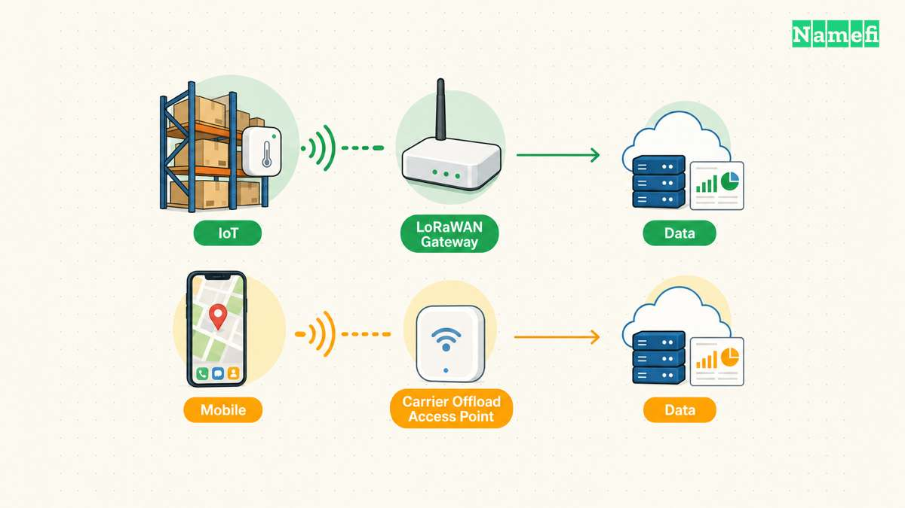
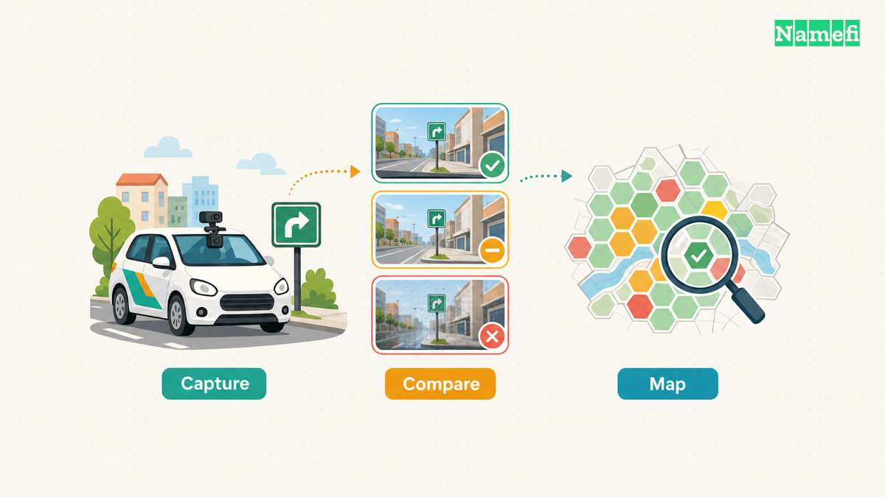
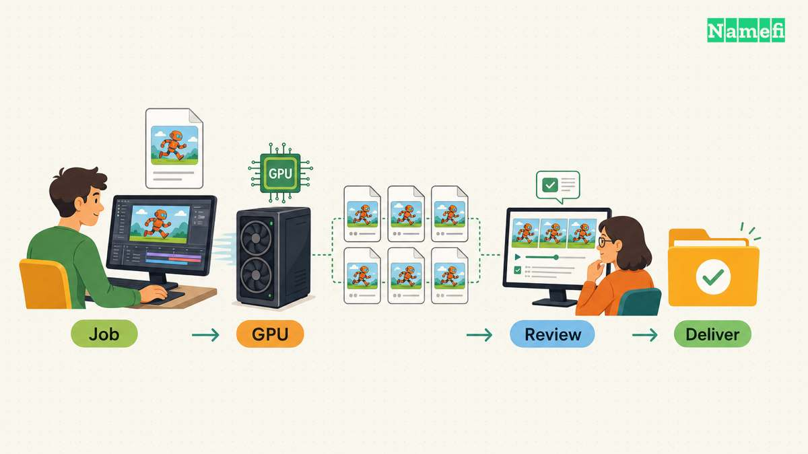
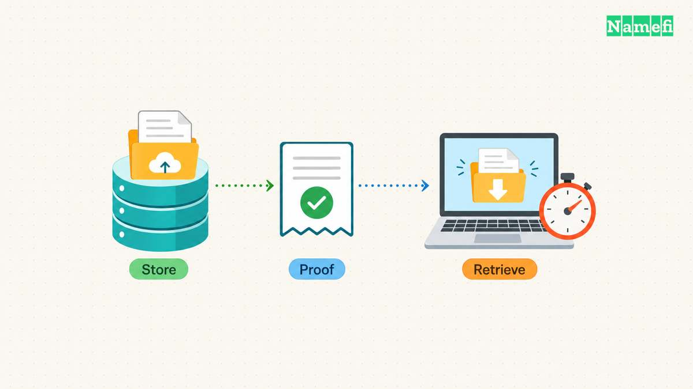

A wireless connection, a road observation, a rendered frame, and a stored file need different acceptance tests. A token transfer cannot establish every requirement.

DePIN means decentralized physical infrastructure networks. This comparison uses the term for networks that coordinate hardware services through token incentives and blockchain records. Helium supplies wireless connectivity. Hivemapper collects mapping observations. Render coordinates GPU work. Filecoin coordinates storage. Their official documentation describes distinct service and payment mechanisms ([Helium](https://docs.helium.com/mobile/5g-on-helium/#introduction), [Hivemapper](https://docs.hivemapper.com/honey-token/map-data-structure-and-verification/#atomic-unit-of-hivemapper-network), [Render](https://know.rendernetwork.com/basics/burn-mint-equilibrium#:~:text=rendering%20and%20AI%20jobs), [Filecoin](https://docs.filecoin.io/getting-started/how-storage-works/upload-to-filecoin#filecoin-onchain-cloud)).

The useful comparison starts with the purchased service. Customer payments, provider rewards, and proof of delivery answer separate questions. A [blockchain](/en/glossary/blockchain/) can preserve an accepted record. The service still needs an appropriate acceptance rule.

The following rubric expresses our assessment of buyer requirements. The examples do not form a performance ranking. The documentation review reflects October 21, 2026.

| Network | Customer buys | Buyer must test |
| --- | --- | --- |
| Helium | Wireless data transfer | Connectivity at required sites |
| Hivemapper | Map imagery and features | Freshness and feature accuracy |
| Render | Supported GPU jobs | Correct outputs before deadlines |
| Filecoin | A selected storage service | Retention and usable retrieval |

A useful pilot fixes the acceptance rule before comparing vendors. The pilot should use the actual device, route, scene, or dataset. Aggregate network activity cannot replace that test.

## Helium connects devices through separate wireless service paths

Helium's Mobile Network currently supports carrier offload through community hotspots and converted Wi-Fi networks. Radios connect to a common core. Deployers supply locations, power, and internet connectivity. Helium rewards eligible data transfer with HNT, and service readiness can affect offload eligibility ([The Mobile Network, “Introduction,” “Hotspots,” and “Rewards”](https://docs.helium.com/mobile/5g-on-helium/#rewards)).

Helium's IoT path uses LoRaWAN network servers for device management, message routing, and application integration. A customer can use a hosted server or operate a server directly. A sensor deployment therefore has a different integration path from mobile carrier offload ([LoRaWAN Network Servers, “Connect and Manage Devices on Helium”](https://docs.helium.com/iot/lorawan-network-servers/#connect-and-manage-devices-on-helium)).

**The current verification model matters.** Helium states that Proof of Coverage ended across its networks on July 6, 2026. Historical beacon and witness records remain available. A current comparison must distinguish historical coverage rewards from present service rules ([Helium Oracle Data, “Oracle Data File Format”](https://docs.helium.com/network-data/oracle-data/#oracle-data-file-format)).

For Mobile, published network tables include verified offload sessions, billed sessions, validated speed tests, and data-transfer rewards. Invalid-session tables record rejection reasons. Those records expose parts of the operational checking process ([Helium Mobile Network Data, “Available Tables” and “Other Tables”](https://docs.helium.com/network-data/mobile-network-data/#available-tables)).

Our assessment separates a valid session record from a coverage commitment. A successful session demonstrates service under particular conditions. The session does not establish future availability throughout a building. A buyer needs representative tests across the intended service area.

**Payment and rewards follow different accounting paths.** Network usage consumes Data Credits, which derive from burning HNT. Data Credits cover data transfer and certain network operations. Helium's documentation separately describes HNT rewards for hosts and operators ([Data Credit, “Data Credit Usage”](https://docs.helium.com/tokens/data-credit/#data-credit-usage), [The Helium Network Token, “HNT Usage”](https://docs.helium.com/tokens/hnt-token/#hnt-usage)). A reward distribution therefore requires more context than a customer invoice.

Consider a hypothetical warehouse sensor deployment. Set the required delivery interval and acceptable message loss first. Test sensors near loading bays, inside storage areas, and during ordinary operating hours. Record missing messages at the application endpoint. A gateway's presence alone does not satisfy the acceptance rule.

For a hypothetical carrier offload deployment, test subscriber authentication, sustained throughput, and reconnection at the proposed location. Identify who handles an internet outage or a failed radio. Require a support route that connects a service incident to the responsible operator.

The pilot should also include an intentional interruption. Disconnect one test location and measure when the application notices missing service. Confirm whether the application queues readings or loses readings. A customer can then decide whether another connectivity path must cover that failure.

**Best fit in our assessment:** Helium merits evaluation when the selected wireless path reaches the required users or devices. The buyer should prioritize site measurements and integration support over historical hotspot reward records.

## Hivemapper turns contributed imagery into location-specific map data

Hivemapper evaluates camera contributions through geographic hexes. A useful contribution can refresh stale imagery or identify a map feature. Features include signs, lane boundaries, traffic lights, and toll information ([Map Data Structure and Verification, “Atomic Unit of Hivemapper Network”](https://docs.hivemapper.com/honey-token/map-data-structure-and-verification/#atomic-unit-of-hivemapper-network)).

The documentation describes vision-based consensus that compares observations from different devices within a location and time window. Device diversity contributes to verification weighting. Hivemapper presents the mechanism as protection against fraudulent imagery and replay attacks ([Map Data Structure and Verification, “Network Verification”](https://docs.hivemapper.com/honey-token/map-data-structure-and-verification/#network-verification)).

Image quality adds another acceptance stage. Hivemapper checks camera positioning, glare, lighting, focus, and location consistency. Machine and human feedback assess imagery. The network rejects unusable submissions from rewards ([Usable Imagery](https://docs.hivemapper.com/honey-token/earning-honey/individual-reward-factors/usable-imagery/#:~:text=Image%20quality%20is%20assessed)).

Those mechanisms address different failure modes. An authentic location does not ensure a readable speed-limit sign. A sharp image does not establish that a road restriction remains current. Our assessment therefore treats contribution validity, feature extraction, and customer suitability as separate checks.

**Map consumption differs from map contribution.** Customers use Map Credits to consume map data. HONEY supports contributor incentives and credit creation. The documentation distinguishes mapping rewards, editing and quality-assurance rewards, consumption rewards, and special incentives ([What Is HONEY?, “What is HONEY?” and “Map Credits”](https://docs.hivemapper.com/honey-token/what-is-honey/#map-credits), [Reward Types](https://docs.hivemapper.com/honey-token/earning-honey/reward-types/#consumption-rewards)).

The distinction changes how a buyer should read activity reports. A payment for useful contribution and a customer purchase measure different events. Our assessment would not treat every contributor reward as evidence of an independent commercial sale. A demand review needs the relevant consumption records and their definitions.

Consider a hypothetical delivery company that needs current loading restrictions. A useful pilot chooses several operating districts and obtains observations for specified dates. Reviewers compare extracted restrictions against a separate field sample. The pilot records omissions and incorrect features, rather than counting only images received.

A second test checks how the product handles change. Give the provider a known road change and ask when the product detected the change. Request the observation timestamp and the feature publication timestamp. A buyer needs to understand both delays before setting a freshness requirement.

The contract review should establish permitted uses, correction procedures, and access to historical observations. The buyer should also identify the operator responsible for the API. These requirements describe our procurement rubric, rather than promises that every Hivemapper product makes.

Require the API to distinguish an unchanged road from an area with no recent observation. Those states lead to different routing decisions. Record how reviewers resolve conflicting observations. A buyer should know whether a missing restriction means confirmed absence or missing evidence.

**Best fit in our assessment:** Hivemapper merits evaluation for applications that need road observations within specific areas and update windows. Coverage breadth alone cannot establish the accuracy of the features that a routing application will consume.

## Render supplies GPU work through supported production workflows

Render's documentation describes rendering and AI jobs within its burn-and-mint model. The model prices work through a credit mechanism and distributes network emissions to GPU suppliers. A buyer still needs to identify the supported application and job path ([Burn Mint Equilibrium](https://know.rendernetwork.com/basics/burn-mint-equilibrium#:~:text=Key%20aspects)).

This comparison focuses on the documented rendering workflow. Render's Blender guide lets creators inspect completed frames, request another node when necessary, approve frames, and download selected outputs. A frame's completion status and a creator's approval represent different stages ([Navigating the Jobs Page and Managing Downloads on Render, “Navigating the Jobs Page”](https://know.rendernetwork.com/getting-started/using-blender-cycles-on-the-render-network/navigating-the-jobs-page-and-managing-downloads-on-render#:~:text=You%20can%20individually%20click)).

Render's production guidance recommends small test batches, matching engine versions, and checking scene assets and memory requirements. The guidance also calls for frame validation before a full batch. Compatibility and output review therefore belong inside the purchase process ([Job Configuration & Settings, sections 1–8](https://know.rendernetwork.com/getting-started/creating-large-productions-on-the-render-network/job-configuration-and-settings#:~:text=Run%20Test%20Batches)).

Our assessment distinguishes a GPU performing work from the delivery of a usable production file. A completed frame can still contain the wrong lighting or missing assets. A blockchain record of payment cannot settle whether an art director accepts the result. The selected workflow needs a clear rejection and correction process.

**Credits pay for work, while emissions reward suppliers.** Render documents burning RENDER SPL tokens for equivalent USD-valued Render Credits. Render Credits are nontransferable work credits. Node operators receive RENDER through network emissions ([The RENDER SPL Token, “Using RENDER Tokens”](https://know.rendernetwork.com/basics/the-render-spl-token#:~:text=Using%20RENDER%20Tokens)). The credit purchase and the operator's reward therefore do not form a simple transfer between the same two parties.

Consider a hypothetical studio with an animation deadline. The pilot should include a demanding frame and a sequence that exposes temporal inconsistencies. Compare textures, motion, color output, and requested passes against accepted local results. Measure the time until the studio obtains usable files, including retries and downloads.

A procurement review should also fix the handling of incomplete jobs. Identify who authorizes rerenders, who approves final outputs, and which charges apply after rejection. Require staff coverage during the approval window. The operator should retain a local copy of every deliverable that the studio must preserve.

Keep retry costs and transfer time inside the pilot measurement. A fast successful frame does not capture the cost of a batch with repeated failures. Record accepted output per completed job, alongside the elapsed time and charges. That record supports a comparison against the studio's existing workflow.

A successful rendering pilot does not establish suitability for every AI workload. Different workloads can require different software, memory, confidentiality controls, and output checks. The buyer should repeat the acceptance review for the actual compute service.

**Best fit in our assessment:** Render merits evaluation when a supported workflow can produce the required files within the production deadline. Available GPU capacity has practical value only when the complete job path satisfies the studio's requirements.

## Filecoin verifies storage through the selected storage service

Filecoin offers several storage paths, including direct provider deals, managed services, and Filecoin Onchain Cloud. Current documentation distinguishes warm storage for retrieval from cold storage for sealed datasets. A comparison must identify the selected path before describing its guarantees ([Upload to Filecoin, “Filecoin Onchain Cloud” and “Direct deal-making”](https://docs.filecoin.io/getting-started/how-storage-works/upload-to-filecoin#filecoin-onchain-cloud)).

For sealed storage, Proof of Replication establishes a provider-specific copy. Proof of Spacetime checks continued storage. WindowPoSt audits storage commitments, while WinningPoSt participates in block production. These mechanisms serve distinct purposes ([Proofs, “Proof-of-Replication” and “Proof-of-Spacetime”](https://docs.filecoin.io/core-concepts/filecoin-virtual-machine/proofs#proof-of-spacetime-post)).

Warm storage uses a different verification path. Filecoin describes Proof of Data Possession for providers holding unsealed data. Cold storage uses sealed copies and service terms. The name Filecoin therefore does not identify one universal latency or payment model ([Glossary, “Filecoin Warm Storage Service” and “Filecoin Cold Storage Service”](https://docs.filecoin.io/reference/general/glossary#filecoin-warm-storage-service-fwss)).

**Retention and retrieval need separate acceptance tests.** Filecoin's retrieval documentation describes service-specific paths and direct provider retrieval. Some workflows use a PieceCID, while other workflows use an IPFS CID. Provider discovery and download access depend on the chosen path ([Retrieval, “Common retrieval paths”](https://docs.filecoin.io/getting-started/what-is-filecoin/retrieval#common-retrieval-paths)).

Our assessment treats a valid storage proof as evidence about its stated storage commitment. A buyer must separately test an application download. The proof does not measure the buyer's complete restore time. Endpoint availability, retrieval preparation, and application integration remain part of the service review.

**Service payments differ from protocol incentives.** Filecoin's glossary distinguishes client payments from block rewards for storage providers. The current cold-storage documentation describes client-selected service levels and payments through Filecoin Pay. The buyer should identify the actual contract and payment asset for the selected service ([Glossary, “Storage provider”](https://docs.filecoin.io/reference/general/glossary#storage-provider), [Filecoin Cold Storage Service](https://docs.filecoin.io/build-on-filecoin/filecoin-onchain-cloud/fcss#:~:text=service-level%20terms)).

Consider a hypothetical organization preserving research datasets. The pilot should upload a representative dataset and retrieve the complete dataset through the intended application. Verify content integrity and measure restore time. Repeat the test after an interval that reflects the retention plan. A successful upload alone does not complete the pilot.

Set a retention calendar before the pilot becomes a production archive. Identify who renews storage commitments and who maintains the metadata needed for retrieval. Test the organization's own access controls and recovery procedure. If the organization encrypts the dataset, test restoration with the separately retained decryption keys.

Across all four networks, buyers can use the same acceptance checklist:

1. Define the service unit and required delivery window.
2. Record the operator, endpoint, and supported integration path.
3. Identify the evidence that triggers payment or rewards.
4. Test quality with the actual device, route, scene, or dataset.
5. Record failure handling, support ownership, and an alternative service path.
6. Separate customer purchases from subsidized provider incentives.

A public domain can support that operator record. The operator can publish endpoints, service terms, contact details, and incident notices under one domain. [DNS](/en/glossary/dns/) supplies naming and routing functions. A domain or [tokenized domain](/en/glossary/tokenized-domain/) cannot prove radio coverage, image freshness, GPU output quality, or file retrieval.

Teams that [tokenize](/en/glossary/tokenize/) a domain should still document who controls service changes. A [smart contract](/en/glossary/smart-contract/) can enforce encoded payment conditions. Buyers must select conditions that correspond to usable delivery. The decisive DePIN comparison connects each purchased service to evidence that the customer can independently evaluate.

## Sources and further reading

The author fetched the following official sources on **2026-10-21 UTC**. The links identify the supporting sections.

- [Helium: The Mobile Network](https://docs.helium.com/mobile/5g-on-helium/#rewards), “Introduction,” “Hotspots,” and “Rewards.”
- [Helium: LoRaWAN Network Servers](https://docs.helium.com/iot/lorawan-network-servers/#connect-and-manage-devices-on-helium), hosted and self-hosted integration options.
- [Helium: Oracle Data](https://docs.helium.com/network-data/oracle-data/#oracle-data-file-format), the July 6, 2026 Proof of Coverage deprecation notice.
- [Helium: Mobile Network Data](https://docs.helium.com/network-data/mobile-network-data/#available-tables), valid sessions, invalid sessions, and reward tables.
- [Helium: Data Credit](https://docs.helium.com/tokens/data-credit/#data-credit-usage), network usage and credit creation.
- [Helium: The Helium Network Token](https://docs.helium.com/tokens/hnt-token/#hnt-usage), host rewards and Data Credits.
- [Hivemapper: Map Data Structure and Verification](https://docs.hivemapper.com/honey-token/map-data-structure-and-verification/#network-verification), hex contributions and vision-based consensus.
- [Hivemapper: Usable Imagery](https://docs.hivemapper.com/honey-token/earning-honey/individual-reward-factors/usable-imagery/#:~:text=Image%20quality%20is%20assessed), quality criteria and feedback.
- [Hivemapper: What Is HONEY?](https://docs.hivemapper.com/honey-token/what-is-honey/#map-credits), contributor incentives and map consumption.
- [Hivemapper: Reward Types](https://docs.hivemapper.com/honey-token/earning-honey/reward-types/#consumption-rewards), contribution, consumption, and special rewards.
- [Render: Burn Mint Equilibrium](https://know.rendernetwork.com/basics/burn-mint-equilibrium#:~:text=Key%20aspects), job pricing and emissions.
- [Render: The RENDER SPL Token](https://know.rendernetwork.com/basics/the-render-spl-token#:~:text=Using%20RENDER%20Tokens), work credits and supplier emissions.
- [Render: Navigating the Jobs Page and Managing Downloads](https://know.rendernetwork.com/getting-started/using-blender-cycles-on-the-render-network/navigating-the-jobs-page-and-managing-downloads-on-render#:~:text=You%20can%20individually%20click), frame review and approval.
- [Render: Job Configuration & Settings](https://know.rendernetwork.com/getting-started/creating-large-productions-on-the-render-network/job-configuration-and-settings#:~:text=Run%20Test%20Batches), sections 1–8.
- [Filecoin: Upload to Filecoin](https://docs.filecoin.io/getting-started/how-storage-works/upload-to-filecoin#filecoin-onchain-cloud), storage paths and managed services.
- [Filecoin: Proofs](https://docs.filecoin.io/core-concepts/filecoin-virtual-machine/proofs#proof-of-spacetime-post), PoRep, PoSt, and their roles.
- [Filecoin: Glossary](https://docs.filecoin.io/reference/general/glossary#storage-provider), warm storage, cold storage, and provider compensation.
- [Filecoin: Retrieval](https://docs.filecoin.io/getting-started/what-is-filecoin/retrieval#common-retrieval-paths), service-specific retrieval paths.
- [Filecoin: Cold Storage Service](https://docs.filecoin.io/build-on-filecoin/filecoin-onchain-cloud/fcss#:~:text=service-level%20terms), client-defined service levels.
