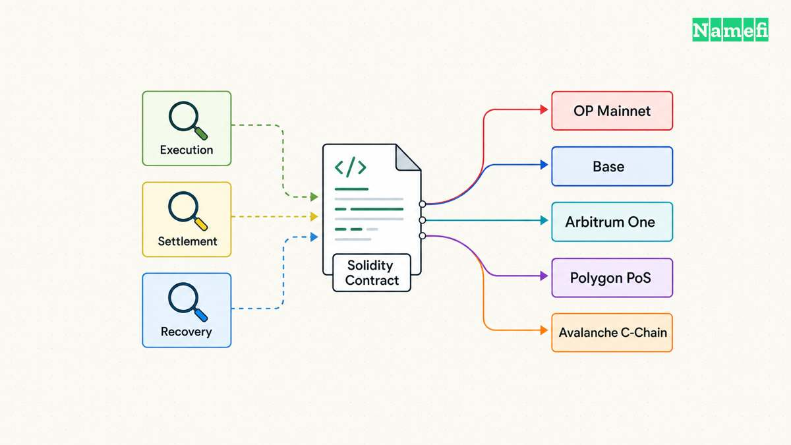
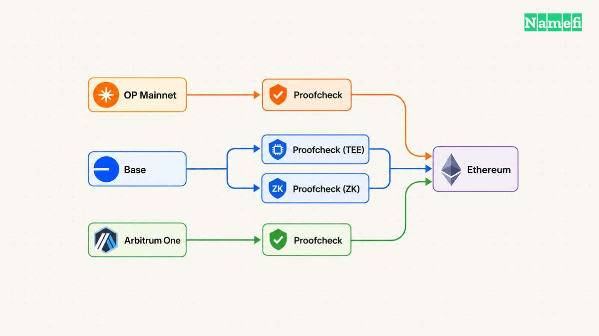
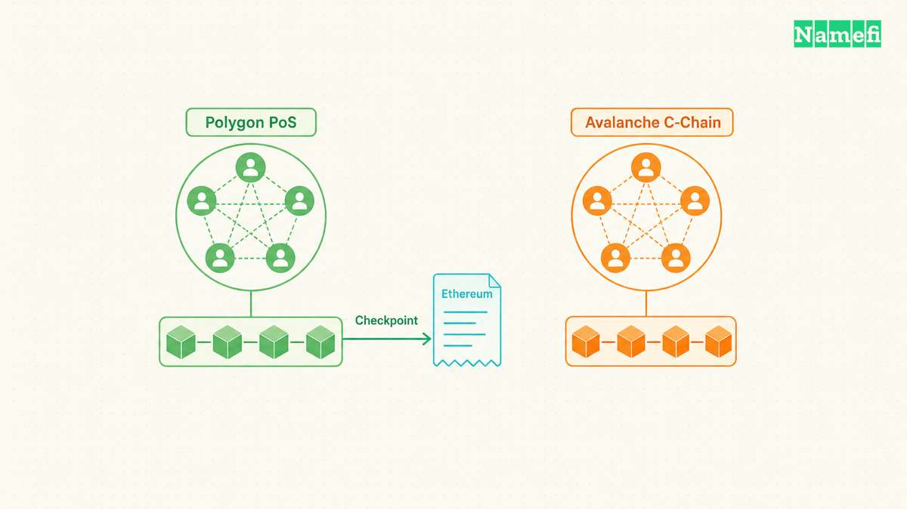
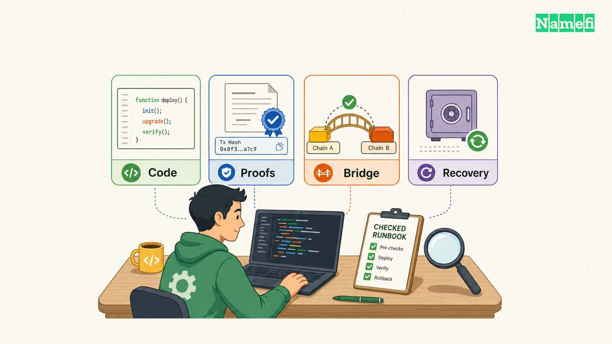

The [Ethereum Virtual Machine](/en/glossary/ethereum-virtual-machine/) (EVM) gives developers a common execution environment. EVM compatibility helps teams reuse contracts and tools. Compatibility does not establish who secures balances, who orders transactions, or how users recover assets during an outage. Ethereum's documentation explicitly separates [EVM compatibility from inherited Ethereum security](https://ethereum.org/developers/docs/scaling/sidechains/#evm-compatibility).

This guide compares OP Mainnet, Base, Arbitrum One, Polygon PoS, and Avalanche C-Chain for application deployment. The useful choice depends on the application's dependencies, settlement requirements, and recovery plan.

**As of October 21, 2026**, current documentation requires more care than familiar category labels suggest. Base documents an independent multiproof upgrade. Avalanche documents a new C-Chain execution implementation. Treat older comparisons as leads for verification, especially when those comparisons describe every Ethereum-connected network as the same kind of rollup.

## Compatibility helps teams reuse code but leaves security questions open

Start with three separate questions. **Execution** asks whether the network runs the application's bytecode correctly. **Settlement** asks which mechanism resolves disputed state claims. **[Data availability](/en/glossary/data-availability/)** asks whether participants can obtain the inputs needed to reconstruct the chain. A familiar wallet interface cannot answer all three questions.

The distinction matters when a deployment works during normal operation but fails during recovery. An application can display a successful transaction before the relevant withdrawal claim becomes usable on Ethereum. Base's documentation distinguishes [L2 transaction finality from withdrawal finalization](https://docs.base.org/specifications/transactions/transaction-finality#finality-for-withdrawal-transactions). Product teams should give each status an explicit meaning.

Use the following architectural comparison before testing application-specific behavior. The labels describe mechanisms, rather than measured security scores.

| Network | State mechanism | First recovery question |
| --- | --- | --- |
| OP Mainnet | Ethereum fault-proof rollup | Can a user propose and challenge? |
| Base | Ethereum multiproof checkpoints | Which proof path backs the exit? |
| Arbitrum One | Ethereum optimistic rollup | Can a validator defend state? |
| Polygon PoS | Own validators and checkpoints | Which checkpoint enables withdrawal? |
| Avalanche C-Chain | Primary Network consensus | Which bridge handles the destination? |

The next sections source each network's mechanism. The recovery questions express our engineering rubric. A favorable answer to one question does not replace the remaining review.

EVM equivalence also needs a concrete scope. Optimism documents [differences in opcodes, address aliasing, fees, and finality](https://docs.optimism.io/op-stack/protocol/differences#opcodes), despite the OP Stack's equivalence goal. For example, a message from an Ethereum contract can have an aliased sender on L2. An authorization check that assumes the original address can fail.

Build a portability inventory before choosing a network. Record compiler settings, required precompiles, transaction types, and every external contract. Include oracles, token contracts, account infrastructure, and cross-chain messengers. For each dependency, identify the exact deployment that the application will call. A vendor's support for a network does not establish that every vendor product supports that network.

For budgeting, compare complete user journeys. A contract call alone omits onboarding, funding, bridge operations, and recovery transactions. Measure the same workflow on candidate networks with the same payload. Record the measurement date and assumptions. This guide avoids fee and throughput rankings because an unmatched benchmark would answer a different question.

## OP Mainnet, Base, and Arbitrum One require separate proof reviews

These networks connect application execution to Ethereum, but the proof mechanisms differ. Compare proof participation, operator dependencies, and administrative intervention separately. A shared software history cannot establish today's deployed security configuration.

**OP Mainnet** uses an optimistic fault-proof system. Optimism says users can submit state proposals and challenge proposals without permission. The documentation also describes a Guardian that can intervene, including a fallback to permissioned games. These are distinct properties: [open participation coexists with intervention powers](https://docs.optimism.io/op-stack/fault-proofs/explainer#permissionless-challenges).

The administrative layer deserves an explicit acceptance decision. Optimism's security model documents [multisig control and upgrades without delays](https://docs.optimism.io/op-stack/security/faq-sec-model#op-stack-multisig). A team should record which privileges affect its assets and which events trigger a deployment pause. Fault proofs do not remove the need to review upgrade authority.

OP Mainnet merits evaluation when a team wants its Ethereum-connected execution environment and can operate within the documented bridge and governance assumptions. Test contract-originated messages and withdrawal handling early. Those tests reveal more about deployment fit than a generic claim that Solidity code “just works.”

**Base** needs its own current description. Base's [Azul overview](https://docs.base.org/upgrades/azul/overview#features) lists mainnet activation on May 28, 2026 and introduces multiproofs. The proof specification describes a permissioned trusted execution environment (TEE) path and a permissionless zero-knowledge (ZK) path. The ZK path can challenge an invalid TEE-backed claim through the [checkpoint proof system](https://docs.base.org/upgrades/azul/proofs#security-and-decentralization).

Later, Base's [Beryl overview](https://docs.base.org/upgrades/beryl/overview#features) lists mainnet activation on June 25, 2026. Beryl reduces the single-proof finalization window to five days. The dual-proof path remains one day when TEE and ZK proofs support the same proposal. These are documented protocol windows, not promises about the complete duration of every withdrawal.

Base's derivation specification describes [constructing L2 blocks from L1 data and sequencer batches](https://docs.base.org/specifications/base-protocol/consensus/derivation#overview). Separate that data path from checkpoint proving. For deployment selection, inspect both. Avoid importing OP Mainnet's proof assumptions into Base merely because older descriptions emphasize common OP Stack origins.

**Arbitrum One** uses Nitro. Its documentation describes Geth-based execution and an optimistic rollup that posts transaction batches to Ethereum. Nitro also supports AnyTrust, but the documentation identifies [Arbitrum One with Rollup and Nova with AnyTrust](https://docs.arbitrum.io/how-arbitrum-works/inside-arbitrum-nitro#transaction-processing-journey-on-arbitrum). Do not apply a committee-based data assumption to Arbitrum One because another Arbitrum network uses that design.

Arbitrum's current [BoLD overview](https://docs.arbitrum.io/how-arbitrum-works/bold/gentle-introduction#what-exactly-is-bold) describes active, permissionless validation and bounded dispute resolution. Validators still need bonds and operational capacity. Permissionless access describes eligibility, not the absence of resource requirements. The governance documentation also identifies a [Security Council with emergency responsibilities](https://docs.arbitrum.foundation/concepts/security-council#the-role-of-the-security-council).

| Candidate | Review emphasis | Useful deployment exercise |
| --- | --- | --- |
| OP Mainnet | Guardian and upgrade powers | Test a contract-originated deposit |
| Base | TEE/ZK checkpoint paths | Trace an exit's proof status |
| Arbitrum One | BoLD participation and control | Trace an assertion and withdrawal |

Use these exercises to develop an operational runbook. The comparison does not imply that one proof architecture makes every application safer. Application contracts, bridge configuration, monitoring, and response procedures remain separate review subjects.

## Polygon PoS and Avalanche C-Chain depend on their own consensus

Polygon PoS and Avalanche C-Chain support EVM applications while relying on consensus outside Ethereum's validator system. A bridge connection does not convert either network into an Ethereum [rollup](/en/glossary/rollup/). Ethereum's [sidechain explanation](https://ethereum.org/developers/docs/scaling/sidechains/#consensus-algorithms) makes the independent-consensus distinction explicit and names Polygon PoS among its examples.

**Polygon PoS** combines Bor execution with Heimdall-v2 consensus. Polygon's architecture documentation describes staking contracts on Ethereum and periodic checkpoint submission. Heimdall-v2 validates Bor block data and [publishes Merkle roots to Ethereum](https://docs.polygon.technology/pos/architecture/overview#heimdall-v2-validation-layer). Those checkpoints support withdrawal proofs. A checkpoint commitment does not itself publish every transaction needed to replay the chain.

The deployment implication is specific. Review Polygon validator assumptions and the bridge's withdrawal requirements alongside application execution. Do not interpret the presence of an Ethereum contract as evidence that Ethereum independently re-executes Polygon transactions. Map the transaction, checkpoint, and bridge steps as separate parts of the asset journey.

Polygon PoS merits evaluation when required users and application dependencies already operate there, and the team accepts the independent validator model. Verify that integration documents describe Polygon PoS specifically. “Polygon” alone is too broad for a security decision because the deployment must identify a concrete network and architecture.

**Avalanche C-Chain** belongs to the Avalanche Primary Network, alongside the P-Chain and X-Chain. The official documentation describes the C-Chain as an EVM implementation with Geth API support and Solidity contract execution. The same page states that [Continuous Execution replaced Coreth after Helicon](https://build.avax.network/docs/primary-network#c-chain-contract-chain), with mainnet activation on September 22, 2026. An older Coreth-only description therefore misses a material implementation change.

Avalanche's [Snowman consensus documentation](https://build.avax.network/docs/primary-network/avalanche-consensus#conceptual-overview) describes repeated sampling of validator preferences. That consensus belongs to Avalanche's own system. Ethereum does not settle C-Chain execution as an Ethereum rollup. A transfer to another network requires review of the selected bridge and destination rules.

C-Chain merits evaluation when the application needs that particular network and its available dependencies. Keep the network scope precise. The C-Chain, other Primary Network chains, and separately deployed Avalanche L1s are different deployment targets. The [Primary Network documentation](https://build.avax.network/docs/primary-network) distinguishes those targets.

For either candidate, test the failure path that matches the actual integration. Record what happens when an RPC provider stops responding, a bridge pauses, or an indexer falls behind. A successful contract deployment verifies only part of the system. A rehearsed recovery procedure gives the team actionable evidence about its service obligations.

## A deployment rubric turns the shortlist into an engineering decision

Use requirements as gates before assigning preferences. First, decide whether the application requires Ethereum-enforced state settlement. If that requirement excludes an independent validator model, remove the incompatible candidates before measuring convenience. Then identify the exact asset and message paths. Finally, compare the remaining networks using reproducible tests.

The following rubric expresses engineering judgment rather than a sourced ranking. A team can change the priorities, but each priority should produce a documented acceptance condition.

| Requirement | Evidence to collect | Acceptance decision |
| --- | --- | --- |
| Contract portability | Dependency and execution tests | Required behavior passes |
| Settlement model | Proof and consensus documents | Trust assumptions accepted |
| Exit availability | Bridge rehearsal and status trace | Recovery fits obligations |
| Operating capacity | RPC and monitoring exercises | Team can detect failures |
| User access | Wallet and funding walkthrough | Users can complete the journey |

Consider two hypothetical applications. A marketplace that must release Ethereum collateral after an L2 sale needs a complete withdrawal and messaging design. A game whose users already hold assets on C-Chain may prioritize existing integrations. Neither example establishes a universal winner. Each example produces a different set of required tests.

An engineering checklist should accompany the final choice:

1. Record the network name, chain ID, RPC endpoints, and deployed contract addresses.
2. Pin compiler settings and verify bytecode on the target network.
3. Test required opcodes, precompiles, signatures, and contract-originated messages.
4. Verify token addresses and distinguish native assets from bridged representations.
5. Rehearse deposits, withdrawals, failed messages, and duplicate request handling.
6. Define separate user statuses for submission, inclusion, settlement, and withdrawal availability.
7. Document proof dependencies, validator assumptions, upgrade authority, and emergency intervention.
8. Test RPC failover and indexer recovery against known transaction receipts.
9. Measure complete workflow costs with dated, reproducible inputs.
10. Assign owners for upgrade monitoring and incident response.

Test the service boundary as well as the contract boundary. For example, interrupt a withdrawal after submission, then restart the application. The interface should recover the existing request rather than create a second request. Reconcile the displayed status with chain receipts and bridge records. Include a deliberate mismatch between the wallet network and the configured contract address. The application should identify the mismatch before requesting a signature.

Keep the evidence with the release. Save test receipts, contract versions, bridge addresses, and configuration timestamps. A network upgrade can invalidate a previous compatibility result. Define which changes require a new test run before the application accepts additional assets or expands transaction limits.

Domain applications need another boundary in the checklist. A token transfer event alone does not establish that every registrar, renewal, DNS, or recovery obligation has completed. Review the domain system's contract and service rules alongside chain behavior. The [onchain domain custody and recovery guide](/en/blog/onchain-domain-custody-and-recovery/) provides that application-level context without treating EVM compatibility as a domain-custody guarantee.

The practical output is a deployment record: one named network, a documented trust model, tested dependencies, and a usable recovery plan. Review that record when protocol upgrades change proof paths or execution behavior. A durable network choice rests on requirements the team can verify again.

## Sources and further reading

The following official sources support the comparison. Fetch dates use UTC and record retrieval, rather than source publication. No archive snapshot was verified.

- Ethereum.org, [Sidechains](https://ethereum.org/developers/docs/scaling/sidechains/#evm-compatibility), “EVM compatibility,” “Consensus algorithms,” and “Use Sidechains.” Fetched 2026-10-21.
- Optimism, [Differences from Ethereum](https://docs.optimism.io/op-stack/protocol/differences#opcodes), “Opcodes,” “Address aliasing,” “Transaction fees,” and “Chain Finality.” Fetched 2026-10-21.
- Optimism, [Fault proofs explainer](https://docs.optimism.io/op-stack/fault-proofs/explainer#permissionless-challenges), opening overview, “Permissionless challenges,” and Guardian discussion. Fetched 2026-10-21.
- Optimism, [OP Stack security model](https://docs.optimism.io/op-stack/security/faq-sec-model#op-stack-multisig), “OP Stack multisig” and “Fault proofs.” Fetched 2026-10-21.
- Base, [Azul overview](https://docs.base.org/upgrades/azul/overview#features), activation table and “Multiproofs.” Fetched 2026-10-21.
- Base, [Proof System](https://docs.base.org/upgrades/azul/proofs#security-and-decentralization), opening checkpoint explanation and “Security and Decentralization.” Fetched 2026-10-21.
- Base, [Beryl overview](https://docs.base.org/upgrades/beryl/overview#features), activation table and “Faster Withdrawals.” Fetched 2026-10-21.
- Base, [Transaction Finality](https://docs.base.org/specifications/transactions/transaction-finality#finality-for-withdrawal-transactions), L2 stages and “Finality for Withdrawal Transactions.” Fetched 2026-10-21.
- Base, [Derivation](https://docs.base.org/specifications/base-protocol/consensus/derivation#overview), “Overview,” input list. Fetched 2026-10-21.
- Arbitrum, [Inside Arbitrum Nitro](https://docs.arbitrum.io/how-arbitrum-works/inside-arbitrum-nitro#nitros-design-the-four-big-ideas), opening network distinction, Geth execution, and Ethereum batch publication. Fetched 2026-10-21.
- Arbitrum, [Overview of BoLD](https://docs.arbitrum.io/how-arbitrum-works/bold/gentle-introduction#what-exactly-is-bold), opening active-network statement and validator responsibilities. Fetched 2026-10-21.
- Arbitrum Foundation, [Security Council overview](https://docs.arbitrum.foundation/concepts/security-council#the-role-of-the-security-council), role and emergency responsibilities. The page labels itself public preview. Fetched 2026-10-21.
- Polygon, [Architecture overview](https://docs.polygon.technology/pos/architecture/overview#heimdall-v2-validation-layer), two-layer architecture and checkpoint construction. Fetched 2026-10-21.
- Avalanche, [Primary Network](https://build.avax.network/docs/primary-network#c-chain-contract-chain), C-Chain implementation, Helicon transition, and separate network targets. Fetched 2026-10-21.
- Avalanche, [Snowman Consensus](https://build.avax.network/docs/primary-network/avalanche-consensus#conceptual-overview), repeated validator sampling. Fetched 2026-10-21.
