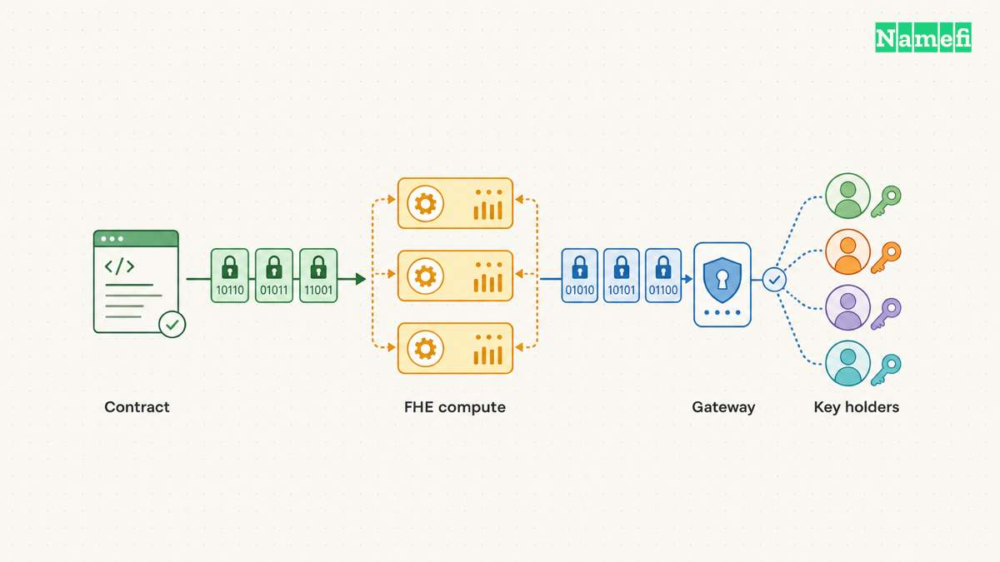
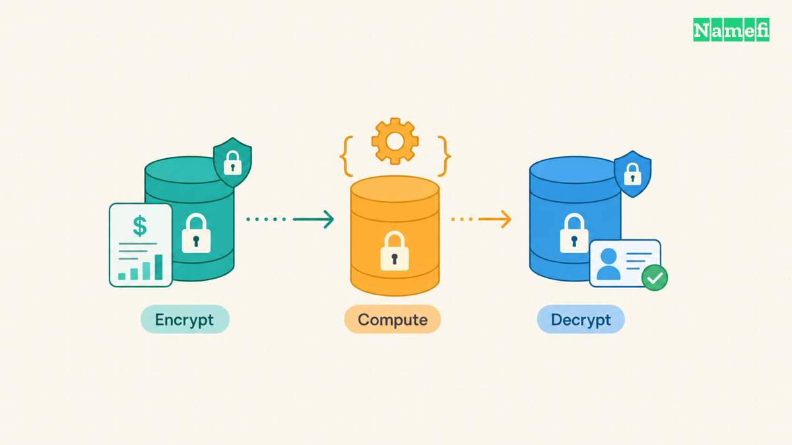
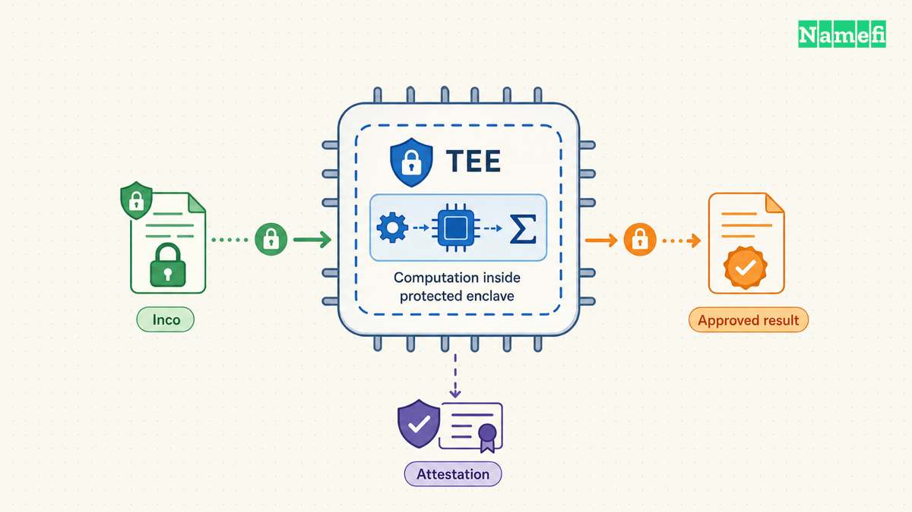
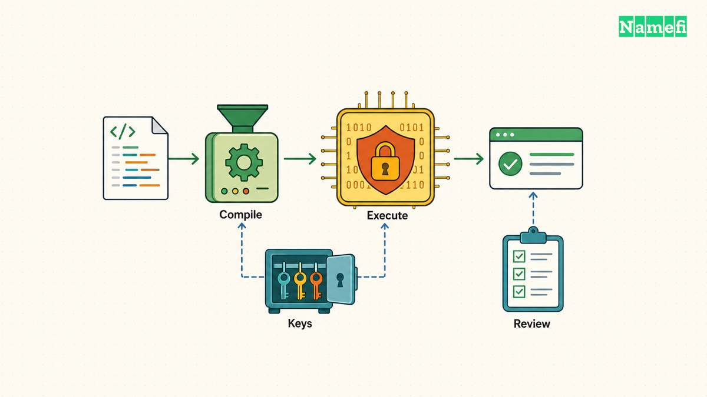

Zama, Fhenix, Inco, and Sunscreen address confidential computation, but the four projects do not offer interchangeable FHE products. Zama documents a blockchain confidentiality protocol. Fhenix offers the CoFHE coprocessor. Inco's current Lightning architecture uses a trusted execution environment. Sunscreen supplies encrypted execution tooling through SPF and Parasol. The distinction matters before any comparison of developer experience or deployment readiness.

[Fully homomorphic encryption](/en/glossary/fully-homomorphic-encryption/) (FHE) lets a computer calculate over encrypted values. An application still needs rules for inputs, execution, keys, and output disclosure. A familiar Solidity interface does not establish which security mechanism protects the calculation. The following comparison examines those boundaries using official documentation retrieved on October 21, 2026.

“Top” describes a practical shortlist for evaluation, without a token valuation or investment ranking. The assessment favors an explicit architecture and usable documentation over promotional performance claims. No shared benchmark supports a speed ranking across these different products.

| Project | Documented role | First evaluation question |
|---|---|---|
| Zama | FHE confidentiality protocol | Does the protocol fit the target chain and disclosure policy? |
| Fhenix | CoFHE FHE coprocessor | Does the supported integration match the application? |
| Inco | TEE confidential computation | Does the hardware trust model meet the privacy requirement? |
| Sunscreen | SPF/Parasol FHE tooling | Can the team build and operate the surrounding system? |

The project sections provide the supporting sources. Use the same rubric for every candidate: execution mechanism, application interface, disclosure control, operational dependencies, and deployment evidence. Treat a working example, a documented mainnet, and an independent security review as different kinds of evidence.

## Zama connects confidential contracts to an FHE protocol

Zama's architecture separates the host blockchain from encrypted computation. Developers use the FHEVM Solidity library to define encrypted operations in a [smart contract](/en/glossary/smart-contract/). Host contracts trigger work, coprocessors perform encrypted calculations, and a Gateway coordinates protocol components. A threshold key management service handles key generation and decryption ([Zama, “FHE on blockchain”](https://docs.zama.org/protocol/protocol/overview.md#fhe-on-blockchain)).

The distinction changes the integration question. A developer must connect contract execution with external computation and authorized result delivery. An ordinary successful blockchain transaction does not, by itself, establish that every downstream service has completed the requested work. The application should represent submission, processing, and disclosure as separate states.

### Zama separates encrypted execution from decryption authority

The protocol combines FHE, [secure multiparty computation](/en/glossary/secure-multiparty-computation/) (MPC), and input proofs. FHE protects calculations. MPC distributes key management. A [zero-knowledge proof](/en/glossary/zero-knowledge-proof/) can establish valid encryption of an input. Those mechanisms answer different questions, so an input proof does not replace a complete application review ([Zama litepaper, “The Zama Confidential Blockchain Protocol”](https://docs.zama.org/protocol/zama-protocol-litepaper/zama-confidential-blockchain-protocol-litepaper#the-zama-confidential-blockchain-protocol)).

Zama's overview describes the KMS as a threshold MPC network. Evaluate both confidentiality and availability around that network. Determine which parties authorize disclosure and which service failures can delay a permitted read. A threshold design distributes authority, but the word “threshold” alone does not specify every deployment assumption.

Current documentation requires another qualification. The litepaper describes KMS operators running MPC software inside AWS Nitro Enclaves. FHE execution therefore does not imply that the wider protocol has no hardware assumptions ([Zama litepaper, “Components”](https://docs.zama.org/protocol/zama-protocol-litepaper/zama-confidential-blockchain-protocol-litepaper#components)). A security review should distinguish encrypted computation from protection of key shares.

### Zama supplies deployment evidence beyond a roadmap

The official litepaper labels Ethereum Mainnet live. The chain configuration page separately lists mainnet and testnet infrastructure ([Zama litepaper, “Roadmap”](https://docs.zama.org/protocol/zama-protocol-litepaper/zama-confidential-blockchain-protocol-litepaper#roadmap), [Zama, “Chains”](https://docs.zama.org/protocol/protocol-apps/chains#mainnet)). Those statements support a narrower conclusion than universal production readiness: Zama documents an Ethereum mainnet deployment.

A team should still verify the target chain's contract addresses, installed package versions, fees, and supported operations before deployment. A listed network does not establish that every example or planned feature works there. Zama fits an evaluation that starts with confidential Solidity applications and accepts a protocol-level dependency for computation and disclosure.

## Fhenix gives Solidity applications an FHE coprocessor interface

Fhenix currently presents CoFHE as its FHE coprocessor. The official product page labels CoFHE live and describes Solidity contracts computing over encrypted data. The same page separates a live Wallet Module from a coming-soon Trading product ([Fhenix developer documentation](https://cofhe-docs.fhenix.zone/#:~:text=Build%20with%20Fhenix)). These product labels should not become an unsupported assertion that every feature has reached every mainnet.

The CoFHE overview identifies a client SDK for encrypting inputs, managing access control permissions, and decrypting outputs. A Solidity library supplies encrypted operations ([Fhenix CoFHE, “Key resources”](https://cofhe-docs.fhenix.zone/cofhe#key-resources)). The interface makes CoFHE a candidate for teams that want confidential values inside an existing Solidity application.

The current documentation index also lists separate decrypt-to-view and decrypt-to-transact workflows. The latter describes a verifiable Teecryptor signature for onchain use ([Fhenix documentation index, client SDK guides](https://cofhe-docs.fhenix.zone/llms.txt#:~:text=Decrypt%20to%20Transact)). That index identifies an integration boundary, rather than a complete security specification. A team must inspect the deployed decryption service and verification contracts before relying on the result.

### A confidential balance requires more than an encrypted variable

Consider an illustrative confidential credit balance. The example describes a review plan, not tested code or a claim that different SDKs share an API. A user submits an encrypted debit amount. The application compares that amount with an encrypted balance, then updates encrypted sender and recipient balances.

The frontend should encrypt the amount before transaction submission. The contract must bind the accepted input to the intended user and operation. The contract should retain permission to use each resulting balance and grant each account only the intended reading rights. The application should expose a private viewing flow separately from a public settlement flow.

| Integration step | Intended behavior | Review evidence |
|---|---|---|
| Input submission | Keep the amount confidential | Inspect calldata and client logs |
| Balance update | Apply an authorized debit | Test insufficient funds and repeated calls |
| Private viewing | Reveal only permitted balances | Test unauthorized accounts |
| Public settlement | Publish only the approved result | Check result binding and replay handling |

The Fhenix overview supports the broad encrypt, compute, and decrypt sequence. The table adds application review requirements. The table does not assert a specific SDK method or an audited implementation. Teams should implement those requirements against the current CoFHE version and test the complete path.

For example, a system could debit zero when the balance cannot cover a transfer. The frontend must explain the resulting state without revealing a private balance through repeated error messages. A private amount also loses confidentiality if the application writes the original value into analytics or transaction metadata.

### Fhenix needs deployment checks for the selected environment

This review verified the current product page, overview, and documentation index. Detailed compatibility pages did not return readable content through the retrieval path. Consequently, this article makes no chain-specific CoFHE mainnet claim. Developers should resolve that compatibility question against accessible network documentation before deployment.

The practical comparison with Zama concerns the complete integration contract: supported environment, permission semantics, output verification, and operational responsibility. Similar encrypted types do not establish equivalent decryption guarantees or interchangeable infrastructure.

## Inco demonstrates why confidential computation does not always mean FHE

Inco belongs in this comparison because a developer evaluating confidential Solidity will encounter the same application goals. However, Inco's current component documentation describes a Confidential Compute Server inside a [trusted execution environment](/en/glossary/trusted-execution-environment/) (TEE). The server performs confidential operations and decryption. The page does not describe those operations as FHE evaluation ([Inco, “Confidential Compute Server”](https://docs.inco.org/architecture/components#confidential-compute-server)).

That architecture changes the confidentiality assumption. FHE protects values during encrypted evaluation. A TEE protects a computation inside a hardware isolation boundary. Teams evaluating Lightning must assess the enclave, approved software, attestation verification, and operator dependencies. Encrypted inputs and encrypted-looking Solidity types do not erase that distinction.

Inco documents encrypted types, arithmetic, comparisons, conditional selection, and access control. The client library encrypts inputs and handles keys and signatures for private decryption ([Inco, “Smart Contract Library” and “Client-side JavaScript Library”](https://docs.inco.org/architecture/components#smart-contract-library)). Those interfaces can simplify application development while leaving the underlying security model different from FHE.

The current homepage describes EVM support as live on Base and SVM support as beta ([Inco, “Build with Inco”](https://docs.inco.org/home#build-with-inco)). Those are project-reported product states. The labels do not establish that an arbitrary application has completed security review or that beta functionality meets production requirements.

### Inco's guidance exposes application-level privacy failures

Inco warns developers to check a caller's allowance when accepting an existing encrypted handle. Otherwise, an application may process a value that the caller cannot legitimately access. Inco also requires applications to preserve access to newly created handles ([Inco, “Always check allowance over inputs” and “Don't lose access over your ciphertexts”](https://docs.inco.org/guide/best-practices#always-check-allowance-over-inputs)).

The same guidance describes information leakage from public prices and repeated auction bids. A secret amount can become inferable when public outputs track changes to the secret. Privacy review must therefore examine what observers can deduce, including repeated interactions, rather than only checking ciphertext storage.

A useful acceptance test gives an attacker ordinary user permissions and a history of public outputs. Ask whether the attacker can distinguish two secret balances or recover a bid through repeated queries. The test should cover legitimate calls as well as malformed transactions.

Inco's confidential interface may fit a team that accepts TEE assumptions. A requirement for FHE computation specifically should exclude the documented Lightning execution path from the FHE shortlist. Keeping Inco in the comparison clarifies that decision instead of silently changing the requirement.

## Sunscreen gives teams encrypted execution tools and more integration responsibility

Sunscreen requires careful version identification. The older Sunscreen repository explicitly identifies itself as the BFV compiler and points developers toward SPF for the newer TFHE compiler. The older repository also labels its library experimental and unsuitable for production ([Sunscreen BFV repository, README introduction](https://github.com/Sunscreen-tech/Sunscreen#readme)). A comparison that describes only BFV misses the project's documented direction.

The SPF repository describes encrypted computation using Sunscreen's TFHE variant. The repository includes the Parasol processor, execution libraries, key generation, and instruction scheduling. Developers use a separate Parasol LLVM compiler to write programs for that environment ([Sunscreen SPF, “Overview” and “Processing Unit”](https://github.com/Sunscreen-tech/spf#overview)).

The verified repository supports a tooling claim, not a managed blockchain service claim. A team choosing SPF must define the surrounding application architecture. Questions include where ciphertexts live, who runs computation, how a contract accepts results, and which party controls decryption. An encrypted program alone does not answer those questions.

### Sunscreen requires a different proof of readiness

SPF explicitly states that the code has not undergone an audit ([Sunscreen SPF, “Disclaimers”](https://github.com/Sunscreen-tech/spf#disclaimers)). The repository establishes available source code and an encrypted execution design. The repository does not establish an independently reviewed production deployment for the confidential balance example.

A prototype should first reproduce a small encrypted calculation with fixed inputs and expected outputs. Next, test incorrect inputs, unavailable workers, lost keys, and unauthorized disclosure requests. Only then connect a result to a contract that can move assets. Each integration step adds responsibilities outside the compiler.

Sunscreen fits teams that need control over encrypted programs and can own more infrastructure. Zama and Fhenix provide a more direct starting point for a blockchain confidentiality integration. Inco offers a separate TEE route. These fit judgments follow the documented product boundaries, rather than measured performance rankings.

Before choosing, write one page that names the secret, permitted readers, public outputs, and failure behavior. Require each prototype to satisfy that same page. Include withdrawal and recovery behavior when the computation or decryption service stops responding. The preferred project is the project that meets the application's explicit requirements with evidence the team can reproduce.

## Sources and further reading

All sources below were fetched on 2026-10-21 UTC. No archive snapshot was verified.

- Zama — [FHE on blockchain](https://docs.zama.org/protocol/protocol/overview.md#fhe-on-blockchain), architecture component definitions.
- Zama — [Protocol litepaper](https://docs.zama.org/protocol/zama-protocol-litepaper/zama-confidential-blockchain-protocol-litepaper#components), mechanism roles, KMS hardware, and Roadmap's Ethereum Mainnet label.
- Zama — [Chains](https://docs.zama.org/protocol/protocol-apps/chains#mainnet), separate mainnet and testnet configurations.
- Fhenix — [Product documentation](https://cofhe-docs.fhenix.zone/#:~:text=Build%20with%20Fhenix), current product labels.
- Fhenix — [CoFHE overview](https://cofhe-docs.fhenix.zone/cofhe#key-resources), client SDK and Solidity library responsibilities.
- Fhenix — [Documentation index](https://cofhe-docs.fhenix.zone/llms.txt#:~:text=Decrypt%20to%20Transact), separate viewing and transaction decryption guides. Detailed compatibility remained unverified.
- Inco — [Components](https://docs.inco.org/architecture/components#confidential-compute-server), TEE server and client responsibilities.
- Inco — [Homepage](https://docs.inco.org/home#build-with-inco), Base and SVM product labels.
- Inco — [Best practices](https://docs.inco.org/guide/best-practices#think-in-terms-of-information-leakage), input allowance, retained access, and inference risks.
- Sunscreen — [BFV repository README](https://github.com/Sunscreen-tech/Sunscreen#readme), migration pointer and experimental status.
- Sunscreen — [SPF README](https://github.com/Sunscreen-tech/spf#overview), TFHE framework, Parasol components, and unaudited disclaimer.
