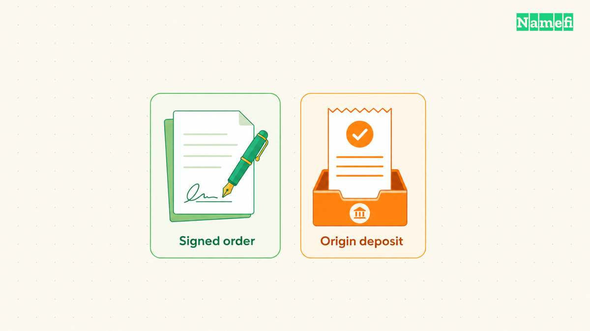
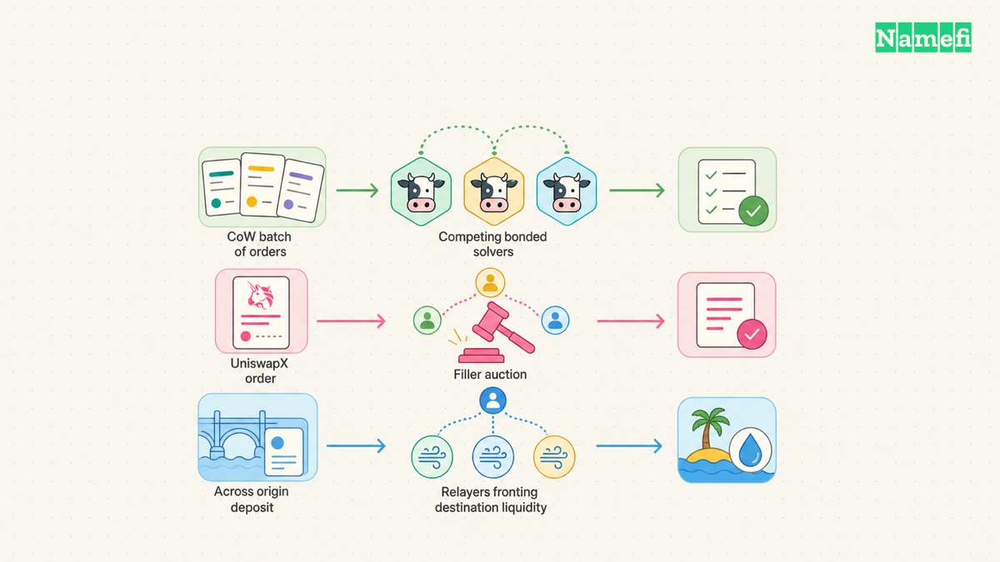
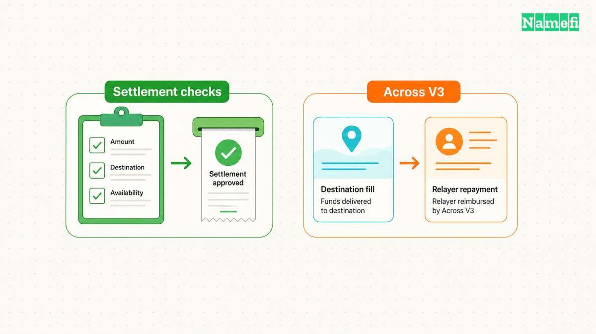
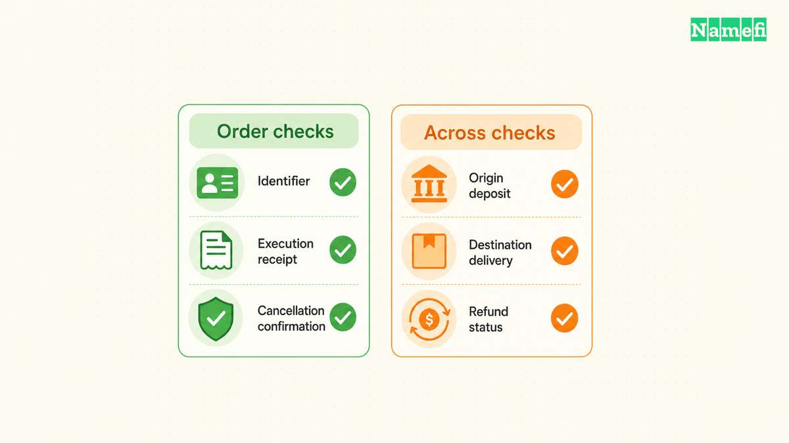

An intent system lets a user specify an acceptable outcome while another participant chooses how to produce that outcome. The useful comparison starts with the authorization and ends with recovery when execution fails.

CoW Protocol, UniswapX and Across illustrate three distinct execution models. CoW Protocol organizes trading orders into solver competitions. UniswapX uses signed swap orders and competing fillers. Across separates destination delivery from later relayer repayment. Their official documentation supports these distinctions, which the sections below examine directly.

This roundup selects systems for their architectural differences. The word “top” does not indicate a ranking by volume, price, safety or investment potential. The scope covers authorization, execution, settlement and recovery. A general bridge comparison answers different questions about message verification and chain connectivity.

## Users authorize outcomes before solvers choose execution paths

A [digital signature](/en/glossary/digital-signature/) can authorize a structured trading order without submitting the final execution transaction. CoW Protocol describes its intent as signed trading constraints, rather than an executable user transaction. Solvers construct a settlement that satisfies those constraints, and the settlement contract checks the authorization. See the protocol's [intent definition](https://docs.cow.fi/cow-protocol/concepts/introduction/intents).

A hypothetical order might authorize selling 100 units of token A for at least 95 units of token B. The order also needs an intended recipient and an expiry. The solver can choose a route, but the user should inspect the constraints before signing. A favorable route cannot correct an incorrect recipient that the user authorized.

A practical review should answer four questions. Which assets can the authorization spend? Which recipient must receive the output? Which price or amount limits apply? When does the authorization stop permitting execution? These questions turn an abstract promise into conditions a reader can compare.

UniswapX similarly lets swappers sign orders that specify outputs. Fillers compete to fulfill those orders using their own strategies or external liquidity. Its [overview](https://developers.uniswap.org/docs/liquidity/uniswapx/overview#trading-on-uniswapx) describes Permit2 authorization. The current auction guide documents RFQ and exclusive Dutch auctions, with time-based or block-based timing. A description of timing on one chain should therefore not become a claim about every deployment.

Across adds an important qualification. Its documented `depositV3` lifecycle starts with an origin-chain transaction that escrows input tokens. The user or another contract calls the origin SpokePool with the destination, output and deadline parameters. The [initiation documentation](https://docs.across.to/guides/concepts/intent-lifecycle#phase-1-initiation) explains the deposit and emitted event. An intent architecture does not require every user flow to start with an offchain signature alone.

This distinction matters when comparing wallet screens. One screen might request an order signature. Another might request token approval or an actual deposit transaction. Record each permission separately. Do not treat the word “intent” as a complete explanation of what a [wallet](/en/glossary/wallet/) will authorize.

Consider a hypothetical application that offers “receive token B on another chain.” Ask the application to show the origin asset and destination asset separately. The same ticker does not establish the intended contract. Record the destination chain and recipient alongside the amount. These checks belong before authorization, while a user can still reject the request.

## Solver competitions select different execution strategies

CoW Protocol groups intents into batch auctions. Independent bonded solvers propose solutions, and the protocol selects the solution that generates the greatest surplus for the batch. The [solver documentation](https://docs.cow.fi/cow-protocol/concepts/introduction/solvers) describes this competition. The unit of optimization can therefore include several orders rather than one isolated swap.

CoW Protocol's intent documentation also describes matching opposite trading needs through Coincidence of Wants. Solvers can combine matching with other liquidity sources. A user should not assume that every order finds a matching counterparty. The mechanism creates an execution option, rather than a promise that each trade bypasses external liquidity.

UniswapX places more emphasis on the auction rules inside the order format. A Dutch auction changes the acceptable output over time. A filler decides when execution becomes economically worthwhile. The current [auction documentation](https://developers.uniswap.org/docs/liquidity/uniswapx/concepts/auction-types) describes a shared RFQ and exclusive Dutch auction model. Ethereum uses timestamps, while the other listed chains use block numbers. A reader needs the actual order format before interpreting timing or exclusivity.

Across's architecture documentation describes a request-for-quote layer, a competitive relayer network and a settlement layer. Relayers front their own capital on the destination chain. The documented RFQ implementation uses fixed fees with competition based on speed. The [architecture description](https://docs.across.to/guides/concepts/intents-architecture#the-three-layers) separates these responsibilities. This differs from assuming every intent network conducts the same price auction.

| System | Execution focus | First comparison question |
|---|---|---|
| CoW Protocol | Batch settlement solutions | Which orders can share a solution? |
| UniswapX | Order-specific filler auctions | Which auction rules govern this order? |
| Across | Destination liquidity delivery | Who fronts destination capital? |

The table compares mechanisms, rather than measured execution quality. A useful evaluation would request quotes for the same assets, amount and time. It would then compare the authorized minimum with the actual output. Differences in route availability or order validity should remain visible in the evaluation.

Competition also needs a participation check. CoW's settlement reference limits settlement submission to authenticated, allow-listed solvers. UniswapX's overview says anyone can fill its orders. Across's architecture describes permissionless relaying, while its lifecycle allows an initial exclusive relayer period. Those statements concern different permissions and should not collapse into one “open network” label.

For an integration, write down who receives the order, who can propose a solution and who can submit settlement. Then identify any exclusive period. This review reveals whether an application depends on an order service even when execution contracts support broader participation. A deployment-specific review should verify those permissions again before launch.

## Settlement contracts enforce different completion conditions

CoW Protocol's [settlement reference](https://docs.cow.fi/cow-protocol/reference/contracts/core/settlement#guarantees-and-invariants) lists signature, expiry, previous-fill and price checks. Its order structure also includes a partial-fill flag. These checks define conditions for a valid trade. They do not establish that a solver will find an executable solution before expiry.

UniswapX uses reactor contracts to settle orders. A reactor validates the order, resolves inputs and outputs, transfers input tokens through Permit2 and invokes the fill strategy. The reactor then checks that output recipients received their tokens. The [architecture reference](https://developers.uniswap.org/docs/liquidity/uniswapx/concepts/architecture#reactors) distinguishes reactors from filler strategy contracts. A filler chooses execution details while the reactor verifies fulfillment.

For a hypothetical swap, inspect the settlement receipt and recipient balance together. A submitted transaction hash only establishes that someone submitted a transaction. A successful receipt and the expected asset movement provide stronger evidence of completion. Application logs should preserve the order identifier and the settlement transaction rather than showing only a generic success notification.

Across requires a different timeline. Its documented destination fill delivers the output using relayer funds. Later settlement verifies fills and repays relayers. The [lifecycle documentation](https://docs.across.to/guides/concepts/intent-lifecycle#phase-3-settlement) describes matching fill events to deposits and constructing payment bundles. User delivery and relayer repayment are separate milestones.

The architecture page describes optimistic bundle verification, including bonds and a challenge period. That description applies to the documented architecture under discussion. Across also documents evolving versions. A reader should identify the deployed version before assuming that every route shares the same verification mechanism.

A [cross-chain bridge](/en/glossary/cross-chain-bridge/) comparison often centers on how one chain learns about another chain. An intent comparison must also track who advances liquidity and when repayment becomes available. Fast delivery can coexist with later settlement. The user-facing delivery time alone does not explain the underlying trust assumptions.

ERC-7683 addresses a separate integration problem. The [current draft](https://eips.ethereum.org/EIPS/eip-7683#abstract) defines a solver-facing interface that uses resolver contracts to translate protocol-specific payloads. The draft permits protocols to differ in authorization, execution and settlement. Earlier descriptions centered on origin and destination settler interfaces, which the draft discusses under “Previous Draft.”

The [security considerations](https://eips.ethereum.org/EIPS/eip-7683#security-considerations) explicitly separate the interface from the security of the underlying protocol. Standardized order interpretation does not replace contract review or chain assumptions. An integration should pin its implementation version and inspect the resolver's stated assumptions. A shared standard can reduce integration work without making different settlement systems equivalent.

## Recovery checks should follow the order's actual state

Before signing, preserve the quote, order parameters, expiry and relevant identifiers. After submission, distinguish acceptance by an order service from confirmed execution. A recovery process should begin with the last verified state. A missing notification does not establish whether funds moved.

CoW Swap's [limit-order guide](https://docs.cow.fi/cow-protocol/tutorials/cow-swap/limit#cancel-a-limit-order) describes offchain cancellation and onchain cancellation. Offchain cancellation depends on processing by the service. Onchain cancellation costs [gas](/en/glossary/gas/) and needs confirmation. Either route can race with settlement before cancellation takes effect. A cancellation request therefore needs a later status check.

The same guide explains that partially fillable limit orders can leave a remainder. A hypothetical order to sell 100 units might execute only 60 units before the user requests cancellation. Check the completed trades before creating a replacement for the remaining 40 units. Replacing the original amount without reconciliation could create more exposure than the user intended.

For UniswapX, start with the signed order and its specific reactor format. Confirm whether a settlement transaction succeeded and whether the expected recipient received the specified output. Use the relevant implementation's documented invalidation procedure if cancellation becomes necessary. Do not copy a cancellation method from another order format merely because both products use signed intents.

For Across, preserve the origin deposit identifier and examine the destination fill. Its lifecycle documents `V3FundsDeposited` and `FilledV3Relay` events for those stages. The [deposit API reference](https://docs.across.to/api-reference/deposits/get#query-parameters) distinguishes unfilled, filled, slow-fill, expired and refunded states. The reference also notes indexing delay. A temporarily stale API response should prompt receipt checks rather than immediate duplicate deposits.

A hypothetical support case might show an origin deposit receipt but no destination receipt. First confirm the recorded destination chain, recipient and deadline. Then inspect the documented deposit status. If the status indicates expiry or refund processing, follow the applicable route's recovery instructions. Do not promise an immediate refund merely because the fill deadline passed.

A useful support record can contain the order identifier, origin transaction, destination transaction, authorized amount and observed amount. Keep each transaction beside its chain name. A transaction hash without chain context can send an investigator to the wrong explorer. Record whether the application obtained a fresh status response or reused an earlier response.

For a hypothetical reconciliation, compare the requested 95 units with the actual recipient credit. Explain any difference using the signed conditions and transaction evidence. If the evidence remains incomplete, label the transfer unresolved. Closing a browser tab or removing an order from a display should never substitute for checking the resulting state.

An integration test should exercise more than the successful route. Test order expiry, a partial fill where supported, a cancellation race and a delayed status update. For cross-chain flows, test the distinction between destination delivery and relayer repayment. Give support staff enough identifiers to locate each stage without asking users to disclose private keys.

These tests provide a practical selection method. Choose the system whose documented authorization, execution rules and recovery states match the application. Compare net received amounts and failure behavior under the same test conditions. Treat any unexplained state transition as an integration gap that needs investigation before larger transfers.

A [smart contract](/en/glossary/smart-contract/) can enforce the conditions its implementation checks. Readers still need to understand the conditions they sign and the evidence that execution finished. That combination provides a more useful basis for choosing an intent system than a general claim of effortless cross-chain execution.

## Sources and further reading

All sources below were fetched on 2026-10-21.

- CoW Protocol, [Intents](https://docs.cow.fi/cow-protocol/concepts/introduction/intents), introduction and Financial Benefits of Intents; fetched 2026-10-21.
- CoW Protocol, [Solvers](https://docs.cow.fi/cow-protocol/concepts/introduction/solvers), competition description; fetched 2026-10-21.
- CoW Protocol, [GPv2Settlement](https://docs.cow.fi/cow-protocol/reference/contracts/core/settlement), Guarantees and Invariants, Data Types and Storage, and Functions; fetched 2026-10-21.
- CoW Protocol, [Limit orders](https://docs.cow.fi/cow-protocol/tutorials/cow-swap/limit), Place a limit order and Cancel a limit order; fetched 2026-10-21.
- Uniswap, [UniswapX Overview](https://developers.uniswap.org/docs/liquidity/uniswapx/overview), Trading on UniswapX and Fillers on UniswapX; fetched 2026-10-21.
- Uniswap, [Auction Types](https://developers.uniswap.org/docs/liquidity/uniswapx/concepts/auction-types), order-format comparison; fetched 2026-10-21.
- Uniswap, [UniswapX Architecture](https://developers.uniswap.org/docs/liquidity/uniswapx/concepts/architecture), Reactors and Fill Contracts; fetched 2026-10-21.
- Across, [Intent Architecture](https://docs.across.to/guides/concepts/intents-architecture), The Three Layers and How Settlement Flows; fetched 2026-10-21.
- Across, [Intent Lifecycle](https://docs.across.to/guides/concepts/intent-lifecycle), initiation, fill, exclusivity and settlement; fetched 2026-10-21.
- Across, [Deposit query reference](https://docs.across.to/api-reference/deposits/get), introduction and Query Parameters/status; fetched 2026-10-21.
- Ethereum Improvement Proposals, [ERC-7683 draft](https://eips.ethereum.org/EIPS/eip-7683), Abstract, Motivation, Previous Draft and Security Considerations; fetched 2026-10-21.
