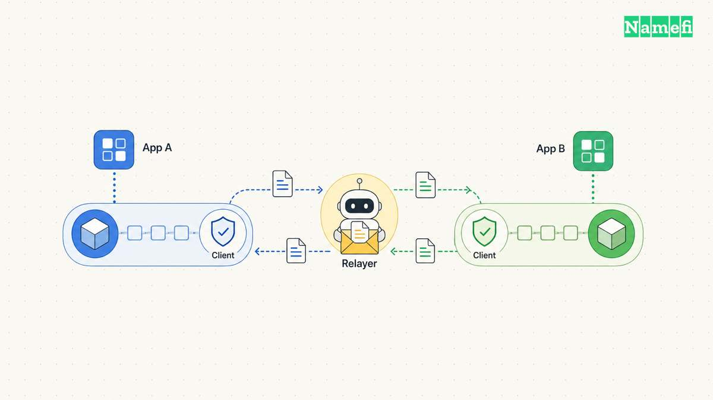
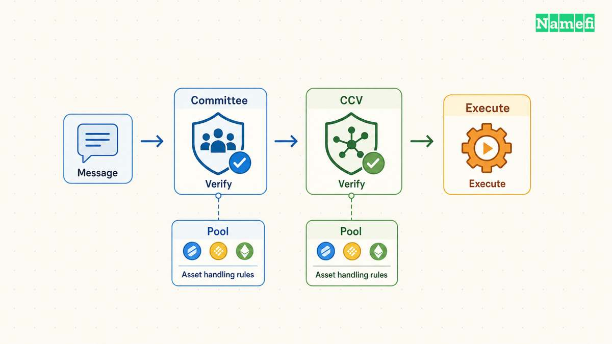
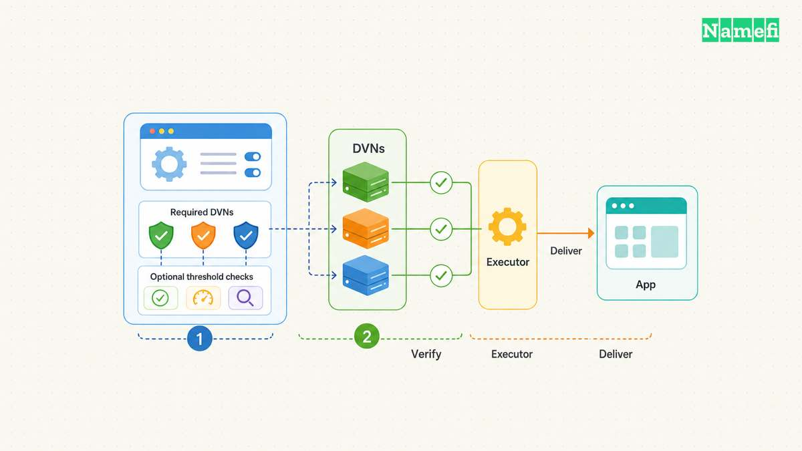
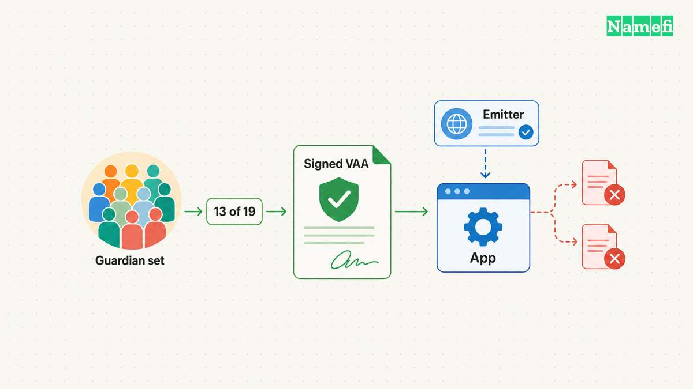

A cross-chain transfer has two questions: what happened on the source chain, and what may the destination application do next? IBC, Chainlink CCIP, LayerZero and Wormhole provide different ways to connect those answers. A useful comparison starts with verification and recovery, rather than a single speed ranking.

A **messaging protocol** carries authenticated instructions. A **token bridge** adds rules for locking, burning, minting or releasing tokens. A **liquidity route** may pay a recipient from available destination inventory and settle obligations separately. A bridge interface can combine several components, so the interface name alone does not identify the security model. The [cross-chain bridge](/en/glossary/cross-chain-bridge/) glossary explains the basic transfer problem.

The comparison below examines current documentation retrieved on October 21, 2026. The assessment concerns architectural fit, rather than a guarantee for any deployment. Supported chains, token pools, verifier services and administrator permissions require checks for the exact route.

| Protocol | What establishes acceptance | What the integration must inspect |
| --- | --- | --- |
| IBC | The selected client verifies counterparty state | Client type, packet lifecycle and token trace |
| Chainlink CCIP | Default committee verification plus applicable additional CCVs | Effective verifier requirements, token pools and execution state |
| LayerZero | Application-configured message libraries and DVN requirements | Required verifiers, optional thresholds, peers and delivery settings |
| Wormhole | Guardian-signed VAAs plus application validation | Observation mode, finality, emitter authorization and replay protection |

The following sections explain those rows using official sources. The practical recommendations represent editorial analysis of the documented mechanisms.

## IBC connects applications through explicitly selected clients

IBC separates packet transport from application behavior. Classic IBC uses connections and channels, while applications define what packet bytes mean. The current IBC-Go documentation also describes **IBC v2**, which identifies packet paths through clients and uses a router for applications. A deployment uses one protocol version for a connection. Describing every IBC deployment through classic channel handshakes would miss that distinction. ([IBC-Go introduction, protocol versions](https://docs.cosmos.network/ibc/latest/intro#:~:text=Since%20ibc-go%20v10))

The important qualification concerns the client. Classic descriptions commonly explain chains running light clients of each other. IBC v2 permits several verification models, including light clients, multisignature clients and proof verifiers. Therefore, an IBC label does not establish one universal trust assumption. The destination accepts the evidence that the chosen client recognizes. Relayers transport evidence, while the client defines verification. ([IBC v2 overview, flexible client types](https://docs.cosmos.network/ibc/latest/intro#:~:text=Flexible%20client%20types))

For evaluation, write down the client implementation and the state the client authenticates. Then identify the authority that can replace or update the client. A light-client route and a multisignature-client route deserve separate entries in a risk assessment, even when both use IBC. Counting intermediary networks without examining those clients can hide the decisive assumption.

Token movement adds another layer. The Cosmos SDK Transfer module implements ICS-20 fungible token transfers. The module records denomination traces, which preserve a token's transfer path. A displayed ticker does not replace the trace. A receiving application must distinguish a particular representation from another representation with a similar name. The current documentation also explains how client identifiers replace channel identifiers in relevant IBC v2 traces. ([Transfer module, denomination trace](https://docs.cosmos.network/ibc/latest/apps/transfer/overview#denomination-trace))

Consider a hypothetical treasury receiving the same named asset through two paths. The treasury should record the origin and trace before treating balances as interchangeable. The routes can create different representations and different recovery dependencies. A wallet's friendly asset label cannot settle those questions. The ICS-20 specification describes the escrow, voucher and return-path rules that implement fungible transfers. ([ICS-20 specification](https://github.com/cosmos/ibc/tree/main/spec/app/ics-020-fungible-token-transfer#technical-specification))

Delivery also needs an explicit completion rule. ICS-20 writes success or error acknowledgements for receipt. IBC v2 uses timestamp timeouts and permits a non-receipt proof to trigger timeout handling. A source transaction alone cannot demonstrate destination completion. ([Transfer acknowledgements](https://docs.cosmos.network/ibc/latest/apps/transfer/overview#acknowledgements), [IBC v2 timeouts](https://docs.cosmos.network/ibc/latest/intro#:~:text=Timestamp-only%20timeout))

**Our assessment:** IBC fits applications that can inspect counterparty verification and integrate packet lifecycle handling. The useful question concerns the deployed client, rather than whether IBC sounds more decentralized than another name. Before approving a route, require a demonstration of successful receipt, error acknowledgement and timeout recovery. Give each result a distinct application state so operators can recognize an incomplete transfer.

## Chainlink CCIP combines messaging with configurable token and verifier requirements

CCIP's current documentation describes Cross-Chain Verifiers, or CCVs, as a pluggable verification layer. The default Committee Verifier remains part of verification. Additional CCVs provide additive requirements. The effective requirements merge contributions from the sender, token pool, receiver and lane configuration. Consequently, a description based only on a generic network diagram cannot fully describe a particular message. ([CCV overview, additive requirements](https://docs.chain.link/ccip/concepts/ccvs/overview#when-to-add-ccvs))

A CCV combines onchain verification components with offchain services that produce message-specific results. The current design uses stable resolver addresses and versioned implementations. Reviewers should therefore inspect implementation and update authority as well as the published resolver address. A familiar address does not prove unchanged verification logic. ([CCV overview, verifier components](https://docs.chain.link/ccip/concepts/ccvs/overview#what-ccvs-do))

CCIP token handling depends on token pools. The Cross-Chain Token standard documents burn-and-mint, lock-and-mint and lock-and-unlock arrangements. Lock-and-unlock requires provisioned destination liquidity and ongoing rebalancing. Minting authority and available inventory answer different questions, so a transfer quote should identify the mechanism. ([CCT overview, token handling mechanisms](https://docs.chain.link/ccip/concepts/cross-chain-token/overview#token-handling-mechanisms))

A token issuer should document who can mint, change pool configuration and add verification requirements. The current pool documentation also describes lane-level rate limits. A limit constrains transfer capacity over time, rather than proving that each transfer instruction is correct. Operators still need authorization checks and monitoring. A well-chosen limit can support incident response by constraining exposure during detection and investigation. ([CCT overview, rate limits](https://docs.chain.link/ccip/concepts/cross-chain-token/overview#token-pool-rate-limits))

Failed execution deserves a separate operating procedure. CCIP documents manual execution through the destination OffRamp. Operators need the encoded message and the applicable verifier results. The indexer's readiness fields describe the indexer's view, which can omit an external verifier's data. Missing indexer data does not establish that a message is permanently unexecutable. ([Manual execution, execution inputs](https://docs.chain.link/ccip/concepts/manual-execution#fetch-execution-inputs))

Gas problems also require precise diagnosis. Increasing the receiver callback allowance cannot fix every token-pool or outer-transaction failure. An operator should locate the failed stage before changing the retry parameters. Record the original message identifier and destination receipt, then retry through the documented execution path. Sending a new business instruction can create a second obligation while the first remains recoverable. ([Manual execution, gas override scope](https://docs.chain.link/ccip/concepts/manual-execution#executing-a-message))

**Our assessment:** CCIP merits consideration when an issuer wants messaging, token pools and documented recovery tooling within one integration. Review the exact deployed version, verifier requirements and pool permissions together. Require a practical recovery demonstration with the application's actual receiver logic. An integration should explain who obtains missing attestations and who pays destination gas during a retry.

## LayerZero makes application configuration central to message verification

LayerZero separates application logic, protocol endpoints, message libraries, verification and execution. An Omnichain Application, or OApp, defines business behavior. The Endpoint supplies messaging interfaces, while message libraries coordinate the acceptance rules. The architecture separates a verified packet from a delivered packet, which matters when an application reports progress. ([LayerZero architecture, five layers](https://docs.layerzero.network/v2/concepts/layerzero-protocol-architecture#architecture-five-independent-layers))

Decentralized Verifier Networks, or DVNs, verify messages under those rules. A DVN can use different verification approaches. An Executor delivers a verified message with the requested execution parameters. The Executor's delivery role does not make the Executor the sole source of message authenticity. ([LayerZero worker services](https://docs.layerzero.network/v2/concepts/verification-execution-services#two-types-of-workers))

Applications configure required DVNs and, where applicable, a threshold across optional DVNs. Every required DVN must attest. An optional threshold adds another condition. The exact addresses and thresholds matter more than a statement that a protocol offers many available verifiers. Available providers and effective providers answer different questions. ([Worker services, DVN architecture](https://docs.layerzero.network/v2/concepts/verification-execution-services#dvn-architecture--implementation))

LayerZero's production guidance explicitly discusses compromise and correlated failure. Two services can share operators or infrastructure, reducing the independence that a simple count implies. Required verifiers also affect availability: an unavailable required verifier can stall messages. Reviewers must evaluate both forgery resistance and the conditions that stop delivery. ([Production DVN configuration, threat model and diversity](https://docs.layerzero.network/v2/concepts/modular-security/production-dvn-configuration#choosing-providers-the-diversity-rules))

Configuration review should cover each direction separately. Pin the intended confirmation settings and inspect the resolved configuration. A project should document who can change verification and peer relationships. Require a review when those authorities change. An application can expose valuable assets through a permissive remote sender even when packet verification functions correctly.

For a hypothetical cross-chain domain application, establish the authoritative record before connecting contracts. A destination representation of a [tokenized domain](/en/glossary/tokenized-domain/) must not create two independently exercisable claims. The application should define which chain authorizes transfers and how destination actions affect that authority. This example describes a design problem, rather than an assertion about an existing Namefi bridge.

A cross-chain representation also does not automatically change registrar ownership. The domain application needs an explicit connection between token authority and the registrar's applicable processes. Messaging can carry an instruction, but the business rules must define the instruction's effect. Keep that boundary visible when a product promises a domain transfer.

**Our assessment:** LayerZero fits teams prepared to own detailed verification configuration and destination execution behavior. Test delivery with a stopped Executor and a missing required verifier. The first scenario tests delivery recovery, while the second tests verification availability. Treat a change to required DVNs as a security decision with an identifiable approver.

## Wormhole authenticates VAAs while applications define their permitted effects

Wormhole's current Guardian documentation describes 19 Guardians and standard 13-of-19 signed attestations. The documentation also distinguishes direct observation from delegated observation on configured chains. A delegated subset can observe events before the canonical signing process produces the standard VAA. The signature threshold therefore does not mean every Guardian independently observes every supported chain. ([Guardians, sets and delegation](https://wormhole.com/docs/protocol/infrastructure/guardians/#guardian-sets-and-delegation))

A VAA carries an emitter chain, emitter address, sequence, payload and other fields. The receiving application must recognize the authorized emitter and interpret the payload correctly. A valid Guardian signature establishes an authenticated message under Wormhole's rules. The signature does not grant every emitter permission to mint an application's assets. ([VAA format and emitter validation](https://wormhole.com/docs/protocol/infrastructure/vaas/#vaa-format))

Finality changes the interpretation of message identity. Wormhole documents that lower consistency settings can expose applications to source-chain reorganizations. Operators should specify the chosen consistency level and explain the resulting delay. Comparing headline arrival times without matching finality assumptions compares different risks. ([VAAs, consistency and finality](https://wormhole.com/docs/protocol/infrastructure/vaas/#consistency-and-finality))

Wormhole messaging and Wrapped Token Transfers serve different roles. Wrapped Token Transfers locks source assets and creates corresponding wrapped assets on another chain. The transfer module adds custody and redemption behavior to messaging. Receiving a wrapped token does not erase dependence on the original collateral and the bridge contracts. Check the token contract and origin before depositing the representation into another application. ([Wrapped Token Transfers, mechanism](https://wormhole.com/docs/products/token-transfers/wrapped-token-transfers/overview/#how-it-works))

**Our assessment:** Wormhole deserves evaluation when an application needs Guardian-authenticated messages or a documented wrapped-token transfer path. Inspect delegated observation where applicable, rather than applying one observation description to every chain. Review destination authorization and duplicate processing as application concerns alongside Guardian verification.

Use the same failure checklist across all four candidates:

- Identify the exact source and destination contracts, protocol version and authorized remote sender.
- Record the verification rule, finality setting and authority that can change either setting.
- Confirm the destination asset, collateral location, minting authority and available redemption mechanism.
- Track source acceptance, verification, destination execution and business completion as separate states.
- Test repeated delivery attempts and reject duplicate business effects.
- Simulate receiver failure, insufficient gas and unavailable delivery services.
- Demonstrate the documented retry, acknowledgement or timeout procedure with retained message evidence.
- Assign an operator to unresolved transfers and define an escalation threshold.

A team should compare an additional general-purpose route against the application's existing chain-specific transfer mechanism before adding dependencies. Require a concrete benefit, such as necessary destinations or application messages. The right choice follows the authority and recovery model the application can operate. A list of supported networks cannot make that decision.

## Sources and further reading

Sources were retrieved on October 21, 2026 (UTC). The linked documentation sections provide the source record for this comparison. No archive snapshot was verified. IBC sources cover protocol versions and ICS-20. Chainlink sources cover current CCV and pool behavior. LayerZero sources cover architecture and production configuration. Wormhole sources cover observation, VAAs and wrapped transfers. Configuration-specific guarantees require a separate review of the deployed contracts.

- [IBC-Go introduction, protocol versions](https://docs.cosmos.network/ibc/latest/intro#:~:text=Since%20ibc-go%20v10). Fetched 2026-10-21 UTC.
- [Transfer module, denomination trace](https://docs.cosmos.network/ibc/latest/apps/transfer/overview#denomination-trace). Fetched 2026-10-21 UTC.
- [ICS-20 specification](https://github.com/cosmos/ibc/tree/main/spec/app/ics-020-fungible-token-transfer#technical-specification). Fetched 2026-10-21 UTC.
- [CCV overview, additive requirements](https://docs.chain.link/ccip/concepts/ccvs/overview#when-to-add-ccvs). Fetched 2026-10-21 UTC.
- [CCT overview, token handling mechanisms](https://docs.chain.link/ccip/concepts/cross-chain-token/overview#token-handling-mechanisms). Fetched 2026-10-21 UTC.
- [Manual execution, execution inputs](https://docs.chain.link/ccip/concepts/manual-execution#fetch-execution-inputs). Fetched 2026-10-21 UTC.
- [LayerZero architecture, five layers](https://docs.layerzero.network/v2/concepts/layerzero-protocol-architecture#architecture-five-independent-layers). Fetched 2026-10-21 UTC.
- [LayerZero worker services](https://docs.layerzero.network/v2/concepts/verification-execution-services#two-types-of-workers). Fetched 2026-10-21 UTC.
- [Production DVN configuration, threat model and diversity](https://docs.layerzero.network/v2/concepts/modular-security/production-dvn-configuration#choosing-providers-the-diversity-rules). Fetched 2026-10-21 UTC.
- [Guardians, sets and delegation](https://wormhole.com/docs/protocol/infrastructure/guardians/#guardian-sets-and-delegation). Fetched 2026-10-21 UTC.
- [VAA format and emitter validation](https://wormhole.com/docs/protocol/infrastructure/vaas/#vaa-format). Fetched 2026-10-21 UTC.
- [Wrapped Token Transfers, mechanism](https://wormhole.com/docs/products/token-transfers/wrapped-token-transfers/overview/#how-it-works). Fetched 2026-10-21 UTC.
