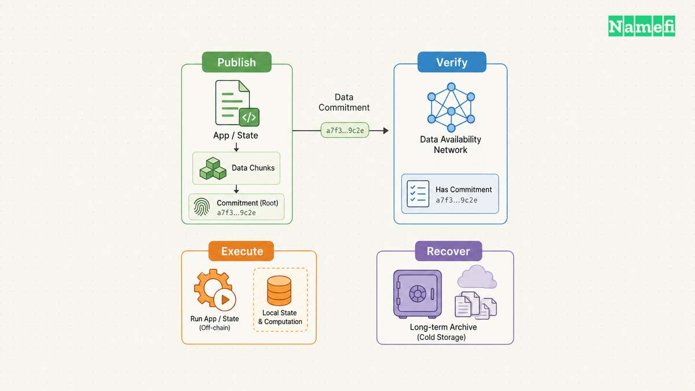
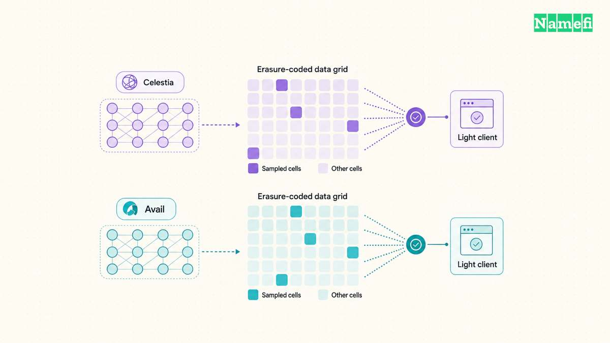
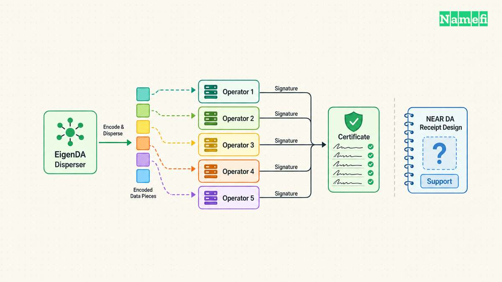
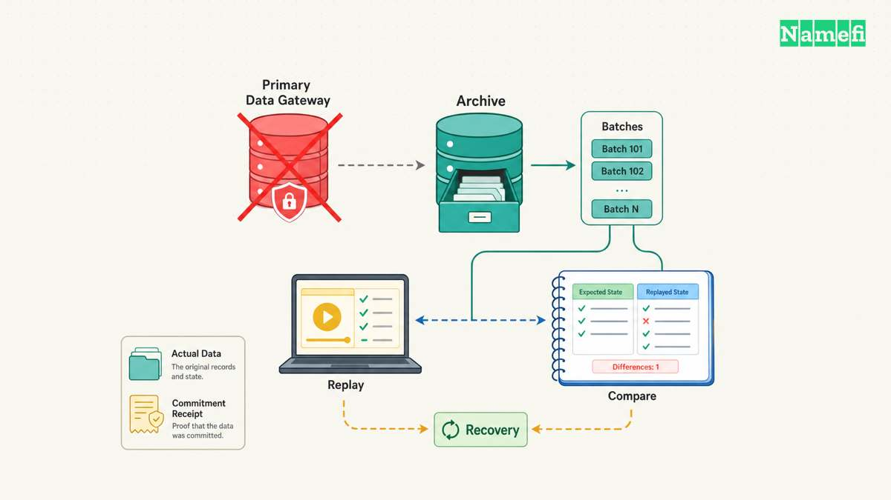

The best modular data availability layer depends on the verification and recovery path an application can actually operate. Celestia and Avail offer dedicated DA networks with light-client sampling. EigenDA offers a service built on EigenLayer restaking. NEAR DA provides a different, receipt-based design, but its available reference material requires additional production-readiness checks.

A current comparison also needs a current integration check. Celestia now labels Blobstream as legacy. The documentation says Succinct-operated SP1 Blobstream deployments stopped receiving new commitments in September 2026. Teams that depend on Blobstream must [operate or source another verification path](https://docs.celestia.org/learn/blobstream/#:~:text=Legacy%20notice). A familiar provider name does not establish a working settlement integration.

This comparison covers four named providers as of October 21, 2026. The earlier [comparison of data availability approaches](/en/blog/top-data-availability-approaches/) explains calldata, blobs, committees, and sampling. Here, the question is which provider fits a specific application, and which responsibilities remain with the application team.

## A provider comparison starts with the application's verification requirements

[Data availability](/en/glossary/data-availability/) asks whether participants can obtain the data needed to check or reconstruct state. Ethereum's documentation separates availability from [historical retrievability](https://ethereum.org/en/developers/docs/data-availability/#data-availability-vs-data-retrievability). An availability guarantee at publication does not automatically fund an indefinite archive.

Execution validity answers another question: did a state transition follow the application's rules? Settlement determines how the system accepts proofs, resolves disputes, or recognizes a final state. A DA provider does not automatically perform either job. Celestia's architecture explicitly [separates execution and settlement from DA](https://docs.celestia.org/learn/celestia-101/data-availability/#monolithic-vs-modular-blockchains).

For a [rollup](/en/glossary/rollup/), compare the full route from batch publication to accepted state. Identify who checks availability, what the settlement contract verifies, and what happens when publication fails. A client-side check and a contract-enforced rule offer different protections. The application must explain which protection users receive.

| Provider | Main evaluation case | Integration question |
| --- | --- | --- |
| Celestia | Dedicated DA with namespaces | Who maintains the settlement verification path? |
| EigenDA | Restaking-based DA service | Which certificate thresholds does the application enforce? |
| Avail | Dedicated DA with application IDs | How does the application verify headers and availability? |
| NEAR DA | Receipt-based DA design | Who supports the production integration and historical retrieval? |

These are editorial evaluation categories, rather than a universal ranking. A sovereign execution chain can verify DA through its own nodes. An Ethereum-settled application also needs a credible rule for accepting external DA evidence. Requirements for a [cross-chain bridge](/en/glossary/cross-chain-bridge/) can therefore outweigh publication throughput.

Separate normal operation from exceptional operation. A demonstration can show that one sequencer publishes a blob and one reader retrieves the blob. A production evaluation must also show that an independent reader can recover after the sequencer, gateway, or proof operator fails.

## Celestia and Avail let light clients sample dedicated DA networks

**Celestia** combines erasure coding, data availability sampling, and namespaced Merkle trees. Light nodes request random shares with proofs. Applications can retrieve their own namespace rather than every application's data. The [DA architecture guide](https://docs.celestia.org/learn/celestia-101/data-availability/#data-availability-sampling-das) explains the probabilistic availability check and the namespace mechanism.

Namespaces help an application identify its published data. Namespaces do not validate the application's transactions or prove that a claimed balance is correct. The execution software still needs to interpret the bytes. The settlement mechanism still needs to accept the appropriate evidence.

Celestia deserves consideration when a team wants dedicated DA and can operate independent readers. For an EVM settlement integration, the team must assess the verification route separately. The [Blobstream legacy notice](https://docs.celestia.org/learn/blobstream/) changes that assessment materially. Historical documentation about managed SP1 Blobstream deployments cannot establish that commitments continue to arrive today.

An evaluator should request a recent accepted commitment, the corresponding source block, and the verification contract address. The evaluator should also identify the proof operator, replacement procedure, and upgrade authority. A maintained network and an abandoned integration can coexist. Review the precise deployment that the application plans to use.

Celestia also places [historical storage responsibility on applications and rollups](https://docs.celestia.org/learn/celestia-101/retrievability/#suggested-practices-for-rollups). The documentation warns against relying exclusively on public archival nodes. Budget for an archive that supports the application's recovery horizon, then test retrieval from that archive.

**Avail** organizes submissions through application IDs. Its block pipeline uses Reed-Solomon erasure coding, KZG commitments, and light-client sampling. Its consensus combines BABE block production with GRANDPA finality. The [architecture documentation](https://docs.availproject.org/docs/da/concepts/how-avail-da-works#block-data-lifecycle) describes those distinct stages.

The useful comparison with Celestia concerns the complete deployment, including client software and settlement integration. The presence of KZG commitments alone does not settle the choice. An application needs correctly verified headers, valid sample proofs, and a rule for responding to missing samples.

Avail's light-client implementation distinguishes sampling from application-specific reconstruction. The [client README](https://github.com/availproject/avail-light/blob/main/client/README.md#modes-of-operation) describes both functions. The README also warns that disabling proof verification adds trust in the supplying node. Check the deployed configuration rather than assuming that every service called a light client verifies every response.

Avail merits evaluation when application-specific data organization and an independently operated sampling client fit the system design. Request a reconstruction demonstration alongside the sampling demonstration. For external settlement, require evidence that the chosen verifier consumes the intended finalized data commitment. A token-bridge interface alone does not establish a rollup's DA verification rule.

Both providers require operational review beyond cryptographic design. Name the party that monitors stalled headers, failed retrieval, and delayed external verification. Define which failure stops acceptance of new application state. A warning dashboard cannot protect users if the application continues accepting state without the required data.

## EigenDA and NEAR DA require different certificate and support checks

**EigenDA** distributes encoded data to operators through a disperser and supports reconstruction through retrieval nodes. EigenLayer supplies the restaking framework. The official [overview](https://docs.eigencloud.xyz/eigenda/core-concepts/overview#architecture) describes those roles and identifies EigenDA as live on mainnet. EigenDA does not require a separate DA blockchain with its own block ordering.

The important security object is the availability certificate. Evaluate the signing stake, quorum selection, encoding parameters, and application verification rule. The [security model](https://docs.eigencloud.xyz/eigenda/core-concepts/security/security-model#safety-and-liveness-analysis) ties guarantees to configured safety and liveness assumptions. Restaked collateral does not mean Ethereum validators publish every application blob through Ethereum's native DA path.

The same security page says the described liveness model currently relies on a trusted disperser. The overview labels light nodes as planned. Therefore, do not treat every mechanism in a whitepaper as an active protection in a specific deployment. Ask which software version and operator configuration implement the claimed guarantee.

EigenDA can suit teams that want an Ethereum-oriented operator framework and explicit bandwidth arrangements. The integration guide offers a [proxy, provided clients, or a custom client](https://docs.eigencloud.xyz/eigenda/integrations-guides/overview#proxy-with-rest-api). A proxy can handle certificate verification, but the application must still enforce the correct acceptance rule. Verify which component rejects an invalid certificate.

The EigenDA whitepaper provides a useful certificate checklist. Section 4.3.2 requires a valid signature, sufficient signing stake, and valid security parameters. Section 4.3.3 describes retrieval during a storage period. Read those [protocol requirements](https://docs.eigencloud.xyz/assets/files/EigenDA_Whitepaper-c917fb56c146ebd146abfba3c52648a1.pdf#page=14) as conditions to inspect, not a promise of perpetual storage.

**NEAR DA** needs a more qualified treatment. The Nuffle-Labs repository remains publicly accessible and documents blob submission through NEAR receipts. The design avoids retaining blob contents in contract state. The README describes archival nodes and indexers as sources after pruning. Its [blob-store section](https://github.com/Nuffle-Labs/data-availability#blob-store-contract) explains that mechanism.

However, the repository explicitly describes reference integrations as proof-of-concept work and says the implementations are not necessarily production grade. The reviewed official material did not establish a currently supported production service with a maintained integration and service commitment. That is an evidence limit, not a claim that the underlying NEAR network has stopped.

Treat NEAR DA as a conditional technical evaluation. Before shortlisting a deployment, obtain a named maintainer, a supported release, a working submission-and-retrieval demonstration, and the settlement verifier. The [integration warning](https://github.com/Nuffle-Labs/data-availability#integrations) makes that diligence necessary. Do not rank the design as a ready substitute solely from an old launch announcement.

The README also gives inconsistent time descriptions around receipt retention. Consequently, this comparison does not convert those descriptions into a present-day retention guarantee. Require a current specification and test the actual node configuration. An enduring transaction identifier does not guarantee that an endpoint still serves the associated bytes.

## A recovery test should decide the final shortlist

Compare total operating cost using the same workload and protection requirements. Celestia documents [transaction and blob-size fee components](https://docs.celestia.org/learn/TIA/paying-for-blobspace/#fee-market-overview). Avail documents [base, length, weight, and congestion components](https://docs.availproject.org/docs/da/concepts/tx-pricing#fees-calculation-for-da-transactions). EigenDA documents [on-demand and reserved bandwidth](https://docs.eigencloud.xyz/eigenda/core-concepts/payments#reserved-bandwidth). Those models do not support a timeless cheapest-provider ranking.

A useful evaluation records compressed batch size, publication frequency, and burst demand. Add certificate or proof verification, settlement transactions, archival copies, retrieval traffic, monitoring, and engineering maintenance. Compare reserved capacity at expected utilization, not only maximum capacity. Record token conversion assumptions and the date of every quote.

| Decision test | Required evidence | Reason to defer |
| --- | --- | --- |
| Verification works | Independent acceptance and rejection tests | Only a sequencer demonstration exists |
| Integration remains maintained | Supported release and recent commitments | No accountable operator exists |
| Recovery meets the deadline | Timed reconstruction from retained data | Retrieval depends on one gateway |
| Cost matches the workload | Dated end-to-end operating estimate | Quote excludes archives or verification |

Use the following recovery checklist before a production decision:

1. Identify the exact bytes required to reconstruct application state.
2. Record the batch identifier, namespace or application ID, and accepted commitment.
3. Download batches through an independently operated reader.
4. Verify inclusion, certificates, and relevant finalized headers.
5. Replay batches with the pinned execution software.
6. Compare the reconstructed state against the accepted state commitment.
7. Disable the primary gateway and repeat the retrieval test.
8. Restore an older checkpoint after the provider's normal retention window.
9. Measure recovery time against challenge periods and withdrawal requirements.
10. Test rejection when availability evidence or required data is missing.

These are proposed acceptance tests, not claims that every provider supplies every recovery feature. A team should retain the results, software versions, and failure logs. A successful sampling check does not replace a full reconstruction test. A recent reconstruction does not prove that older data remains recoverable.

Consider a hypothetical domain marketplace that batches ownership and listing changes on an application chain. The marketplace could publish recovery batches through a modular DA provider. An independent reader would need enough data to reconstruct marketplace state. The marketplace would also need to define which contract or mechanism recognizes the resulting state.

Suppose the marketplace's gateway disappears during an ownership dispute. A commitment can help verify a recovered batch against published data. A commitment cannot supply missing bytes or complete a registrar-side transfer. The marketplace must separately preserve operational records and explain the relationship between blockchain state and domain control. This example describes a possible architecture, not a claim about Namefi's deployed infrastructure.

Choose Celestia or Avail when the dedicated-network model and independent verification route meet the application's requirements. Evaluate EigenDA when its certificate model and operating arrangements fit. Keep NEAR DA conditional until current support and deployment evidence resolve the gaps. In every case, make successful independent recovery a release requirement.

## Sources and further reading

All sources below were opened on **October 21, 2026 UTC**. The links identify original sources and relevant sections. No archive snapshot was verified for this review.

- Ethereum, [Data availability](https://ethereum.org/en/developers/docs/data-availability/#data-availability-vs-data-retrievability), “Data availability vs data retrievability.”
- Celestia, [DA architecture](https://docs.celestia.org/learn/celestia-101/data-availability/), “Data availability sampling,” “Namespaced Merkle trees,” and “Monolithic vs. modular blockchains.”
- Celestia, [Blobstream legacy notice](https://docs.celestia.org/learn/blobstream/), opening notice and “What remains.”
- Celestia, [Data retrievability and pruning](https://docs.celestia.org/learn/celestia-101/retrievability/#suggested-practices-for-rollups), “Suggested practices for rollups.”
- Celestia, [Paying for blobspace](https://docs.celestia.org/learn/TIA/paying-for-blobspace/#fee-market-overview), “Fee market overview.”
- Avail, [How Avail DA works](https://docs.availproject.org/docs/da/concepts/how-avail-da-works), block lifecycle, sampling, and consensus sections.
- Avail, [Light-client README](https://github.com/availproject/avail-light/blob/main/client/README.md#modes-of-operation), “Modes of Operation.”
- Avail, [Transaction pricing](https://docs.availproject.org/docs/da/concepts/tx-pricing#fees-calculation-for-da-transactions), DA transaction formula and fee modifier.
- EigenCloud, [EigenDA overview](https://docs.eigencloud.xyz/eigenda/core-concepts/overview#architecture), “Architecture,” including planned light nodes.
- EigenCloud, [Security model](https://docs.eigencloud.xyz/eigenda/core-concepts/security/security-model#safety-and-liveness-analysis), “Safety and Liveness Analysis,” including the trusted disperser assumption.
- EigenCloud, [Integration overview](https://docs.eigencloud.xyz/eigenda/integrations-guides/overview#proxy-with-rest-api), proxy and client options.
- EigenCloud, [Payments](https://docs.eigencloud.xyz/eigenda/core-concepts/payments#reserved-bandwidth), on-demand and reserved bandwidth sections.
- Eigen Labs, [EigenDA whitepaper](https://docs.eigencloud.xyz/assets/files/EigenDA_Whitepaper-c917fb56c146ebd146abfba3c52648a1.pdf#page=14), sections 4.3.2–4.3.3, printed page 14. Supporting phrase: “Sufficient signing stake.”
- Nuffle-Labs, [NEAR DA repository](https://github.com/Nuffle-Labs/data-availability#integrations), “Blob store contract,” “Light client,” and “Integrations.”
