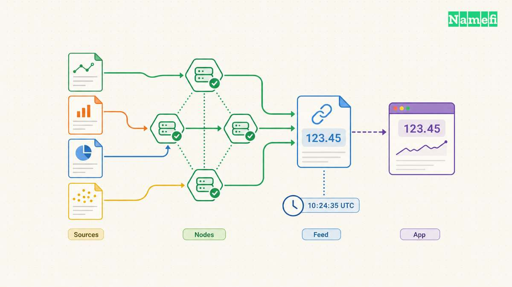
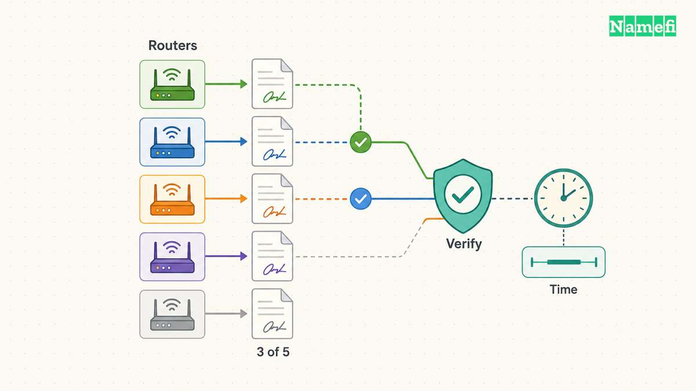
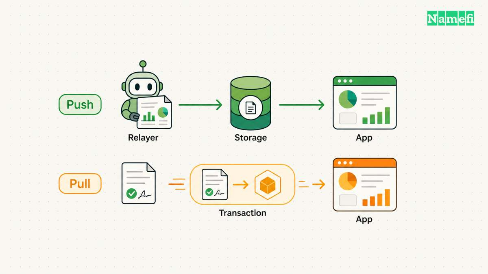
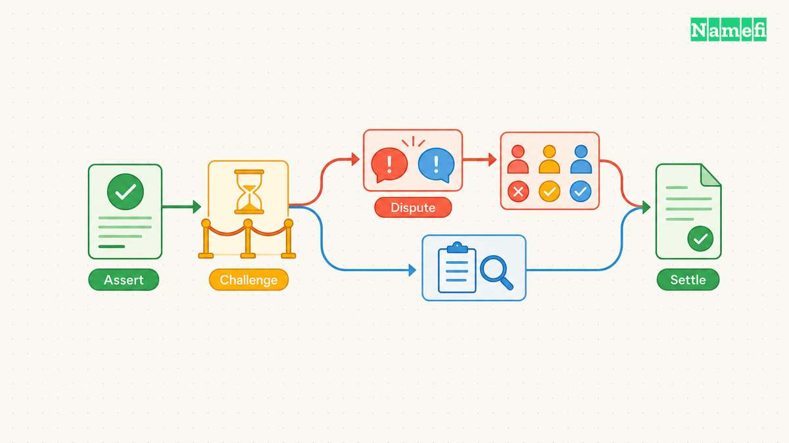

A contract can correctly verify a signed price and still accept a dangerous valuation. The signature establishes who authorized the report. The application must decide whether the report describes the right asset, remains recent enough, and supports the intended action.

Chainlink, Pyth, RedStone and UMA illustrate different answers to the oracle problem. Chainlink Data Feeds publish aggregated values onchain. Pyth supplies market data through a consumer update path. RedStone offers both push and pull delivery. UMA resolves assertions through a challenge process. Their official documentation describes these mechanisms, but the mechanisms do not establish a universal performance ranking ([Chainlink](https://docs.chain.link/data-feeds#build-with-data-feeds), [Pyth](https://docs.pyth.network/price-feeds/core#quick-start), [RedStone](https://docs.redstone.finance/docs/introduction/#stage-1-market-data), [UMA](https://docs.uma.xyz/developers/optimistic-oracle-v3/quick-start#a-minimum-viable-oov3-integration)).

A price feed answers a repeated numerical question. An optimistic assertion asks participants to challenge a particular statement before settlement. A system that needs continuous collateral valuations has different requirements from a system that settles an event once.

Use the following rubric to narrow an integration review. The judgments describe design fit rather than adoption, investment merit, or measured superiority. Product availability, contract addresses, and feed parameters require checks for the selected chain and deployment.

| Network and path | Main integration question | Main operational obligation |
| --- | --- | --- |
| Chainlink Data Feeds | Does the published feed match the asset and valuation purpose? | Check freshness, update rules, and application limits. |
| Pyth Core | Can the transaction obtain and verify a suitable price update? | Check timestamps, uncertainty, and update infrastructure. |
| RedStone push or pull | Should a relayer store prices or should transactions carry data? | Review signer settings and the complete delivery path. |
| UMA Optimistic Oracle v3 | Can a precise assertion wait through challenge and dispute resolution? | Support monitoring, incentives, and settlement states. |

## Chainlink Data Feeds publish shared prices under feed-specific rules

Chainlink describes several aggregation levels, including data sources and oracle operators. The exact oracle count varies by feed. Consumer contracts typically read a proxy that points to an aggregator. The aggregator stores updates for applications to read ([Decentralized Data Model, “Data aggregation,” “Decentralized Oracle Network,” and “Components”](https://docs.chain.link/architecture-overview/architecture-decentralized-model?parent=dataFeeds#data-aggregation)).

The practical benefit is a shared value already present onchain. An application does not need every caller to obtain an external report before reading that value. Our assessment favors this pattern when the selected feed already matches the application's instrument and update requirements.

Chainlink's aggregator documentation identifies deviation and heartbeat triggers. A deviation trigger responds to a specified difference from the stored value. A heartbeat trigger starts an update after a specified interval. Feed parameters therefore matter as much as the network name ([Aggregator](https://docs.chain.link/architecture-overview/architecture-decentralized-model?parent=dataFeeds#aggregator)).

A heartbeat does not mean every application can safely tolerate that entire interval. Consider a hypothetical checkout that fixes a dollar amount and accepts a volatile payment asset. A stored value might remain available while an outage prevents further updates. Reading successfully would not establish that the checkout received a suitable current exchange rate.

An integration review should therefore distinguish three questions. Did the contract return a value? Does the timestamp satisfy the application's policy? Does the policy remain appropriate for the action? Different answers can justify displaying an estimate, delaying a payment, or rejecting a state change.

Chainlink assigns application developers responsibility for market integrity and code risks. The documentation specifically calls for data quality checks, circuit breakers, and contingency logic. Low liquidity and market manipulation can undermine the economic meaning of a reported price ([Developer Responsibilities, “Market Integrity Risks” and “Application Code Risks”](https://docs.chain.link/data-feeds/developer-responsibilities#market-integrity-risks)).

**Our integration judgment:** review the feed's asset definition before treating the number as a valuation. A token price does not automatically establish redemption value, available liquidity, or a sale price for a unique asset. Those questions require separate evidence and application rules.

A second feed can provide a useful discrepancy signal. However, the review should identify whether both feeds depend on overlapping markets or providers. Agreement alone cannot demonstrate independence. Define the response to disagreement before enabling an automatic fallback. An unexamined fallback can exchange a visible outage for an unsuitable valuation.

The deployment record should name the feed, chain, proxy, units, accepted age, and permitted actions. The application should also identify who can change each setting. An upgrade path creates an operational dependency that deserves the same review as the initial address.

## Pyth Core combines transaction updates with explicit uncertainty controls

Pyth identifies exchanges and market makers as first-party data providers. First-party origin describes the relationship between publishers and observations. The application still needs to assess aggregation, delivery, verification, and the quality of the resulting market information ([Pyth Core introduction](https://docs.pyth.network/price-feeds/core#:~:text=Data%20is%20sourced)).

Current architecture matters here. Pyth documents an August 26, 2026 Core upgrade. The upgraded design uses five independently operated routers and a three-of-five signature quorum. Consumers retrieve signed roots and proofs through Hermes. Destination contracts verify the signatures and the requested aggregate. The upgrade retains the interface but uses newly deployed contract addresses ([Upgrade architecture, “Data flow,” “Components,” and comparison table](https://docs.pyth.network/price-feeds/core/upgrade/how-it-works#data-flow)).

That change makes an old integration diagram an unreliable description of the current verification path. A team should record the actual destination contract and the deployment version. Interface compatibility does not prove that an old address selects the intended system.

Pyth's integration guidance discusses stale prices, user selection of acceptable historical updates, and the latency advantage available to adversaries. The guidance recommends age checks and describes `getPriceNoOlderThan()`. The same guidance explains that wide confidence intervals require additional treatment when applications offer executable prices ([Best Practices, “Adversarial selection,” “Latency,” and “Executable Price Risks”](https://docs.pyth.network/price-feeds/core/best-practices#adversarial-selection)).

Consider a hypothetical application that reads a price of $100 with confidence of $8. The ratio of confidence to price equals 8%. Suppose the application permits at most 2% uncertainty. A fresh timestamp passes the age check, but the report fails the application's uncertainty policy.

The figures describe an invented test case, not an observed Pyth feed. The case separates two independent checks. Freshness asks when the observation occurred. Confidence gives information about uncertainty around the estimate. Passing one check cannot substitute for passing the other.

Now suppose the same application receives a $100 report that is 90 seconds old. The application requires an age below 30 seconds. A narrow confidence interval does not rescue the expired report. The correct test outcome follows the stated age policy, regardless of the attractive displayed value.

**Our integration judgment:** write separate acceptance rules for age and uncertainty. Then test how the contract responds when only one rule fails. The application should distinguish a rejected report from an execution failure elsewhere in the transaction.

The update service also needs operational review. Pyth's current Core page states that Hermes requires an API key. A transaction design should account for access configuration and report retrieval, as well as onchain verification ([Pyth Core upgrade notice](https://docs.pyth.network/price-feeds/core#:~:text=Hermes%20now%20requires)). A valid cryptographic design cannot supply a payload that the application never obtains.

## RedStone separates data delivery from the consumer interface

RedStone's pull integration adds data to the user's transaction. The contract uses extraction and verification libraries. The application prepares the additional payload. RedStone warns that third-party aggregators must support passing that payload through the transaction path ([Pull model, “Usage”](https://docs.redstone.finance/docs/stage1-market-data/price-feeds/pull-model/#usage)).

Our assessment favors reviewing this design as a complete transaction route. A direct application call may carry the required data successfully. A wallet router or another contract may call the same operation through a different route. The review should prove that every supported route preserves the required payload.

The pull documentation exposes controls for timestamp validation, aggregation, authorized signers, and signer thresholds. The example documentation also distinguishes production services from demonstration code ([Pull model, contract adjustment and override functions](https://docs.redstone.finance/docs/stage1-market-data/price-feeds/pull-model/#1-adjust-your-smart-contracts)).

These controls make configuration part of the trust model. A report can satisfy an unsuitable configuration exactly. Reviewers should therefore inspect the selected data service, accepted signers, required unique signers, timestamp bounds, and aggregation behavior. A source-code review that ignores deployment settings leaves those questions unanswered.

RedStone push adds a relayer that publishes data to storage contracts. The documentation describes time and value-deviation update conditions. The adapter records prices and timestamps, and an additional interface can resemble a Chainlink price feed. RedStone recommends multiple independent relayer instances ([Push model, “How RedStone Push works,” “Relayer,” and “Contracts”](https://docs.redstone.finance/docs/stage1-market-data/price-feeds/push-model/#how-redstone-push-works)).

A familiar interface can reduce consumer changes. However, a familiar interface does not establish identical sources, signers, or update policies. Teams should compare the behavior behind the interface before exchanging addresses in a configuration file.

**Our integration judgment:** choose push or pull from the application's call pattern. Push introduces an ongoing relayer responsibility. Pull introduces a transaction payload responsibility. Both approaches require an explicit response when the next acceptable report does not arrive.

For a hypothetical domain-payment application, a price feed could convert a stated dollar checkout amount into a payment-token quantity. A report about that payment token would answer a currency-conversion question. The report would not establish the market value of the domain itself.

A unique [tokenized domain](/en/glossary/tokenized-domain/) needs a valuation method that accounts for the individual asset and the intended transaction. A team should resist reusing a liquid-token feed as evidence for unrelated collateral. The example describes a possible application design and makes no claim about a Namefi integration.

A useful acceptance test sends the same operation through every supported entry point. Another test removes the update infrastructure temporarily. The expected outcome should preserve the application's stated settlement policy, including any deliberate delay or rejection.

## UMA resolves assertions through challenges before applications settle

UMA Optimistic Oracle v3 accepts truth assertions about offchain information. Assertions enter a challenge period. An undisputed assertion can settle as true. The default flow sends disputed assertions to UMA's Data Verification Mechanism, or DVM ([OOv3 quick start, “A minimum viable OOV3 integration”](https://docs.uma.xyz/developers/optimistic-oracle-v3/quick-start#a-minimum-viable-oov3-integration)).

The data origin is an assertion with resolution rules, rather than a continuously published market observation. This distinction changes the integration question. The application must define what statement participants evaluate, which evidence resolves the statement, and when settlement may occur.

UMA describes economic incentives for proposers and disputers. Disputes reach a voting mechanism in which UMA stakers resolve outcomes. A disputed request therefore introduces a different completion path from an undisputed request ([How does UMA work?, “Disputes” and “Dispute Resolution via DVM”](https://docs.uma.xyz/protocol-overview/how-does-umas-oracle-work#disputes)).

Our assessment favors optimistic assertions for discrete questions with sufficiently precise evidence rules and acceptable settlement delays. A team seeking immediate, continuously updated prices should first establish how a challenge process could satisfy those timing requirements.

Consider a hypothetical service that asserts whether a domain-transfer milestone occurred before a deadline. The application would need to define the relevant record, timezone, evidence source, and treatment of conflicting records. “The transfer completed” leaves too much interpretation unless the contract's rules explain completion.

The application also needs a state for an unresolved assertion. A submitted assertion should not trigger an irreversible delivery merely because nobody has disputed the assertion yet. The contract should wait for the settlement result specified by the integration.

UMA's quick-start guide explicitly warns that its short, unbonded demonstration lacks suitable mainnet incentives. The guide therefore supports learning the assertion lifecycle, rather than copying the demonstration's settings into production ([Quick start, “Next Steps”](https://docs.uma.xyz/developers/optimistic-oracle-v3/quick-start#next-steps)).

**Our integration judgment:** budget for monitoring and dispute participation alongside contract execution. A challenge window only provides an opportunity to object. The application still needs an operational plan for detecting incorrect assertions and funding the required response.

The following checklist applies across the four designs. Each item should produce a recorded answer before deployment.

1. Define the exact asset, statement, units, and evidence sources.
2. Verify the selected network, deployment version, contract address, and feed identifier.
3. Document source aggregation, authorized signers, thresholds, and upgrade authority.
4. Set separate freshness, uncertainty, and economic acceptance rules.
5. Specify behavior for missing reports, disputed assertions, and unavailable delivery services.
6. Test stale timestamps, wrong units, missing payloads, and unresolved settlement states.
7. Assign monitoring, configuration changes, incident response, and recovery responsibilities.

A [smart contract](/en/glossary/smart-contract/) cannot replace those decisions with a provider name. Chainlink, Pyth, RedStone and UMA offer concrete mechanisms for different questions. The integration succeeds when the chosen mechanism, deployed configuration, and application rules describe the same question.

## Sources and further reading

 Official documentation below was fetched on October 21, 2026 UTC. The linked sections identify the evidence locations. Deployment details can change after that date.

- Chainlink: [Data Feeds overview](https://docs.chain.link/data-feeds#build-with-data-feeds), [aggregation model and update triggers](https://docs.chain.link/architecture-overview/architecture-decentralized-model?parent=dataFeeds#aggregator), and [developer responsibilities](https://docs.chain.link/data-feeds/developer-responsibilities#application-code-risks).
- Pyth: [Core introduction and service notice](https://docs.pyth.network/price-feeds/core), [upgraded architecture and quorum comparison](https://docs.pyth.network/price-feeds/core/upgrade/how-it-works#comparison-existing-vs-upgraded-pyth-core), and [integration risks](https://docs.pyth.network/price-feeds/core/best-practices#executable-price-risks-and-mitigations).
- RedStone: [product scope](https://docs.redstone.finance/docs/introduction/#stage-1-market-data), [pull integration](https://docs.redstone.finance/docs/stage1-market-data/price-feeds/pull-model/#usage), and [push relayers and storage](https://docs.redstone.finance/docs/stage1-market-data/price-feeds/push-model/#how-redstone-push-works).
- UMA: [OOv3 assertion lifecycle and demonstration caveat](https://docs.uma.xyz/developers/optimistic-oracle-v3/quick-start#next-steps) and [dispute resolution mechanism](https://docs.uma.xyz/protocol-overview/how-does-umas-oracle-work#dispute-resolution-via-dvm).
