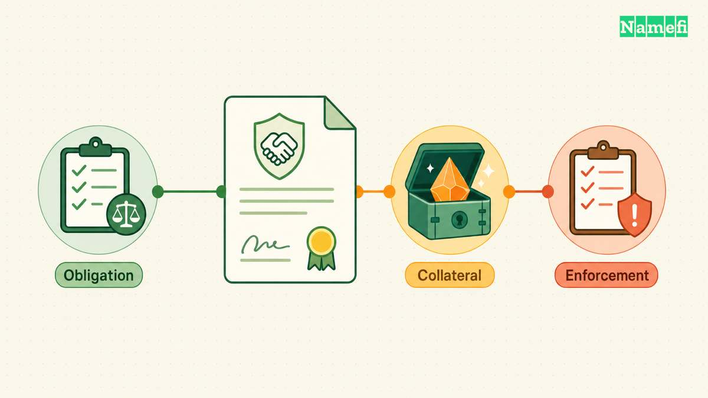
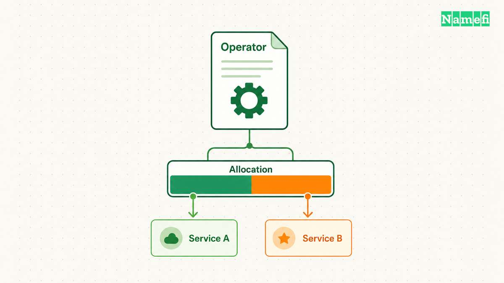
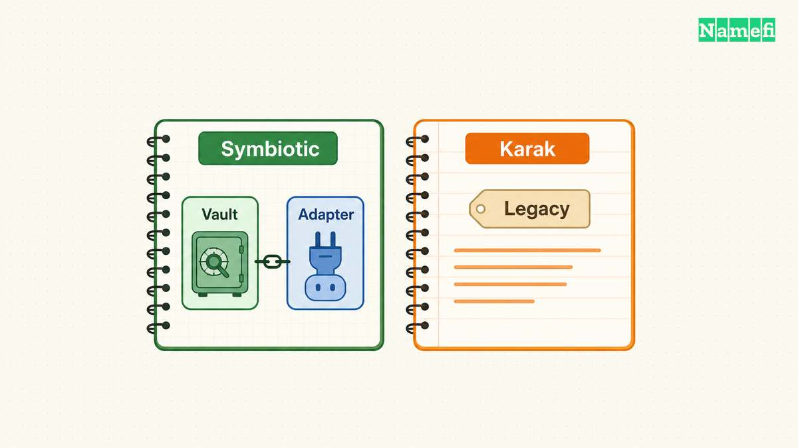
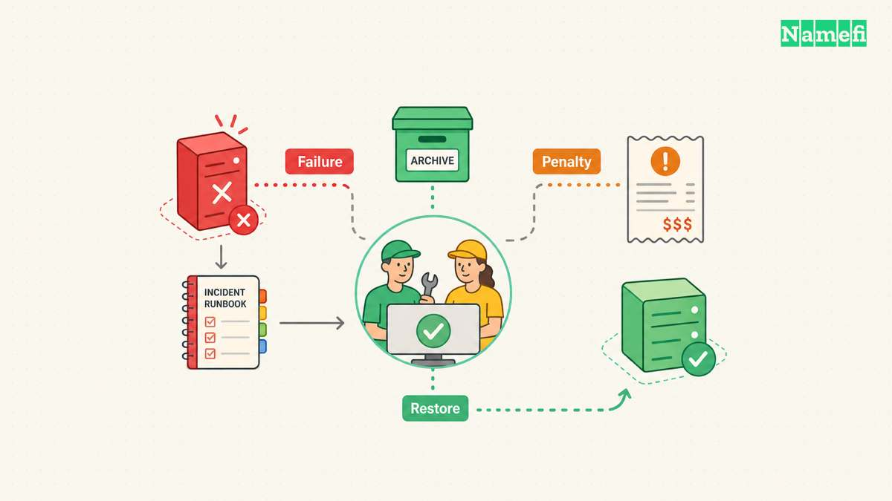

A service can recruit operators with existing collateral instead of issuing a new token to establish an economic penalty. Restaking supplies that possibility. The useful comparison starts with the penalty that a particular service can execute, rather than the total deposits that a platform displays.

Ethereum [proof of stake](/en/glossary/proof-of-stake/) assigns validators duties within [Ethereum](/en/glossary/ethereum/) consensus. Validators propose blocks and attest to the chain, and provable consensus violations can trigger slashing. Restaking introduces additional service commitments with separate rules and enforcement paths ([Ethereum staking, “What is staking?”](https://ethereum.org/staking/#what-is-staking)). A restaked oracle does not make Ethereum consensus responsible for the oracle's answer.

EigenLayer, Symbiotic, and Karak illustrate different approaches to connecting collateral with service obligations. However, their current status requires care. EigenCloud still identifies EigenLayer as its staking and security product. Symbiotic now documents a broader collateral platform. Karak's former homepage redirects to OpenGDP, which labels Karak staking links as legacy ([EigenCloud documentation](https://docs.eigencloud.xyz/), [Symbiotic overview](https://docs.symbiotic.fi/get-started/what/overview), [OpenGDP homepage, “Legacy”](https://opengdp.network/#:~:text=Legacy)).

This comparison reflects the public sources checked on October 21, 2026. “Top” identifies important architectural examples, rather than a deposit recommendation or a ranking by yield.

## A service must define the obligation that collateral actually secures

Shared security combines participants or capital across services. The design can reduce the work needed to recruit an operator network. EigenLayer explicitly describes aggregating operators and restaked assets to help new services establish economic security ([EigenLayer overview, architecture](https://docs.eigencloud.xyz/eigenlayer/concepts/eigenlayer-overview#eigenlayer-architecture-overview)). The benefit does not remove the need to specify each service's behavior.

A [smart contract](/en/glossary/smart-contract/) can express enforcement rules, while operators perform the service tasks. An operator might promise to sign a correct result, provide [data availability](/en/glossary/data-availability/), or answer before a deadline. Each promise needs evidence. Conflicting signatures can provide direct evidence of equivocation. A missed response can require a precise definition of the observation window and an available challenge path. These examples are design analysis, rather than claims that every platform supplies identical proofs.

A service should distinguish fault detection from penalty execution. Symbiotic's Slasher processes requests from network middleware and checks amount and timing constraints. The Slasher does not discover faults by itself ([Symbiotic slashing, “Slasher module”](https://docs.symbiotic.fi/learn/core-concepts/slashing#slasher-module)). An application therefore needs to inspect the middleware and the party that can submit a request.

Collateral also needs a definition. Native staked ETH, a liquid staking token, and another accepted token expose different underlying dependencies. A token balance describes an asset quantity. A service still needs an assessment of the asset's value during an incident, the redemption path, and any external obligations. A nominal unit count cannot answer those questions.

Use the following rubric before comparing platform names. The questions express an evaluation method, rather than a protocol guarantee.

| Criterion | Evidence to request | Reason the evidence matters |
| --- | --- | --- |
| Covered behavior | Task specification and fault evidence | A penalty needs a defined violation |
| Available collateral | Asset, allocation, and remaining slashable amount | Platform deposits can exceed the service's backing |
| Enforcement authority | Slasher, middleware, veto, and upgrade permissions | Authorized parties can determine enforcement outcomes |
| Timing | Detection, challenge, execution, and exit windows | A valid claim can fail after its deadline |
| Recovery | Recipient, dispute process, and service fallback | Penalizing an operator does not restore service |

Total value locked measures a pool under a particular reporting definition. Total value locked does not establish uniquely slashable backing for one service. A service needs effective allocation, eligible operators, valid enforcement rights, and an unexpired claim. A shared pool can also expose competing obligations. The comparison should show the service-level amount after those constraints, without summing overlapping claims as independent protection.

## EigenLayer assigns slashable stake through operator sets

EigenCloud's documentation separates EigenCompute, EigenDA, and EigenLayer. The current overview calls services on EigenLayer Autonomous Verifiable Services, abbreviated AVSs ([EigenCloud product directory](https://docs.eigencloud.xyz/), [EigenLayer overview](https://docs.eigencloud.xyz/eigenlayer/concepts/eigenlayer-overview)). Older material may expand AVS differently. The technical question remains which service rules an operator accepts.

The overview describes native ETH and liquid staking tokens as restaking inputs. Stakers delegate to operators, and operators run service software. The deposit route and the operator's service commitments are distinct decisions ([EigenLayer overview, architecture](https://docs.eigencloud.xyz/eigenlayer/concepts/eigenlayer-overview#eigenlayer-architecture-overview)). A reader should inspect accepted strategies for the deployment under consideration instead of treating the overview as an exhaustive asset list.

EigenLayer introduced mainnet slashing and Unique Stake Allocation in April 2025. The launch description explains that operators can assign portions of delegated stake to particular AVSs ([Eigen Labs, “Unique Stake Allocation”](https://www.eigenlabs.org/blog/slashing-goes-live/#:~:text=Unique%20Stake%20Allocation)). This historical milestone does not establish that every listed service currently uses slashing.

The current AllocationManager documentation describes operator sets with specific strategies and slashing authority. Actual slashability requires both registration and an active allocation. Registration alone therefore does not prove collateral backing ([AllocationManager, “Allocations and Slashing”](https://github.com/Layr-Labs/eigenlayer-contracts/blob/main/docs/core/AllocationManager.md#allocations-and-slashing)). Unique allocation separates accounting exposure, but shared operators can still experience the same software bug or infrastructure outage.

Delegation can expose a new staker immediately when the operator already has an active slashable allocation. The current DelegationManager documentation also lists a mainnet withdrawal delay of 100,800 blocks, approximately 14 days. Queued shares remain slashable during that delay ([DelegationManager, “Parameterization,” “delegateTo,” and “slashOperatorShares”](https://github.com/Layr-Labs/eigenlayer-contracts/blob/main/docs/core/DelegationManager.md#parameterization)). An exit request therefore does not erase existing exposure.

Treat block counts as configuration evidence, rather than a guaranteed calendar appointment. Integrators should verify deployed contracts and current parameters before depending on an exit schedule. Repository documentation can describe newer behavior than a particular deployment.

Our assessment: EigenLayer provides an explicit framework for service-specific operator groupings and stake allocation. A useful integration review still follows the exact strategy, operator set, slasher, and withdrawal path. The platform name cannot substitute for that review.

## Symbiotic configurations and legacy Karak designs require version-specific review

Symbiotic's current overview describes collateral markets that back obligations for defined periods. Current Core V2 risk guidance asks participants to evaluate each integration's assumptions ([Symbiotic overview](https://docs.symbiotic.fi/get-started/what/overview), [Symbiotic risks](https://docs.symbiotic.fi/get-started/resources/risks)). A description limited to early restaking vaults misses the broader current architecture.

Current vault documentation describes single-asset ERC-4626 vaults with transferable shares and independent curators. Curators choose applications, adapters, fees, and access controls ([Symbiotic vaults](https://docs.symbiotic.fi/get-started/what/components/vaults)). A depositor consequently accepts a configured management policy, rather than one uniform platform risk.

Adapters connect vault capital with applications or external strategies. App Adapters can support economic security and financial obligations. Liquidity Adapters can deploy capital into external sources ([Symbiotic adapters, “Adapter Types”](https://docs.symbiotic.fi/get-started/what/components/adapters#adapter-types)). A restaking comparison must inspect the actual adapter instead of assuming every deposited asset backs operator faults.

The Universal Delegator applies allocation limits and coordinates withdrawals across adapters. An adapter can return liquidity immediately, partially satisfy a request, or require an asynchronous withdrawal. The current documentation therefore does not justify one universal exit duration ([Universal Delegator, “Withdrawals”](https://docs.symbiotic.fi/get-started/what/components/universal-delegator#withdrawals)).

Symbiotic also retains documentation for network-oriented vaults with Delegator and Slasher modules. Those pages describe network and operator opt-ins, instant slashing, optional veto review, and vaults without slashing ([Registries and Opt-ins](https://docs.symbiotic.fi/learn/mechanics/registries-and-opt-ins#opt-ins), [Slashing](https://docs.symbiotic.fi/learn/core-concepts/slashing#slasher-module)). Those mechanics must not silently become blanket claims about every Core V2 adapter.

For the epoch-based design, a withdrawal requested in epoch k becomes claimable after epoch k+1 ends. The documented delay spans one to less than two epochs, with exposure continuing until the claim boundary. The detection and execution path must fit within the captured stake guarantee ([Epochs and Delays, “Withdrawal Timing” and “Network Epochs and Buffers”](https://docs.symbiotic.fi/learn/mechanics/epochs-and-delays#withdrawal-timing)). Verify the deployed version before applying that model.

Karak needs a different status label. The current OpenGDP homepage links to V1 and V2 staking under “Legacy.” The V2 page still presents deposit and unstake controls. Those visible controls establish an interface, not a verified current service inventory or an operational guarantee ([OpenGDP, “Legacy”](https://opengdp.network/#:~:text=Legacy), [Karak V2 interface](https://v2.karak.network/)).

Karak's 2024 code submission provides a historical architecture: stakers deposit into operator vaults, and operators register with Distributed Secure Services, or DSSs. The submission permits the same vault to support multiple DSSs. The historical Core contract includes slashing requests, a veto role, and finalization ([Karak submitted architecture](https://github.com/code-423n4/2024-07-karak#overview), [submitted Core contract](https://github.com/code-423n4/2024-07-karak/blob/main/src/Core.sol)). These sources document submitted code, rather than today's deployed configuration.

| Approach | Allocation model to inspect | Status and principal limit |
| --- | --- | --- |
| EigenLayer | Strategy allocation to a registered operator set | Current EigenCloud security product, with service-specific slashability |
| Symbiotic | Exact vault, adapter, curator, and application | Current collateral platform, with version-specific enforcement and liquidity |
| Legacy Karak | Operator vault participation across DSSs | Legacy links remain, while current enforcement requires fresh deployment evidence |

Our assessment: Symbiotic demands configuration-level comparison because the architecture spans several collateral uses. Karak remains useful for understanding operator-vault sharing, but historical code cannot establish a present integration decision.

## A recovery plan must cover failures that slashing cannot repair

Consider a hypothetical domain-monitoring service called RecordWatch. RecordWatch asks independent operators to sign periodic observations of a domain's published records. RecordWatch is an invented example, not a current Namefi integration. The example makes the security boundary concrete without claiming a product deployment.

Suppose an operator signs two incompatible observations for the same task identifier. RecordWatch could define the conflicting signatures as a violation. The application would still need authenticated task identifiers, a dispute procedure, and an authorized enforcement path. Collateral alone supplies none of those specifications.

A penalty could discourage conflicting signatures. A penalty would not give RecordWatch control over the registrar account, repair a compromised DNS account, or restore unavailable observation history. The owner would still need access recovery and independent records. This distinction matters when an application turns a financial commitment into a broader claim of operational safety.

The operator set also needs a correlation review. Ten signing keys can belong to infrastructure with one cloud dependency or one software release. Distinct collateral allocations do not make those operating dependencies independent. This conclusion follows from the difference between allocating assets and running software, rather than from a platform's advertised operator count.

A collateral stress test should ask what happens when several services fail together. For shared collateral, earlier penalties can reduce the funds available for later claims. Symbiotic explicitly warns that slashing on other networks can affect restaking guarantees ([Symbiotic vault, “Slasher Module”](https://docs.symbiotic.fi/learn/core-concepts/vault#slasher-module)). Even exclusive allocations need separate evaluation of collateral value and operational correlation.

Use the following risk and recovery checklist before accepting a service's security claim:

- Identify the task, fault evidence, and party responsible for detecting failures.
- Check effective collateral after allocations, pending exits, and previous penalties.
- Identify the slasher, veto authority, upgrade authority, and emergency permissions.
- Test whether detection and dispute handling finish before enforcement expires.
- Map common operator software, infrastructure, key custody, and external data dependencies.
- Confirm who receives penalized collateral and how users submit any compensation claim.
- Rehearse service suspension, operator replacement, and restoration from independent records.
- Verify the exit process when the normal website or coordinator becomes unavailable.

Compensation deserves a separate line in the service agreement. A mechanism that destroys collateral creates a deterrent. A mechanism that redistributes collateral needs a recipient rule. Neither mechanism automatically measures a user's damage or promises full reimbursement. An integration review should avoid treating “slashable” as a synonym for “insured.”

The most useful comparison produces a bounded statement: a named group secures a defined task with specified collateral and an executable penalty window. The recovery plan then explains how users continue operating after that group fails. Restaking can strengthen the financial consequences of operator misconduct, while the application retains responsibility for its own evidence and recovery design.

## Sources and further reading

All sources below were fetched on **2026-10-21 UTC**. No archive snapshot is asserted.

- Ethereum.org: [Staking](https://ethereum.org/staking/#what-is-staking), “What is staking?”
- EigenCloud: [Product directory](https://docs.eigencloud.xyz/) and [EigenLayer architecture](https://docs.eigencloud.xyz/eigenlayer/concepts/eigenlayer-overview#eigenlayer-architecture-overview).
- Eigen Labs: [Mainnet slashing launch](https://www.eigenlabs.org/blog/slashing-goes-live/#:~:text=Unique%20Stake%20Allocation), April 17, 2025, “Unique Stake Allocation.”
- Layr Labs: [AllocationManager](https://github.com/Layr-Labs/eigenlayer-contracts/blob/main/docs/core/AllocationManager.md#allocations-and-slashing) and [DelegationManager](https://github.com/Layr-Labs/eigenlayer-contracts/blob/main/docs/core/DelegationManager.md#parameterization), allocation, registration, queue, and slashing sections.
- Symbiotic: [Overview](https://docs.symbiotic.fi/get-started/what/overview), [Vaults](https://docs.symbiotic.fi/get-started/what/components/vaults), [Adapters](https://docs.symbiotic.fi/get-started/what/components/adapters#adapter-types), and [Universal Delegator](https://docs.symbiotic.fi/get-started/what/components/universal-delegator#withdrawals), current collateral architecture.
- Symbiotic: [Risks](https://docs.symbiotic.fi/get-started/resources/risks), application and allocator responsibilities.
- Symbiotic: [Opt-ins](https://docs.symbiotic.fi/learn/mechanics/registries-and-opt-ins#opt-ins), [Slashing](https://docs.symbiotic.fi/learn/core-concepts/slashing#slasher-module), [Vault](https://docs.symbiotic.fi/learn/core-concepts/vault#slasher-module), and [Epochs and Delays](https://docs.symbiotic.fi/learn/mechanics/epochs-and-delays#withdrawal-timing), retained network-oriented mechanics.
- OpenGDP: [Homepage](https://opengdp.network/#:~:text=Legacy), legacy staking links. Karak: [V2 interface](https://v2.karak.network/).
- Karak's 2024 Code4rena submission: [Architecture](https://github.com/code-423n4/2024-07-karak#overview) and [Core contract](https://github.com/code-423n4/2024-07-karak/blob/main/src/Core.sol), historical submitted code.
