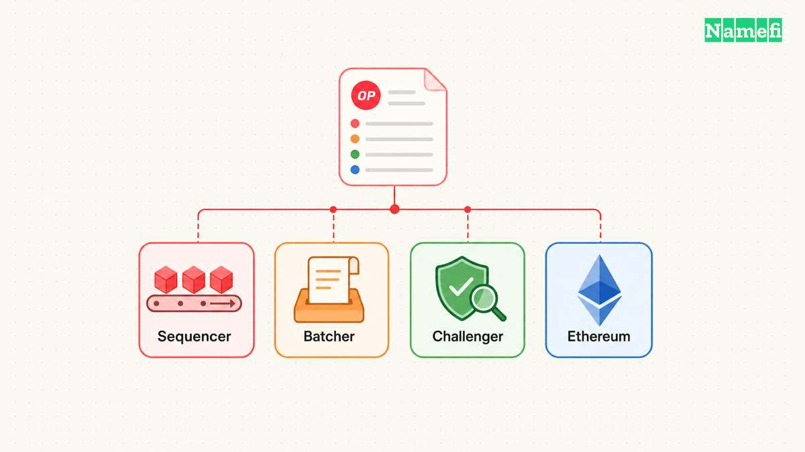
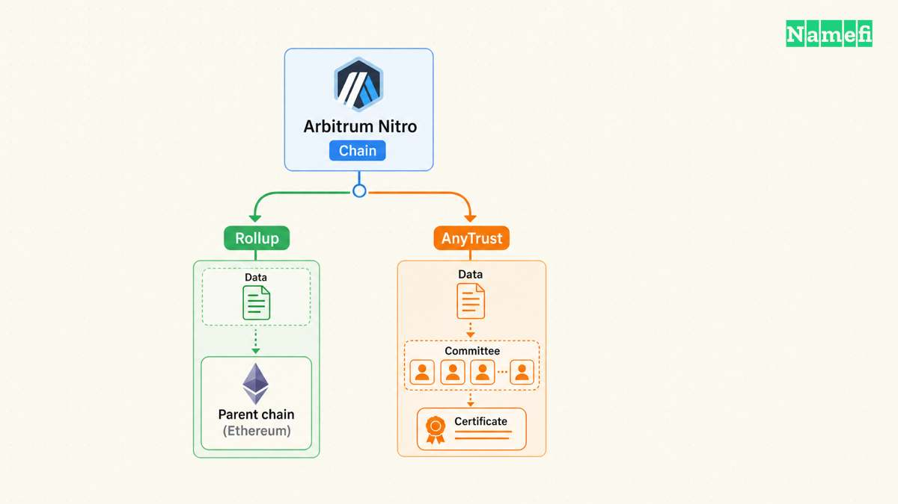
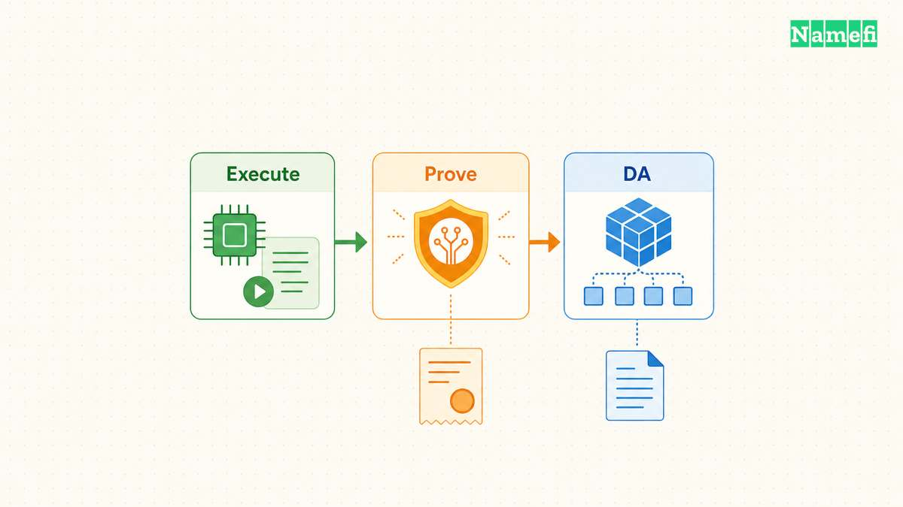
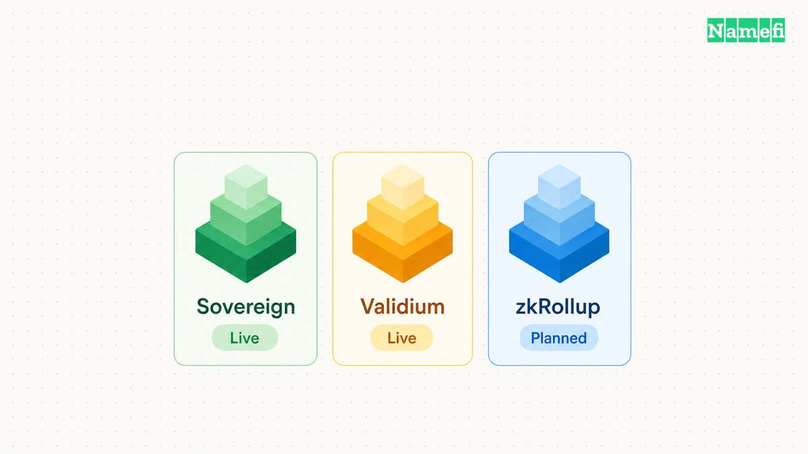

A rollup framework supplies software and deployment conventions for a dedicated chain. A deployment team still chooses the actual security configuration. The useful shortlist includes OP Stack, Arbitrum Orbit with Nitro, ZK Stack, and Polygon CDK. These projects now cover different products and operating modes, so a four-way speed ranking would hide the important decisions.

Start with the requirement. Does the application need its own chain, or would contracts on an existing network meet the requirement? A dedicated chain creates responsibilities for availability, upgrades, bridges, and user support. Fee control and dedicated capacity must justify those responsibilities.

A [rollup](/en/glossary/rollup/) publishes the data needed to reconstruct state through its parent chain. A [validium](/en/glossary/validium/) uses validity proofs with offchain data availability. Framework branding does not settle that distinction. The following comparison checks current official documentation as of October 21, 2026, and separates available configurations from planned features.

Use the same three-column rubric when requesting deployment proposals. The table identifies useful evaluation directions, not an overall winner. The sections explain the documentation behind each row.

| Framework | Useful evaluation direction | Configuration that needs proof |
| --- | --- | --- |
| OP Stack | Standard Ethereum-oriented rollup operations and shared components | Actual DA source, fault-proof permissions, upgrade authority, and release compatibility |
| Arbitrum Orbit / Nitro | Custom chain configuration within Arbitrum infrastructure | Parent chain, Rollup versus AnyTrust, validator access, and withdrawal settings |
| ZK Stack | ZKsync chain deployment with integrated proving components | Execution version, DA validation, prover capacity, and ecosystem governance |
| Polygon CDK | Managed institutional chains with Agglayer connectivity | Sovereign versus validium, execution client, access controls, and current mode availability |

A framework and a managed Rollup-as-a-Service provider answer different questions. The framework defines the protocol implementation. A provider supplies some combination of hosting, deployment, monitoring, and maintenance. ZKsync explicitly describes [RaaS partners as infrastructure and tooling providers](https://docs.zksync.io/zk-stack/running/raas#deploying-and-running-using-a-rollup-as-a-service-provider). Request the software configuration and service agreement separately.

## OP Stack gives teams a standard rollup architecture

OP Stack provides shared, open-source components for production Ethereum Layer 2 chains. Its introduction describes [EVM equivalence and separate DA, sequencing, and settlement layers](https://docs.optimism.io/op-stack/introduction/op-stack#what-the-op-stack-gives-you). That combination makes OP Stack a useful starting point for teams seeking familiar Ethereum tooling and an established operating structure.

The standard architecture follows an [optimistic rollup](/en/glossary/optimistic-rollup/) model. The operator publishes data to Ethereum and proposes state claims. Challengers dispute incorrect claims. However, Optimism explicitly states that [Ethereum DA and permissionless fault proofs are configurable choices](https://docs.optimism.io/op-stack/architecture#the-big-picture). A proposal must specify both choices before the team evaluates security inheritance.

The architecture also exposes the operating burden. The [component table](https://docs.optimism.io/op-stack/architecture#the-actors-and-who-runs-each) separates consensus and execution clients, batch publication, state proposals, challenges, and optional sequencer failover. These services have different failure effects. A sequencer can continue showing transactions while delayed batch publication prevents independent derivation from advancing.

For evaluation, request a demonstration of the complete transaction path. Submit a transaction, locate the corresponding publication, and compare the independent verifier state. Then complete a withdrawal through the configured contracts. A responsive RPC endpoint alone does not demonstrate the complete system.

DA customization needs particular attention. Optimism labels [Alt-DA mode experimental](https://docs.optimism.io/op-stack/features/experimental/alt-da-mode#:~:text=This%20is%20an%20experimental%20feature). Alternative DA can change the cost structure, but the team must evaluate the selected provider and verification integration. The proposal should explain how an independent operator obtains missing data during an outage.

Upgrade authority creates another boundary. Optimism's [security-model discussion](https://docs.optimism.io/op-stack/security/faq-sec-model#fault-proofs) warns that instant contract upgrades limit the protection that fault proofs provide. Inspect the deployed chain's authorized signers and delays. Do not copy OP Mainnet governance assumptions into a separately operated deployment.

Base illustrates why historical stack labels require care. In February 2026, Base announced [a unified, Base-operated stack and a separate release path](https://www.base.org/blog/next-chapter-for-base-chain-1#accelerating-upgrades). The announcement also described a proof-system transition in its roadmap. That announcement supports checking Base-specific releases and proofs, rather than treating every historically OP-derived chain as an identical configuration.

For a team comparison, OP Stack deserves a trial when Ethereum tooling and a standard operating architecture match the application. The trial should measure publication reliability, withdrawal completion, and upgrade rehearsal. Raw transactions per second cannot answer those questions.

## Arbitrum Orbit gives teams Nitro configuration choices

Arbitrum Orbit is the familiar name for launching custom Arbitrum chains. Current Arbitrum documentation presents the product as launching an Arbitrum chain using the [Nitro codebase](https://docs.arbitrum.io/launch-arbitrum-chain/overview/introduction#:~:text=using%20the%20Arbitrum%20Nitro%20codebase). Separate the chain-launching product from Nitro, the implementation that the deployment runs.

Arbitrum's overview lists custom gas tokens, fee policies, sequencing, precompiles, and DA among the available configuration areas. These options make a useful evaluation direction for teams seeking control over execution economics. Each customization also creates another setting that the team must document and maintain.

The first architecture question concerns the parent chain. Record the chain that accepts the deployed chain's commitments and the route that assets follow. A layered deployment requires evaluation of each link. A claim about Ethereum settlement does not describe every intermediate operational dependency.

The second question concerns [data availability](/en/glossary/data-availability/). Arbitrum documents [Rollup mode, AnyTrust mode, and alternative DA options](https://docs.arbitrum.io/launch-arbitrum-chain/chain-config/data-availability/config-data-availability#available-data-availability-options). Rollup mode posts transaction data to the parent as calldata or blobs. AnyTrust uses a permissioned Data Availability Committee and signed certificates instead of posting every batch's data directly.

The distinction changes the review. For Rollup mode, inspect publication behavior and parent-chain costs. For AnyTrust, inspect committee membership, quorum, storage, retrieval, and replacement procedures. Arbitrum's configuration guide requires DA servers, a registered keyset, and endpoint configuration. Those requirements represent infrastructure that someone must operate, even under a managed contract.

The deployment proposal should name the party responsible for each committee member. Several servers under one administrator do not demonstrate independent administration. Request a recovery exercise that removes a server and tests data retrieval from the remaining arrangement. Treat the result as evidence about that deployment, not the whole framework.

Timing claims also need configuration context. Arbitrum's overview distinguishes [optional fast withdrawals from its default withdrawal setting](https://docs.arbitrum.io/launch-arbitrum-chain/overview/introduction#enable-fast-withdrawals-to-reduce-withdrawal-finality-time). The page warns that fast withdrawals do not apply by default. Record the actual withdrawal mechanism and conditions instead of copying the shortest advertised duration.

For an application team, Nitro customization is useful when the team can explain the operational purpose of each change. A custom gas token should solve a user or accounting problem. A shorter block interval should meet a measured latency requirement. Configuration flexibility should produce a shorter requirements list, not a longer list of unsupported promises.

## ZK Stack makes proving and DA separate deployment decisions

ZK Stack supplies a modular framework for launching interoperable ZKsync chains. Its [current component overview](https://docs.zksync.io/zk-stack/components#:~:text=The%20main%20components%20of%20each%20ZKsync%20chain) lists ZKsync OS, the server, Airbender, an explorer, and a fee withdrawer. Request exact versions and compatibility requirements when comparing deployment proposals.

The [Airbender documentation](https://docs.zksync.io/zk-stack/components/zksync-airbender#how-it-fits-with-zksync-os) describes a RISC-V proving system that validates execution encoded in RISC-V bytecode. The proving pipeline ends with a wrapper proof for onchain verification. A team should evaluate the complete pipeline, including witness generation and final submission, rather than comparing one prover benchmark.

Operationally, measure the gap between executed batches and proven batches. Test normal traffic, peak traffic, and interrupted proving. Ask how the provider clears a backlog and which resources the provider reserves. These tests reveal whether the proposed capacity matches the application's workload.

A [ZK rollup](/en/glossary/zk-rollup/) and a ZK Stack validium have different DA assumptions. ZKsync's [validium documentation](https://docs.zksync.io/zk-stack/customizations/validium#types-of-validium) distinguishes database-only storage, external DA without onchain inclusion verification, and external DA with L1 verification. A label such as external DA therefore leaves a material question unanswered.

Ask which DA validator contracts the deployment uses and what those contracts verify. Ask how independent operators retrieve the data needed to rebuild state. An execution proof does not supply missing state data. ZKsync explicitly states that [a DA layer does not prove L2 correctness](https://docs.zksync.io/zk-stack/customizations/validium#what-is-a-da-layer). The deployment must address both correctness and availability.

Governance also spans multiple roles. ZKsync's [ownership model](https://docs.zksync.io/zk-stack/running/ownership-model#contracts-overview) identifies ecosystem contracts, chain contracts, DA validators, and upgrade ownership. Its roles table distinguishes ChainAdmin powers from protocol governance. Review that arrangement before assuming that a dedicated chain gives the application unrestricted control over upgrades.

A useful acceptance test starts with a fresh independent node and known source data. The team rebuilds state, submits a proof, and completes an exit under the proposed configuration. The team also rehearses an upgrade across the sequencer and prover versions. Record every dependency that requires another organization's action.

ZK Stack belongs on the shortlist when the application needs the ZKsync deployment architecture and can support the proving lifecycle. Teams should budget for monitoring, data retention, and upgrade coordination alongside compute. A low proof-generation quote does not describe the full operating requirement.

## Polygon CDK requires teams to check the available operating mode

Polygon CDK needs a current comparison because the product has changed. Polygon now describes [CDK as a bespoke institutional chain product operated with Polygon](https://docs.polygon.technology/chain-development/cdk#:~:text=CDK%20is%20the%20product). The current documentation emphasizes private blockspace and Agglayer connectivity. Teams should evaluate that delivery model alongside the technical configuration.

The [CDK overview lists op-geth, op-reth, and Hyperledger Besu execution options](https://docs.polygon.technology/chain-development/cdk/get-started/overview#execution-clients). That overlap matters: OP Stack and CDK are not completely separate execution families. The procurement comparison must identify what CDK adds through deployment, access control, operating mode, and interoperability.

The same overview marks [sovereign and validium modes live, with zkRollup in development](https://docs.polygon.technology/chain-development/cdk/get-started/overview#rollup-modes). Sovereign mode uses pessimistic proofs for Agglayer connectivity and requires no execution prover. Validium uses ZK-secured execution with offchain DA through OP Succinct AltDA. Besu supports sovereign mode only.

Those distinctions prevent an important mistake. Agglayer connectivity does not establish that a chain proves every execution transition to Ethereum. Teams seeking an Ethereum-DA ZK rollup must verify an available configuration that meets that requirement. The documented roadmap does not constitute a deployed security property.

CDK also differs from Polygon zkEVM Mainnet Beta. Polygon states that [the zkEVM Mainnet Beta sequencer stopped on July 3, 2026](https://polygon.technology/polygon-zkevm#:~:text=As%20of%20July%203%2C%202026). The sunset does not mean CDK disappeared. Conversely, CDK availability does not make the sunset network a current deployment recommendation.

Consider a hypothetical domain marketplace operating `market.example`. The marketplace proposes a dedicated chain for listing and escrow events. The team first specifies who must read events, who may submit transactions, and how users recover assets. The domain is an interface address, not a source of settlement security.

The marketplace then compares two concrete proposals with the same workload and exit requirements. One proposal could use a standard Ethereum-DA deployment. Another could use a gated institutional configuration. The marketplace must explain whether restricted data access meets user recovery requirements before comparing monthly invoices.

Use this practical acceptance checklist for any shortlisted framework:

- Record the parent chain, DA source, execution client, and deployed verifier addresses.
- Identify upgrade signers, emergency powers, delays, and the procedure for replacing operators.
- Complete deposits and withdrawals through the proposed production contract configuration.
- Rebuild a node from independently retained data and document missing dependencies.
- Stop sequencing, batch publication, and proving separately, then measure recovery behavior.
- Test peak workload costs, including parent-chain fees, DA, proving, storage, RPC, and support.
- Export configuration, snapshots, and operational procedures before testing a provider change.
- Assign ownership for the domain, DNS, certificates, explorer, status page, and incident notices.

Require evidence for each checklist item during a trial. A provider's dashboard can assist operations, but the acceptance record should remain understandable without that dashboard. Keep the chain configuration and service responsibilities together so future maintainers can repeat the checks.

Choose the framework whose available configuration meets the application requirements and whose operations the team can sustain. Choose the service provider through a separate assessment of access, support, recovery, and migration. A chain becomes reviewable when the proposal names the contracts, data, permissions, and people behind every promised guarantee.

## Sources and further reading

All sources below were opened and checked on October 21, 2026 UTC. Fetch dates record retrieval, not publication dates.

- Optimism, [The OP Stack](https://docs.optimism.io/op-stack/introduction/op-stack#what-the-op-stack-gives-you), features and modularity — fetched 2026-10-21.
- Optimism, [OP Stack architecture](https://docs.optimism.io/op-stack/architecture#the-actors-and-who-runs-each), components, configuration, and transaction lifecycle — fetched 2026-10-21.
- Optimism, [Alt-DA Mode Explainer](https://docs.optimism.io/op-stack/features/experimental/alt-da-mode#:~:text=This%20is%20an%20experimental%20feature), experimental status — fetched 2026-10-21.
- Optimism, [OP Stack security model](https://docs.optimism.io/op-stack/security/faq-sec-model#fault-proofs), upgrade authority and fault-proof limits — fetched 2026-10-21.
- Base Engineering Team, [A new, unified stack for Base Chain](https://www.base.org/blog/next-chapter-for-base-chain-1#accelerating-upgrades), release-path transition and roadmap — fetched 2026-10-21.
- Arbitrum, [Overview of Arbitrum chains](https://docs.arbitrum.io/launch-arbitrum-chain/overview/introduction#customization), Nitro, configuration, and withdrawal caveats — fetched 2026-10-21.
- Arbitrum, [Configure data availability](https://docs.arbitrum.io/launch-arbitrum-chain/chain-config/data-availability/config-data-availability#available-data-availability-options), Rollup and AnyTrust deployment requirements — fetched 2026-10-21.
- ZKsync, [ZK Stack components](https://docs.zksync.io/zk-stack/components#:~:text=The%20main%20components%20of%20each%20ZKsync%20chain), component inventory — fetched 2026-10-21.
- ZKsync, [Airbender](https://docs.zksync.io/zk-stack/components/zksync-airbender#proving-pipeline), proving pipeline — fetched 2026-10-21.
- ZKsync, [Validium in ZK Stack](https://docs.zksync.io/zk-stack/customizations/validium#types-of-validium), DA distinctions and verification — fetched 2026-10-21.
- ZKsync, [Ownership model](https://docs.zksync.io/zk-stack/running/ownership-model#contracts-overview), contracts and roles — fetched 2026-10-21.
- ZKsync, [Rollup as a Service](https://docs.zksync.io/zk-stack/running/raas#deploying-and-running-using-a-rollup-as-a-service-provider), provider responsibilities — fetched 2026-10-21.
- Polygon, [CDK](https://docs.polygon.technology/chain-development/cdk#:~:text=CDK%20is%20the%20product), institutional delivery model — fetched 2026-10-21.
- Polygon, [What is CDK?](https://docs.polygon.technology/chain-development/cdk/get-started/overview#rollup-modes), execution clients and mode status — fetched 2026-10-21.
- Polygon, [Polygon zkEVM Mainnet Beta sunset](https://polygon.technology/polygon-zkevm#:~:text=As%20of%20July%203%2C%202026), July 3 cessation of block production — fetched 2026-10-21.
