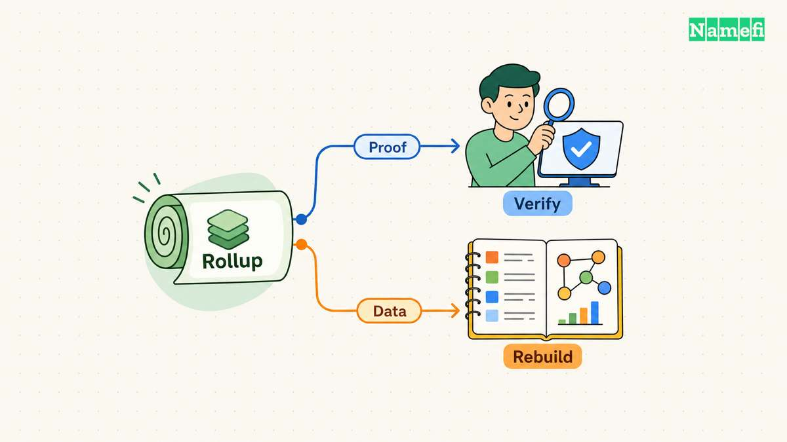
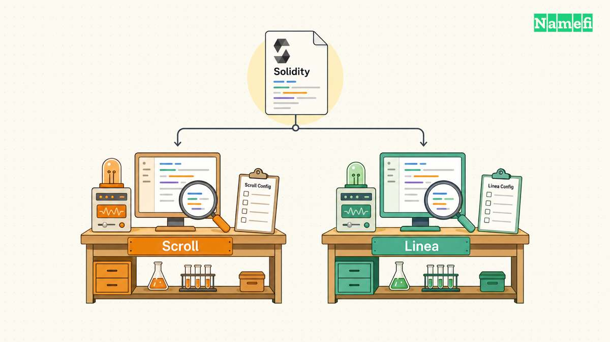
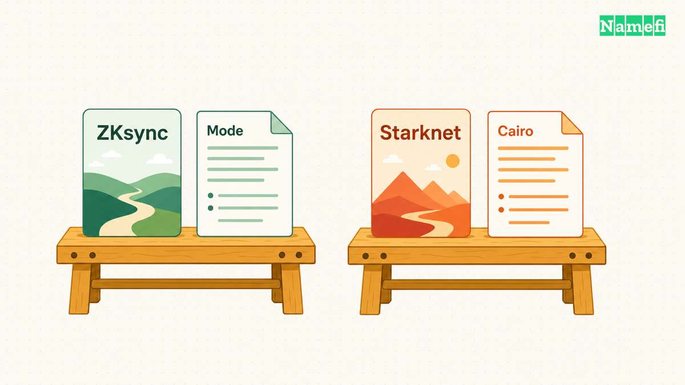
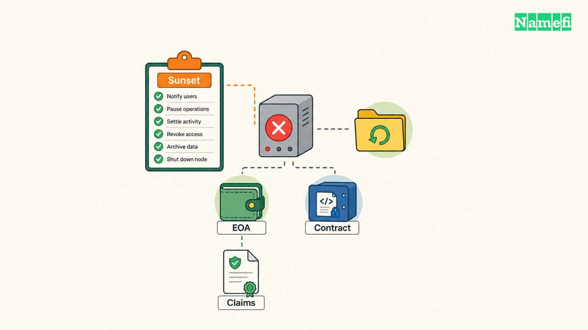

The top ZK rollups do not form one interchangeable product category. Scroll and Linea emphasize Ethereum development compatibility. ZKsync requires attention to the selected chain and execution environment. Starknet offers a Cairo development path. Polygon zkEVM now belongs in a recovery discussion: [Polygon confirms its completed sequencer sunset](https://polygon.technology/polygon-zkevm#:~:text=As%20of%20July%203%2C%202026).

This comparison checks public documentation on October 21, 2026. “Top” identifies five prominent names that readers encounter together, rather than a measured ranking of safety, liquidity, or performance. The recommendations below express editorial analysis for application teams. The comparison does not assign token investment ratings.

A useful shortlist starts with the application: existing Solidity contracts, new account behavior, specialized computation, or a migration from an older network. A useful security review then asks separate questions about proofs, data, administrative authority, and exits. A familiar wallet screen answers none of those questions alone.

## A useful comparison separates validity, compatibility, and recovery

A [ZK rollup](/en/glossary/zk-rollup/) executes transactions outside Ethereum and submits evidence of correct execution. Ethereum's developer guide explains that [validity proofs support state updates while published data permits state reconstruction](https://ethereum.org/developers/docs/scaling/zk-rollups/#what-are-zero-knowledge-rollups). Proof verification and access to state data perform different jobs. A successful proof does not supply missing historical records to an application indexer.

The word “ZK” also creates a privacy trap. Ethereum's guide states that [using validity proofs does not automatically make transactions confidential](https://ethereum.org/developers/docs/scaling/zk-rollups/#how-zk-rollups-publish-transaction-data-on-ethereum). A domain marketplace should therefore treat bids, wallet relationships, and transaction inputs as potentially public. An application needs an explicit privacy design before promising confidential purchases.

The [Ethereum Virtual Machine](/en/glossary/ethereum-virtual-machine/) creates another distinction. Source compatibility concerns whether a language and compiler can express an application. Bytecode compatibility concerns whether an execution environment accepts compiled Ethereum contracts. Operational compatibility includes deployment tools, gas estimation, wallets, indexing, and supported protocol features. A team should test all three levels.

The following rubric guides the project comparisons. The questions form a review process, rather than claims that every project already satisfies every requirement.

| Criterion | Evidence to request | Application consequence |
| --- | --- | --- |
| Execution compatibility | Supported bytecode, compiler target, and documented differences | Determines migration work and test coverage |
| Settlement | Proof verification and Ethereum finality lifecycle | Determines when an external action can proceed |
| Recovery | Published state data and an executable recovery procedure | Determines options after an operator failure |
| Administrative control | Upgrade authority, pause powers, and applicable delays | Determines exposure to authorized protocol changes |
| Total operating cost | Representative execution, data, bridging, and infrastructure costs | Determines the cost of a completed customer task |

**Editorial selection rule:** eliminate a candidate when a critical requirement fails. A low transfer fee should not compensate for an unsupported contract feature. A familiar development environment should not compensate for an exit procedure that the team cannot explain.

Use the same workload for every remaining candidate. Include a successful transaction, a reverted transaction, a contract deployment, and an exit. Record network conditions and test dates. Avoid comparing one project's minimum transfer fee with another project's complex application transaction.

## Scroll and Linea favor teams that already use Ethereum tools

Scroll's developer introduction describes [EVM bytecode compatibility and familiar Ethereum tooling](https://docs.scroll.io/en/developers/building-on-scroll/#:~:text=compatible%20with%20EVM%20bytecode). The documentation also identifies Scroll as an Ethereum Layer 2 network and describes verification of execution proofs on Layer 1. The development fit centers on reusing an existing Ethereum application.

Compatibility still requires reading the exceptions. Scroll maintains an [Ethereum and Scroll differences page](https://docs.scroll.io/en/developers/ethereum-and-scroll-differences#evm-opcodes), including opcode behavior and unsupported features. The page separately discusses transaction ordering, finality, and fees. A port should review the sections that match the application's dependencies before deployment.

For example, consider a hypothetical Solidity marketplace that transfers domain tokens and distributes payments. The team should test approvals, payment settlement, failed transfers, and marketplace event indexing. A transaction that returns success does not prove that the indexer records every ownership change correctly. The acceptance test should compare the final owner, payment balances, and customer receipt.

Linea's current documentation describes [Linea Mainnet as a public zkEVM network built on Lineth](https://docs.linea.build/network#:~:text=Linea%20Mainnet%20is%20the%20public). Lineth names the deployable stack, while Linea Mainnet names the public network. A team comparing public networks should not substitute claims about a custom Lineth deployment for evidence about Linea Mainnet.

Linea also maintains [a detailed Ethereum differences page](https://docs.linea.build/network/overview/ethereum-differences#evm-opcodes). The page covers opcode behavior, precompiles, transaction types, and RPC differences. Broad equivalence language should therefore start a compatibility review rather than end the review. The exact contract dependency matters more than the marketing label.

Linea's finality documentation distinguishes [soft finality from hard finality after proof verification and Ethereum finalization](https://docs.linea.build/network/overview/transaction-finality#hard-finality). An application can acknowledge receipt before making an irreversible external commitment. The product should use clear states such as “submitted” and “settled” when those states require different evidence.

| Candidate | Development reason to shortlist | Requirement to verify |
| --- | --- | --- |
| Scroll | Ethereum bytecode and tool reuse | Relevant opcode differences, indexing, and settlement behavior |
| Linea Mainnet | Ethereum application deployment on a public zkEVM | Current feature exceptions and finality requirements |

**Editorial assessment:** test Scroll and Linea first when the strongest constraint is preserving an existing Solidity application. Choose between Scroll and Linea using the application's actual dependencies and supported infrastructure. The sources above do not establish a universal cost or safety winner.

A trial should include the customer's wallet and the team's production libraries. An isolated contract test omits the approval screen, gas estimation, RPC failure behavior, and support workflow. Those integration details can decide whether customers complete a purchase even when both networks execute the contract correctly.

## ZKsync and Starknet require explicit execution decisions

ZKsync's protocol overview describes [a network architecture that supports both rollups and validiums](https://docs.zksync.io/zksync-protocol/rollup#:~:text=rollups%20and%20validiums). A chain's membership in the ZKsync ecosystem therefore does not establish an identical data availability model. Identify the target chain, settlement configuration, and execution environment before comparing a deployment with Scroll or Linea.

ZKsync's EraVM documentation describes [an EVM bytecode interpreter that runs above EraVM](https://docs.zksync.io/zksync-protocol/era-vm/evm-interpreter/overview#execution-model). The interpreter enables an Ethereum bytecode deployment path alongside native EraVM compilation. The same documentation lists differences in gas interpretation, feature support, and interactions between execution modes. “ZKsync uses a custom VM” alone no longer explains the available development paths.

A team should record the selected mode in the deployment specification. Include a rollback condition and an accountable reviewer. The reviewer should compare observed behavior with the application requirements before approving customer access. Run compatibility tests against that mode. Review deployment scripts, deterministic addresses, library behavior, and calls across execution environments. Do not assume a successful native deployment proves an interpreted deployment behaves identically.

ZKsync also provides a concrete warning against instant-withdrawal claims. Its [withdrawal-delay documentation specifies a three-hour minimum execution delay across supported chains](https://docs.zksync.io/zksync-protocol/security/withdrawal-delay#:~:text=3%20hour%20minimum). The documentation warns that actual finalization can take longer because of network activity and proof generation. A validity proof removes the optimistic fraud-challenge model, but a deployment can impose other delays.

**Editorial assessment:** shortlist a specific ZKsync chain when the chain's execution options and ecosystem meet a defined application requirement. Budget time for mode-specific testing. Evaluate the chain configuration rather than treating “ZKsync” as one fixed deployment with one security profile.

Starknet takes a different development path. The official examples teach [smart contracts written in Cairo](https://docs.starknet.io/build/starknet-by-example#what-is-starknet-by-example). Starknet's protocol introduction describes [STARK-based validity proofs, smart-contract accounts, and compressed state differences published to Ethereum](https://docs.starknet.io/learn/protocol/intro#block-production-and-validation). A Cairo application and an EVM bytecode application require different development assumptions.

The account model deserves specific attention. Starknet documents [native account abstraction and flexible authorization logic](https://docs.starknet.io/learn/protocol/intro#user-interactions). A team can evaluate account behavior such as session permissions as part of the application design. The account feature does not eliminate the need to review authorization code or customer recovery.

For a hypothetical domain management application, separate permission to update a record from permission to transfer ownership. Test expired permissions, revoked permissions, and recovery after a lost device. A convenient account experience can increase the importance of clear permission boundaries. The application should show the exact action that each signature authorizes.

| Candidate | Development decision | Main review burden |
| --- | --- | --- |
| Selected ZKsync chain | Confirm chain configuration and execution mode | Mode-specific compatibility, data policy, and withdrawal timing |
| Starknet | Adopt Cairo and Starknet's account model | Contract implementation, authorization, and integration support |

**Editorial assessment:** consider Starknet when the team can support Cairo and has a concrete reason to use Starknet's application model. A Solidity team should budget for implementation and review work. A general promise of higher throughput does not justify an unmeasured migration cost.

## Polygon zkEVM's sunset makes an exit plan part of selection

Polygon's current status page reports [the completed Polygon zkEVM Mainnet Beta sequencer sunset on July 3, 2026](https://polygon.technology/polygon-zkevm#:~:text=As%20of%20July%203%2C%202026). The page states that the network no longer produces blocks and that Agglayer Bridge withdrawals no longer operate. Polygon zkEVM therefore fails the first requirement for a new live application: ongoing transaction processing.

The same page distinguishes recovery by asset location. Polygon provides [a Claims interface for eligible assets held in externally owned accounts](https://polygon.technology/polygon-zkevm#:~:text=The%20Polygon%20zkEVM%20Claims%20interface). The Claims interface does not recover [assets held inside smart contracts at sunset](https://polygon.technology/polygon-zkevm#:~:text=Assets%20that%20were%20held%20inside%20smart%20contracts). 

Polygon says the interface remains available through [December 31, 2027](https://polygon.technology/polygon-zkevm#:~:text=The%20Claims%20interface%20is%20now%20live). Interface retirement does not forfeit recorded assets to Polygon Labs, but alternative recovery may be impractical. 

The lesson extends beyond Polygon zkEVM. A network selection should include a documented shutdown response before an application accepts valuable assets. The following checklist describes recommended application tests, rather than assurances that any listed network supplies every capability.

1. Identify every asset's chain, contract, and owner type.
2. Record the canonical bridge and supported withdrawal procedure.
3. Test a small deposit and a complete withdrawal.
4. Document proof, finality, and administrative waiting periods.
5. Verify access to historical events and recovery data.
6. Assign an owner for network upgrade and sunset monitoring.
7. Test the response when the primary RPC stops answering.
8. Explain migration requirements before customers need migration.

For a domain application, apply the checklist to a complete hypothetical purchase. The customer pays, the application records the owner, and the service updates the intended domain configuration. Define which event permits each step. A successful token transaction alone should not trigger an unrelated registrar operation without the application's required checks.

Keep the asset's authoritative chain explicit. A token representation on another chain can introduce a bridge and a second recovery procedure. Treat a [cross-chain bridge](/en/glossary/cross-chain-bridge/) as a separate dependency during the review. Describe the relationship between the token, the domain service, and any external records in the product documentation.

The practical shortlist follows the constraints. Start with Scroll and Linea for an existing Ethereum application. Evaluate a specific ZKsync configuration when execution options justify the added review. Evaluate Starknet when Cairo and the account model fit the product. Treat Polygon zkEVM as a recovery case. Recheck the selected network before launch and after material upgrades.

## Sources and further reading

All sources below were opened on October 21, 2026, UTC. The references record retrieval dates without invented archive snapshots.

- Ethereum.org, [Zero-knowledge rollups](https://ethereum.org/developers/docs/scaling/zk-rollups/#what-are-zero-knowledge-rollups), sections “What are zero-knowledge rollups?” and “How ZK-rollups publish transaction data on Ethereum.” Validity, data, and privacy distinctions. Fetched 2026-10-21.
- Scroll, [Building on Scroll](https://docs.scroll.io/en/developers/building-on-scroll/#:~:text=compatible%20with%20EVM%20bytecode), introductory compatibility paragraphs. Fetched 2026-10-21.
- Scroll, [Ethereum and Scroll differences](https://docs.scroll.io/en/developers/ethereum-and-scroll-differences#evm-opcodes), opcode, finality, and fee sections. Fetched 2026-10-21.
- Linea, [Linea Mainnet](https://docs.linea.build/network#:~:text=Linea%20Mainnet%20is%20the%20public), opening network and Lineth definitions. Fetched 2026-10-21.
- Linea, [Ethereum differences](https://docs.linea.build/network/overview/ethereum-differences#evm-opcodes), opcode, precompile, and transaction-type sections. Fetched 2026-10-21.
- Linea, [Transaction finality](https://docs.linea.build/network/overview/transaction-finality#hard-finality), transaction lifecycle and hard finality sections. Fetched 2026-10-21.
- ZKsync, [Protocol overview](https://docs.zksync.io/zksync-protocol/rollup#:~:text=rollups%20and%20validiums), opening architecture description. Fetched 2026-10-21.
- ZKsync, [EVM bytecode interpreter overview](https://docs.zksync.io/zksync-protocol/era-vm/evm-interpreter/overview#execution-model), execution model and developer considerations. Fetched 2026-10-21.
- ZKsync, [Withdrawal delay](https://docs.zksync.io/zksync-protocol/security/withdrawal-delay#:~:text=3%20hour%20minimum), opening delay specification and finalization caveat. Fetched 2026-10-21.
- Starknet, [Starknet By Example introduction](https://docs.starknet.io/build/starknet-by-example#what-is-starknet-by-example), Cairo development description. Fetched 2026-10-21.
- Starknet, [Protocol introduction](https://docs.starknet.io/learn/protocol/intro#block-production-and-validation), user interactions and block validation sections. Fetched 2026-10-21.
- Polygon, [Polygon zkEVM Mainnet Beta sunset complete](https://polygon.technology/polygon-zkevm#:~:text=As%20of%20July%203%2C%202026), status, Claims interface, recovery window, and smart-contract asset sections. Fetched 2026-10-21.
